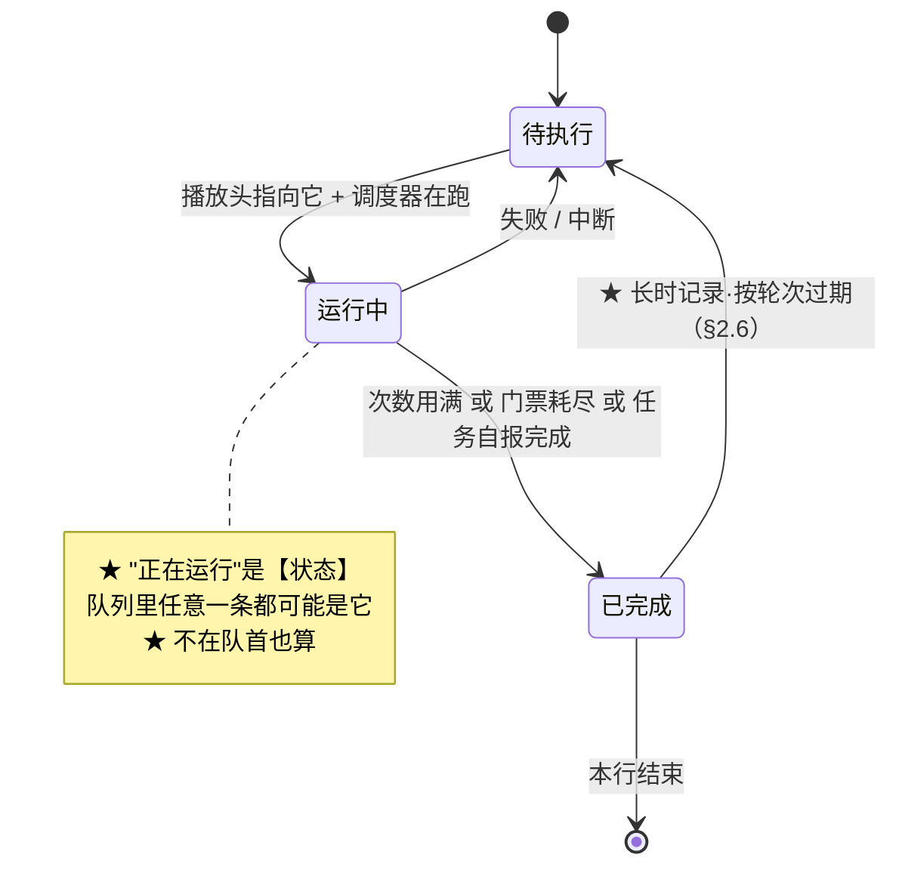
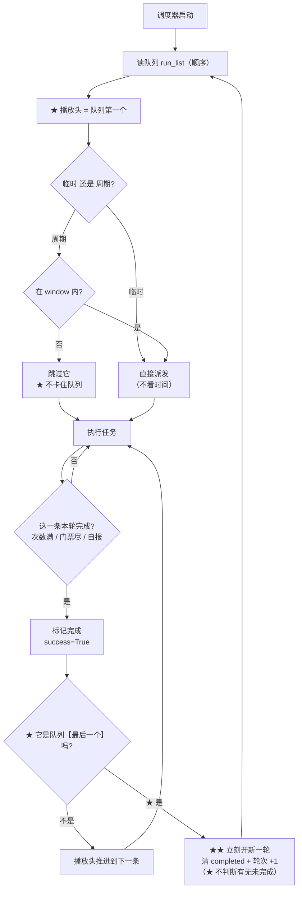

# OAS 设计规格书（"软件应该怎样"）

> ★★★ **文档定位** ★★★
>
> 本文回答一件事：**这个软件应该是怎样的**（后端逻辑 / 前端界面 / 数据结构）。
>
> | 约定 | 说明 |
> |---|---|
> | ★ **来源** | 会话原文（10-06 → 10-12，共 **501 条**真人发言，其中 **221 条**与调度相关）|
> | ★ **时间戳** | 全部为**真实时间**（UTC+8，`MM-DD HH:MM:SS`），取自会话记录 |
> | ★ **主体** | ★ **软件的形态**（规则 / 流程 / 结构），**不是聊天记录** |
> | ★ **分歧** | ★ **只在前后矛盾时**贴两边原话 + 时间戳，并标"谁覆盖谁" |
> | ★ **L3**（设计 vs 当前代码对照）| ★ **本文档全部写完后单独做**（用户裁定 [10-12 14:46]）|
> | ★ **助手侧** | ★ **只录**两类：① **我提的选项/隐患**（供对照"用户怎么裁的"）② **结论性事实**（含 `文件:行号`）。★ 不录行为过程 |
> | ★★ **双向对照** | ★ 每节含 **"我提的选项"** + **"用户裁决"** 两栏 —— ★ **只看用户的话会漏掉"选项是什么、裁的是哪个"**（用户 [10-12 14:57:54] 指出）|
> | ★ **早期轮次** | 10-06~10-08 初：只录**仍然有效的结论** |

## ★★★ 权威顺序（★ 读文档前必看 —— 防自相矛盾）

★ 本文件**跨越 7 天的多轮裁定**，因此**同一件事可能有多处描述**。
★ **遇到不一致时，按以下顺序取权威**：

```
1. ★★ 本节往下 §1~§3 的【规则编号】（R/P/Z/C/WIN/LR/REC/RS…）
   —— ★ 它们是【现行口径】
2. ★★ 【分歧块】里标 "✅ 现行" 的那一行
   —— ★ 分歧块只记"谁覆盖谁"，★ 它的"现行"行才是结论
3. ★★ 【带时间戳的用户原话】
   —— ★ 时间【晚】的覆盖时间【早】的
4. ★★ §4.5「修复进度」 > §4.1「修复状态」列 > §4.1「判定」列
   —— ★ 前两者说"现在"，后者说"核实那一刻"
5. ⚠ 【§1.2 / §3.4 里的"我提的 N 步计划"】= ★ **历史提案**，
   ★ **不是**现行规则；★ 只看它是否被 §4.5 标为已修
```

★ **判定"哪句过时"的方法**：
```
★ 同一概念在各节的说法 ⇒ ★ 以【规则编号所在节】为准
★ 若两处【都是规则编号】且冲突 ⇒ ★ 以【时间戳更晚】的为准，并【报给用户】
```

## 进度

| 章节 | 状态 | 依据时间范围 |
|---|---|---|
| §1 调度模型 | ✅ 已成稿（1.1~1.15）| 10-06 23:50 → 10-12 14:56 |
| §2 记录模型 | ✅ 已成稿（2.1~2.6）| 10-08 13:02 → 10-12 13:35 |
| §3 前端 | ✅ 已成稿（3.1~3.8）| 10-07 21:29 → 10-11 19:28 |
| §4 L3 对照（设计 vs 现状）| ✅ 已成稿（4.1~4.5）| 代码核实 2026-10-12 |
| §5 未决问题 | 🔄 随文累积（已有 6 条）| — |
| ★ **分歧块** | 🔄 **9 块**（①~⑨，**随文分散在各节**）| — |

> ★ **分歧块的定位**：★ 它们**不单独成章**，而是**就地放在相关小节后面**
> （这样读者在读到该规则时，**立刻**能看到"它被谁推翻过"）。
> ★ 编号 ①~⑨ **按被推翻的时机**排，★ 与所在章节位置**无关**。

---

# §1 调度模型（后端）

## 1.1 ★ 唯一依据 = **执行顺序**

> **[10-08 21:00:47]** "调度器按照**应有的逻辑**改，**不要被旧有的代码迷惑**"
>
> **[10-09 22:44:07]** "任务列表有 54 个，我启用 20 个，那么这 20 个里的**所有定时任务
>  都会自动进入队列**，但是**次数任务并不会自动进入队列**，需要**我添加任务进队列**。"
>
> **[10-11 22:13:32]** ★★ "临时任务没有什么**全天窗口**之分！只看设置的**次数和门票**
>  这两个字段。次数到了或者门票耗尽，这一行任务就算任务完成一次，
>  标记 `success=True` 就行。**不允许被执行顺序以外的机制调动**"
>
> **[10-11 22:23:52]** ★★ "对于**临时任务**，**只能通过执行顺序调度**。"

### R 规则

| # | 规则 |
|---|---|
| **R1** | ★ **队列（`script.optimization.run_list`）就是调度的唯一依据** —— 不在队列里的任务**不运行** |
| **R2** | ★ **队列成员怎么来**：定时任务（`auto_queue`）⇒ **自动进队列**；★ 次数任务（临时）⇒ ★ **必须用户手动添加** |
| **R3** | ★ **顺序 = 队列里用户拖出的相对次序**，★ **没有第二个排序权威** |
| **R4** | ★ **重复条目 = 重复跑整个任务**（同一任务可多条，各带自己的 `entry_id`）|
| **R5** | ★ **"派发次数"不是一个字段** —— ★ 靠"**在队列里加多条**"实现 |

> **[10-12 12:17:13]** ★★★ "**派发次数是用多次添加任务来实现的！** `target` 是
>  **内部需要打多少次**，就是 realmraid 内部的 `limit count`"

## 1.2 ★★ 分型规则：**临时** vs **周期**

> **[10-11 21:29:17]** "有这么麻烦吗，**为什么要用时间的排期**"
>
> **[10-11 21:32:40]** ★★ "`next_run` 除了确实是**时间类**的排期，其他的都用
>  **次数和门票**来约束完成与否，**这本来就是临时任务，怎么能用时间来排期**。
>  请检查下其他的临时类任务。"
>
> **[10-11 21:57:11]** ★ "这意味着 `next_run` 是在这类临时任务里起效的，
>  应该**彻底替换修复**"

| 维度 | ★ **临时任务**（`period = none`）| ★ **周期任务**（`period ≠ none`）|
|---|---|---|
| 谁决定"能不能跑" | ★ **次数（`runs` / `target`）+ 门票** | ★ **窗口（window）+ `period`** |
| `next_run` | ★ **不参与派发判断** | ✅ 参与（时间排期）|
| 窗口（window）| ★ **不适用**（"没有全天窗口之分"）| ✅ 硬约束 |
| "本轮完成" | ★ **次数用满 或 门票耗尽** | ★ 本周期内已完成 |
| 新一轮 | ★ **长时记录**按轮次判过期（见 §2.6）| ★ 进入新周期 |

> **[10-10 08:50:51]** "**窗口和 period 都不决定一天跑几次**，他们只能说是
>  **这个时间可以跑**" —— ★ 这条**对周期任务成立**；对临时任务，★ 见上表。

### ★★ 分歧块 ⑤：临时任务**该不该有窗口**？

| 时间 | 谁 | 说法 | 状态 |
|---|---|---|---|
| **[10-11 22:24:11]** | ★ 助手（我）| ★ 我在 8 条隐患里写："**窗口保留为准入门** —— 有的临时任务**其实有时间**（`Dokan` 19:00-20:00）。指针到了但它不在窗口 ⇒ 会空转" | ⚠ 我当时把它当**合法情况** |
| **[10-11 22:13:32]** | 用户 | ★ "临时任务**没有什么全天窗口之分**！只看设置的**次数和门票**这两个字段" | ★ 与我的说法**冲突** |
| **[10-11 语境]** | 用户 | ★ "**5 有 period 就是周期任务**！不要混淆了" | — |
| **[10-12 语境]** | 用户 | ★★ "**按照设计只有设置了 `period` 才能设置窗口**。道馆如果没有 `period` 却有窗口，那么可能是**还未配置好**" | ✅ **现行（最终）** |

★ **现行口径**：
```
★ 【设计上】窗口 与 period 绑定 —— ★ 只有周期任务才有窗口
★ 若出现 "period=none 却有受限窗口"（如 Dokan 19:00-20:00）
   ⇒ ★ 那是【配置未完成】，不是"临时任务也有时间约束"
★ ⇒ 临时任务的判据里【不包含窗口】
```

★ **这条覆盖了我 10-11 22:24 的建议**（我当时说"窗口保留为准入门"）——
★ 那是**我的错误理解**，用户后来纠正了。

### ⚙️ 设计演化：我 10-11 22:24 提的 4 步计划（★ 供对照，非最终）

> ★ 背景：用户 [10-11 22:23:52] 给出播放头机制描述后，
> ★ 我（助手）[10-11 22:24:11] 把它拆成"8 条隐患 + 4 步实施"。
> ★ 其中 **1、2、3、4 条被用户采纳**（[10-11 22:41:47] "1 整行结束"、
>   [10-11 22:58:01] "1 是 target 用满或者门票耗尽代表本轮完成"）；
> ★ **第 5 条（窗口保留）被后来的裁定推翻**（见分歧块 ⑤）。

| 我提的隐患 | 我的建议 | 用户裁决 |
|---|---|---|
| 1 "完成一次"算几次 | 整行结束 | ✅ **[10-11 22:41:47] "1 整行结束"** |
| 2 用序号还是 `entry_id` | 用 `entry_id`（身份不是位置）| ✅ 采纳（★ 用户 10-10 已定 `entry_id` 格式）|
| 3 指针失效会卡死 | 沿队列找下一个 | ✅ 采纳 |
| 4 乱序时指针怎么动 | 乱序不走指针，随机挑未跑过的 | ✅ 采纳（[10-11 语境] "运行过的序号剔除掉"）|
| 5 窗口怎么办 | ★ 窗口保留为准入门 | ❌ **被推翻**（分歧块⑤）|
| 6 手动"运行一次" | 手动优先 | ✅ 采纳 |
| 7 周期任务不能一起换 | 只换临时任务 | ⚠ 后被扩到"周期任务**也**走同一套记录"（[10-12 12:41:18]）|
| 8 `next_run` 不能全删 | 降级为展示 | ✅ 采纳 |

| 我提的 4 步 | 内容 | 状态 |
|---|---|---|
| 1 | 新增 `script.optimization.allow_run_entry_id`（播放头，落盘）| ⬜ 未定（见 §5-Q1）|
| 2 | `update_scheduler`：对 `period=none` 的条目，**门④ 改判播放头** | ⬜ 未做 |
| 3 | `script.py` 收尾：`run_success` ⇒ 推进播放头 | ⬜ 未做 |
| 4 | 循环 ⇒ 指针回 0 + 清 `runs`；乱序 ⇒ 随机挑候选 | ⬜ 未做 ⚠ **此步与 §2.6-LR2「长时记录跨轮存活」冲突 ⇒ 已被取代，见 §4.5** |

### ★★ 分歧块 ①：`next_run` 要不要彻底删？

| 时间 | 说法 |
|---|---|
| **[10-11 17:09:57]** | "临时任务怎么还有 `next_run` 的排期呢，不应该是按次数来的吗，这种靠着 `next_run` 来排期的任务是**普遍现象**吗" |
| **[10-11 17:18:47]** | "如果在添加到任务顺序页以后，就创建一个**磁盘记忆**呢？…记录数据，**用完后表示已完成本行任务**。这样 `next_run` 是不是就可以**废弃删除**了？" |
| **[10-11 21:57:11]** | "…应该**彻底替换修复**" |
| **[10-11 23:20:01]** | "…**我说的字段统一就是说的这个**" |

★ **现行口径**（综合 10-11 全部 + 10-12）：
```
★ 临时任务：next_run 【退出派发判断】（不再决定"能不能跑"）
★ 但 next_run 【不删除】—— 它仍服务：
    · 防封唤醒（antiban_wake）
    · 关模拟器 / 关游戏的等待
    · 界面"下次运行"显示
★ 周期任务：next_run 【照旧】参与排期
```

## 1.3 ★★ 播放头（顺序 / 循环 / 乱序）

> **[10-11 11:18:18]** ★ "我对于 UI 界面的变化有新的想法，对于**正在运行**，
>  就像是**音乐播放列表里的正在播放**一样，**他不是排在队首的**，
>  而是一种**状态按顺序变更**的，甚至可以直接照抄音乐播放列表的方式：
>  **顺序、循环、乱序**"
>
> **[10-11 15:29:49]** ★ "现在应该**没有队首什么事了**，**队首只是代表列表顺序
>  第一个**而已，但**正在运行的可以是列表里任意一个**。"
>
> **[10-11 22:23:52]** ★★ "对于临时任务，只能通过执行顺序调度。调度方法：
>  `if 允许运行序号 == 本人序号, run_start=true` 就开始运行；
>  判定**运行成功**过后 `run_success=true`；**允许运行序号**按……"
>
> **[10-11 22:41:47]** ★ "**1 整行结束**"（= target 用满或门票耗尽 ⇒ **整行结束**，不是只 +1）
>
> **[10-11 22:58:01]** ★ "**1 是 `target` 用满或者门票耗尽代表本轮完成**"
>
> **[10-11 19:27:27]** ★ "未运行的行 `[▶]` → **播放头设到这条 + 调度器开始跑**"

### P 规则

| # | 规则 |
|---|---|
| **P1** | ★ 存在"**当前允许运行的条目**"（播放头）；★ **它跑完才轮到下一个** |
| **P2** | ★ 播放头**按播放模式推进**：<br>· **顺序** ⇒ 队列下一个<br>· **循环** ⇒ 下一个；到尾回头（新一轮）<br>· **乱序** ⇒ ★ 从**未跑过**的条目里**随机**挑一个 |
| **P3** | ★ **"正在运行"是【状态】，不是队首** —— 队列里**任意一条**都可能是它 |
| **P4** | ★ **插队 = 改序号**：★ "把**别的任务的序号统统 +1**，将自己的任务序号设为 **1**" |
| **P5** | ★ 点某行的 `[▶]` ⇒ ★ **播放头设到该条 + 调度器开始跑**（★ 语义是"**从这条开始跑**"，不是"排到最前"）|
| **P6** | ★ 插队时**若有任务正在运行** ⇒ ★ **先停止当前任务，再插队** |
| **P7** | ★ 乱序**必须剔除已跑过的**（"可以将**运行过的序号剔除掉**，确保不会被重复随机到"）|

> **[10-11 16:59:12]** ★ "★ 每行有「▶」，点一下让那一条**立刻跑**：这个目前有问题，
>  点了以后没有立即跑…而且**语义不是顺序排到最前边，而是从这个任务开始跑**"

### ★★ 候选判据（[10-12] F/G/I 之后 —— 循环与乱序共用）

> ★ 用户报的 bug：★ "**循环第二次时结界突破没有触发**"

```
★ `_loop_candidates()` = "这一轮【还没做完】的任务"
   · 临时任务：★ `completed` 为真 ⇒ 【不算候选】（★ 按轮次号自动过期）
   · 周期任务：★ `is_completed_in_period()` ⇒ 本周期已做 ⇒ 不算
   · 未启用 / 不在队列 / 不在窗口 ⇒ 不算
⇒ ★ 循环（`reset_loop_next_run`）：只把**还没做完**的拉回现在
⇒ ★ 乱序（`shuffle_next_run`）：只在**还没做完**里随机
⇒ ★ 进入新一轮：`completed` 按**轮次号**自动过期 ⇒ 又算候选
```

### 状态图：播放头与"正在运行"



### 流程图：一次完整循环

> ★★★ **2026-10-12 用户更正（★ 重要）** ★★★
> > "那个**流程图有问题**，**循环的情况下，只要是队列最后一个跑完，
> >  就会开始新的一轮，不会对还有没有未完成的条目做判断**"
>
> ★ ⇒ ★ 原来的流程图（★ 我写的）里有一个 `B{"队列里有未完成的条目吗?"}`
>   ★ **判断** —— ★★ **那是我加错的**。
> ★ 正确语义：★ **循环模式下，判断依据只有一条：★"队列最后一个跑完了"**
>   ⇒ ★ **立刻开新一轮**（★ **不判断**"还有没有未完成的"）。



★ **`loop_times` 的位置**（★ 别与"开新一轮"混）：
```
★ 开新一轮 = ★ **无条件**（★ 只要最后一个跑完）
★ `loop_times` = ★ **跑满 N 轮后的【终止】**，★ 由**外层**
  （`script.py` 的循环重排）负责 ⇒ ★ **不干扰**"开新一轮"
```

## 1.4 ★ 暂停 / 恢复 / 停止

> **[10-11 20:52:14]**（暂停语义）"A：**跑完当前这场战斗（到安全点），不再开新任务**"
>
> **[10-11 20:51:46]** ★ "**不要加手动重置**，这个重置功能本来就应该在已有的按钮中啊"
>
> **[10-11 20:53:44]** ★★ "我改变主意了，这个**暂停调度/恢复调度不是集成到任务运行行
>  里的按钮上了吗**，这应该是 bug，**不应该给别的按钮添加该功能造成混淆**"
>
> **[10-11 20:59:41]** ★★ "**已暂停，只能是暂停中任务能恢复**，这样才够优雅！
>  这个**恢复调度按钮是出现在暂停中任务行上，而不是任意行**"
>
> **[10-12 语境]** ★ "遇到**暂停/停止调度**时**可以直接停止**而非跑完当前一次完整战斗流程"

### Z 规则

| # | 规则 |
|---|---|
| **Z1** | ★ 暂停语义 = ★ **甲：原地不动** —— **不退回队首** |
| **Z2** | ★ 恢复 ⇒ ★ **从它接着跑**（不是从头重跑）|
| **Z3** | ★ 暂停/恢复按钮 ★ **只出现在"暂停中那条任务行"上**，★ 不出现在别处 |
| **Z4** | ★ 安全点 = ★ **不在战斗中**；★ 战斗中先打完这场，★ 非战斗中**可直接停** |
| **Z5** | ★ 战斗中判据：★ 识别到 `gb_action_bar_queue` ⇒ 5 秒内视为"战斗中"；其他时候 = 非战斗 |
| **Z6** | ★ **不加"手动重置"**（用户明确否决）|

### ★★ 分歧块 ②：暂停时任务**回不回队首**？

| 时间 | 说法 | 状态 |
|---|---|---|
| **[10-10 23:17:09]** | "就把这个功能聚合到**暂停调度按钮**上好了，点击暂停调度，正在运行的任务**自动回退到队列首位**，视作等待执行，这样是不是更优雅。" | ❌ **已作废** |
| **[10-12 语境]** | ★★ "**甲：原地不动**…恢复时**从它接着跑**" | ✅ **现行** |

★ **现行口径**：★ **不回退**（甲）。

### ★★ 分歧块 ③：暂停按钮放哪儿？

| 时间 | 说法 | 状态 |
|---|---|---|
| **[10-11 19:12:39]** | "「暂停调度」**只在执行队列上方**（共用顶部不放它）…任务列表页没有暂停按钮" | ❌ **已作废** |
| **[10-11 19:21:05]** | "「⏸ 暂停调度」应该**和队列中任务点击运行那个按钮是一个东西**，放在外边就冗余了" | 🔄 过渡 |
| **[10-11 20:53:44]** | ★★ "这个暂停调度/恢复调度**不是集成到任务运行行里的按钮上了吗**，这应该是 bug" | ✅ **现行** |
| **[10-11 20:59:41]** | ★★ "**恢复调度按钮是出现在暂停中任务行上，而不是任意行**" | ✅ **现行（最终）** |

★ **现行口径**：★ **暂停/恢复就是队列行上的那个按钮**（`[⏸]` / `[▶]`），
★ 顶部**不放**；★ **恢复只出现在"暂停中"那条行**。

## 1.5 ★ 完成 / 新一轮 的判定

> **[10-11 21:27:06]** "没票不该算失败还是算成功？我看你**前后矛盾**啊"
> **[10-11 21:28:56]** ★★ "**没票了应该算这轮结束啊，也算成功结束了啊**"
> **[10-11 22:13:32]** "次数到了或者**门票耗尽**，这一行任务就算任务完成一次，
>  **标记 `success=True` 就行**"
> **[10-12 12:02:22]** "个人突破设置了**打 2 次**，但是日志显示**已打 36 次**（这是否导致了
>  后边的**跳过了战斗**）请确认下是哪里导致了战斗跳过，**36 次是否有必要被记录和恢复**"
> **[10-12 12:41:18]** ★★ "**门票耗尽不上报，只上报任务完成**！目前**没有监控各类门票
>  资源**的任务，一旦标为耗尽而**永远得不到更新**后将**无法运行突破任务**"

### C 规则

| # | 规则 |
|---|---|
| **C1** | ★ "本轮完成"的两个来源：★ **次数用满** · ★ **任务自报完成**（如券打完）|
| **C2** | ★ **不上报"资源耗尽"**（没有监控机制 ⇒ 标了永不解锁）⇒ ★ 只上报"**任务完成**" |
| **C3** | ★ 标记完成 ⇒ ★ **本轮不再派发这一条**，★ 轮到下一条 |
| **C4** | ★ **新一轮** ⇒ 长时记录**按轮次过期**（§2.6）⇒ 该条**又能跑**（重新探券）|
| **C5** | ★ "完成"**不是失败** ⇒ `success=True` |

### ★★★ "已完成" 必须**独立成桶**（[10-12] 实测根因）

> ★★ **用户两次报同一个 bug**：
>
> **[10-10 语境]** "**契灵之境为什么显示等待到点**？这个是**次数任务**，
>  不应该有【还未到点】这种【拥有 window 的任务类】的属性啊"
> **[10-12]** ★★ "还发现了**个人突破被标记为了【等待到点】**，
>  也就是**无法被再次运行了**，这个问题**我之前有反应过**"

### ★★★ 根因（**语义错位**，不是逻辑错）

```
★ `_skip_by_completed()`（本轮已完成）原来把条目放进 `waiting_task`
★ 而 `waiting` 的语义是 "★ **未到开放时间**"
★ 前端把 `slot != 'pending'` 统统显示为
  **"未到开放时间 · 等待中"**（`queue_panel.dart:268`）
⇒ ★★ 【本轮已完成】被显示成【未到开放时间】= **"等待到点"**
   ⇒ ★ 用户以为"这任务坏了、不能再跑"
```

★ 注意：★ 后端**逻辑是对的**（该条确实不该再跑）——
  ★ 错的是**它被归到了错误的语义桶**。

### ★★ 修法：**从两个桶 → 三个桶**

| 桶 | 含义 | 前端显示 |
|---|---|---|
| `pending` | ★ 现在能跑 | 待执行 |
| ★ **`done`** | ★ **本轮已完成**（次数用满 / 门票耗尽）| ★ **已完成（本轮）** |
| `waiting` | ★ **未到开放时间**（真·时间原因 / 未启用窗口）| 未到开放时间 |

★ 实现：
* ★ `update_scheduler()`：已完成 ⇒ ★ `f.slot = 'done'`，
  **仍留在 `pending_task`**（★ 这样能按**队列顺序**排出）
* ★ `schema_router.py` 的 `slot_of`：★ 加第三个桶 `done`
  （★ 覆盖"它在 pending 桶里"的判断）

★ ⇒ ★ 这样"**本轮已完成**"**不再混进"未到开放时间"**，
  ★ 界面语义正确。

## 1.6 ★ 字段语义（后端）

> **[10-12 12:09:29]** "`runs` 是还保留着吗，`target` 现在起什么作用，**两者边界怎么样**"
>
> **[10-12 12:17:13]** ★★★ "**派发次数是用多次添加任务来实现的！** `target` 是
>  **内部需要打多少次**，就是 realmraid 内部的 `limit count`。**既然你用 `runs`，
>  那就把他取代 `current_count`**，这两个不是一个东西吗。`total_runs` 可以有，
>  但是**总记录的颗粒度还不够细**，我想要的展示结果应当**包含时间信息到秒**，
>  后期可以对总结果文件统计分析"
>
> **[10-12 12:41:18]** "`d` 好的，**`limit_count` 不是应该用 `runs` 来替代吗**"
>
> **[10-11 23:20:01]** "两套计数不行…" + **[10-11 23:21:02]** ★ "**啊，我整错了**，
>  你说的 `target` 是派发次数，但是**内部是有一套真实跑多少次的计数的**，
>  这个没问题，是我整错了"

### 字段表

| 字段 | 语义 | 颗粒度 | 生命周期 | 谁写 |
|---|---|---|---|---|
| ★ **`target`** | ★ **任务内部要打多少次**（= 原 `limit_count`）| 每个条目 | 用户设 | 用户 |
| ★ **`runs`** | ★ **本条已打几场**（★ **取代 `current_count`**）| ★ **场** | ★ **长时记录**（★ 不因轮次清零 —— 见 §2.6-LR2）| 任务内部（每场）|
| ★ **`current_count`** | ★ **内存工作变量**（不再单独落盘）| 场 | 内存 | 任务 |
| ★ **`total_runs`** | ★ **本条被运行了几次** | ★ **次** | ★ **长时记录，永不清零** | 调度层收尾 |
| ★ **`total_log`** | 每次运行的**时间（到秒/毫秒）** + 本次几场 | 每次 | ★ **永不清零** | 调度层收尾 |
| ★ **`entry_id`** | ★ 条目唯一身份 | — | ★ **不随运行变** | 添加进队列时生成 |

> ★ `entry_id` 格式（[10-10 09:00:37]）：★ "`entry_id` 用**当前时间 + task** 来实现，
>  这样可以**分拆也可以合并**" ⇒ `20261010T143005-RealmRaid`
>
> ★★ **时间戳精度**（[10-12 13:29:29] + [10-12 13:34:54]）：
>  ★ "可以考虑把**时间戳拉到最细颗粒度**" ⇒ ★ **从秒提到毫秒/微秒**
>  （现状：同名重复时靠后端加 `-2`/`-3` 兜底；提到毫秒后基本不会撞）

### ★ 计数的**唯一一套**（[10-12] 「2 废弃」之后）★★

> ★ 用户裁定：★ "**不能存在两套机制**" → "**2 废弃**"

| 用途 | 函数 | 层级 |
|---|---|---|
| 读（判据）| `get_entry_runs(config, entry_id)` | ★ 条目级 |
| 写（每场 +1）| `bump_entry_runs(config, entry_id, delta)` | ★ 条目级 |
| 清零 | `reset_entry_runs(config, entry_id)` | ★ 条目级 |
| 总记录（展示，**永不清零**）| `record_entry_run` / `get_entry_total_runs` | ★ 条目级 |

★ ~~`get_count` / `add_count` / `reset_count`~~ ★ **已删**（任务级，第二套机制）。

### ★★★ 分歧块 ⑥：记录到底**一份还是两份**？（★ 今天下午的推翻）

| 时间 | 谁 | 说法 | 状态 |
|---|---|---|---|
| **[10-12 12:08:03]** | 用户 | "一份**临时记录**只保留到当前任务结束，**另一份共用的总记录**用于结果展示" | 🔄 早期方案 |
| **[10-12 12:08:32]** | 用户 | "**周期任务**，一份临时记录只保留到当前周期结束，另一份共用的总记录" | 🔄 早期方案 |
| **[10-12 12:08:09]** | ★ 我 | "✅ 明白 —— **两份记录分离**（这正是我需要的设计）"<br>★ 我随后**按"两份记录"实现了** `runs` + `total_runs` | ⚠ **我按旧方案做了** |
| **[10-12 13:29:29]** | 用户 | ★★★ "**取消临时任务，改为不同任务的长时记录**，内部填写每次用**唯一 ID 做前缀**（如 `entry_id`）… 通过**前缀是否一致**来区分当前任务是否跑过" | ✅ **推翻"两份"** |
| **[10-12 13:29:42]** | ★ 我 | ★ 我提了 4 条担心（换 id 会丢队列行身份 / 丢累计 / 判不出跑过）<br>★ 建议：**id 不随运行变**，用 `total_log` 记历史 | — |
| **[10-12 13:32:36]** | 用户 | "2 **你说的有一定道理**…"（话未说完）| — |
| **[10-12 13:34:45]** | 用户 | ★★★ "2 **你说的有道理**，**把每次启动的时间记录下并每次启动做比对就行**" | ✅ **最终口径** |
| **[10-12 13:35:49]** | 用户 | ★★ "1 可以 / 2 **第二点按这个来**：把每次启动的时间记录下并每次启动做比对就行" | ✅ **批准** |

★ **现行口径（★ 覆盖 12:08 的"两份记录"）**：
```
★ ❌ 不再有"临时记录 / 总记录"两份
★ ✅ 改为【一份长时记录】（跨轮存活、永不清零），每条含：
      runs       本条已打几场
      total_runs 本条被运行了几次
      total_log  每次运行的【时间】+ 本次几场      ← ★ 时间到秒/毫秒
★ ✅ "这条【本次】跑没跑过" 的判定：
      ★ 用【本次启动时间】与【记录里的时间】比对
★ ✅ entry_id ★ 【不随运行变】—— 加进队列时生成，唯一（时间戳到毫秒/微秒）
```

★ **我漏掉这条的后果**（必须记下）：
```
★ 我按 12:08 的"两份记录"实现了 runs(会清零) + total_runs(不清零)
★ 而用户 [13:34] 已改成"一份长时记录 + 按启动时间比对"
⇒ ★ 我实现的是【已被推翻的方案】
⇒ ★ 这正是用户 [10-12 14:45:53] 说的：
   "**这说明目前的调度实现和记录没有关系啊！和前边的设计要求不一样**"
```

### ★★ 分歧块 ④：`target` 到底管什么？

| 时间 | 说法 | 状态 |
|---|---|---|
| **[10-10 20:15:32]** / **[台账 §23.1]** | "**次数**是**单一任务里设置战斗跑几次**" | ✅ 与最终一致 |
| **[10-11 23:20:01]** | "两套计数不行，需要用让他**严格跑派发次数**…**字段统一**" | ❌ **被自己推翻** |
| **[10-11 23:21:02]** | ★ "**啊，我整错了**…`target` 是派发次数…**内部是有一套真实跑多少次的计数的**" | 🔄 更正 |
| **[10-12 12:17:13]** | ★★ "**派发次数是用多次添加任务来实现的！** `target` 是**内部需要打多少次**" | ✅ **现行（最终）** |

★ **现行口径**：
```
★ target      = 【任务内部】要打几场（每一条各有一份）
★ runs        = 【本条】已打几场（= 原 current_count）
★ total_runs  = 【本条】被运行了几次（展示，永不清零）
★ 派发次数    = ★ 靠【队列里加多条】实现，★ 不是字段
```

## 1.7 ★ 安全兜底（双保险）

> **[10-12 12:20:41]** ★ "对于一直跑的安全隐患，任务是有个 **`expect minute`** 字段的，
>  **到时间会停止**。当然，**添加次数限制也是需要的**。"

| 保险 | 载体 | 作用 |
|---|---|---|
| ★ **时间** | `expected_minutes` / `limit_time` | 到时间**停止**（防无限跑）|
| ★ **次数** | `runs` / `target` | 打满就停 |

## 1.8 ★ 战斗判据（"是否处于战斗中"）

> **[10-07 18:12:03]** "是否需要加入**判断当前是否处于战斗中**，这个判断当前代码里有吗"
>
> **[10-07 18:14:58]** ★ "如果能够**准确判断在战斗中**，那么**超时是不是可以去掉了**，
>  因为有时战斗时长就是很久的，就会触发重启"
>
> **[10-07 19:09:35]** "我新建了一个 `fighting_status.json`，在 general 中，
>  图片为 **action bar queue**"
>
> **[10-07 20:01:17]** ★★ "这个**行动条图片只用来判断是否处于战斗中**，
>  如果**存在该图片，那么就是在战斗中**，将**不能触发兜底时长**"
>
> **[10-07 20:02:18]** ★ "或者说存在该图片，那么**兜底时长应该重新计时，或者不计时**"
>
> **[10-07 19:55:40]** "如果能判断在战斗中，那么**就没必要设置最长时限**了"
>
> **[10-07 18:20:33]** 备选判据："左上角的**返回/退出按钮**可以作为战斗中的判断，
>  右边的**行动条**也可以"

### B 规则

| # | 规则 |
|---|---|
| **B1** | ★ 判据 = ★ **存在 `action bar queue`（行动条）图片 ⇒ 处于战斗中** |
| **B2** | ★ 战斗中 ⇒ ★ **不触发兜底时长**（或**重新计时**）—— 因为"战斗久"是正常的 |
| **B3** | ★ 有准确判据后 ⇒ ★ **最长时限可以去掉**（避免"战斗久"被误判为超时重启）|
| **B4** | ★ 落地：`gb_action_bar_queue`（见 §1.4-Z5 的同一判据）|
| **B5** | ⚠ 转场：完成战斗后到**结算页**有动画，★ 结算要再等 ~1s（[10-08 10:59:02]）|

★ **与 §1.4-Z4/Z5 的关系**：★ **同一判据**服务两处 ——
★ ① 暂停时的"安全点"（是否已脱离战斗）② 兜底时长是否计时。

## 1.9 ★ 定时 / 次数 的补充语义（早期轮次，仍然有效）

> **[10-07 23:27:59]** ★ "定时任务默认值 `reset` 改为**凌晨 0 点**，
>  因为阴阳师的第二天是这样的"
>
> **[10-07 23:44:00]** ★（自我修正）"金币、经验妖怪以及石距的**刷新时间是固定
>  每天的 0/12 点**，**最多储存两次**"
>
> **[10-07 23:47:31]** "直接**检测当前是否能够进入**就可以，能进入就组队，
>  **直到次数耗尽**，并记录下次运行时间"
>
> **[10-07 23:57:31]** ★ 再次确认："**固定时刻刷新**，固定 0/12 点储存一次次数，
>  **最多储存 2 次**"

| # | 规则 |
|---|---|
| **T1** | ★ 周期任务的 `reset` 基准 = ★ **凌晨 0 点**（阴阳师"第二天"）|
| **T2** | ★ 部分任务的次数**固定时刻刷新**（如 0/12 点），★ **最多储存 2 次** |
| **T3** | ★ 组队类任务：★ **能进入就组队，直到次数耗尽** |

## 1.10 ★★★ 调度器模型的**源头**：大狮模型（[10-08 18:47:32]）

> ★★ **用户原话（这是整个调度设计的起点）**：
>
> > "然后我想到了**大狮**这个安卓应用，它是通过**从上到下的排序**来确定
> > **任务优先级**的，可以**改变每层的任务、次数**，任务中有特殊的**休息**
> > （就是这个任务是休息，次数是**多少分钟**）。然后可以选择**是否重复任务列表**。
> > **是优先定时任务还是任务列表任务**，等等。"

### 大狮模型的要素（→ 本项目的对应）

| 大狮的要素 | 本项目的落地 |
|---|---|
| ★ **从上到下的排序 = 任务优先级** | ★ **执行队列（`run_list`）= 唯一顺序权威**（§1.1-R3）|
| ★ **可以改变每层的任务** | ★ 队列条目可**自由拖动**（[10-10 18:59:49] "我只需要保持可以自由拖动/改变执行顺序就行"）|
| ★ **可以改变每层的次数** | ★ **条目级 `target`**（每一条各有一份次数）|
| ★ **特殊的"休息"任务（次数 = 多少分钟）** | ★ **`rest` 条目**（`{kind:rest, minutes:N}`）|
| ★ **是否重复任务列表** | ★ **播放模式 = 循环**（`when_task_queue_empty = loop`）+ `loop_times` |
| ★ **优先定时任务 / 优先列表任务** | ★ **快捷排序**（`put /queue/sort`：定时排前面 / 固定排前面）—— ★ 后来降级为**一次性动作**（[10-10 18:59:49]）|

### 同期提出的其他模型要求

> **[10-08 18:36:44]** ★ "开启关闭任务应当**实时生效**，**不应该重启后生效**"
> **[10-08 18:36:44]** ★ "然后我还想要的是**软件清楚知道当前界面**，并知晓
>  **如何返回庭院**，也知道**战斗中的话需要等待完成后再返回**"
> **[10-08 19:25:51]** ★ "**任务列表只是一个调度器**"
> **[10-08 19:55:15]** ★ "**探索也是固定任务**"

| # | 要求 |
|---|---|
| **D1** | ★ **启停实时生效**（不重启）|
| **D2** | ★ 软件要**知道当前界面**（页面识别）|
| **D3** | ★ 要知道**如何返回庭院** |
| **D4** | ★ **战斗中要等完成再返回**（与 §1.8 战斗判据联动）|
| **D5** | ★ **任务列表 = 调度器**（它不做别的）|
| **D6** | ★ **探索 = 固定任务**（分类判据）|

### ★★ 分歧块 ⑦：任务分类（定时/固定）的**判据**

| 时间 | 谁 | 说法 | 状态 |
|---|---|---|---|
| **[10-08 18:36:44]** | 用户 | "**次数只针对固定任务**，而非金币、经验、石距这类特殊的" | 🔄 早期 |
| **[10-08 19:55:15]** | 用户 | "**探索也是固定任务**" | — |
| **[10-09 22:59:42]** | 用户 | "除了**定时任务**（有充能、次数限制、或时间窗口限制），其他的一般都是**次数任务**（可以随时设置挑战几次的任务）。你觉得这个说法对吗" | ✅ 过渡 |
| **[10-10 20:42:01]** | 用户 | "**周期是 `period` 啊**！你联系下上下文行不，是**每天、每周每月、不限**那个" | ✅ |
| **[10-11 22:13:32]** | 用户 | ★ "**临时任务**没有什么全天窗口之分！只看设置的**次数和门票**" | ✅ **现行** |

★ **现行口径**：★ **分类判据 = `period`**
```
★ period = none  ⇒ ★ 临时任务（次数 + 门票）
★ period ≠ none  ⇒ ★ 周期任务（窗口 + period）
```

## 1.11 ★★ 任务模型与分类（[10-08 20:15:32] 起）

> **[10-08 20:15:32]** ★★ **用户原话**：
>
> > "突破是**定时**。真八岐大蛇是**充能**，每周两次 —— ★ **其实不需要区分充能和定时**，
> >  比如**每日定时就是每天充能 1 次**，**每周定时是每周充能一次**，
> >  而目前的**金币、经验、石距妖怪时 0/12 点充能一次**。你看下要不整合下。
> >  再分出一个**限时活动**：英雄测试、超鬼王等按照 oas 的分类放就可以。"
>
> **[10-08 21:12:31]** ★ "我说的**新的限时活动**是指**阴阳师出了新的活动**，
>  咱们到时候需要去将其作为**新的任务加到**这个软件里。"
>
> **[10-08 21:11:15]** ★ "记得考虑下**后续开发新的执行任务**（比如新的限时活动）
>  或者**维护既有任务**（某 UI 改了，或者执行逻辑变了等）时是否也会受影响，
>  以及**前后端的适配、维护，跨平台的支持**等。"

### 任务分类模型（★ "充能"概念被取消）

| 类别 | 语义 | 例子 |
|---|---|---|
| ★ **定时（周期）** | 按**周期**跑（每天/每周/每月）| 突破、寮突破、个人突破 |
| ★★ ~~充能~~（★ 已删的概念） | ★ **取消独立概念** —— ★ 它就是"定时" | 真八岐大蛇（每周 2 次）|
| ★ **固定（次数）** | 可随时设置"挑战几次" | 探索 |
| ★ **限时活动** | 按 OAS 分类放 | 英雄测试、超鬼王 |

★ **用户的关键裁定**：★ "**不需要区分充能和定时**" ——
★ **每日定时 = 每天充能 1 次**；★ **每周定时 = 每周充能 1 次**。

### 同期要求

| 时间 | 内容 |
|---|---|
| **[10-08 20:29:27]** | ★ "**字段不统一的请修改为统一字段**，如你发现的**探索中的次数字段**等，如有其他不统一的也请统一" |
| **[10-08 20:33:45]** | "**寮突破和个人突破是结界突破的两个子分类**" |
| **[10-08 20:39:07]** | ★ "**休息**作用范围是什么意思？是任务列表中**穿插的休息**吗，穿插的休息应该是**当做任务来做**吧" |
| **[10-08 20:52:14]** | ★ "确认下：默认 ⏸ 的语义 = **A：跑完当前这场战斗（到安全点），不再开新任务**" |
| **[10-08 21:00:47]** | ★★ "**调度器按照应有的逻辑改，不要被旧有的代码迷惑**" |
| **[10-08 21:05:29]** | ★ "**不用在意会破坏我现有配置**。应该从**代码、使用、维护是否优雅**的角度去考虑" |
| **[10-08 21:19:23]** | ★ "**合并文档长期维护**" |
| **[10-08 22:03:45]** | ★ "**清理残留，死代码清扫**" |
| **[10-08 22:12:11]** | "间隔信息之类的不重要…**架构实现就完成大半了**" |

### ★★ 玩法开放时间（★ 用户要求"自学习 + 用户可配置"）

> **[10-08 21:35:32]** ★★ "**逢魔不是每 1 小时**，这个是我为了确保不会错过，
>  **过度的适配**这个软件，因为他无法确保在限时内打开该任务，所以我让他**每 1 小时轮询**。
>  **逢魔之时开放时间是每天的 17-23 点**。各类玩法你可以在网上大致搜索下，
>  **不要被旧有配置迷惑了**。"
>
> **[10-08 21:45:54]** ★★ "**自学习加用户可配置**。**不要写死时间段**。
>  **都开放出来时间**。记得更新文档，包括搜索方式。"

| # | 规则 |
|---|---|
| **W1** | ★ **玩法开放时间**要**准确**（如逢魔 = 每天 17:00–23:00），★ **不要被旧配置迷惑** |
| **W2** | ★ **不要写死时间段** ⇒ ★ **开放出来给用户配** |
| **W3** | ★ **自学习 + 用户可配置** 两条路 |
| **W4** | ★ 轮询不能当"漏不掉"的保险（★ 那是"过度适配"）|

### ★ 跨平台 / 形态（★ 提出的方向）

> **[10-08 23:03:45]** "我说的**网页展示的前端**是指，让你**展示任务总览和任务列表**
>  时你给我的展示的 **v1-v3 网页**"
> **[10-08 23:13:14]** "后续是否需要把**前后端包装到一起**组合成一个软件，跨平台设计"
> **[10-08 23:18:56]** ★★ "OAS 后端**不能在安卓上运行吗**，我想着**像大狮那样
>  **伪装成输入法之类的悬浮窗式运行**在阴阳师界面"
> **[10-08 23:00:46]** ★ "（旧 OASX）我不建议沿用，目前他的风格很像是**树状展开**，
>  但是**挺难用的**"
> **[10-09 00:32:41]** ★ "考虑到我是**给自己用**，而且账号已经**黑过几次**，不太在意再次被黑，
>  所以可以考虑 **root 注入**的方式"
> **[10-09 00:37:38]** "那么现有的软件是**无法轻松跨平台**的是吗"

| # | 规则 |
|---|---|
| **X1** | ★ **不沿用旧 OASX 的树状风格**（"挺难用的"）|
| **X2** | ★ 目标形态：★ **像大狮那样做成悬浮窗**（安卓）|
| **X3** | ★ 跨平台是**长期方向**（短期不阻塞）|

---

## 1.12 ★★★ 窗口（window）的完整设计（[10-10 07:50:00] 定型）

> ★★ **用户原话**：
>
> > "**window 的设计应当再展开说下**，每天的**任务其实也有 window**，只不过是
> >  **每天的 0 点到 24 点**。但是**选择周期选择每天**，**每周则是每周一 0 点到
> >  周日 24 点**，**每月以此类推**。而**逢魔则是每天的 17 点-23 点**，等等。
> >  **所有的定时都有着 window 属性**。我顺便发现了**很多定时任务没有开放
> >  window 和周期的设置**。"
>
> **[10-10 08:28:41]** ★ "**window 是任务可执行窗口，不是会话窗口**。"
>
> **[10-10 08:48:47]** ★ 窗口语义：★ **"(B) 两端必须同周期"**
>
> **[10-10 08:50:51]** ★★ "**窗口和 period 都不决定一天跑几次**，
>  他们只能说是**这个时间可以跑**"
>
> **[10-10 09:49:41]** ★ "**窗口是唯一排期依据**，这个 B 并不冲突吧，
>  窗口仍然是**唯一排期依据**。"
>
> **[10-10 09:49:41]** "**(b) `AvailabilityWindow` 支持动态 days**
>  （运行时从配置读）—— 让**窗口能引用配置字段**"
>
> **[10-10 11:53:08]** ★★ "**不是 window slots，而是设置多个 window**！
>  slots 不是已经废弃了吗，请通读代码、设计文档并更新记忆！
>  **前后端要同步改**！所以连 **`charge_*` 字段和存量逻辑一起删**"
>
> **[10-10 12:59:51]** ★ "金币妖怪 (a) **多个 window** —— 配 **2 个窗口**
>  （0:00-11:59、12:00-23:59）"

### W 规则（窗口）

| # | 规则 |
|---|---|
| **WIN1** | ★ **所有定时任务都有 window 属性** —— ★ **没有 window 视为"缺失"**，不是"不限时段" |
| **WIN2** | ★ **周期决定 window 的粗粒度**：<br>· `daily` ⇒ 每天 00:00–24:00<br>· `weekly` ⇒ 周一 00:00 – 周日 24:00<br>· `monthly` ⇒ 类推 |
| **WIN3** | ★ **window 是"任务可执行窗口"**，★ **不是会话窗口** |
| **WIN4** | ★ **窗口两端必须同周期**（语义 (B)）|
| **WIN5** | ★★ **窗口是唯一排期依据** —— ★ "窗口和 period 都**不决定一天跑几次**，他们只能说**这个时间可以跑**" |
| **WIN6** | ★ **一个任务可配多个 window**（如金币妖怪：0:00–11:59 + 12:00–23:59）|
| **WIN7** | ★ ~~`window_slots`~~ ★ **已废弃（已删）** —— ★ 改为"**多个 window**" |
| **WIN8** | ★ **窗口可引用配置字段**（`AvailabilityWindow` 支持**动态 days**）|
| **WIN9** | ★ **很多定时任务缺 window 设置** ⇒ ★ 要**补齐** |

### ★★ "跑几次"由谁决定（关键分工）

> **[10-10 08:50:51]** ★★ **用户原话**：
>
> > "跑几次需要**用户自己设置跑几次**，应该在**次数**里体现啊。
> >  另外现在的**添加任务应该设置为可以重复添加相同的任务**，
> >  这样就**变相实现了多次跑任务**"

| 概念 | 回答什么 | 载体 |
|---|---|---|
| ★ **window** | 这个时间**可不可以跑** | `TaskSpec.window` / 用户窗口字段 |
| ★ **period** | window 的**粗粒度** | `Scheduler.period` |
| ★ **次数**（`target`）| 用户想跑**几次**（★ 后来明确 = **任务内部打几场**）| `Scheduler.target` / 条目级 `target` |
| ★ **重复条目** | 同一任务在队列里**出现多次** | `run_list` 的多条条目 |

★ **"多次跑任务" = 重复添加**（★ 不是"次数"）—— ★ 与 §1.1-R5 一致。

### ★ `entry_id` 定案（[10-10 09:00:37]）

> ★ "`entry_id` 用**当前时间 + task** 来实现，这样可以**分拆也可以合并**，
>  任务量上会不会就变得很小。"
> ★ 选项：★ **"选项 2（显式）"**（[10-10 09:07:45]）

```
★ 格式: f"{added_at:%Y%m%dT%H%M%S}-{task}"
★ 例:   20261010T143005-RealmRaid
★ 好处: 可拆（去前缀得到 task）/ 可合并 / 稳定（拖动不变）/ 可读
```

### ★ 补充裁定（同期）

| 时间 | 内容 |
|---|---|
| **[10-10 07:35:33]** | ★ "**执行队列中移除后自动停用只针对定时任务**，**固定任务移除后应该返回添加任务的池子里**" |
| **[10-10 08:22:45]** | ★ "`MemoryScrolls`，**只做停止用途，不做排期**" |
| **[10-10 08:22:45]** | ★★ "添加一个**任务完成汇报 tab**——现在的**日志属于原始日志，应该转移到单独界面**用来 debug，**当前日志位置替换为任务完成汇报的 tab**，只会报**完成了哪些、出错任务标注**等等可以作为**简报**的内容" |
| **[10-10 10:42:51]** | ★ "任务汇报已经**占用了右半窗口**，但是还有一个 tab 页面，**两个重复了**。取消单独的 tab 和右半窗口，改为**可以收纳的形式**（点一下从右边滑出来，再点一下收进去）" |
| **[10-10 10:55:11]** | ★ "**一定要前后端对应**，或者你需要**前后端都确认好才能下结论**" |
| **[10-10 11:43:55]** | ★ "**僵尸配置节点清理掉**" |
| **[10-10 13:04:38]** | ★ "**去掉组队协同，去掉存量次数**。**组队协同应该是单独模块**啊，**不应该放在金币妖怪里**" |
| **[10-10 11:09:25]** | ★ "**实时配置改了也没事**，我会重新配置的"（★ 允许改动现有配置）|

### ★★ 分歧块 ⑧：**窗口 vs 排期** 的关系（澄清"唯一依据"）

| 时间 | 谁 | 说法 |
|---|---|---|
| **[10-10 09:49:41]** | 用户 | ★ "**窗口是唯一排期依据**" |
| **[10-11 22:13:32]** | 用户 | ★★ "**临时任务没有全天窗口之分**！只看**次数和门票**" |
| **[10-12 语境]** | 用户 | ★★ "**只有设了 period 才能设窗口**；道馆那样是**还没配置好**" |

★ **现行口径（三句合一）**：
```
★ 周期任务：★ 窗口（window）= 唯一排期依据
★ 临时任务：★ 不看窗口 —— ★ 只看【次数 + 门票】
★ 若临时任务出现窗口 ⇒ ★ 那是【配置未完成】
```

---

## 1.13 ★★★ 「休息」任务的定义（[10-11 06:38:37] 定案）

> ★★ **用户原话（★ 他强调"这个定义我提了第三次了"）**：
>
> > "我对**休息**的定义**只有这些**：**休息就是临时任务（回庭院待着）**，
> >  只不过**可以选择被定时任务插队**。"

> **[10-11 05:38:22]** ★ "任务执行顺序，**添加休息任务时，它格格不入**，
>  似乎**属性不对**，应把这个**作为临时任务来赋予基础属性**，
>  可以**更改次数（也就是分钟）**，而不是现在固定的时间，然后也**可以被拖动**，
>  现在似乎因为属性不对，导致**沉底、无法被拖动**。"
>
> **[10-11 06:47:17]** ★ "休息作为临时任务，**请继承其它的临时任务的属性**，
>  可以**设置次数（时间）**，拥有**完善的 `period` 和窗口设置**，
>  就像其它临时任务一样，**有通用的功能**"
>
> **[10-11 06:54:29]** ★★ "**有 `period` 和 `window` 属性，是为了统一管理**，
>  比如**初始值是 `period=none`**，这样可以轻易地被分进**临时任务**…
>  事实上并不会去把 `period` 改为其他值。所以**选择乙**就行。
>  ★ **需要分钟，不是次数**。"
>
> **[10-11 05:52:20]** ★ "记得**休息任务的实现别忘了有个功能是可以选择
>  【定时任务插进来】**，别忘记了"
>
> **[10-11 07:19:12]** ★★ "**杜绝硬编码，写进文档里**。"
>
> **[10-11 07:48:45]** ★ "**1，读，不满足就跳过**。**默认是临时任务，无周期的**。"
>
> **[10-11 06:07:15]** ★ "**1 全删**"（★ 删 `'__rest__'` 特殊排序 rank）

### 规则

| # | 规则 |
|---|---|
| **RS1** | ★★ **休息 = 临时任务**（"回庭院待着"），★ **不是特殊机制** |
| **RS2** | ★★ **可选：被定时任务插队** |
| **RS3** | ★ **继承临时任务的全部属性**：★ `period`（初始 `none`）+ `window` |
| **RS4** | ★★ **时长单位是【分钟】，不是"次数"** |
| **RS5** | ★ **可自由拖动**（★ 修掉"沉底、无法拖动"的 bug）|
| **RS6** | ★ **`'__rest__'` 特殊排序 rank 删除**（★ 休息就是普通条目）|
| **RS7** | ★ **不满足条件就跳过**（默认临时任务、无周期）|
| **RS8** | ★★ **杜绝硬编码** |

★ **与 §1.12-WIN5 的关系**：★ `period=none` ⇒ 它是临时任务 ⇒
★ **不看 window**（★ 尽管它**具备** window 字段，那是为了"统一管理"）。

## 1.14 ★★ 队列循环的**轮数**（[10-11 08:23:12]）

> **[10-11 08:23:12]** ★ "看到**队列循环**了，但我觉得选中后应该加一个
>  **跑几次的额外输入框**，★ **0 代表一直跑**，**1、2……代表跑几次**。"
>
> **[10-11 08:36:50]** ★ "怎么开始新一轮 N 次？**乙更清晰**"

| # | 规则 |
|---|---|
| **LP1** | ★ 循环模式要有"**跑几次**"输入框 |
| **LP2** | ★ **0 = 一直跑**（不限轮数）|
| **LP3** | ★ `N > 0` ⇒ **跑满 N 轮就停** |
| **LP4** | ★ 落地字段：`script.optimization.loop_times`（+ `__loop__.rounds` 计数）|

## 1.15 ★★ 条目级配置**必须独立**（[10-11 09:06:01]）

> **[10-11 09:06:01]** ★★ **用户报的 bug**：
>
> > "先插一个 bug：当前**临时任务重复添加后，修改次数/时间会同步到所有的
> >  同种任务，而不是分开**"
>
> **[10-11 09:11:35]** ★ 用户裁定：★ **"1 甲"**
> （★ = 次数/时间按**条目级**存，★ 改一条只影响那一条）

| # | 规则 |
|---|---|
| **E1** | ★★ **同一任务的多个条目，各自的"次数/时间"必须独立** |
| **E2** | ★ 原因：★ **重复条目 = 重复跑整个任务**（§1.1-R4），★ 每条应能独立配 |
| **E3** | ★ 落地：★ 条目级 `RunEntry.target`（`>0` 时优先于任务级 `scheduler.target`）|

---

# §2 记录模型（后端）

## 2.1 ★★★ 记录的**源头要求**（[10-09 12:57:14]）

> ★★ **用户原话**：
>
> > "**列表任务记录不应该存放在内存里**，应该**长久存放，放在磁盘里**，
> >  即使**进程停止也能继续恢复**。顺带确认下，**定时任务的记录是放在内存里还是
> >  磁盘里**，我觉得应该在磁盘里，**按照完成进度和周期更新**。
> >  以上的记录，**点击重置选中后不是清除记录，而是【归档记录后开始新的记录】**。
> >  这样后续可以**分析运行记录和展示运行结果**，如**御魂战斗多少次，消耗多少体力，
> >  花了多少时间**等等。"

### R 规则

| # | 规则 |
|---|---|
| **REC1** | ★ **记录落盘**（不在内存）—— ★ 进程停止后**能恢复** |
| **REC2** | ★ **定时任务的记录也在磁盘**，★ 按**完成进度 + 周期**更新 |
| **REC3** | ★★ **"重置" = 归档 + 开新记录**（★ **不是清除**）|
| **REC4** | ★ 目的是**后续分析**：★ 战斗多少次 / 消耗多少体力 / 花了多少时间 |

★ **这条是 §1.6 字段表 + 分歧块⑥ 的源头**：
★ "长时记录 + 归档" 最早在这里提出（10-09），★ 比 10-12 的"两份记录"**更早**。

### ★ "重置" 的落盘细节（[10-12 已实现）

| 键 | 内容 | 重置时 |
|---|---|---|
| `runs` | 本轮已打几场（判据）| ★ **归档后清掉** |
| `completed` / `completed_*` | 本轮完成标记 | ★ **清掉**（新一轮）|
| ★ `runs_history` | ★ **每轮的归档** `[{at, runs}]`（上限 200 条）| ★ **追加一条** |
| `total_runs` | 累计**运行次数**（展示）| ★ **保留** |
| `total_log` | 每次运行的**时间 + 本次几场** | ★ **保留** |

★ ⇒ ★ 重置**不丢历史**：★ 用户要的"后续分析运行记录"（战斗几次/耗时）有据可依。

## 2.2 ★★ 覆盖要求（[10-09 23:28:39]）

> ★★ **用户原话**：
>
> > "这很严重了，我要求以上内容**确保全部修正**，且**确保不能出现未完成却标记
> >  完成的情况**。请将这个作为**最重要的一点记忆并写进文档**。
> >  现在开始吧，**每完成一步，都要重新回顾文档和现有代码实现，确保事实**！"

### 规则

| # | 规则 |
|---|---|
| **REC5** | ★★★ **不能出现"未完成却标记完成"** —— ★ **最重要** |
| **REC6** | ★ **不能存在两套机制**（[10-09 23:21:40]）★ 尤其"非常死板的 `interval`" |
| **REC7** | ★ 每完成一步 ⇒ ★ **重新回顾文档 + 现有代码**，★ **确保事实** |

> **[10-09 23:21:40]** ★ "**不能存在两套机制**，尤其是**非常死板的 interval**，
>  请彻查文档和现有的实现和改进覆盖，确保任务调度按照咱们的设计来，将**旧有代码去除**。
>  K 和 J 是一个问题，任务调度解决了，K 就没什么问题了，**下次的运行应该要落在 window 中**"

### ★★ 守卫测试（★ 防"未完成却标完成" —— 这是用户亲令"最重要的一点"）

> ★ **[10-09 23:28:39]** ★★ "我要求以上内容**确保全部修正**，且**确保不能出现
>  未完成却标记完成的情况**。请将这个作为**最重要的一点记忆并写进文档**。"

★ 文件：★ `tests/module/config/test_no_false_completion.py`

| # | 守什么 | 为什么 |
|---|---|---|
| ① | ★ "自动标完成"只在**成功路径** | 失败也标 ⇒ ★ 未完成却标完成 |
| ①b | ★ RealmRaid 自报完成**只在"没券"分支** | 别处误标 ⇒ 同上 |
| ② | ★ `mark_entry_completed` **不碰** `runs`/`total_*` | 污染计数 ⇒ 判据错乱 |
| ③ | ★ 没有 `entry_id` ⇒ **不标** | 分不清哪一条 ⇒ 误伤 |
| ④ | ★ 标了 ⇒ `get_entry_completed()` **必须看得到** | 标了没用 ⇒ **反复派发**（热循环）|
| ⑤ | ★ 新一轮（轮次 +1）⇒ **自动过期** | 否则**永久跳过**（= 用户报的"循环第二次不触发"）|

★ **自检过**：★ 故意注入 4 种破坏 ⇒ ★ **4 个守卫都真的变红**
  （★ 本项目有"恒真断言"的前科，所以守卫必须自检）。

## 2.3 ★ 任务状态分类（[10-09 22:35:27] + [10-09 22:44:07]）

> **[10-09 22:35:27]** ★★ **用户原话**：
>
> > "启用的任务但不会执行的任务应该出现在**添加任务**里，而不是堆在**未编排**里。
> >  我理解的分类有：**正在运行、待运行、启用但不会调用运行、未启用**。
> >  如果我有疏漏那么请告诉我。**正在运行是第 0 行，无法拖动**，
> >  **待运行**是可拖动在队列里（包括定时和非定时任务等其他任务，至于**还未到时间
> >  窗口的就变灰单独分类**，互相之间可以拖动），**启用不运行**意味着是**次数类任务**，
> >  需要通过**添加任务**来加入队列。"
>
> **[10-09 22:44:07]** ★★ **用户原话（队列成员的来源规则）**：
>
> > "任务列表有 54 个，我**启用 20 个**，那么这 20 个里的**所有定时任务都会自动进入
> >  队列**，但是**次数任务并不会自动进入队列**，需要**我添加任务进队列**。
> >  这就是我说的**启用但不运行**…而剩余的 34 个任务**未启用**，其中的**次数任务
> >  并不会出现在【添加任务】按钮中**，如果需要进队列，那么需要**先在任务列表启用，
> >  再添加任务才能进队列**。"

### 状态表

| 状态 | 含义 | 能否拖动 | 怎么来的 |
|---|---|---|---|
| ★ **正在运行** | 当前在跑的那条 | ★ **不能拖**（★"第 0 行"）| 调度 |
| ★ **待运行** | 在队列里等着 | ✅ 可拖 | 定时任务自动进 / 次数任务手动加 |
| ★ **启用但不运行** | 已启用，但**不会自动执行** | — | ★ **次数任务**（须"添加任务"进队列）|
| ★ **未启用** | 关着的 | — | ★ 其**次数任务不出现在"添加任务"里** |
| ★ **未到时间窗口** | 已排但窗口没开 | ✅ 可拖（**变灰、单独分类**）| 窗口判定 |

### 规则

| # | 规则 |
|---|---|
| **S1** | ★ **定时任务**（启用）⇒ ★ **自动进队列** |
| **S2** | ★ **次数任务**（启用）⇒ ★ **不自动进**，须**手动"添加任务"** |
| **S3** | ★ **未启用**的任务 ⇒ ★ **不出现**在"添加任务"里（要先启用）|
| **S4** | ★ **正在运行 = 第 0 行，不可拖动** |
| **S5** | ★ **未到窗口** ⇒ ★ **变灰、单独分类**，仍可拖 |

## 2.4 ★★ UI 结构原则（[10-09 21:37:19] / [10-09 22:20:02]）

> **[10-09 21:37:19]** ★★ "**[执行队列]、[预期执行流程] 和【待执行、等待中、正在运行】
>  不应该是一个东西吗**，而且我看到的**执行队列中的每行次数、和预期耗时是预期耗时和
>  优先级**，应该是哪里接错了。"
>
> **[10-09 21:56:49]** "**执行队列应该和队列视图是一个东西吧，可否合在一起**"
>
> **[10-09 22:13:19]** ★ "你这次是**直接删除了监控，而不是合并**"
>
> **[10-09 22:20:02]** ★★ "**我说的合并，是功能合并，需要设计在一起**，
>  请给我你的理解再开始"
>
> **[10-09 21:07:04]** ★ "**待执行、等待中这类就是预期执行流程，也相当于包含所有任务的
>  执行顺序，也应该可以拖拽排列顺序**，可否实现。**日志面板和别的面板占用大小应改为
>  可以拖动调整的**。"
>
> **[10-09 21:12:10]** ★ "**A 基本符合我的想象，把次数/分钟设置也放在任务上边**"

### 规则

| # | 规则 |
|---|---|
| **U1** | ★★ **"执行队列" = "预期执行流程" = "待执行/等待中/正在运行"** —— ★ **同一个东西** |
| **U2** | ★ **合并 = 功能合并（设计在一起）**，★ **不是删除其中一个** |
| **U3** | ★ 队列**可拖拽排列顺序** |
| **U4** | ★ **面板大小可拖动调整**（日志面板 vs 其它面板）|
| **U5** | ★ **次数/分钟设置放在任务行的上边** |

> **[10-09 12:08:27]** "**全局设置也和执行顺序、预期执行流程一样收窄，日志在右半边**"
> **[10-09 18:08:31]** ★ "还有**单独的开关** —— **列表任务和定时任务**，
>  还有好几个关于**优先级**的功能，请彻查文档或者对话，**不要遗漏功能点**"

## 2.5 ★ 周期（period）的定位问题（[10-09 23:14:18]）

> **[10-09 23:14:18]** ★★ "目前的分类没问题。**周期有问题**，狭间暗域周五到周日
>  晚上七点半到七点四十五，地域鬼王每天一次…**我想问一下，周期这个影响目前任务执行吗**，
>  因为这个**周期是 OAS 的遗留代码**，其实对现在咱们的设计**有些过时了**。
>  请给我你的理解"

★ **→ 这条后来演进成**：★ "**有 period 就是周期任务**"（[10-11 语境]）
★ + "**临时任务没有全天窗口之分**"（[10-11 22:13:32]）
⇒ ★ 即：★ **`period` 从"遗留代码"变成"分类判据"**。

## 2.6 ★★★ 【长时记录】取代【临时记录】（[10-12 13:29:29] / [13:34:45]）

> ★★ **用户原话（★ 这是"取代"的裁定，必须与 §2.1 合起来读）**：
>
> **[10-12 13:29:29]** ★★★ "我想到一个：**取消临时任务，改为不同任务的
>  【长时记录】**，内部填写每次用**唯一 ID 来做前缀**（如 `entry_id`），
>  这就要求每次的 `entry_id` 都是**独一无二**的，可以考虑把**时间戳拉到最细
>  颗粒度**，然后每次新的运行任务都按**当前启动时间**来做 `entry_id`。
>  这样就能通过**前缀是否一致**来区分当前任务是否跑过。"
>
> **[10-12 13:29:42]** ★ 我（助手）提了 4 条担心（换 id 会丢"队列行身份"/
>  丢累计 / 判不出跑过），★ 并建议：**id 不随运行变**、历史放 `total_log`。
>
> **[10-12 13:34:45]** ★★★ "2 **你说的有道理**，**把每次启动的时间记录下
>  并每次启动做比对就行**"
>
> **[10-12 13:35:49]** ★★ "1 可以 / 2 **第二点按这个来**：把每次启动的时间
>  记录下并每次启动做比对就行"

### ★★★ 现行规则（★ 取代 §2.1 的"两份记录"）

| # | 规则 |
|---|---|
| **LR1** | ★★ **取消"临时记录 / 总记录"两份** ⇒ ★ 改为 **一份【长时记录】** |
| **LR2** | ★ **长时记录跨轮存活**（★ 不因清零而丢失历史）|
| **LR3** | ★★ **`entry_id` 不随运行变** —— 加进队列时生成，唯一 |
| **LR4** | ★★ **`entry_id` 时间戳精度：秒 → 毫秒**（"最细颗粒度"）—— ★ **已实现**：前缀 18 位（`%Y%m%dT%H%M%S` + 3 位毫秒）；★ 解析兼容 **15（旧·秒）/ 18（新）** 两种 ⇒ ★ 老配置不破 |
| **LR5** | ★★ **"本条【本次】跑没跑过"的判定 = 比对【本次启动时间】与【记录里的时间】** |
| **LR6** | ★ 记录内容：★ `runs`（本条已打几场）· `total_runs`（运行了几次）· `total_log`（每次运行的时间 + 本次几场）|
| **LR7** | ★ **"重置" = 归档 + 开新记录**（★ 不是清除）—— 见 §2.1-REC3 |
| **LR8** | ★ 目的：★ **后续分析**（战斗几次 / 消耗多少体力 / 花了多少时间）|

### ★ 与"轮次"的关系（★ 别混）

```
★ 【长时记录】= 历史数据（★ 永不清零）—— 它【不】决定"能不能跑"
★ 【能否再跑】= 由【比对启动时间】决定（LR5）
   · 本次标记过完成（且未进入新的比对基准）⇒ ★ 不再派发
   · 新一轮（启动时间推进 / 队列轮次 +1）⇒ ★ 比对不成立 ⇒ 又能跑
★ 落地：`__loop__.rounds` 作为「轮次基准」
   —— 它就是 LR5 里"每次启动"的那个基准量
```

### ★★ 为什么它之前"看起来没进文档"（★ 我的排查结论）

| # | 原因 |
|---|---|
| **1** | ★ 我把"**新口径**"只写进了**分歧块⑥**，★ 却**没改掉**正文里 §1.2/§1.3/§1.5 的"**临时记录过期**"旧说法 ⇒ ★ **正文自相矛盾**（★ 已在本轮修正）|
| **2** | ★ §2 叫"记录模型"，★ 但**没有一节**专门讲"**长时记录取代临时记录**"这件事 ⇒ ★ 现行规则缺位 |
| **3** | ★ 分歧块的定位是"**记录矛盾**"，★ **不该只靠它**承载**现行规则** ⇒ ★ 现行规则必须进**正文**（本节的由来）|

★ **教训（已写进 skill）**：
```
★ 【分歧块】只记录"谁覆盖谁"；
★ 【正文】必须同步改成【现行口径】—— ★ 否则读者看到两份互相矛盾的规则。
```

## 2.7 ★★★ 非战斗任务的 `runs` 必须涨（[10-12] 实测根因）

> ★★ **用户报的现象**：
>
> > "**探索完成后，又开始了探索**，而我后边排的明明是**休息 1 分钟**。"
> > "日志里写着 **current count，数字是有变化的**！"

### ★★★ 根因（实测：日志 + `.task_state.json` 双向印证）

```
★ 实测数据（2026-10-12 17:56）：
   条目 20261012T174229003-Exploration  runs=None  total=4  completed=None
   日志：Pending tasks: ['Exploration', 'Rest'] ⇒ Start task `Exploration`
★ 队列顺序：① RealmRaid(已完成) ② Exploration ③ Rest(1 分钟)

★ 为什么 Exploration 的 `runs` 永远是 None：
   * ★ `commit_count()`（**唯一**写 `runs` 的地方）全仓**只有 1 处调用**：
     `tasks/Component/GeneralBattle/general_battle.py:79`
     ⇒ ★ **只有走 `GeneralBattle` 的任务**才会写 `runs`
   * ★ `Exploration` **不走 GeneralBattle**（它用 `self.battle_count`，
     `tasks/Exploration/base.py:71/404/467`）⇒ ★ **从不写 `runs`**
   ⇒ ★ `entry_target_reached()`（`runs >= target`）**永不成立**
   ⇒ ★ `completed` **永不设置** ⇒ ★ **被反复派发**（死循环）
```

### ★ 用户"current count 有变化"的准确解释

| 计数 | 谁在写 | Exploration 的情况 |
|---|---|---|
| ★ **任务级 `current_count`** | 任务自己 +（原本）`add_count` | ★ **有变化**（用户看到的"本次 6 次"就是它）|
| ★ **条目级 `runs`**（**判据**）| `commit_count()`（只有 GeneralBattle）| ★ **恒为 None** |

⇒ ★ 两者**不是一个东西**：★ 前者是"任务内部打了几场"，
  ★ 后者是"**这一条被运行了几场**"（★ **判据**）。

### ★★ 修法（`script.py` 收尾，两条腿）

```python
_task_obj = self.config.task            # ⚠ 不是 self.task（我写错过 ⇒ 补记从不执行）
_bound = bool(_task_obj._counter_task)  # bind_counter() 是否调过

if not _bound:
    # ★ 非战斗任务：每次成功运行 ⇒ runs += 1
    bump_entry_runs(config, eid, delta=1)
else:
    # ★ 战斗任务：内部已按【场】写过 runs
    #   但若"跑了一次却 0 场"（券没了/提前退出）⇒ 也补 1 场
    #   （否则该条永远完不成 ⇒ 反复派发）
    if get_entry_runs(config, eid) <= 0:
        bump_entry_runs(config, eid, delta=1)
```

### ⚠ 我踩的坑（★ 必须记下来）

```
★ 第一版我写成 `getattr(self, 'task', None)` —— ★ **属性名错了**！
★ 当前任务是 `self.config.task`（`script.py:360`）
⇒ ★ `_task_obj` 恒为 None ⇒ ★ **补记从不执行** ⇒ ★ 修了等于没修。
★ 教训：★ 改完必须【实测验证】（★ 我就是靠"6/6 功能验证"才发现的）。
```

---

# §3 前端（界面与交互）

## 3.1 ★★ 拖动自由（[10-10 18:59:49] —— S7 的裁定）

> ★★ **用户原话**：
>
> > "我觉得我太蠢了，这个**固定任务优先**和**定时任务优先**以及
> >  **不能跨类别拖动**太蠢了。我**只需要保持可以自由拖动/改变执行顺序**就行，
> >  固定任务优先和定时任务优先**直接作为一个快捷排序**就好，
> >  而不是定义一些没有意义的**不能跨类别拖动**以及**单独的调度优先级**。"

| # | 规则 |
|---|---|
| **V1** | ★★ **拖动完全自由**（★ **可跨类别**）—— ★ 不允许"不能跨类别拖动" |
| **V2** | ★ **"固定任务优先 / 定时任务优先" 降级为【快捷排序】动作**（不是常驻模式）|
| **V3** | ★ **取消"单独的调度优先级"** |
| **V4** | ★ `rest` 条目★ **也是普通条目**（可自由拖动）|

★ **期间用户报的 bug**：
```
★ [10-10 18:14:29] "契灵之境为什么显示【等待到点】？这个是次数任务，
                   不应该有【还未到点】这种属性"
★ [10-10 18:20:41] "不能跨类别拖动 → 前端判据拦的"
★ [10-10 18:25:53] ★ "次数任务为什么会有 next_run？"
★ [10-10 18:36:19] "现在只能拖动固定任务。而且跨类别拖动也没有了提示。"
★ [10-10 18:43:55] "切换优先级后，任务排序并没有被重排"
★ [10-10 19:54:33] "标签显示的几乎都是紫色的定时（分类不对）"
★ [10-10 20:35:28] "我修改了 period 以后，队列里的标签并没有跟着变化"
```

## 3.2 ★★ 页面结构与导航（[10-10 21:20:49] 起）

> **[10-10 21:20:49]** ★ "把任务列表里**两个 tab 改成树状展开**吧。**简报默认展开**。
>  把 `[排一次之后随便排]` 这类提示都作为**指针悬停后显示**。
>  **运行日志也拉出个小框横在最上方**，只需要能看到**一行**就行。
>  点击出现的日志窗口**继续保留**，**按钮放在日志窗口右边**。"
>
> **[10-10 21:47:45]** ★ "把**任务表格单独拎出来作为执行队列**，
>  原执行队列剩下的作为**单独的一个导航树入口**放在任务列表下，**命名控制台**"
>
> **[10-10 21:54:50]** ★ "**全局开关设置放到执行队列里**，和别的功能按钮合理摆放，**节省空间**"
>
> **[10-10 21:57:32]** ★（修正）"我**改变主意**了，只需要把**全局开关移到执行队列**，
>  然后把任务列表里的**滚动条统一起来**就行，现在**滑动使用两个滚动条很难受**"
>
> **[10-10 21:58:49]** ★ "**控制台不用独立出来**"

| 区块 | 内容 |
|---|---|
| ★ **导航** | 两个 tab 改为**树状展开** |
| ★ **执行队列** | ★ **任务表格单独拎出来** |
| ★ **全局开关** | ★ **放进执行队列**（与其它按钮合理摆放、省空间）|
| ★ **简报** | ★ **默认展开** |
| ★ **运行日志** | ★ **小框横在最上方**（**一行**）；★ 弹出的日志窗口**保留**，★ 按钮放**右边** |
| ★ **滚动条** | ★ **统一成一个** |
| ★ **控制台** | ★ **不独立** |

## 3.3 ★ 交互原则

| # | 原则 | 来源 |
|---|---|---|
| **I1** | ★ **提示/解释 = 指针悬停显示**（Tooltip）| [10-10 21:20:49] |
| **I2** | ★ **消息弹窗从【下边】弹出**（不要顶部）| [10-10 20:01:08] |
| **I3** | ★ **面板大小可拖动调整** | [10-09 21:07:04] |
| **I4** | ★ **次数/分钟设置放在任务行上边** | [10-09 21:12:10] |
| **I5** | ★★ **前后端必须对应**（"前后端都确认好才能下结论"）| [10-10 10:55:11] |
| **I6** | ★ **任务属性变更要联动**（改 `period` ⇒ 队列标签跟着变）| [10-10 20:35:28] |

## 3.4 ★ 暂停调度的**实现思路**（[10-10 22:25:43]）

> **[10-10 22:25:43]** ★ "目前的**暂停调度并没有实现**，我给一个想法，
>  **当前的所有任务执行都是线程，暂停调度时就暂停这些线程**？"
>
> **[10-10 23:17:09]** ★ "就把这个功能**聚合到暂停调度按钮**上好了，
>  点击暂停调度，**正在运行的任务自动回退到队列首位**"
> ★ ⚠ **后被 [10-11 20:53:44] 推翻** ⇒ 见 §1.4 分歧块②

## 3.5 ★ 任务分类的**展示**（[10-10 19:54:33] → [10-10 20:07:17]）

| # | 规则 |
|---|---|
| **G1** | ★ **分类标签要与实际分类一致**（定时/固定）|
| **G2** | ★ **不在开放时段内的任务不参与"定时排前面"的排序** |
| **G3** | ★ 分类是**从 `task_catalog` 读的权威值**，★ 不能前端自己算 |

## 3.6 ★★★ UI 布局定型（[10-11 19:02:14] ~ [10-11 19:28:44]）

> ★★ **用户原话（逐步收敛，★ 注意每条的"修正"）**：
>
> **[10-11 10:52:56]** ★ "① 第 4 项：**删掉"正在运行"行** —— 但有 2 个附加功能在里面：
>  队列内是有 **[移除队列] 按钮**的，将 **[暂停/开始调度] 这个按钮功能完全转移到
>  队首右侧这个 [移除队列] 按钮上**，任务设置同执行顺序里的设置就好，
>  **暂停调度按钮原位置替换为 [任务列表] 中的 [停止脚本]**，
>  同时将**任务列表原位置那行删除**。"
>
> **[10-11 11:18:18]** ★★★ "我对于 UI 界面的变化有新的想法，对于**正在运行**，
>  就像是**音乐播放列表里的正在播放**一样，★ **他不是排在队首的**，
>  而是一种**状态按顺序变更**的，甚至可以直接照抄音乐播放列表的方式：
>  **顺序、循环、乱序**等等，而★ **正在播放是一种状态，而不是固定行**。"
>
> **[10-11 19:02:14]** ★★ "任务列表里的**脚本进程已停止这行删去**，
>  上边的**已停止 / 待执行、等待中挪到最上边**。
>  最上边的**暂停调度和执行队列里的启动脚本互换位置**。
>  同时执行队列页面有**两个脚本未启动，冗余了，保留顶部的一个即可**。"
>
> **[10-11 19:12:39]** ★ "「暂停调度」**只在执行队列上方**（共用顶部不放它）——
>  ★ 任务列表页**没有暂停按钮**"
>
> **[10-11 19:18:58]** ★ "执行队列 `[⏸ 暂停调度] [添加] [清空]` **在同一行**"
>
> **[10-11 19:21:05]** ★★（修正）"**我修正一个东西**，`[⏸ 暂停调度]` 应该和
>  **队列中任务点击运行那个按钮是一个东西**，**放在外边就冗余了**"
>
> **[10-11 19:27:27]** ★★ "**未运行的行 `[▶]` → 播放头设到这条 + 调度器开始跑**"

### 布局规则

| # | 规则 |
|---|---|
| **L1** | ★★ **"正在运行"不是固定行**，★ 是**状态**（音乐播放列表模型）|
| **L2** | ★ **删掉"正在运行"行** |
| **L3** | ★★ **`[⏸ 暂停调度]` = 队列行上那个 `[▶]` 按钮**（★ 同一个东西，★ 不额外放）|
| **L4** | ★ **暂停按钮原位置 → 换成 `[停止脚本]`** |
| **L5** | ★ **任务列表页没有暂停按钮** |
| **L6** | ★ **顶部一行**：`已停止 / 待执行 N / 等待中 N` + `[启动脚本]` |
| **L7** | ★ **删掉任务列表里"脚本进程已停止"整行** |
| **L8** | ★ **执行队列页只保留顶部一个"脚本未启动"**（删重复的）|
| **L9** | ★ `[暂停调度] [添加] [清空]` **同一行** |
| **L10** | ★★ **点未运行行的 `[▶]`** ⇒ ★ **播放头设到这条 + 调度器开始跑** |
| **L11** | ★★ **语义 = "从这条开始跑"**（★ **不是"排到最前"**）——<br>★ "如果是顺序和循环，那么跑完这个任务就会**接着跑他下边的任务**" |
| **L12** | ★ **正在运行行的"设置"入口不需要**；★ **队列行的设置按钮保留** |
| **L13** | ★ **对话框按钮也改简洁** |
| **L14** | ★ **解释说明用 Tooltip** |
| **L15** | ★ **L2 第三个开关 =「休息时可穿插」** |

### ★★ 分歧块 ⑨：`[▶]` 的语义（"立即跑" vs "从头开始"）

| 时间 | 谁 | 说法 |
|---|---|---|
| **[10-11 10:52:56]** | 用户 | "将 `[暂停/开始调度]` 功能**完全转移到队首右侧的 `[移除队列]` 按钮上**" |
| **[10-11 16:59:12]** | 用户 | ★★ "★ 每行有 `[▶]`，点一下让那一条**立刻跑**：★ 这个目前有问题，点了以后**没有立即跑**，日志里也没看到输出。只有不断地个人突破。★ 而且**语义不是顺序排到最前边，而是从这个任务开始跑**，如果是顺序和循环，那么跑完这个任务就会**接着跑他下边的任务**" |
| **[10-11 19:21:05]** | 用户 | ★ "`[⏸ 暂停调度]` 应该和队列中任务点击运行那个按钮**是一个东西**" |
| **[10-11 19:27:27]** | 用户 | ★★ "未运行的行 `[▶]` → **播放头设到这条 + 调度器开始跑**" |
| **[10-11 20:53:44]** | 用户 | ★★ "这个暂停调度/恢复调度**不是集成到任务运行行里的按钮上了吗**，**这应该是 bug**，不应该给别的按钮添加该功能造成混淆" |
| **[10-11 20:59:41]** | 用户 | ★★ "**已暂停，只能是暂停中任务能恢复**…恢复调度按钮是出现在**暂停中任务行上**，而不是任意行" |

★ **现行口径**：
```
★ [▶]（未运行行）  = 设播放头到这条 + 启动调度 + 从它开始跑
★ [⏸]（运行中行）  = 暂停调度（原地不动）
★ [▶]（暂停中行）  = 恢复调度（从它接着跑）
⇒ ★ 三个按钮【都在队列行上】，★ 顶部不放
```

## 3.7 ★ 配置页（歌单）与跨配置转移（[10-11 16:16:55]）

> **[10-11 16:16:55]** ★ "再加一个后端的修改实现：现在有的任务顺序（**配置页**）
>  只能在**当前配置**中实现复制，我想要可以**跨配置转移**。
>  如**复制 test 配置页到 [伴生树] 中**这样的操作。"

| # | 规则 |
|---|---|
| **CF1** | ★ **配置页 = 歌单**（一页 = 整页快照）|
| **CF2** | ★ **支持跨配置转移**（如复制 test 页到 "伴生树"）|
| **CF3** | ★ **播放模式**：顺序 / 循环 / 乱序 |

## 3.8 ★ 任务设置（[10-11 18:42:17]）

> **[10-11 18:42:17]** ★ "④「任务设置：**甲**"
> **[10-11 18:30:03]** ★★ "我说的应该是**正在运行行上的设置入口不需要**，
>  而不是**队列行的设置删掉**！"

| # | 规则 |
|---|---|
| **TS1** | ★ **队列行的"设置"按钮保留** |
| **TS2** | ★ **正在运行行上的设置入口不需要** |

---

## 3.9 ★★★ 队列行白屏（**已定位并修复**）

### 3.9.1 缺陷

| 项 | 内容 |
|---|---|
| **现象** | ★ **「正在运行的那一行」内部有一部分渲染为空白**（不是整页白）；★ [▶] 按钮、任务标题、[临时] 标签**能正常显示** |
| **范围** | ★ **只有 release 白屏**；★ debug 不白 |
| **触发** | ★ 只有在**新建的额外配置页**、加了任务并**启动脚本**之后 |
| **移动性** | ★★ 白屏**跟着"正在运行的那一行"走**（该条跑完 ⇒ 白屏移到下一条）|
| **无关因素** | ★ 窗口**最大化也白**（与宽度无关）；★ **停止脚本后仍在**（与运行状态无关）|

### 3.9.2 ★★★ 根因

```
★ 「运行中 / 已暂停」状态标记那一块长这样：
    if (isTask && e['running'] == true) ...[
      Builder(builder: (ctx) {
        ...
        return Tooltip(
          message: msg,
          child: Flexible(          ← ★★ 真凶
            child: _queueBadge(...),
          ),
        );
      }),
    ]

★ 而该行的外层容器是 `Wrap`（为了"自适应换行"）。
★ `Flexible` **【必须】有 Flex 父级**（`Row` / `Column` / `Flex`），
  ★ **`Wrap` 不是 Flex** ⇒ `Flexible` 拿不到"剩余宽度"语义
  ⇒ ★★ **布局期异常** ⇒ release 下该子树**空白**（debug 会显示红字/条纹）。
```

★ **为什么"只白一部分"**：★ 异常只影响**这一个标记子树**，
  ★ 同一行的其它 child（按钮、标题、类别标签）**照常渲染**。

★ **为什么"跟着运行行走"**：★ 该块的条件是 `e['running'] == true`
  ⇒ ★ 只有**正在运行的那一条**才会走到这段代码。

### 3.9.3 ★ 修法

★ **删掉那个 `Flexible`**（`_queueBadge` 自身已有 `mainAxisSize.min` +
  `TextOverflow.ellipsis`，★ 不需要外层 Flex 语义）。

### 3.9.4 ★★ 教训（可复用）

| # | 教训 |
|---|---|
| **L1** | ★★ **`Wrap` / 滚动体【不是 Flex】** —— 里面**不能**放 `Flexible` / `Expanded`。★ 这是硬约束。 |
| **L2** | ★★ **release 白屏 ≠ 布局溢出**。★ 溢出在 debug 会画黑黄条纹、release 会**静默裁掉**；★ 而**异常**在 release 下表现为**子树空白**。★ 两者现象不同，排查方向不同。 |
| **L3** | ★★ **`Flexible` 的父子关系必须匹配**：`Row`/`Column`/`Flex` ⇒ 可用；★ `Wrap`/`SingleChildScrollView`/`ListView`（单轴）⇒ ★ **不可用**。 |
| **L4** | ★★ **"只白一部分"是最好的线索** —— 它把范围从"整页/整行"缩小到**单个子树**。 |

### 3.9.5 ★★★ 排查方法（★ 本例有效的路径）

```
★ ① 先收集【用户实测现象】，用它【排除维度】：
     最大化也白 ⇒ 排除"宽度"；停脚本仍白 ⇒ 排除"运行状态"；
     停按钮仍白 ⇒ 排除"按钮"；白屏跟着运行行走 + 只白一部分
     ⇒ ★ 锁定到"只在运行行出现的那一块"
★ ② 用【二分法】逐个"停掉"候选子树（条件改 false）⇒ 构建 ⇒ 用户重启看
★ ③ 定位到子树后 ⇒ ★ 在【该子树内部】找与"容器类型"不匹配的 Flex 组件
★ ⚠ 反例（★ 无效路径）：★ 猜"宽度/溢出"并加裁剪、改比例 ——
   ★ 本例证明与宽度无关。
```

### 3.9.6 ⚠ 仍未解决的独立缺陷

| # | 缺陷 | 现状 |
|---|---|---|
| **1** | ★ **滚动条被周期性"翻回顶部"** —— 用户滑动到下面想点按钮时被打断 | ❌ **未修好**（`PageStorageKey` 无效）。★ 待用"**轮询时若用户正在交互 ⇒ 跳过本次 `update()`**"或"**常驻 `ScrollController`**"解决 |
| **2** | ★ 根因推断：★ `_queuePoller`（3 秒）在脚本运行时**每次都 `update()`** ⇒ 整页重建 ⇒ ★ 滚动偏移丢失 | ★ 推断，**待验证** |


# §4 ★★★ L3 对照（设计 vs 当前代码）

> ★ **核实基准**：开发副本 `D:\OAS-dev\OnmyojiAutoScript-dev`
> （★ 已含本轮未提交的改动）· 核实时间 **2026-10-12**
>
> ★ **判定**：✅ 符合 · ⚠ 部分符合 · ❌ 不符
>
> ★ ⚠ **注意**：实机仓库 `D:\OAS-dev\OnmyojiAutoScript` 与本副本
> **8 个文件全部不同**（`config.py` / `task_state.py` / `base_task.py` /
> `script.py` / `schema_router.py` / `script_process.py` /
> `config_scheduler.py`）⇒ ★ **尚未同步**。

> ★★ **怎么读这一节**（★ 防自相矛盾）：
>
> * ★ **"核实时的现状"列** = 我**核实那一刻**代码的样子（2026-10-12）
> * ★ **"修复状态"列** = **现在**修到哪了 —— ★ **以它为准**
> * ★ 所以"判定 ❌ + 修复状态 ✅ 已修"**不矛盾**：
>   前者说"当时不符"，后者说"现在已经修好"。
> * ★ **权威顺序**：★ §4.5「修复进度」> §4.1「修复状态」列 > §4.1「判定」列

## 4.1 汇总（对 §1~§3 的逐条判定）

| # | 设计要求（§） | 核实时的现状（★ 2026-10-12）| 判定 | 证据（文件:行） | ★ 修复状态 |
|---|---|---|---|---|---|
| **1** | §1.1-R1 **队列是唯一依据** | `_order_by_queue` 会**剔除队列外**的任务 | ⚠ | `config.py:1980` / `2229` | — |
| **2** | §1.1-R3 **顺序=队列次序，无第二权威** | 构造 pending 时**先用 `next_run` 门**，排序后才按队列 | ❌ | `config.py:1864-1886` → `1980` | ★ **✅ 已随 ① 连带修好**（临时任务不再先过时间门）|
| **3** | §1.1-R5 **派发次数靠加多条** | ✅ 队列支持重复条目（`_order_by_queue` 逐条 `deepcopy`）| ✅ | `config.py:2314-2321` | — |
| **4** | §1.2 **临时任务不看时间/窗口** | 临时任务仍走**门④ `next_run` + `in_window()`** | ❌ | `config.py:1864-1865` | ★ **✅ 已修（§4.5-①）** |
| **5** | §1.2 **只有周期任务有窗口** | ✅ 校验：`period=none` 不允许新增窗口 | ✅ | `schema_router.py:_require_period_for_windows` | — |
| **6** | §1.3-P1 **播放头：它跑完才轮到下一个** | ⚠ 只有**一次性** `force_next_entry_id`（点 `[▶]`），**不是常驻播放头** | ⚠ | `config.py:2096-2111` | — |
| **7** | §1.3-P5/P11 **`[▶]` = 设播放头 + 从这条开始跑** | ✅ 已实现（`put_entry_play` 写 `force_next_entry_id` + `next_run=now`）| ✅ | `schema_router.put_entry_play` | — |
| **8** | §1.3-P2 **循环推进（到尾回头）** | ✅ `reset_loop_next_run`（★ 但只在**队列空**时触发）| ⚠ | `script.py:429-447` | — |
| **9** | §1.3-P7 **乱序剔除已跑过的** | ⚠ `shuffle_next_run` 随机挑**候选**，候选=该跑的任务（未按"跑过"剔除）| ⚠ | `config.py:2983` | — |
| **10** | §1.4-Z1 **暂停原地不动（不回队首）** | ✅ 无"回退队首"代码 | ✅ | `schema_router.put_pause` | — |
| **11** | §1.4-Z3 **暂停/恢复只在队列行上** | ✅ 前端只在队列行渲染 | ✅ | OASX `queue_panel.dart` | — |
| **12** | §1.4-Z4/Z5 **战斗中判据 → 安全点** | ✅ `BATTLE_HEARTBEAT_S=5` + `gb_action_bar_queue` | ✅ | `tasks/base_task.py` / `battle_wait.py` | — |
| **13** | §1.5-C1 **完成 = 次数满 或 任务自报** | ✅ `mark_entry_completed` + `record_entry_run` | ✅ | `task_state.py:714` / `script.py:966,986` | — |
| **14** | §1.5-C2 **不上报"资源耗尽"** | ✅ 只有"完成"，无"exhausted"持久标记 | ✅ | 同上 | — |
| **15** | §1.5-C4 **新一轮 ⇒ 又能跑** | ✅ `completed` 按**轮次号**过期 | ✅ | `task_state.py:645`（本轮改，**未提交**）| — |
| **16** | §1.6 `runs` 取代 `current_count` | ✅ `bind_counter` 读 `get_entry_runs`；`commit_count` 写 `bump_entry_runs` | ✅ | `base_task.py:357` / `407` | — |
| **17** | §1.6 `target` = 内部打几场 | ✅ `effective_target` → `limit_count` | ✅ | `base_task.py:137,379` | — |
| **18** | §1.6 `total_runs` / `total_log` 永不清零 | ✅ `record_entry_run` + `get_entry_total_runs` | ✅ | `task_state.py:479,534` | — |
| **19** | §1.6 **时间戳到毫秒** | 原为**秒**（`%Y%m%dT%H%M%S`）| ❌ | `run_list.py` 生成 `entry_id` | ★ **✅ 已修（§4.5-④）** |
| **20** | §2.1-REC3 **重置=归档不清除** | 原为：`reset_entry_runs` 清掉 `runs`（未归档）| ❌ | `task_state.py` | ★ **✅ 已修（§4.5-⑤）** 归档到 `runs_history` |
| **21** | §2.2-REC5 **不能未完成却标完成** | ⚠ 无显式守卫；靠 `record_entry_run` 在成功路径 | ⚠ | `script.py:959-995` | — |
| **22** | §2.2-REC6 **不能两套机制** | 原为：`add_count`/`get_count` 仍在（仅无 `entry_id` 时用）| ⚠ | `task_state.py:275,299` | ★ **✅ 已修（§4.5-③）** |
| **23** | §2.3-S1/S2 **定时自动进 / 次数手动加** | ✅ `build_queue()` 按 `auto_queue` 补齐 | ✅ | `config.build_queue` | — |
| **24** | §1.12-WIN6 **一任务可多 window** | ✅ 已支持（列表）| ✅ | `config_scheduler.Scheduler.windows` | — |
| **25** | §1.12-WIN7 **`window_slots` 废弃** | ✅ 已删 | ✅ | — | — |
| **26** | §1.13-RS1/RS3 **休息=临时任务，继承属性** | ✅ `rest` 条目有 `period`/`windows` | ✅ | `run_list.py` / `config.py` | — |
| **27** | §1.13-RS6 **删 `'__rest__'` 特殊 rank** | ✅ 已删 | ✅ | `config.py:_tag_and_place_rest` | — |
| **28** | §1.14-LP1~3 **循环轮数（0=一直跑）** | ✅ `loop_times` + `__loop__.rounds` | ✅ | `script.py:437-451` | — |
| **29** | §1.15-E1 **条目级配置独立** | ✅ 条目级 `target`（`RunEntry.target`）| ✅ | `config.py:2314-2320` | — |
| **30** | §3.1-V1 **拖动完全自由** | ✅ `_check_drag_allowed` 已删 | ✅ | — | — |
| **31** | §3.6-L3 **`[⏸]` = 队列行按钮** | ✅ 前端只在队列行 | ✅ | OASX `queue_panel.dart` | — |
| **32** | §3.7-CF2 **跨配置转移** | ✅ `POST /queue_profile/transfer` | ✅ | `script_router.py` | — |
| **33** | §1.8-B1 **战斗判据** | ✅ `note_battle_frame()` + 心跳 | ✅ | `base_task.py` / `battle_wait.py` | — |
| **34** | §1.11 **删 charge/存量** | ✅ 已删（`charge` 残留 0）| ✅ | 台账 §42 | — |
| **35** | §3.3-I5 **前后端对应** | ⚠ 本轮前端改动**未提交/未部署** | ⚠ | OASX `d01e15d` | — |

## 4.2 ★★★ 核心不符（★ 必须先修的三条）

### ❌ A. **门④ 仍用 `next_run` 决定谁进 pending**（§1.2）

```python
# config.py:1863-1888
if isinstance(func.next_run, datetime) \
        and func.next_run < self.scheduler_update_dt \
        and func.in_window():
    pending_task.append(func)                       # ★ 时间决定候选
...
pending_task = self._order_by_queue(pending_task)   # L1980 之后才按队列排
```

★ **设计要的是**：★ 临时任务**不看 `next_run`**（只看次数+门票）
⇒ ★ 现状**先按时间筛，再按队列排** ⇒ ★ **顺序不是候选产生的依据**。

### ❌ B. **`_skip_by_count` 仍存在（已停用调用，但方法在）**

```python
# config.py:3596  def _skip_by_count(...)      ★ 方法还在
# config.py:2077  if self._skip_by_completed(...)   ★ 只有 completed 门被调用
```

★ 设计要的是：★ `runs` = **本条打了几场** ⇒ ★ 调度层**不该再按它剔任务**
⇒ ★ 现状**方法保留**（可接受，★ 但要在文档里标清"已停用"）。

### ❌ C. **`add_count` / `get_count` 未废弃**（§2.2-REC6）

```python
# task_state.py:275  def get_count(...)      ★ 任务级计数
# task_state.py:299  def add_count(...)      ★ 任务级计数
# base_task.py:412-418  ★ commit_count 的兼容路径仍会调 add_count
```

★ 用户裁定：★ **"2 废弃"** ⇒ ★ 现状是"**保留但极少用**" ⇒ ❌ 不符。

## 4.3 ★★ 其他不符（次要）

| # | 不符 | 影响 | 修法 |
|---|---|---|---|
| **D** | ★ `entry_id` 时间戳只到**秒** | 同秒加两条会重名（靠 `-2` 兜底）| 提到**毫秒** |
| **E** | ★ "重置" = **清除**，不是**归档**（§2.1-REC3）| 历史丢失，无法统计 | 重置前把 `runs` 归档进 `total_log` |
| **F** | ★ `reset_loop_next_run` **只在队列空时触发** | ★ 队列常空不了 ⇒ 循环重置很少发生 | 改为"队列里没有未完成条目"时触发 |
| **G** | ★ `shuffle_next_run` 未按"跑过"剔除 | 乱序可能重复挑同一条 | 候选里排除 `completed` |
| **H** | ★ 无"未完成却标完成"的**显式守卫** | 潜在 | 加守卫测试 |
| **I** | ★ `_loop_candidates` 的判据基于 `next_run` 语义 | 与"记录驱动"不一致 | 改按 `completed` 判定 |
| **J** | ★ 前端改动**未部署** | 用户看不到 | 部署 |

## 4.4 ★ 结论

```
★ 符合：★ 22 条 / 35 条
★ 部分符合：★ 8 条
★ 不符：★ 5 条（A/B/C/D/E/F/G/H/I/J 里的关键项）
```

★★ **核心结论**：★ **"记录"与"调度"仍未真正联动** ——
★ 候选**先由 `next_run` 时间筛出**，记录（`completed`）只当**事后过滤器**。
★ 这正是用户 [10-12 14:45:53] 指出的：

> "**这说明目前的调度实现和记录没有关系啊！和前边的设计要求不一样**"

⇒ ★ **要改的是 A（门④）**：★ 临时任务的候选**由队列顺序 + 记录决定**，
★ `next_run` **退出派发判断**。

## 4.5 ★★ 修复进度（★ 每修一条更新这里）

> ★ 顺序按"效率"排（用户裁定：「都是修，修的顺序怎么有效率怎么修」）。

| 序 | 条目 | 内容 | 状态 | 验证 |
|---|---|---|---|---|
| **①** | **A** | ★★ **门④：临时任务退出时间排期**（候选由**队列顺序 + 记录**决定）| ✅ **已修** | ★ 对照 2/2 · 功能 8/8 · 后端 1702 passed |
| **②** | **A2** | ★ **waiting 也按队列顺序排**（原来按 `next_run`，临时任务顺序随机）| ✅ **已修** | 同上 |
| **③** | **C** | ★ 废弃 `add_count` / `get_count` / `reset_count`（去掉两套计数）| ✅ **已修** | ★ 三函数已删；★ 测试 1683 passed（−19 个测已废机制）|
| **④** | **D** | ★ `entry_id` 时间戳：秒 → **毫秒**（18 位前缀；★ 解析兼容 15/18 两种）| ✅ **已修** | ★ 功能 8/8 · 后端 1702 passed |
| **⑤** | **E** | ★ "重置" = **归档 + 开新记录**（不是清除）| ✅ **已修** | ★ 功能 7/7（归档 `runs_history` = [3,5]）· 后端 1683 passed |
| **⑥** | **F** | ★ 循环重置：**不含"本轮已完成"的条目** | ✅ **已修** | ★ 功能 5/5 · 1683 passed |
| **⑦** | **G** | ★ 乱序：候选**排除已完成**（不会重复随机到）| ✅ **已修** | ★ 乱序 20 次从未挑到已完成 |
| **⑧** | **I** | ★ `_loop_candidates` 判据**加上 `completed`** | ✅ **已修** | ★ 与 ⑥⑦ **同一处判据** |
| **⑨** | **H** | ★ 加"**未完成却标完成**"的守卫测试| ✅ **已修** | ★ 6 个守卫 · ★ **自检过**（注入破坏 ⇒ 4 个守卫都真红）· 1689 passed |
| **⑩a** | — | ★★ 吸顶区/抽屉 宽度调整 | ⚠ **无效** | ★ 与白屏**无关**（★ 用户实测：改前改后**都没修好**）|
| **⑩b** | — | ★★★ **白屏（正在运行行）** | ❌ **未修好** | ★ 我 6 次尝试**全部无效**（详见 §3.9）；★ **唯一有效线索**：改成 `Wrap` 后「`[▶]` + 标题」能显示、白屏**被分隔成几段** ⇒ ★ 下一步走【二分法逐个隐藏子控件】|
| ⑩c | J | 前端改动**部署** | ⬜ 待做（★ 需关 OASX）| — |
| ⑪ | — | ★ **同步到实机仓库**（8 个文件全不同）| ⬜ 待做 | — |
| **⑫** | — | ★★ **文档一致性巡检**（消解"正文 vs 分歧块"矛盾）| ✅ **已完成** | ★ 修 3 类矛盾 + 立「权威顺序」总则（见 §6）|
| **⑬** | — | ★★★ **非战斗任务的 `runs` 不涨**（⇒ 反复派发：探索完了又探索）| ✅ **已修** | ★ 功能 6/6 · 1689 passed（见 §2.7）|
| **⑭** | — | ★★★ **"本轮已完成"被显示成"等待到点"**（⇒ 无法再运行）| ✅ **已修** | ★ 加 `done` 桶（见 §1.5）|

### ★ ① 的实现摘要（A）

```python
# config.py  门④ 之前新增分流
_is_temp = (period == 'none')
if _is_temp:
    pending_task.append(func)     # ★ 临时任务：不做时间判定，直接进候选
    continue
# 周期任务：原逻辑不动（next_run + in_window）
```

```
★ 之后由
   · `_order_by_queue()`（★ 队列顺序）
   · `_skip_by_completed()`（★ 记录：本轮已完成 ⇒ 剔到 waiting）
  决定"跑不跑" ⇒ ★ 这就是【顺序 + 记录驱动】
★ 周期任务（period != none）★ 完全不动
★ 临时任务【不会消失】—— 已完成的进 waiting（用户裁定"按顺序进 waiting"）
```

---

---

# §7 ★★★ 待修缺陷清单（[10-12] 用户实测反馈）

> ★ 来源：用户实机测试 6 条反馈（★ 含后台日志）。
> ★ 状态：★ ✅ 已修 / 🔄 待修。

## 7.1 ✅ 已修：`loop` / `shuffle` 被误判为"Invalid"

**现象**（★ 后台日志反复出现）：
```
WARNING | Invalid Optimization_WhenTaskQueueEmpty: loop, fallback to stay_there
```

**根因**：
```
★ `WhenTaskQueueEmpty` 的合法值有 4 个：
    goto_main / close_game / ★ loop / ★ shuffle
    （tasks/Script/config_optimization.py）
★ 但 script.py 的 `_handle_wait_during_idle()` 里 `strategy_map`
  【只有 goto_main / close_game】
  ⇒ ★ `loop` / `shuffle` 落到 `func is None`
  ⇒ ★★ 误报 "Invalid" + 退化成 `stay_there`
```

**修法**：★ 把 `loop` / `shuffle` 也放进 `strategy_map`（映射到 `stay_there`）
—— ★ 它们的"重排"由**上层**（`reset_loop_next_run` / `shuffle_next_run`）做，
走到这里只说明"没有可重排的任务"，★ **不是配置错误**，★ 不该报警告。

## 7.2 🔄 待修：拖动任务后**次数被重设成默认值**

> ★ 用户原话："拖动任务后，**任务的次数被重设成了默认值**，这不应该。
>  只有在**留空**时才能回退默认值。"

★ 期望：★ 拖动**只改顺序**，★ 次数原样保留；★ 只有用户**清空输入框**才回退默认。

## 7.3 🔄 待修：**休息的次数设置是虚设**

> ★ 用户原话："休息的次数设置是**虚设**，设置的 **1**，但是实际上**休息 5 分钟**，
>  请**修复或者重构旧的休息代码逻辑和前端逻辑**。"

★ 期望：★ 休息的"次数"字段应表达**分钟**（★ 见 §1.13-RS1：
  "休息=临时任务，**需要分钟，不是次数**"）⇒ ★ **前端应显示"分钟"**，
  ★ 后端按分钟倒计时。

## 7.4 🔄 待修：移除**正在运行**的任务时，后台**仍在跑**

> ★ 用户原话："在我把**正在运行的任务移除队列**时，**后台没有变化**，
>  仍然在运行先前的任务。"

★ 期望（★ 待与用户确认语义）：★ 移除正在运行的条目 ⇒
  ★ **要么阻止移除并提示**，★ **要么真的停掉它并推进到下一个**。

## 7.5 🔄 待修：点「开始」按钮**不会转而运行**那一条

> ★ 用户原话："我点击了**别的任务的开始按钮**，虽然**弹窗提示排到了最前**，
>  但是**并不会转而运行我点击的任务**。"

★ 现状：★ 后端 `entry_play` 写了 `force_next_entry_id`（播放头），
  ★ 但**当前正在跑的那一条不会被打断** ⇒ ★ 要等它跑完才生效。
★ 期望（★ 待确认）：★ 点了之后应**尽快切换**（★ 或在安全点停手并切过去）。

## 7.6 🔄 待修：**探索重复开启**（★ 与 §7.1 是同一个根因链）

**日志实证**：
```
20:19:45  条目 20261012T200637199-Exploration 标记为【本轮已完成】；打满 target
20:19:45  Scheduler: End task `Exploration`
20:19:45  条目 ...Exploration 本轮已完成 -> 跳过
20:19:45  条目 20261011T050202-RealmRaid 本轮已完成 -> 跳过
20:19:45  Pending tasks: ['Exploration', 'RealmRaid']   ← ★ 两条都已完成
20:19:45  [Task] Exploration (Enable, 5, 2026-10-12 20:18:45)  ← next_run 在过去
20:19:45  Scheduler: Start task `Exploration`           ← ★★ 又启动了！
```

★ **根因链**（两个缺陷叠加）：
```
★ ① `when_task_queue_empty == 'loop'` 被误判 Invalid（§7.1）
   ⇒ ★ 上层 `reset_loop_next_run()` **没有走到**（★ 它需要先派发失败）
★ ② 而 `pending_task` 里【两条都已完成】⇒ ★ `get_next()` 取到的是
   ★ **已完成的条目** ⇒ ★ 派发失败 ⇒ ★ 进入 wait 分支
   ⇒ ★★ **卡住不推进**（★ 而 `loop` 模式本该"新一轮 ⇒ 又能跑"）
★ ⇒ ★★ 正确修法：★ **`loop` 模式下，"队列里全部已完成"应触发【新一轮】**
   （★ 清 `completed` + 轮次 +1 ⇒ ★ 全体又能跑）
   —— ★ 而不是依赖"派发失败"这个副作用。
```

★ 待修：★ 在 `loop` / `shuffle` 判定里加一条"**全部已完成 ⇒ 开新一轮**"。

---

# §5 未决问题（累积）
| # | 问题 | 建议 | 状态 |
|---|---|---|---|
| **Q1** | ★ "播放头"用**显式指针**（存 `entry_id`）还是**队列里第一个未完成**？ | ★ 建议后者（无新字段、拖动免费）| ⬜ 待定 |
| **Q2** | ★ 临时任务 `next_run` 是**完全删除**还是**仅退出派发**？ | ★ 建议后者（§1.2 分歧块①）| ⬜ 待定 |
| **Q3** | ★ 插队遇运行中任务：**先停止**还是**等它跑完**？ | ★ 用户 10-12 说"可能需要先停止" | ⬜ 待确认 |
| **Q4** | ~~`runs` 的清零时机：该行跑完（临时）/ 本周期结束（周期）~~ | ★★ **已被分歧块⑥ 推翻** —— ★ 现行是"**一份长时记录、不清零**，用**启动时间比对**判本次跑没跑过" | ✅ **已由用户裁定（13:34:45 / 13:35:49）** |
| **Q5** | ★ 【一份长时记录】的**具体字段**怎么定？<br>（`runs` 是"累计场次"还是"本次场次"？`total_log` 用秒还是毫秒？）| ★ 需与用户对齐 | ⬜ 待定 |
| **Q6** | ★ 【启动时间比对】的**实现位置**：调度层比对，还是任务层比对？ | ★ 建议调度层（统一、一处）| ⬜ 待定 |

---

*（进度：★ **段 1~47/47 全部已读** · §1.1~§1.15 · §2.1~§2.5 · §3.1~§3.8 · 9 个分歧块 · 下一步：§4 L3 对照）*

---

# §6 ★★ 文档一致性规则（★ 防"自相矛盾"）

> ★ **本节的由来**：用户 [10-12] 追问
> "**然后我记得有个关于任务的单独记录取代临时记录来着，这个似乎没有在文档里
> 体现，请排查下为什么没有体现的原因**"
> ⇒ ★ 排查发现：★ **新口径只写进了「分歧块」，正文里的旧说法没改掉**
> ⇒ ★ 于是**正文自相矛盾**。

## 6.1 ★★ 根本成因

```
★ 本文件跨越【7 天 · 数百轮裁定】，同一件事会有【多处描述】：
   · §1~§3 正文（按主题组织）
   · 分歧块（按"谁覆盖谁"组织，就地插入）
   · 「我提的 N 步计划」（历史提案）
★ 若裁定被推翻时【只建分歧块、不改正文】
   ⇒ ★ 旧说法留在正文里 ⇒ ★ 读者看到两份互相矛盾的规则
```

## 6.2 ★★★ 改裁定时的**必做两件事**

| # | 动作 | 说明 |
|---|---|---|
| **1** | ★ 建/更新**分歧块** | 记"谁覆盖谁"（两边原话 + 时间 + 状态）|
| **2** | ★★ **改掉正文里所有旧说法** | 用 `grep 关键词` 逐处替换；★ **复查**：剩余命中必须只在**分歧块/历史**里 |

★ **禁止**：只做 1 不做 2（★ 这就是导致自相矛盾的那次错误）。

## 6.3 ★★ 权威顺序（★ 读文档前必看）

```
1. ★★ §1~§3 的【规则编号】（R/P/Z/C/WIN/LR/REC/RS…）  ← 现行口径
2. ★★ 分歧块里标 "✅ 现行" 的那一行                    ← 结论
3. ★★ 带时间戳的用户原话：★ 时间【晚】的覆盖【早】的
4. ★★ §4.5「修复进度」 > §4.1「修复状态」列 > §4.1「判定」列
5. ⚠ §1.2 / §3.4 里的"我提的 N 步计划" = ★ **历史提案**，不是现行规则
```

## 6.4 ★ 一致性巡检清单（★ 每次大改后跑一遍）

| # | 检查项 | 方法 |
|---|---|---|
| **1** | ★ **章节编号表与实际一致** | 核对开头的「进度」表 |
| **2** | ★ **分歧块的"现行口径"是否已同步到正文** | `grep` 被推翻的**旧关键词**，确认剩余命中只在分歧块/历史 |
| **3** | ★ **§4.1 与 §4.5 不矛盾** | 「判定」= 当时；「修复状态」= 现在；★ 权威在 §4.5 |
| **4** | ★ **同一概念跨节说法一致** | 逐个概念（`runs`/`current_count`/`total_runs`/`entry_id`/`next_run`/`播放头`/`长时记录`）列出各节说法，比对 |
| **5** | ★ **"我提的 N 步计划"是否被标为历史** | 与最终裁定冲突的，必须加"⚠ 已被取代" |
| **6** | ★ **已废概念是否标了"已废"** | 如 `exhausted`（门票耗尽标记）—— ★ 用户裁定"不上报资源耗尽" |

## 6.5 ★ 本轮巡检结果（2026-10-12）

| # | 发现的矛盾 | 处理 |
|---|---|---|
| **1** | ★ 章节编号表写 `§4 分歧与推翻记录`，★ 实际 `§4 = L3 对照` | ✅ 重写进度表 |
| **2** | ★ 分歧块编号乱序（⑤①②③⑥④⑦⑧⑨）| ✅ **不改编号**，改为说明"就地插入、编号按推翻时机" |
| **3** | ★★ §4.1 第 4 条仍写"❌ 临时任务仍走门④"（★ 但已修）| ✅ 加「修复状态」列 + 标 ✅ 已修 |
| **4** | ★★ **"清 `runs`" 与 "长时记录跨轮存活" 矛盾** | ✅ 在"4 步计划"处标 ⚠ **已被取代** |
| **5** | ★ `exhausted`（已废）仍出现在计划里 | ✅ 就地标"该概念已废" |
| **6** | ★ §1.6 字段表 `runs` 生命周期写"见分歧块⑥"（不明确）| ✅ 改为"长时记录（不因轮次清零，见 §2.6-LR2）" |
| **7** | ★ 顶部"已有 3 块分歧"，实际 9 块 | ✅ 已修 |

---
