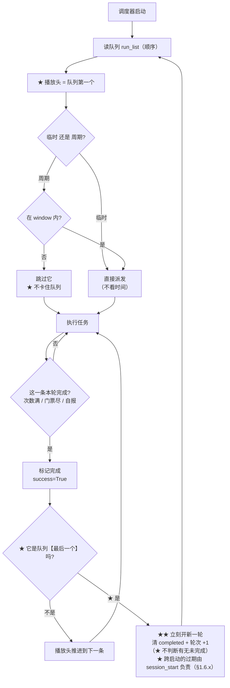

# OAS 设计规格书（"软件应该怎样"）

> ★★★ **[2026-11-01] 范围提示（现行权威）** ★★★
>
> 本文是旧 `backend/frontend`（旧仓，已冻结）的设计规格，来源为 10-06~10-12 会话。
> OAS 当前主线已迁至 **`oas-core`（Rust workspace）**；现行设计与实现以
> **`ENGINE-DESIGN.md §22` + `PENDING-LEDGER.md` + `RESUME.md`** 为准。
> 阅读旧仓历史/资产设计时可参考本文；不要用本文覆盖 oas-core 的现行裁定。

> ★★★ **文档定位** ★★★
>
> 本文回答一件事：**这个软件应该是怎样的**（后端逻辑 / 前端界面 / 数据结构）。
>
> | 约定 | 说明 |
> |---|---|
> | ★ **来源** | 会话原文（10-06 → 10-12，共 **501 条**真人发言，其中 **221 条**与调度相关）|
> | ★ **时间戳** | 全部为**真实时间**（UTC+8，`MM-DD HH:MM:SS`），取自会话记录 |
> | ★ **主体** | ★ **软件的形态**（规则 / 流程 / 结构），**不是聊天记录** |
> | ★ **分歧** | ★ **只在前后矛盾时**贴两边原话 + 时间戳，并标"谁覆盖谁" |
> | ★ **L3**（设计 vs 当前代码对照）| ★ **本文档全部写完后单独做**（用户裁定 [10-12 14:46]）|
> | ★ **助手侧** | ★ **只录**两类：① **我提的选项/隐患**（供对照"用户怎么裁的"）② **结论性事实**（含 `文件:行号`）。★ 不录行为过程 |
> | ★★ **双向对照** | ★ 每节含 **"我提的选项"** + **"用户裁决"** 两栏 —— ★ **只看用户的话会漏掉"选项是什么、裁的是哪个"**（用户 [10-12 14:57:54] 指出）|
> | ★ **早期轮次** | 10-06~10-08 初：只录**仍然有效的结论** |

## ★★★ 权威顺序（★ 读文档前必看 —— 防自相矛盾）

★ 本文件**跨越 7 天的多轮裁定**，因此**同一件事可能有多处描述**。
★ **遇到不一致时，按以下顺序取权威**：

```
1. ★★ 本节往下 §1~§3 的【规则编号】（R/P/Z/C/WIN/LR/REC/RS…）
   —— ★ 它们是【现行口径】
2. ★★ 【分歧块】里标 "✅ 现行" 的那一行
   —— ★ 分歧块只记"谁覆盖谁"，★ 它的"现行"行才是结论
3. ★★ 【带时间戳的用户原话】
   —— ★ 时间【晚】的覆盖时间【早】的
4. ★★ §4.5「修复进度」 > §4.1「修复状态」列 > §4.1「判定」列
   —— ★ 前两者说"现在"，后者说"核实那一刻"
5. ⚠ 【§1.2 / §3.4 里的"我提的 N 步计划"】= ★ **历史提案**，
   ★ **不是**现行规则；★ 只看它是否被 §4.5 标为已修
```

★ **判定"哪句过时"的方法**：
```
★ 同一概念在各节的说法 ⇒ ★ 以【规则编号所在节】为准
★ 若两处【都是规则编号】且冲突 ⇒ ★ 以【时间戳更晚】的为准，并【报给用户】
```

## 进度

| 章节 | 状态 | 依据时间范围 |
|---|---|---|
| §1 调度模型 | ✅ 已成稿（1.1~1.15）| 10-06 23:50 → 10-12 14:56 |
| §2 记录模型 | ✅ 已成稿（2.1~2.7）| 10-08 13:02 → 10-13 |
| §3 前端 | ✅ 已成稿（3.1~3.8）| 10-07 21:29 → 10-11 19:28 |
| §4 L3 对照（设计 vs 现状）| ✅ 已成稿（4.1~4.5）| 代码核实 2026-10-12 |
| §5 未决问题 | 🔄 随文累积（已有 6 条）| — |
| ★ **分歧块** | 🔄 **11 块**（①~⑪，**随文分散在各节**）| — |

> ★ **分歧块的定位**：★ 它们**不单独成章**，而是**就地放在相关小节后面**
> （这样读者在读到该规则时，**立刻**能看到"它被谁推翻过"）。
> ★ 编号 ①~⑪ **按被推翻的时机**排，★ 与所在章节位置**无关**。

---

# §1 调度模型（后端）

## 1.1 ★ 唯一依据 = **执行顺序**

> **[10-08 21:00:47]** "调度器按照**应有的逻辑**改，**不要被旧有的代码迷惑**"
>
> **[10-09 22:44:07]** "任务列表有 54 个，我启用 20 个，那么这 20 个里的**所有定时任务
>  都会自动进入队列**，但是**次数任务并不会自动进入队列**，需要**我添加任务进队列**。"
>
> **[10-11 22:13:32]** ★★ "临时任务没有什么**全天窗口**之分！只看设置的**次数和门票**
>  这两个字段。次数到了或者门票耗尽，这一行任务就算任务完成一次，
>  标记 `success=True` 就行。**不允许被执行顺序以外的机制调动**"
>
> **[10-11 22:23:52]** ★★ "对于**临时任务**，**只能通过执行顺序调度**。"

### R 规则

| # | 规则 |
|---|---|
| **R1** | ★ **队列（`script.optimization.run_list`）就是调度的唯一依据** —— 不在队列里的任务**不运行** |
| **R2** | ★ **队列成员怎么来**：定时任务（`auto_queue`）⇒ **自动进队列**；★ 次数任务（临时）⇒ ★ **必须用户手动添加** |
| **R3** | ★ **顺序 = 队列里用户拖出的相对次序**，★ **没有第二个排序权威** |
| **R4** | ★ **重复条目 = 重复跑整个任务**（同一任务可多条，各带自己的 `entry_id`）|
| **R5** | ★ **"派发次数"不是一个字段** —— ★ 靠"**在队列里加多条**"实现 |

> **[10-12 12:17:13]** ★★★ "**派发次数是用多次添加任务来实现的！** `target` 是
>  **内部需要打多少次**，就是 realmraid 内部的 `limit count`"

## 1.2 ★★ 分型规则：**临时** vs **周期**

> **[10-11 21:29:17]** "有这么麻烦吗，**为什么要用时间的排期**"
>
> **[10-11 21:32:40]** ★★ "`next_run` 除了确实是**时间类**的排期，其他的都用
>  **次数和门票**来约束完成与否，**这本来就是临时任务，怎么能用时间来排期**。
>  请检查下其他的临时类任务。"
>
> **[10-11 21:57:11]** ★ "这意味着 `next_run` 是在这类临时任务里起效的，
>  应该**彻底替换修复**"

| 维度 | ★ **临时任务**（`period = none`）| ★ **周期任务**（`period ≠ none`）|
|---|---|---|
| 谁决定"能不能跑" | ★ **次数（`target`，在任务内部生效）+ 门票** | ★ **窗口（window）+ `period`** |
| `next_run` | ★ **不参与派发判断** | ✅ 参与（时间排期）|
| 窗口（window）| ★ **不适用**（"没有全天窗口之分"）| ✅ 硬约束 |
| "本轮完成" | ★ **次数用满 或 门票耗尽** | ★ 本周期内已完成 |
| 新一轮 | ★ **后端调度循环再启动** ⇒ `session_start` 刷新 ⇒ 完成标记按**时间戳**过期（见 §1.6.x / §2.6-LR5）| ★ 进入新周期 |

> **[10-10 08:50:51]** "**窗口和 period 都不决定一天跑几次**，他们只能说是
>  **这个时间可以跑**" —— ★ 这条**对周期任务成立**；对临时任务，★ 见上表。

### ★★ 分歧块 ⑤：临时任务**该不该有窗口**？

| 时间 | 谁 | 说法 | 状态 |
|---|---|---|---|
| **[10-11 22:24:11]** | ★ 助手（我）| ★ 我在 8 条隐患里写："**窗口保留为准入门** —— 有的临时任务**其实有时间**（`Dokan` 19:00-20:00）。指针到了但它不在窗口 ⇒ 会空转" | ⚠ 我当时把它当**合法情况** |
| **[10-11 22:13:32]** | 用户 | ★ "临时任务**没有什么全天窗口之分**！只看设置的**次数和门票**这两个字段" | ★ 与我的说法**冲突** |
| **[10-11 语境]** | 用户 | ★ "**5 有 period 就是周期任务**！不要混淆了" | — |
| **[10-12 语境]** | 用户 | ★★ "**按照设计只有设置了 `period` 才能设置窗口**。道馆如果没有 `period` 却有窗口，那么可能是**还未配置好**" | ✅ **现行（最终）** |

★ **现行口径**：
```
★ 【设计上】窗口 与 period 绑定 —— ★ 只有周期任务才有窗口
★ 若出现 "period=none 却有受限窗口"（如 Dokan 19:00-20:00）
   ⇒ ★ 那是【配置未完成】，不是"临时任务也有时间约束"
★ ⇒ 临时任务的判据里【不包含窗口】
```

★ **这条覆盖了我 10-11 22:24 的建议**（我当时说"窗口保留为准入门"）——
★ 那是**我的错误理解**，用户后来纠正了。

### ⚙️ 设计演化：我 10-11 22:24 提的 4 步计划（★ 供对照，非最终）

> ★ 背景：用户 [10-11 22:23:52] 给出播放头机制描述后，
> ★ 我（助手）[10-11 22:24:11] 把它拆成"8 条隐患 + 4 步实施"。
> ★ 其中 **1、2、3、4 条被用户采纳**（[10-11 22:41:47] "1 整行结束"、
>   [10-11 22:58:01] "1 是 target 用满或者门票耗尽代表本轮完成"）；
> ★ **第 5 条（窗口保留）被后来的裁定推翻**（见分歧块 ⑤）。

| 我提的隐患 | 我的建议 | 用户裁决 |
|---|---|---|
| 1 "完成一次"算几次 | 整行结束 | ✅ **[10-11 22:41:47] "1 整行结束"** |
| 2 用序号还是 `entry_id` | 用 `entry_id`（身份不是位置）| ✅ 采纳（★ 用户 10-10 已定 `entry_id` 格式）|
| 3 指针失效会卡死 | 沿队列找下一个 | ✅ 采纳 |
| 4 乱序时指针怎么动 | 乱序不走指针，随机挑未跑过的 | ✅ 采纳（[10-11 语境] "运行过的序号剔除掉"）|
| 5 窗口怎么办 | ★ 窗口保留为准入门 | ❌ **被推翻**（分歧块⑤）|
| 6 手动"运行一次" | 手动优先 | ✅ 采纳 |
| 7 周期任务不能一起换 | 只换临时任务 | ⚠ 后被扩到"周期任务**也**走同一套记录"（[10-12 12:41:18]）|
| 8 `next_run` 不能全删 | 降级为展示 | ✅ 采纳 |

| 我提的 4 步 | 内容 | 状态 |
|---|---|---|
| 1 | 新增 `script.optimization.allow_run_entry_id`（播放头，落盘）| ⬜ 未定（见 §5-Q1）|
| 2 | `update_scheduler`：对 `period=none` 的条目，**门④ 改判播放头** | ⬜ 未做 |
| 3 | `script.py` 收尾：`run_success` ⇒ 推进播放头 | ⬜ 未做 |
| 4 | 循环 ⇒ 指针回 0 + 清 `runs`；乱序 ⇒ 随机挑候选 | ⬜ 未做 ⚠ **此步与 §2.6-LR2「长时记录跨轮存活」冲突 ⇒ 已被取代，见 §4.5** |

### ★★ 分歧块 ①：`next_run` 要不要彻底删？

| 时间 | 说法 |
|---|---|
| **[10-11 17:09:57]** | "临时任务怎么还有 `next_run` 的排期呢，不应该是按次数来的吗，这种靠着 `next_run` 来排期的任务是**普遍现象**吗" |
| **[10-11 17:18:47]** | "如果在添加到任务顺序页以后，就创建一个**磁盘记忆**呢？…记录数据，**用完后表示已完成本行任务**。这样 `next_run` 是不是就可以**废弃删除**了？" |
| **[10-11 21:57:11]** | "…应该**彻底替换修复**" |
| **[10-11 23:20:01]** | "…**我说的字段统一就是说的这个**" |

★ **现行口径**（综合 10-11 全部 + 10-12）：
```
★ 临时任务：next_run 【退出派发判断】（不再决定"能不能跑"）
★ 但 next_run 【不删除】—— 它仍服务：
    · 防封唤醒（antiban_wake）
    · 关模拟器 / 关游戏的等待
    · 界面"下次运行"显示
★ 周期任务：next_run 【照旧】参与排期
```

## 1.3 ★★ 播放头（顺序 / 循环 / 乱序）

> **[10-11 11:18:18]** ★ "我对于 UI 界面的变化有新的想法，对于**正在运行**，
>  就像是**音乐播放列表里的正在播放**一样，**他不是排在队首的**，
>  而是一种**状态按顺序变更**的，甚至可以直接照抄音乐播放列表的方式：
>  **顺序、循环、乱序**"
>
> **[10-11 15:29:49]** ★ "现在应该**没有队首什么事了**，**队首只是代表列表顺序
>  第一个**而已，但**正在运行的可以是列表里任意一个**。"
>
> **[10-11 22:23:52]** ★★ "对于临时任务，只能通过执行顺序调度。调度方法：
>  `if 允许运行序号 == 本人序号, run_start=true` 就开始运行；
>  判定**运行成功**过后 `run_success=true`；**允许运行序号**按……"
>
> **[10-11 22:41:47]** ★ "**1 整行结束**"（= target 用满或门票耗尽 ⇒ **整行结束**，不是只 +1）
>
> **[10-11 22:58:01]** ★ "**1 是 `target` 用满或者门票耗尽代表本轮完成**"
>
> **[10-11 19:27:27]** ★ "未运行的行 `[▶]` → **播放头设到这条 + 调度器开始跑**"

### P 规则

| # | 规则 |
|---|---|
| **P1** | ★ 存在"**当前允许运行的条目**"（播放头）；★ **它跑完才轮到下一个** |
| **P2** | ★ 播放头**按播放模式推进**：<br>· **顺序** ⇒ 队列下一个<br>· **循环** ⇒ 下一个；到尾回头（新一轮）<br>· **乱序** ⇒ ★ 从**未跑过**的条目里**随机**挑一个 |
| **P3** | ★ **"正在运行"是【状态】，不是队首** —— 队列里**任意一条**都可能是它 |
| **P4** | ★ **插队 = 改序号**：★ "把**别的任务的序号统统 +1**，将自己的任务序号设为 **1**" |
| **P5** | ★ 点某行的 `[▶]` ⇒ ★ **播放头设到该条 + 调度器开始跑**（★ 语义是"**从这条开始跑**"，不是"排到最前"）|
| **P6** | ★ 插队时**若有任务正在运行** ⇒ ★ **先停止当前任务，再插队** |
| **P7** | ★ 乱序**必须剔除已跑过的**（"可以将**运行过的序号剔除掉**，确保不会被重复随机到"）|

> **[10-11 16:59:12]** ★ "★ 每行有「▶」，点一下让那一条**立刻跑**：这个目前有问题，
>  点了以后没有立即跑…而且**语义不是顺序排到最前边，而是从这个任务开始跑**"

### ★★ 候选判据（[10-12] F/G/I 之后 —— 循环与乱序共用）

> ★ 用户报的 bug：★ "**循环第二次时结界突破没有触发**"

```
★ `_loop_candidates()` = "这一轮【还没做完】的任务"
   · 临时任务：★ `completed` 为真 ⇒ 【不算候选】
       —— ★ 而"真"的判据是 ★ **`completed_session == __loop__.session_start`**
          （★ **不是"轮次号"** —— ★ 见 §1.6.x / §2.6-LR5）
   · 周期任务：★ `is_completed_in_period()` ⇒ 本周期已做 ⇒ 不算
   · 未启用 / 不在队列 / 不在窗口 ⇒ 不算
⇒ ★ 循环（`reset_loop_next_run`）：只把**还没做完**的拉回现在
⇒ ★ 乱序（`shuffle_next_run`）：只在**还没做完**里随机
⇒ ★ **后端调度循环再启动**（`script.py` 的 `loop()` 开头 ⇒ `session_start` 刷新）
   ⇒ ★ 上一次启动标的 `completed` **自动全部失效** ⇒ 又算候选
   （★ 判据是**时间戳**，★ 不是轮次号）
```

### ★★★ 分歧块 ⑪：`completed` 的过期依据 —— **轮次号 → 时间戳**（[10-13] 的最终裁定）

| 时间 | 谁 | 说法 | 状态 |
|---|---|---|---|
| **[10-12]** | ★ 我 | ★ 我把 `completed` 的过期挂在 **`__loop__.rounds`（轮次号）** 上：★ "进入新一轮（轮次 +1）⇒ `completed` 自动过期" | ❌ **已作废**（★ 正是本节的旧说法）|
| **[10-12]** | 用户 | ★ "**循环第二次时结界突破没有触发**"（★ 实测报 bug）| — **证据**（★ 不是裁定）|
| **[10-13]** | ★ 我 | ★ 我把 `completed` 与 `runs` **落盘**并当判据；★ 用户报：★★ "**痛点是，重新跑的时候，读取了上一轮跑的计数，导致无法运行**" | ❌ **实机故障**（★ 见 §1.6 的故障证据）|
| **[10-13]** | 用户 | ★★ "**或者按照时间戳来判断**" | ✅ **现行** |
| **[10-13]** | 用户 | ★★ "**就按这个来**"（指 §1.6 现行口径：★ 用【本次启动时间】与【记录里的时间】比对）| ✅ **批准** |
| **[10-13]** | 用户 | ★★ "**可以可以**"（★ 同意每次后端调度循环启动时刷新 `session_start`；★ 同意把 **§1.3 的"按轮次号过期"改成"按时间戳"**；★ 同意把 **§5-Q5/Q6 的"待定"划掉**）| ✅ **批准（本节依据）** |

★ **现行口径（后者覆盖前者）**：
```
★ ❌ 过期依据【不再】是"轮次号"（`__loop__.rounds`）
      —— ★ 轮次号只在 loop 模式 + 队列有可重排候选时才 +1
      ⇒ ★ 在 `goto_main` / `stay_there` / 乱序下**永不推进**
      ⇒ ★ 当基准会**永久跳过**该条（★ 旧说法"自动过期"是**空头承诺**）
★ ✅ 过期依据【改为】"**本次启动时间**"：★ `__loop__.session_start`（**毫秒**）
      ★ 写入 = `task_state.mark_session_start()`（`task_state.py:960`）
      ★ 时机 = `script.py` 的 `loop()` **开头**调一次（`script.py:1083`）
      ★ 比对 = `task_state.get_entry_completed()`（`task_state.py:736`）
      ★ 判据 = ★ `completed_session == session_start`
      ★ `session_start` 为空 ⇒ ★ **一律按未完成**
★ ✅ `completed_round` ★ **保留但不再是判据**（向后兼容 + 排障可读）
★ ★ 完整七条见 ★ **§1.6.x「本次启动时间（`session_start`）」**
```

### 状态图：播放头与"正在运行"


### 流程图：一次完整循环

> ★★★ **2026-10-12 用户更正（★ 重要）** ★★★
> > "那个**流程图有问题**，**循环的情况下，只要是队列最后一个跑完，
> >  就会开始新的一轮，不会对还有没有未完成的条目做判断**"
>
> ★ ⇒ ★ 原来的流程图（★ 我写的）里有一个 `B{"队列里有未完成的条目吗?"}`
>   ★ **判断** —— ★★ **那是我加错的**。
> ★ 正确语义：★ **循环模式下，判断依据只有一条：★"队列最后一个跑完了"**
>   ⇒ ★ **立刻开新一轮**（★ **不判断**"还有没有未完成的"）。



★ **`loop_times` 的位置**（★ 别与"开新一轮"混）：
```
★ 开新一轮 = ★ **无条件**（★ 只要最后一个跑完）
★ `loop_times` = ★ **跑满 N 轮后的【终止】**，★ 由**外层**
  （`script.py` 的循环重排）负责 ⇒ ★ **不干扰**"开新一轮"
```

## 1.4 ★ 暂停 / 恢复 / 停止

> **[10-11 20:52:14]**（暂停语义）"A：**跑完当前这场战斗（到安全点），不再开新任务**"
>
> **[10-11 20:51:46]** ★ "**不要加手动重置**，这个重置功能本来就应该在已有的按钮中啊"
>
> **[10-11 20:53:44]** ★★ "我改变主意了，这个**暂停调度/恢复调度不是集成到任务运行行
>  里的按钮上了吗**，这应该是 bug，**不应该给别的按钮添加该功能造成混淆**"
>
> **[10-11 20:59:41]** ★★ "**已暂停，只能是暂停中任务能恢复**，这样才够优雅！
>  这个**恢复调度按钮是出现在暂停中任务行上，而不是任意行**"
>
> **[10-12 语境]** ★ "遇到**暂停/停止调度**时**可以直接停止**而非跑完当前一次完整战斗流程"

### Z 规则

| # | 规则 |
|---|---|
| **Z1** | ★ 暂停语义 = ★ **甲：原地不动** —— **不退回队首** |
| **Z2** | ★ 恢复 ⇒ ★ **从它接着跑**（不是从头重跑）|
| **Z3** | ★ 暂停/恢复按钮 ★ **只出现在"暂停中那条任务行"上**，★ 不出现在别处 |
| **Z4** | ★ 安全点 = ★ **不在战斗中**；★ 战斗中先打完这场，★ 非战斗中**可直接停** |
| **Z5** | ★ 战斗中判据：★ 识别到 `gb_action_bar_queue` ⇒ 5 秒内视为"战斗中"；其他时候 = 非战斗 |
| **Z6** | ★ **不加"手动重置"**（用户明确否决）|

### ★★ 分歧块 ②：暂停时任务**回不回队首**？

| 时间 | 说法 | 状态 |
|---|---|---|
| **[10-10 23:17:09]** | "就把这个功能聚合到**暂停调度按钮**上好了，点击暂停调度，正在运行的任务**自动回退到队列首位**，视作等待执行，这样是不是更优雅。" | ❌ **已作废** |
| **[10-12 语境]** | ★★ "**甲：原地不动**…恢复时**从它接着跑**" | ✅ **现行** |

★ **现行口径**：★ **不回退**（甲）。

### ★★ 分歧块 ③：暂停按钮放哪儿？

| 时间 | 说法 | 状态 |
|---|---|---|
| **[10-11 19:12:39]** | "「暂停调度」**只在执行队列上方**（共用顶部不放它）…任务列表页没有暂停按钮" | ❌ **已作废** |
| **[10-11 19:21:05]** | "「⏸ 暂停调度」应该**和队列中任务点击运行那个按钮是一个东西**，放在外边就冗余了" | 🔄 过渡 |
| **[10-11 20:53:44]** | ★★ "这个暂停调度/恢复调度**不是集成到任务运行行里的按钮上了吗**，这应该是 bug" | ✅ **现行** |
| **[10-11 20:59:41]** | ★★ "**恢复调度按钮是出现在暂停中任务行上，而不是任意行**" | ✅ **现行（最终）** |

★ **现行口径**：★ **暂停/恢复就是队列行上的那个按钮**（`[⏸]` / `[▶]`），
★ 顶部**不放**；★ **恢复只出现在"暂停中"那条行**。

## 1.5 ★ 完成 / 新一轮 的判定

> **[10-11 21:27:06]** "没票不该算失败还是算成功？我看你**前后矛盾**啊"
> **[10-11 21:28:56]** ★★ "**没票了应该算这轮结束啊，也算成功结束了啊**"
> **[10-11 22:13:32]** "次数到了或者**门票耗尽**，这一行任务就算任务完成一次，
>  **标记 `success=True` 就行**"
> **[10-12 12:02:22]** "个人突破设置了**打 2 次**，但是日志显示**已打 36 次**（这是否导致了
>  后边的**跳过了战斗**）请确认下是哪里导致了战斗跳过，**36 次是否有必要被记录和恢复**"
> **[10-12 12:41:18]** ★★ "**门票耗尽不上报，只上报任务完成**！目前**没有监控各类门票
>  资源**的任务，一旦标为耗尽而**永远得不到更新**后将**无法运行突破任务**"

### C 规则

| # | 规则 |
|---|---|
| **C1** | ★ "本轮完成"的两个来源：★ **次数用满** · ★ **任务自报完成**（如券打完）|
| **C2** | ★ **不上报"资源耗尽"**（没有监控机制 ⇒ 标了永不解锁）⇒ ★ 只上报"**任务完成**" |
| **C3** | ★ 标记完成 ⇒ ★ **本轮不再派发这一条**，★ 轮到下一条 |
| **C4** | ★ **新一次后端启动** ⇒ `__loop__.session_start` 刷新 ⇒ 完成标记**按时间戳过期**（§1.6.x / §2.6-LR5）⇒ 该条**又能跑**（重新探券）|
| **C5** | ★ "完成"**不是失败** ⇒ `success=True` |

> ★★★ **10-13 裁定：把 C1 的"次数用满"从【调度层判据】里拿掉** ★★★
>
> > ★★ **用户原话**：
> > > "**痛点是，重新跑的时候，读取了上一轮跑的计数，导致无法运行**"
> > > "**或者按照时间戳来判断**"
>
> ★ 原来"次数用满"读的是**落盘的计数器**（`runs >= target`）⇒ ★ 计数残留 ⇒
>   ★ **任务开跑即结束（跑不起来）** —— ★ 就是那个痛点。
> ★ 现行：★ **"次数满"不再是调度层的判据**，而是 ★ **任务内部 `target`（→ `limit_count`）自己**的事
>   （`tasks/base_task.py:137 effective_target()`）——
>   ★ 它跑到目标，就走**成功路径**收尾 ⇒ ★ 调度层按
>   ★ "**临时任务成功跑完一次即算本轮完成**"记账（`config.py:3993 entry_target_reached()`）。
> ★ ⇒ ★ **C1 的两个来源都保留**，★ 但**判据载体变了**：★ 不再是计数，★ 而是
>   ★ "跑完了" 这个**事实**（§1.6.x-Z6）。

### ★★★ "已完成" 必须**独立成桶**（[10-12] 实测根因）

> ★★ **用户两次报同一个 bug**：
>
> **[10-10 语境]** "**契灵之境为什么显示等待到点**？这个是**次数任务**，
>  不应该有【还未到点】这种【拥有 window 的任务类】的属性啊"
> **[10-12]** ★★ "还发现了**个人突破被标记为了【等待到点】**，
>  也就是**无法被再次运行了**，这个问题**我之前有反应过**"

### ★★★ 根因（**语义错位**，不是逻辑错）

```
★ `_skip_by_completed()`（本轮已完成）原来把条目放进 `waiting_task`
★ 而 `waiting` 的语义是 "★ **未到开放时间**"
★ 前端把 `slot != 'pending'` 统统显示为
  **"未到开放时间 · 等待中"**（`queue_panel.dart:268`）
⇒ ★★ 【本轮已完成】被显示成【未到开放时间】= **"等待到点"**
   ⇒ ★ 用户以为"这任务坏了、不能再跑"
```

★ 注意：★ 后端**逻辑是对的**（该条确实不该再跑）——
  ★ 错的是**它被归到了错误的语义桶**。

### ★★ 修法：**从两个桶 → 三个桶**

| 桶 | 含义 | 前端显示 |
|---|---|---|
| `pending` | ★ 现在能跑 | 待执行 |
| ★ **`done`** | ★ **本轮已完成**（次数用满 / 门票耗尽）| ★ **已完成（本轮）** |
| `waiting` | ★ **未到开放时间**（真·时间原因 / 未启用窗口）| 未到开放时间 |

★ 实现：
* ★ `update_scheduler()`：已完成 ⇒ ★ `f.slot = 'done'`，
  **仍留在 `pending_task`**（★ 这样能按**队列顺序**排出）
* ★ `schema_router.py` 的 `slot_of`：★ 加第三个桶 `done`
  （★ 覆盖"它在 pending 桶里"的判断）

★ ⇒ ★ 这样"**本轮已完成**"**不再混进"未到开放时间"**，
  ★ 界面语义正确。

## 1.5.x ★★★ 「队列全完成 ⇒ 待命」—— ★ **调度循环绝不许断**（[10-12] 起 · [10-14] 定型）

> ★★ **用户原话（两次报同一个 bug）**：
> > **[10-12]** "**循环虚设**！！！跑到最后一列后出现以下日志：
> >  `CRITICAL No task waiting or pending`"
> >
> > **[10-14]**（附 [10-13] 实机日志）"**1循环模式，以上是最后一个任务结束后报错日志。**"

### ★★ 实机日志（真因现场，`记录/20261013-关于循环和周期任务.txt:37-41`）

```
INFO     | 队列里没有可跑的条目（本轮全完成/未到点） -> **待命**（不抛 CRITICAL）
WARNING  | 构造待命占位失败(KeyError: 'Restart')      ← ★★ 真因
CRITICAL | No task waiting or pending
CRITICAL | Please enable at least one task
ERROR    | Run script 恋鸟树 error  ➜ RequestHumanTakeover  ➜ 脚本进程退出
```

### ★★★ 规则

| # | 规则 |
|---|---|
| **SB1** | ★★ **"队列全完成"是【正常状态】，不是错误** ⇒ ★ `get_next()` **不许** `raise RequestHumanTakeover`（★ 那会**中断整个调度循环** `script.py:1130` 的 `while 1`）|
| **SB2** | ★★ 该情形 ⇒ 返回一条 **「待命占位」**（`config.py:4479-4491`）—— ★ 上游据其 `command` 继续走等待逻辑 |
| **SB3** | ★★ **占位必须构造成功**：★ `Function(...)` 的**第一个参数必须是【小写配置键】**<br>★ 为什么：`Function.__init__` 调 `ConfigModel.type(key)`（`config.py:89`），而它是 **`ConfigModel.__annotations__[key]`**（`config_model.py:314`）—— ★ 模型字段名**全是小写**<br>★ 实测：`Function('Restart', …)` ⇒ **`KeyError`**（★ → 被 `except` 吞 ⇒ 落到 `raise` ⇒ **调度器死掉**）；`Function('restart', …)` ⇒ `command='Restart'` ✅ |
| **SB4** | ★ **占位必须是 `Function` 对象**（**不许** `return None` / 返回字符串）：★ `script.py:1139` 用 `task == 'Restart'` **比字符串**、`script.py:1156` 直接把它当字符串赋给 `running_task`；而 `Function` **未实现 `__eq__`** ⇒ ★ 换类型会让语义静默漂移 |
| **SB5** | ★ **不许把"待命分支"提前**：★ `pending_task` 非空 ⇒ 必须先返回它（`config.py:4353-4373`）；★ `waiting_task` 非空 ⇒ 必须返回它（`:4496-4501`）|

★ **守这条的地方**：`tests/module/config/test_standby_placeholder.py`（★ 5 条用例：
  ★ 不抛异常 · `command` 必须是真任务 · 必须是 `Function` · ★ 两条**反向**守卫）
★ **教训（★ 我在这里连续空转两次）**：★ `get_next()` **第一行就
  `self.update_scheduler()`**（`config.py:4351`）⇒ ★ 在外部设
  `pending_task` / `waiting_task` **会被重算覆盖** ⇒ ★ 守卫必须
  **`monkeypatch` 打桩 `update_scheduler`** 才能精确构造"待命"那一刻；
  ★ 并且**必须同时清 `pending` 与 `waiting`**（★ 模板里 `Restart` 默认
  `enable=True` ⇒ 实测 `pending_task = ['Restart']` ⇒ ★ 不清就走**出路①** ⇒ 空转）。

## 1.5.y ★★★ 「换御魂」可选项 —— ★ **失败必须"响亮地跳过"，不许终结任务**（[10-08] 定案 · [10-14] 修复）
> ★★ **用户原话（[10-14] 记录第 9 条）**：
> > "**御灵之境更换御魂出错，直接跳过了更换。**"

### ★★ 真因（代码级，已实测）

```
★ switch_soul_config.switch_group_team 出厂默认 = '-1,-1'
★ 用户只勾「启用」没设组/队 ⇒ 值就是 '-1,-1'
★ 实测 switch_parser('-1,-1') ⇒ (-1, -1)     ← ★ 解析**成功**（不抛）
★ ⇒ 绕过旧代码唯一的 except ValueError
★ ⇒ switch_soul_one(-1, -1) ⇒ get_group_assets(-1) 是 dict 下标
★ ⇒ ★★ KeyError: -1        ← ★ 不是 ValueError ⇒ 仍抓不住
★ ⇒ 异常冒泡；★ 所有调用方（25+ 任务）都把 run_switch_soul(...) 写在 try 之外
★ ⇒ ★★ 整局任务被这一行终结 ⇒ 用户体感"直接跳过了更换"
```

### ★★★ 规则

| # | 规则 |
|---|---|
| **SS1** | ★★ **换御魂是【可选项】**：★ 找不到 / 配置非法 ⇒ ★ **跳过并继续**，★ **绝不许**让整局任务卡死或终结<br>★ 依据（**已定案**）：`SESSION-INDEX.md:1162`（10-08 12:00）「确认：**所有调用方都不检查返回值**，所以『**跳过切换御魂**』是**安全的**」；★ `_scan_for_name` 注释同源 |
| **SS2** | ★★ **跳过必须"响亮"**：★ 用 **`logger.error`** 写明 ① **跳过** ② **原因** ③ **合法范围 / 该怎么改配置**<br>★ 禁止"静默 `return`"（★ 用户报的就是"出错…直接跳过"看不见） |
| **SS3** | ★★ **校验必须排在【任何 UI 动作】之前**：★ 组 ∈ **1-7**、队 ∈ **1-4**<br>★ 反例（旧行为）：校验排在 `get_group_assets()` 之后 ⇒ ★ 非法值先在 **dict 下标**上抛 **`KeyError`**（★ **不是** `ValueError`）⇒ ★ 旧的 `except ValueError` **抓不住** |
| **SS4** | ★ **两条入口都要校验**：★ 字符串 `'组,队'`（`switch_parser`）★ **和** 元组/列表（`BondlingFairyland` / `Hunt` 等调用方用元组） |
| **SS5** | ★ **`-1,-1` 不是"合法值"**，是「**未设置**」⇒ ★ 必须走 SS1/SS2（★ 它是 `SwitchSoulConfig` 的**出厂默认**，所以"只勾启用"的用户**一定**会撞到） |

★ **守这条的地方**：`tests/tasks/Component/SwitchSoul/test_switch_soul_validation.py`
  （★ **38 条**：★ 非法值只跳过 · ★ 非法值**不碰 UI** · ★ 合法值**照常换**（反向）·
   ★ 元组入口 · ★ `error` 级日志 · ★★ **运行时**断言 `switch_soul_one`
   抛 **`ValueError`** 而非 `KeyError`）
★ **教训（★ 这条守我踩得最深）**：★ **源码级"比行序"的守卫是空转的** ——
  ★ 把校验改成 `if False:`（★ 校验形同不存在）它**照样绿**（★ `raise` 字样还在）
  ⇒ ★ **必须有运行时断言**（★ 注入验证抓出来的，见台账 §C.3）。

## 1.6 ★ 字段语义（后端）

> **[10-12 12:09:29]** "`runs` 是还保留着吗，`target` 现在起什么作用，**两者边界怎么样**"
>
> **[10-12 12:17:13]** ★★★ "**派发次数是用多次添加任务来实现的！** `target` 是
>  **内部需要打多少次**，就是 realmraid 内部的 `limit count`。**既然你用 `runs`，
>  那就把他取代 `current_count`**，这两个不是一个东西吗。`total_runs` 可以有，
>  但是**总记录的颗粒度还不够细**，我想要的展示结果应当**包含时间信息到秒**，
>  后期可以对总结果文件统计分析"
>
> **[10-12 12:41:18]** "`d` 好的，**`limit_count` 不是应该用 `runs` 来替代吗**"
>
> **[10-11 23:20:01]** "两套计数不行…" + **[10-11 23:21:02]** ★ "**啊，我整错了**，
>  你说的 `target` 是派发次数，但是**内部是有一套真实跑多少次的计数的**，
>  这个没问题，是我整错了"

### 字段表

| 字段 | 语义 | 颗粒度 | 生命周期 | 谁写 |
|---|---|---|---|---|
| ★ **`target`** | ★ **任务内部要打多少次**（= 原 `limit_count`）| 每个条目 | 用户设 | 用户 |
| ★ **`runs`** | ★ **本条已打几场**（★ **取代 `current_count`**）；★ **10-13 起：★ 不再参与任何判定** —— ★ 本轮进度**只在内存**（§1.6.x-Z5）| ★ **场** | ★ **遗留计数键**：★ 任务侧**不读盘、不写盘**（`bind_counter` 从 0 起 / `commit_count` 空操作）；★ 磁盘上仅由「**重置**」**归档后清掉**（§2.1-REC3）；★ **统计看 `total_runs` / `total_log`（永不清零）**| 任务内部（★ 仅内存）|
| ★ **`current_count`** | ★ **内存工作变量**（不再单独落盘）| 场 | 内存 | 任务 |
| ★ **`total_runs`** | ★ **本条被运行了几次** | ★ **次** | ★ **长时记录，永不清零** | 调度层收尾 |
| ★ **`total_log`** | 每次运行的**时间（到秒/毫秒）** + 本次几场 | 每次 | ★ **永不清零** | 调度层收尾 |
| ★ **`entry_id`** | ★ 条目唯一身份 | — | ★ **不随运行变** | 添加进队列时生成 |

> ★ `entry_id` 格式（[10-10 09:00:37]）：★ "`entry_id` 用**当前时间 + task** 来实现，
>  这样可以**分拆也可以合并**" ⇒ `20261010T143005-RealmRaid`
>
> ★★ **时间戳精度**（[10-12 13:29:29] + [10-12 13:34:54]）：
>  ★ "可以考虑把**时间戳拉到最细颗粒度**" ⇒ ★ **从秒提到毫秒/微秒**
>  （现状：同名重复时靠后端加 `-2`/`-3` 兜底；提到毫秒后基本不会撞）

### ★ 计数的**唯一一套**（[10-12] 「2 废弃」之后）★★

> ★ 用户裁定：★ "**不能存在两套机制**" → "**2 废弃**"

| 用途 | 函数 | 层级 |
|---|---|---|
| 读（判据）| `get_entry_runs(config, entry_id)` | ★ 条目级 |
| 写（每场 +1）| `bump_entry_runs(config, entry_id, delta)` | ★ 条目级 |
| 清零 | `reset_entry_runs(config, entry_id)` | ★ 条目级 |
| 总记录（展示，**永不清零**）| `record_entry_run` / `get_entry_total_runs` | ★ 条目级 |

★ ~~`get_count` / `add_count` / `reset_count`~~ ★ **已删**（任务级，第二套机制）。

### ★★★ 分歧块 ⑥：记录到底**一份还是两份**？（★ 今天下午的推翻）

| 时间 | 谁 | 说法 | 状态 |
|---|---|---|---|
| **[10-12 12:08:03]** | 用户 | "一份**临时记录**只保留到当前任务结束，**另一份共用的总记录**用于结果展示" | 🔄 早期方案 |
| **[10-12 12:08:32]** | 用户 | "**周期任务**，一份临时记录只保留到当前周期结束，另一份共用的总记录" | 🔄 早期方案 |
| **[10-12 12:08:09]** | ★ 我 | "✅ 明白 —— **两份记录分离**（这正是我需要的设计）"<br>★ 我随后**按"两份记录"实现了** `runs` + `total_runs` | ⚠ **我按旧方案做了** |
| **[10-12 13:29:29]** | 用户 | ★★★ "**取消临时任务，改为不同任务的长时记录**，内部填写每次用**唯一 ID 做前缀**（如 `entry_id`）… 通过**前缀是否一致**来区分当前任务是否跑过" | ✅ **推翻"两份"** |
| **[10-12 13:29:42]** | ★ 我 | ★ 我提了 4 条担心（换 id 会丢队列行身份 / 丢累计 / 判不出跑过）<br>★ 建议：**id 不随运行变**，用 `total_log` 记历史 | — |
| **[10-12 13:32:36]** | 用户 | "2 **你说的有一定道理**…"（话未说完）| — |
| **[10-12 13:34:45]** | 用户 | ★★★ "2 **你说的有道理**，**把每次启动的时间记录下并每次启动做比对就行**" | ✅ **最终口径** |
| **[10-12 13:35:49]** | 用户 | ★★ "1 可以 / 2 **第二点按这个来**：把每次启动的时间记录下并每次启动做比对就行" | ✅ **批准** |

★ **现行口径（★ 覆盖 12:08 的"两份记录"）**：
```
★ ❌ 不再有"临时记录 / 总记录"两份
★ ✅ 改为【一份长时记录】（跨轮存活、永不清零），每条含：
      runs       本条已打几场
      total_runs 本条被运行了几次
      total_log  每次运行的【时间】+ 本次几场      ← ★ 时间到秒/毫秒
★ ✅ "这条【本次】跑没跑过" 的判定：
      ★ 用【本次启动时间】与【记录里的时间】比对
★ ✅ entry_id ★ 【不随运行变】—— 加进队列时生成，唯一（时间戳到毫秒/微秒）
```

★ **我漏掉这条的后果**（必须记下）：
```
★ 我按 12:08 的"两份记录"实现了 runs(会清零) + total_runs(不清零)
★ 而用户 [13:34] 已改成"一份长时记录 + 按启动时间比对"
⇒ ★ 我实现的是【已被推翻的方案】
⇒ ★ 这正是用户 [10-12 14:45:53] 说的：
   "**这说明目前的调度实现和记录没有关系啊！和前边的设计要求不一样**"
```

### ★★★ 10-13 补记：**这个跑偏导致了实机故障**（用户裁定「丙」）

> ★★ **用户原话 [10-13]**：
> > "**痛点是，重新跑的时候，读取了上一轮跑的计数，导致无法运行**"
>
> > "**或者按照时间戳来判断**"

★ **实机证据**（`D:\OAS` 运行日志）：
```
INFO | 从状态恢复战斗计数: 88          ← ★ bind_counter() 把上一轮的 88 读回来
INFO | 本次目标次数: 30 (已跑 88)      ← ★ 30 是 target，88 是残留计数
INFO | Current count 88, max count 30  ← ★ 88 >= 30
INFO | 运行记录: RealmRaid 本次 88 次, 0 分钟  ← ★ 0 分钟 = 一场没打
⇒ ★★ **任务"跑不起来"** —— 正是用户说的痛点。
```

★ **根因（两层）**：
```
★ ① `tasks/base_task.py` 的 `bind_counter()` **每次 run 都从磁盘恢复计数**
     `task_state.get_count(..., period='none')`
★ ② 而临时任务的 `period='none'` ⇒ ★ 该计数**永不过期**
     且 `reset_count()` **在生产路径里没有任何调用点**
     ⇒ ★★ **计数只增不减** ⇒ 跨轮次一直垒高 ⇒ 迟早超过 target ⇒ 跑不起来
★ ③ `D:\OAS` 里连"条目级 runs"都还没有（★ 旧代码），
     ★ 但**同一类病**在 `dev-scheduler` 里也存在（`entry_target_reached` 读 `runs`）
```

★ **现行口径（★ 本节覆盖上面"两份记录"的一切实现）**：
```
★ 判定"这条【本次】跑没跑过" ⇒ ★★ **只按【时间戳】比对**：
      用【本次本轮的开始时间】与【该条目的长时记录时间】比对
★ ❌ **不再用"计数 >= target"当"本轮已完成"的判据**
      （★ 计数会残留、会虚高 ⇒ 就是本次故障的根源）
★ ❌ **不再把"本轮进度计数"落盘**
      （★ `bind_counter` 不读盘、`commit_count` 不写盘）
★ ✅ 磁盘**只保留长时记录**（纯统计，不参与调度判定）：
      `total_runs` 本条被运行了几次 · `total_log` 每次运行的时间到毫秒
★ ✅ "这一轮打了多少场" ⇒ ★ **只活在内存**（★ 重启后从 0 开始）
      ⚠ 副作用（用户已接受）：重启后本轮会**从 0 重打**，不续跑
```

### ★★ 分歧块 ⑩：本轮进度**要不要落盘**？

| 时间 | 谁 | 说法 | 状态 |
|---|---|---|---|
| **[10-12 13:34:45]** | 用户 | "把每次**启动的时间**记录下并**每次启动做比对**就行" | ✅ 现行 |
| **[10-13]** | ★ 我 | ★ 我实现成 `runs` 计数器 + `completed` 状态位**落盘**，并当判据 | ❌ **已作废**（导致实机"跑不起来"）|
| **[10-13]** | 用户 | ★★ "**痛点是重新跑的时候读取了上一轮跑的计数，导致无法运行**" | ✅ **现行（最终）** |

★ **现行口径（后者覆盖前者）**：★ **本轮进度只在内存；跨轮判定只用时间戳。**

### ★★ 分歧块 ④：`target` 到底管什么？

| 时间 | 说法 | 状态 |
|---|---|---|
| **[10-10 20:15:32]** / **[台账 §23.1]** | "**次数**是**单一任务里设置战斗跑几次**" | ✅ 与最终一致 |
| **[10-11 23:20:01]** | "两套计数不行，需要用让他**严格跑派发次数**…**字段统一**" | ❌ **被自己推翻** |
| **[10-11 23:21:02]** | ★ "**啊，我整错了**…`target` 是派发次数…**内部是有一套真实跑多少次的计数的**" | 🔄 更正 |
| **[10-12 12:17:13]** | ★★ "**派发次数是用多次添加任务来实现的！** `target` 是**内部需要打多少次**" | ✅ **现行（最终）** |

★ **现行口径**：
```
★ target      = 【任务内部】要打几场（每一条各有一份）
★ runs        = 【本条】已打几场（= 原 current_count）
★ total_runs  = 【本条】被运行了几次（展示，永不清零）
★ 派发次数    = ★ 靠【队列里加多条】实现，★ 不是字段
★ ★ 10-13 补：★ runs 【不再参与判定】—— ★ 判定只看【本次启动时间】（§1.6.x）
★ ★ 10-13 补：★ 本轮进度【只在内存】—— ★ 磁盘只留 total_runs / total_log
```

## 1.6.x ★★★ 本次启动时间（`session_start`）—— ★ [10-13] 裁定的「按时间戳判断」

> ★★★ **用户原话（[10-13]，这是本节全部依据）**：
> > "**痛点是，重新跑的时候，读取了上一轮跑的计数，导致无法运行**"
> >
> > "**或者按照时间戳来判断**"
> >
> > "**就按这个来**"（★ 指 §1.6 的现行口径：用【本次启动时间】与【记录里的时间】比对）
> >
> > "**可以可以**"（★ 同意 ① 每次后端调度循环启动时刷新 `session_start`；
> >  ★ ② 把 §1.3 的"按轮次号过期"改成"按时间戳"；★ ③ 把 §5-Q5/Q6 的"待定"划掉）

★ **这一节是"这条【本次】跑没跑过"的【唯一判据】** ——
★ 它**取代** §1.3 的"**按轮次号自动过期**"（★ 变更过程见 §1.3 分歧块⑪）。

### Z 规则（★ 七条，与代码一一对应）

| # | 规则 |
|---|---|
| **Z1** | ★★ **新增字段** `__loop__.session_start` —— ★ **毫秒**时间串（`%Y-%m-%d %H:%M:%S.%f` 截 3 位）<br>★ 写：`task_state.mark_session_start()`（`task_state.py:960`）· ★ 读：`task_state.get_session_start()`（`task_state.py:1013`）|
| **Z2** | ★★ **写入时机** = ★ `script.py` 的 `loop()` **开头**调一次（`script.py:1083`）<br>★ **语义** = ★ **"本次后端调度循环启动的时刻"** <br>⚠ 不是"任务开始时刻"，★ 也不是"某次派发时刻" —— ★ 它是**整段调度循环的基准量** |
| **Z3** | ★★ **判据** = ★ **`completed_session == session_start`**（★ 落在 `task_state.get_entry_completed()`，`task_state.py:736`）<br>· **相等** ⇒ ★ **本轮已完成**（★ 不派发）<br>· **不等** ⇒ ★ **已过期** ⇒ ★ 就地清掉脏标记（`task_state.py:814-827`）⇒ **可再跑**<br>· `session_start` **为空** ⇒ ★★ **一律按未完成**（`task_state.py:829-832`）—— ★ 宁可多跑一次，★ 也不能因为读不到基准就永远不跑 |
| **Z4** | ★ **`completed_round` 保留但不再是判据** —— ★ 只作**向后兼容 + 排障可读**（`task_state.py:855-857`）|
| **Z5** | ★★ **本轮进度只在内存**：★ `tasks/base_task.py` 的 `bind_counter()` **不读盘**（`current_count = 0`，`base_task.py:286`）· ★ `commit_count()` **不写盘**（**空操作**，`base_task.py:391`）|
| **Z6** | ★★ **不再用"计数 >= target"当判据**：★ `config.entry_target_reached()`（`config.py:3993`）<br>· ★ **临时任务**（`period = none`）⇒ ★ **成功跑完一次即 `True`** <br>· ★ **周期任务** ⇒ ★ **`False`**（★ 不越权判 ⇒ 交给**周期记忆** `_skip_by_period`，按 `period_key`）|
| **Z7** | ★ **`runs` 不再是判据、不再落盘用于判定**；★ 磁盘只留**长时记录**：`total_runs` / `total_log`（★ 时间戳**毫秒** + 带 `session` 标签，`task_state.py:522`）<br>⚠ **副作用（★ 用户已接受）**：★ **重启后端 ⇒ 本轮【从 0 重打】，不续跑** |

### ★ 为什么要这样（★ 故障本体，不是口味问题）

```
★ 旧行为：bind_counter() 从盘恢复计数 ⇒ current_count = 88
         而 target = 30 ⇒ 88 >= 30 ⇒ ★ 任务开跑即 break ⇒ ★ "跑不起来"
         （★ 实机日志：INFO | 本次目标次数: 30 (已跑 88)
                        INFO | Current count 88, max count 30
                        INFO | 运行记录: RealmRaid 本次 88 次, 0 分钟 ← ★ 0 分钟 = 一场没打）
★ 根因：★ 判据挂在【落盘的计数器】上 —— 而清它的钩子只在
         "loop 模式 + 队列有重排候选"时才触发 ⇒ ★ 其它模式下【只增不减】
★ ⇒ ★ 现行把判据换成【本次启动时间】：
         ★ 后端下次启动 ⇒ 基准必变 ⇒ ★ 上一次的"已完成"自动全部失效
         ⇒ ★ **一定能跑**（★ 正是用户要的效果）
```

### ★ 与"长时记录"的分工（★ 别混）

| 层 | 载体 | 决定什么 |
|---|---|---|
| ★ **能否再跑** | ★ `__loop__.session_start` + `completed_session`（★ 判据）| ★ 这条**本次**跑没跑过 |
| ★ **历史统计** | ★ `total_runs` / `total_log`（★ 永不清零）| ★ 战斗几次 / 消耗多少体力 / 花了多少时间 |

★ ⇒ ★ **统计的数据永不参与判定**；★ **判定的数据只活一次启动**。

## 1.7 ★ 安全兜底（双保险）

> **[10-12 12:20:41]** ★ "对于一直跑的安全隐患，任务是有个 **`expect minute`** 字段的，
>  **到时间会停止**。当然，**添加次数限制也是需要的**。"

| 保险 | 载体 | 作用 |
|---|---|---|
| ★ **时间** | `expected_minutes` / `limit_time` | 到时间**停止**（防无限跑）|
| ★ **次数** | `runs` / `target` | 打满就停 |

## 1.8 ★ 战斗判据（"是否处于战斗中"）

> **[10-07 18:12:03]** "是否需要加入**判断当前是否处于战斗中**，这个判断当前代码里有吗"
>
> **[10-07 18:14:58]** ★ "如果能够**准确判断在战斗中**，那么**超时是不是可以去掉了**，
>  因为有时战斗时长就是很久的，就会触发重启"
>
> **[10-07 19:09:35]** "我新建了一个 `fighting_status.json`，在 general 中，
>  图片为 **action bar queue**"
>
> **[10-07 20:01:17]** ★★ "这个**行动条图片只用来判断是否处于战斗中**，
>  如果**存在该图片，那么就是在战斗中**，将**不能触发兜底时长**"
>
> **[10-07 20:02:18]** ★ "或者说存在该图片，那么**兜底时长应该重新计时，或者不计时**"
>
> **[10-07 19:55:40]** "如果能判断在战斗中，那么**就没必要设置最长时限**了"
>
> **[10-07 18:20:33]** 备选判据："左上角的**返回/退出按钮**可以作为战斗中的判断，
>  右边的**行动条**也可以"

### B 规则

| # | 规则 |
|---|---|
| **B1** | ★ 判据 = ★ **存在 `action bar queue`（行动条）图片 ⇒ 处于战斗中** |
| **B2** | ★ 战斗中 ⇒ ★ **不触发兜底时长**（或**重新计时**）—— 因为"战斗久"是正常的 |
| **B3** | ★ 有准确判据后 ⇒ ★ **最长时限可以去掉**（避免"战斗久"被误判为超时重启）|
| **B4** | ★ 落地：`gb_action_bar_queue`（见 §1.4-Z5 的同一判据）|
| **B5** | ⚠ 转场：完成战斗后到**结算页**有动画，★ 结算要再等 ~1s（[10-08 10:59:02]）|

★ **与 §1.4-Z4/Z5 的关系**：★ **同一判据**服务两处 ——
★ ① 暂停时的"安全点"（是否已脱离战斗）② 兜底时长是否计时。

## 1.9 ★ 定时 / 次数 的补充语义（早期轮次，仍然有效）

> **[10-07 23:27:59]** ★ "定时任务默认值 `reset` 改为**凌晨 0 点**，
>  因为阴阳师的第二天是这样的"
>
> **[10-07 23:44:00]** ★（自我修正）"金币、经验妖怪以及石距的**刷新时间是固定
>  每天的 0/12 点**，**最多储存两次**"
>
> **[10-07 23:47:31]** "直接**检测当前是否能够进入**就可以，能进入就组队，
>  **直到次数耗尽**，并记录下次运行时间"
>
> **[10-07 23:57:31]** ★ 再次确认："**固定时刻刷新**，固定 0/12 点储存一次次数，
>  **最多储存 2 次**"

| # | 规则 |
|---|---|
| **T1** | ★ 周期任务的 `reset` 基准 = ★ **凌晨 0 点**（阴阳师"第二天"）|
| **T2** | ★ 部分任务的次数**固定时刻刷新**（如 0/12 点），★ **最多储存 2 次** |
| **T3** | ★ 组队类任务：★ **能进入就组队，直到次数耗尽** |

## 1.10 ★★★ 调度器模型的**源头**：大狮模型（[10-08 18:47:32]）

> ★★ **用户原话（这是整个调度设计的起点）**：
>
> > "然后我想到了**大狮**这个安卓应用，它是通过**从上到下的排序**来确定
> > **任务优先级**的，可以**改变每层的任务、次数**，任务中有特殊的**休息**
> > （就是这个任务是休息，次数是**多少分钟**）。然后可以选择**是否重复任务列表**。
> > **是优先定时任务还是任务列表任务**，等等。"

### 大狮模型的要素（→ 本项目的对应）

| 大狮的要素 | 本项目的落地 |
|---|---|
| ★ **从上到下的排序 = 任务优先级** | ★ **执行队列（`run_list`）= 唯一顺序权威**（§1.1-R3）|
| ★ **可以改变每层的任务** | ★ 队列条目可**自由拖动**（[10-10 18:59:49] "我只需要保持可以自由拖动/改变执行顺序就行"）|
| ★ **可以改变每层的次数** | ★ **条目级 `target`**（每一条各有一份次数）|
| ★ **特殊的"休息"任务（次数 = 多少分钟）** | ★ **`rest` 条目**（`{kind:rest, minutes:N}`）|
| ★ **是否重复任务列表** | ★ **播放模式 = 循环**（`when_task_queue_empty = loop`）+ `loop_times` |
| ★ **优先定时任务 / 优先列表任务** | ★ **快捷排序**（`put /queue/sort`：定时排前面 / 固定排前面）—— ★ 后来降级为**一次性动作**（[10-10 18:59:49]）|

### 同期提出的其他模型要求

> **[10-08 18:36:44]** ★ "开启关闭任务应当**实时生效**，**不应该重启后生效**"
> **[10-08 18:36:44]** ★ "然后我还想要的是**软件清楚知道当前界面**，并知晓
>  **如何返回庭院**，也知道**战斗中的话需要等待完成后再返回**"
> **[10-08 19:25:51]** ★ "**任务列表只是一个调度器**"
> **[10-08 19:55:15]** ★ "**探索也是固定任务**"

| # | 要求 |
|---|---|
| **D1** | ★ **启停实时生效**（不重启）|
| **D2** | ★ 软件要**知道当前界面**（页面识别）|
| **D3** | ★ 要知道**如何返回庭院** |
| **D4** | ★ **战斗中要等完成再返回**（与 §1.8 战斗判据联动）|
| **D5** | ★ **任务列表 = 调度器**（它不做别的）|
| **D6** | ★ **探索 = 固定任务**（分类判据）|

### ★★ 分歧块 ⑦：任务分类（定时/固定）的**判据**

| 时间 | 谁 | 说法 | 状态 |
|---|---|---|---|
| **[10-08 18:36:44]** | 用户 | "**次数只针对固定任务**，而非金币、经验、石距这类特殊的" | 🔄 早期 |
| **[10-08 19:55:15]** | 用户 | "**探索也是固定任务**" | — |
| **[10-09 22:59:42]** | 用户 | "除了**定时任务**（有充能、次数限制、或时间窗口限制），其他的一般都是**次数任务**（可以随时设置挑战几次的任务）。你觉得这个说法对吗" | ✅ 过渡 |
| **[10-10 20:42:01]** | 用户 | "**周期是 `period` 啊**！你联系下上下文行不，是**每天、每周每月、不限**那个" | ✅ |
| **[10-11 22:13:32]** | 用户 | ★ "**临时任务**没有什么全天窗口之分！只看设置的**次数和门票**" | ✅ **现行** |

★ **现行口径**：★ **分类判据 = `period`**
```
★ period = none  ⇒ ★ 临时任务（次数 + 门票）
★ period ≠ none  ⇒ ★ 周期任务（窗口 + period）
```

## 1.11 ★★ 任务模型与分类（[10-08 20:15:32] 起）

> **[10-08 20:15:32]** ★★ **用户原话**：
>
> > "突破是**定时**。真八岐大蛇是**充能**，每周两次 —— ★ **其实不需要区分充能和定时**，
> >  比如**每日定时就是每天充能 1 次**，**每周定时是每周充能一次**，
> >  而目前的**金币、经验、石距妖怪时 0/12 点充能一次**。你看下要不整合下。
> >  再分出一个**限时活动**：英雄测试、超鬼王等按照 oas 的分类放就可以。"
>
> **[10-08 21:12:31]** ★ "我说的**新的限时活动**是指**阴阳师出了新的活动**，
>  咱们到时候需要去将其作为**新的任务加到**这个软件里。"
>
> **[10-08 21:11:15]** ★ "记得考虑下**后续开发新的执行任务**（比如新的限时活动）
>  或者**维护既有任务**（某 UI 改了，或者执行逻辑变了等）时是否也会受影响，
>  以及**前后端的适配、维护，跨平台的支持**等。"

### 任务分类模型（★ "充能"概念被取消）

| 类别 | 语义 | 例子 |
|---|---|---|
| ★ **定时（周期）** | 按**周期**跑（每天/每周/每月）| 突破、寮突破、个人突破 |
| ★★ ~~充能~~（★ 已删的概念） | ★ **取消独立概念** —— ★ 它就是"定时" | 真八岐大蛇（每周 2 次）|
| ★ **固定（次数）** | 可随时设置"挑战几次" | 探索 |
| ★ **限时活动** | 按 OAS 分类放 | 英雄测试、超鬼王 |

★ **用户的关键裁定**：★ "**不需要区分充能和定时**" ——
★ **每日定时 = 每天充能 1 次**；★ **每周定时 = 每周充能 1 次**。

### 同期要求

| 时间 | 内容 |
|---|---|
| **[10-08 20:29:27]** | ★ "**字段不统一的请修改为统一字段**，如你发现的**探索中的次数字段**等，如有其他不统一的也请统一" |
| **[10-08 20:33:45]** | "**寮突破和个人突破是结界突破的两个子分类**" |
| **[10-08 20:39:07]** | ★ "**休息**作用范围是什么意思？是任务列表中**穿插的休息**吗，穿插的休息应该是**当做任务来做**吧" |
| **[10-08 20:52:14]** | ★ "确认下：默认 ⏸ 的语义 = **A：跑完当前这场战斗（到安全点），不再开新任务**" |
| **[10-08 21:00:47]** | ★★ "**调度器按照应有的逻辑改，不要被旧有的代码迷惑**" |
| **[10-08 21:05:29]** | ★ "**不用在意会破坏我现有配置**。应该从**代码、使用、维护是否优雅**的角度去考虑" |
| **[10-08 21:19:23]** | ★ "**合并文档长期维护**" |
| **[10-08 22:03:45]** | ★ "**清理残留，死代码清扫**" |
| **[10-08 22:12:11]** | "间隔信息之类的不重要…**架构实现就完成大半了**" |

### ★★ 玩法开放时间（★ 用户要求"自学习 + 用户可配置"）

> **[10-08 21:35:32]** ★★ "**逢魔不是每 1 小时**，这个是我为了确保不会错过，
>  **过度的适配**这个软件，因为他无法确保在限时内打开该任务，所以我让他**每 1 小时轮询**。
>  **逢魔之时开放时间是每天的 17-23 点**。各类玩法你可以在网上大致搜索下，
>  **不要被旧有配置迷惑了**。"
>
> **[10-08 21:45:54]** ★★ "**自学习加用户可配置**。**不要写死时间段**。
>  **都开放出来时间**。记得更新文档，包括搜索方式。"

| # | 规则 |
|---|---|
| **W1** | ★ **玩法开放时间**要**准确**（如逢魔 = 每天 17:00–23:00），★ **不要被旧配置迷惑** |
| **W2** | ★ **不要写死时间段** ⇒ ★ **开放出来给用户配** |
| **W3** | ★ **自学习 + 用户可配置** 两条路 |
| **W4** | ★ 轮询不能当"漏不掉"的保险（★ 那是"过度适配"）|

### ★ 跨平台 / 形态（★ 提出的方向）

> **[10-08 23:03:45]** "我说的**网页展示的前端**是指，让你**展示任务总览和任务列表**
>  时你给我的展示的 **v1-v3 网页**"
> **[10-08 23:13:14]** "后续是否需要把**前后端包装到一起**组合成一个软件，跨平台设计"
> **[10-08 23:18:56]** ★★ "OAS 后端**不能在安卓上运行吗**，我想着**像大狮那样
>  **伪装成输入法之类的悬浮窗式运行**在阴阳师界面"
> **[10-08 23:00:46]** ★ "（旧 OASX）我不建议沿用，目前他的风格很像是**树状展开**，
>  但是**挺难用的**"
> **[10-09 00:32:41]** ★ "考虑到我是**给自己用**，而且账号已经**黑过几次**，不太在意再次被黑，
>  所以可以考虑 **root 注入**的方式"
> **[10-09 00:37:38]** "那么现有的软件是**无法轻松跨平台**的是吗"

| # | 规则 |
|---|---|
| **X1** | ★ **不沿用旧 OASX 的树状风格**（"挺难用的"）|
| **X2** | ★ 目标形态：★ **像大狮那样做成悬浮窗**（安卓）|
| **X3** | ★ 跨平台是**长期方向**（短期不阻塞）|

---

## 1.12 ★★★ 窗口（window）的完整设计（[10-10 07:50:00] 定型）

> ★★ **用户原话**：
>
> > "**window 的设计应当再展开说下**，每天的**任务其实也有 window**，只不过是
> >  **每天的 0 点到 24 点**。但是**选择周期选择每天**，**每周则是每周一 0 点到
> >  周日 24 点**，**每月以此类推**。而**逢魔则是每天的 17 点-23 点**，等等。
> >  **所有的定时都有着 window 属性**。我顺便发现了**很多定时任务没有开放
> >  window 和周期的设置**。"
>
> **[10-10 08:28:41]** ★ "**window 是任务可执行窗口，不是会话窗口**。"
>
> **[10-10 08:48:47]** ★ 窗口语义：★ **"(B) 两端必须同周期"**
>
> **[10-10 08:50:51]** ★★ "**窗口和 period 都不决定一天跑几次**，
>  他们只能说是**这个时间可以跑**"
>
> **[10-10 09:49:41]** ★ "**窗口是唯一排期依据**，这个 B 并不冲突吧，
>  窗口仍然是**唯一排期依据**。"
>
> **[10-10 09:49:41]** "**(b) `AvailabilityWindow` 支持动态 days**
>  （运行时从配置读）—— 让**窗口能引用配置字段**"
>
> **[10-10 11:53:08]** ★★ "**不是 window slots，而是设置多个 window**！
>  slots 不是已经废弃了吗，请通读代码、设计文档并更新记忆！
>  **前后端要同步改**！所以连 **`charge_*` 字段和存量逻辑一起删**"
>
> **[10-10 12:59:51]** ★ "金币妖怪 (a) **多个 window** —— 配 **2 个窗口**
>  （0:00-11:59、12:00-23:59）"

### W 规则（窗口）

| # | 规则 |
|---|---|
| **WIN1** | ★ **所有定时任务都有 window 属性** —— ★ **没有 window 视为"缺失"**，不是"不限时段" |
| **WIN2** | ★ **周期决定 window 的粗粒度**：<br>· `daily` ⇒ 每天 00:00–24:00<br>· `weekly` ⇒ 周一 00:00 – 周日 24:00<br>· `monthly` ⇒ 类推 |
| **WIN3** | ★ **window 是"任务可执行窗口"**，★ **不是会话窗口** |
| **WIN4** | ★ **窗口两端必须同周期**（语义 (B)）|
| **WIN5** | ★★ **窗口是唯一排期依据** —— ★ "窗口和 period 都**不决定一天跑几次**，他们只能说**这个时间可以跑**" |
| **WIN6** | ★ **一个任务可配多个 window**（如金币妖怪：0:00–11:59 + 12:00–23:59）|
| **WIN7** | ★ ~~`window_slots`~~ ★ **已废弃（已删）** —— ★ 改为"**多个 window**" |
| **WIN8** | ★ **窗口可引用配置字段**（`AvailabilityWindow` 支持**动态 days**）|
| **WIN9** | ★ **很多定时任务缺 window 设置** ⇒ ★ 要**补齐** |

### ★★ "跑几次"由谁决定（关键分工）

> **[10-10 08:50:51]** ★★ **用户原话**：
>
> > "跑几次需要**用户自己设置跑几次**，应该在**次数**里体现啊。
> >  另外现在的**添加任务应该设置为可以重复添加相同的任务**，
> >  这样就**变相实现了多次跑任务**"

| 概念 | 回答什么 | 载体 |
|---|---|---|
| ★ **window** | 这个时间**可不可以跑** | `TaskSpec.window` / 用户窗口字段 |
| ★ **period** | window 的**粗粒度** | `Scheduler.period` |
| ★ **次数**（`target`）| 用户想跑**几次**（★ 后来明确 = **任务内部打几场**）| `Scheduler.target` / 条目级 `target` |
| ★ **重复条目** | 同一任务在队列里**出现多次** | `run_list` 的多条条目 |

★ **"多次跑任务" = 重复添加**（★ 不是"次数"）—— ★ 与 §1.1-R5 一致。

### ★ `entry_id` 定案（[10-10 09:00:37]）

> ★ "`entry_id` 用**当前时间 + task** 来实现，这样可以**分拆也可以合并**，
>  任务量上会不会就变得很小。"
> ★ 选项：★ **"选项 2（显式）"**（[10-10 09:07:45]）

```
★ 格式: f"{added_at:%Y%m%dT%H%M%S}-{task}"
★ 例:   20261010T143005-RealmRaid
★ 好处: 可拆（去前缀得到 task）/ 可合并 / 稳定（拖动不变）/ 可读
```

### ★ 补充裁定（同期）

| 时间 | 内容 |
|---|---|
| **[10-10 07:35:33]** | ★ "**执行队列中移除后自动停用只针对定时任务**，**固定任务移除后应该返回添加任务的池子里**" |
| **[10-10 08:22:45]** | ★ "`MemoryScrolls`，**只做停止用途，不做排期**" |
| **[10-10 08:22:45]** | ★★ "添加一个**任务完成汇报 tab**——现在的**日志属于原始日志，应该转移到单独界面**用来 debug，**当前日志位置替换为任务完成汇报的 tab**，只会报**完成了哪些、出错任务标注**等等可以作为**简报**的内容" |
| **[10-10 10:42:51]** | ★ "任务汇报已经**占用了右半窗口**，但是还有一个 tab 页面，**两个重复了**。取消单独的 tab 和右半窗口，改为**可以收纳的形式**（点一下从右边滑出来，再点一下收进去）" |
| **[10-10 10:55:11]** | ★ "**一定要前后端对应**，或者你需要**前后端都确认好才能下结论**" |
| **[10-10 11:43:55]** | ★ "**僵尸配置节点清理掉**" |
| **[10-10 13:04:38]** | ★ "**去掉组队协同，去掉存量次数**。**组队协同应该是单独模块**啊，**不应该放在金币妖怪里**" |
| **[10-10 11:09:25]** | ★ "**实时配置改了也没事**，我会重新配置的"（★ 允许改动现有配置）|

### ★★ 分歧块 ⑧：**窗口 vs 排期** 的关系（澄清"唯一依据"）

| 时间 | 谁 | 说法 |
|---|---|---|
| **[10-10 09:49:41]** | 用户 | ★ "**窗口是唯一排期依据**" |
| **[10-11 22:13:32]** | 用户 | ★★ "**临时任务没有全天窗口之分**！只看**次数和门票**" |
| **[10-12 语境]** | 用户 | ★★ "**只有设了 period 才能设窗口**；道馆那样是**还没配置好**" |

★ **现行口径（三句合一）**：
```
★ 周期任务：★ 窗口（window）= 唯一排期依据
★ 临时任务：★ 不看窗口 —— ★ 只看【次数 + 门票】
★ 若临时任务出现窗口 ⇒ ★ 那是【配置未完成】
```

---

## 1.13 ★★★ 「休息」任务的定义（[10-11 06:38:37] 定案）

> ★★ **用户原话（★ 他强调"这个定义我提了第三次了"）**：
>
> > "我对**休息**的定义**只有这些**：**休息就是临时任务（回庭院待着）**，
> >  只不过**可以选择被定时任务插队**。"

> **[10-11 05:38:22]** ★ "任务执行顺序，**添加休息任务时，它格格不入**，
>  似乎**属性不对**，应把这个**作为临时任务来赋予基础属性**，
>  可以**更改次数（也就是分钟）**，而不是现在固定的时间，然后也**可以被拖动**，
>  现在似乎因为属性不对，导致**沉底、无法被拖动**。"
>
> **[10-11 06:47:17]** ★ "休息作为临时任务，**请继承其它的临时任务的属性**，
>  可以**设置次数（时间）**，拥有**完善的 `period` 和窗口设置**，
>  就像其它临时任务一样，**有通用的功能**"
>
> **[10-11 06:54:29]** ★★ "**有 `period` 和 `window` 属性，是为了统一管理**，
>  比如**初始值是 `period=none`**，这样可以轻易地被分进**临时任务**…
>  事实上并不会去把 `period` 改为其他值。所以**选择乙**就行。
>  ★ **需要分钟，不是次数**。"
>
> **[10-11 05:52:20]** ★ "记得**休息任务的实现别忘了有个功能是可以选择
>  【定时任务插进来】**，别忘记了"
>
> **[10-11 07:19:12]** ★★ "**杜绝硬编码，写进文档里**。"
>
> **[10-11 07:48:45]** ★ "**1，读，不满足就跳过**。**默认是临时任务，无周期的**。"
>
> **[10-11 06:07:15]** ★ "**1 全删**"（★ 删 `'__rest__'` 特殊排序 rank）

### 规则

| # | 规则 |
|---|---|
| **RS1** | ★★ **休息 = 临时任务**（"回庭院待着"），★ **不是特殊机制** |
| **RS2** | ★★ **可选：被定时任务插队** |
| **RS3** | ★ **继承临时任务的全部属性**：★ `period`（初始 `none`）+ `window` |
| **RS4** | ★★ **时长单位是【分钟】，不是"次数"** |
| **RS5** | ★ **可自由拖动**（★ 修掉"沉底、无法拖动"的 bug）|
| **RS6** | ★ **`'__rest__'` 特殊排序 rank 删除**（★ 休息就是普通条目）|
| **RS7** | ★ **不满足条件就跳过**（默认临时任务、无周期）|
| **RS8** | ★★ **杜绝硬编码** |

★ **与 §1.12-WIN5 的关系**：★ `period=none` ⇒ 它是临时任务 ⇒
★ **不看 window**（★ 尽管它**具备** window 字段，那是为了"统一管理"）。

## 1.14 ★★ 队列循环的**轮数**（[10-11 08:23:12]）

> **[10-11 08:23:12]** ★ "看到**队列循环**了，但我觉得选中后应该加一个
>  **跑几次的额外输入框**，★ **0 代表一直跑**，**1、2……代表跑几次**。"
>
> **[10-11 08:36:50]** ★ "怎么开始新一轮 N 次？**乙更清晰**"

| # | 规则 |
|---|---|
| **LP1** | ★ 循环模式要有"**跑几次**"输入框 |
| **LP2** | ★ **0 = 一直跑**（不限轮数）|
| **LP3** | ★ `N > 0` ⇒ **跑满 N 轮就停** |
| **LP4** | ★ 落地字段：`script.optimization.loop_times`（+ `__loop__.rounds` 计数）|

## 1.14.x ★★★ 休息时长**范围内随机 ±20%**（[10-14] 新增）

> ★★ **用户原话（[10-14] 记录第 3 条）**：
> > "**添加任务的休息时间做成范围内随机上下20%**"

### ★★★ 规则

| # | 规则 |
|---|---|
| **RJ1** | ★★ 实际休息分钟 = ★ **`base × (1 ± 0.20)` 内均匀随机**，★ **四舍五入到整数分钟**<br>★ `base` = 沿用 §1.13 的四级取值（条目 `target` → 条目 `minutes` → 任务级 `scheduler.target` → 30）|
| **RJ2** | ★★ **下限 1 分钟** —— ★ 不许出现"0 分钟休息"（`base=1` 也要休满 1 分钟）|
| **RJ3** | ★★ **配置里的分钟数不许被改写** —— ★ 随机的只是"**这一轮实际睡多久**"<br>★ 为什么：★ 若写回配置 ⇒ ★ 切页/重启后**越随机越偏**（游走），★ 而且用户再也看不到**自己填的那个数**<br>★ ⇒ ★ 界面与日志里的"休息 N 分钟"**仍是用户填的值**；★ 实际值另打一行日志 |
| **RJ4** | ★★ **必须真的睡随机后的值**（`total_s = actual * 60`）—— ★ 不许"算了随机却睡固定值"（★ 典型空转修法，守卫专门盯它）|
| **RJ5** | ★ **均匀分布**（不是正态）—— ★ 用户说的是"**范围内**随机上**下** 20%" ⇒ ★ 均值**必须仍在 `base`**（★ 不许写成"只加不减"）|

★ **守这条的地方**：`tests/tasks/test_rest_random_minutes.py`（★ **14 条**：
  ★ 400 次采样都落在 ±20% 内（含取整余量）· ★ 均值居中（±5%）· ★ 下限 1 分钟 ·
  ★ 非正数原样返回 · ★ **签名只接标量**（从结构上无法改写配置）· ★ **`total_s` 必须用 `actual`**）
★★ **注入验证 2/2 真红**：★ ①"只加不减" ⇒ 均值判据失败；★ ②"算了不用" ⇒ 源码判据失败。

## 1.15 ★★ 条目级配置**必须独立**（[10-11 09:06:01]）
> **[10-11 09:06:01]** ★★ **用户报的 bug**：
>
> > "先插一个 bug：当前**临时任务重复添加后，修改次数/时间会同步到所有的
> >  同种任务，而不是分开**"
>
> **[10-11 09:11:35]** ★ 用户裁定：★ **"1 甲"**
> （★ = 次数/时间按**条目级**存，★ 改一条只影响那一条）

| # | 规则 |
|---|---|
| **E1** | ★★ **同一任务的多个条目，各自的"次数/时间"必须独立** |
| **E2** | ★ 原因：★ **重复条目 = 重复跑整个任务**（§1.1-R4），★ 每条应能独立配 |
| **E3** | ★ 落地：★ 条目级 `RunEntry.target`（`>0` 时优先于任务级 `scheduler.target`）|

## 1.16 ★★★ 「新建任务」的标准流程（[10-14] 用户需求 · ★ **待你确认后实现**）

> ★★ **用户原话（[10-14] 记录第 6 条，逐字）**：
> > "**结合 http://127.0.0.1:22288/tool/annotator 这类 OAS Web 标注工具，
> >   进一步集成新建任务的功能。目前只具备测试 match 程度、更新识别库的功能。
> >   需要彻底了解目前代码的实现，然后设计增删改查复制任务的标准流程，
> >   然后通过代码来实现前后端，最后用前端实现新增一个周期任务和一个临时任务
> >   并成功运行，至此通过验收。再通过这类流程将当前所有的周期任务统一化管理，
> >   接入统一化的调度。**"

### ★★★ 一、任务是什么（★ 有调研证据的**契约**）

★ 一个任务 = **4 个约定文件**（`tasks/Rest/meta.py:4-9` 是权威说明）：

| # | 文件 | 是否必需 | 作用 | 谁读它 |
|---|---|---|---|---|
| **1** | `meta.py` | ★★ **必需** | ★ `SPEC = TaskSpec(task=…, name_zh=…, category=…, period=…, window=…)` —— ★ **任务与调度器之间的唯一契约** | `task_catalog._discover_specs()`（`task_catalog.py:588-605`）|
| **2** | `config.py` | ⚠ ★ **[10-14] 实测订正：不是"必需"** —— ★ `tasks/GotoMain/` **就没有** `config.py`（目录里只有 `meta.py` / `script_task.py` / `assets.py`），★ 它照样能被发现、能跑 | ★ 但**要配置界面**就必须有：`class <Name>(ConfigBase)` + `scheduler: Scheduler` | `config_model._discover_config_classes()`（`config_model.py:64-93`、`:138`）|
| **3** | `script_task.py` | ★★ **必需** | ★ 类名**必须**叫 `ScriptTask`，**必须**实现 `run()` | `script.py:848-852`（`tasks/<cmd>/script_task.py` 写死）|
| **4** | `assets.py` | ★ 有素材才需要 | `class <Name>Assets` + `RuleImage/RuleOcr(...)` | 由 `dev_tools/assets_extract.py` **自动生成** |

★ **字段来源**（★ 易踩）：★ `name_zh` / `category` / `window` / `period` / `auto_queue` / `list_pos`
  来自 **`meta.py`**；★ 而 **`count_default` 不在 `meta.py`**（★ 实测 55 个 `meta.py` 零命中）
  ⇒ ★ 它在 `module/config/task_catalog_data.json`（由 `gen_task_catalog.py` 生成）。

### ★★ 二、现状（★ 调研实测）

| 能力 | 现状 | 证据 |
|---|---|---|
| ★ 标注**规则 json**（增删改）| ✅ 有 | `tool_router.py:246-261`（`rules/source/create` / `delete`）|
| ★ 试识别 / 调阈值 | ✅ 有 | `tool_router.py:318-332` |
| ★ 模拟器取帧 | ✅ 有 | `tool_router.py:282-315`、`:368-414`（WS 推帧）|
| ★ 保存规则 ⇒ **自动重生成 `assets.py`** | ✅ 有 | `tool.py:1309-1378`、`assets_extract.py:262,400` |
| ★★ **创建 `tasks/<New>/` 目录** | ❌ **没有** | ★ 全文无此代码；且 `_resolve_task_root` **要求目录已存在**否则 404（`tool.py:843-844`）|
| ★★ **生成 `meta.py` / `config.py` / `script_task.py`** | ❌ **没有** | ★ `tool.py` 的写操作只有 `:944-946,963,1121,1339-1344,1425-1426`，**没有一个**指向这三个文件 |
| ★ 前端**输入新任务名** | ❌ **没有** | ★ `web/annotator` 内无"新建任务"字样；`taskName` 只能从已选目录首段推出（`app.js:1868-1883`）|
| ★ 离线 `meta.py` 生成器 | ⚠ 有但**只对已存在目录** | `dev_tools/gen_task_meta.py:127-131`（不建目录、不暴露 HTTP）|

★★ **结论**：★ 现有 annotator 正好是"**从已有任务目录开始**"的**下游**（写 json → 生成 assets.py）。
   ★ **缺上游三步**：① 建目录 + `meta.py` ② `config.py` / `script_task.py` 骨架 ③ 名称校验 + **失败回滚**。

### ★★★ 三、规则（★ 增删改查复制 —— 请你确认后再实现）

| # | 规则 |
|---|---|
| **NT1** | ★★ **新建 = 一个原子操作**：★ 一次调用里创建 `tasks/<Name>/` + `meta.py` + `config.py` + `script_task.py`（+ 空 `assets.py`）<br>★ **要么全成、要么全不落盘**（★ 失败必须**回滚删除**刚建的目录 —— ★ 半成品目录会让 `config_model` 发现一个坏配置类 ⇒ ★ 后端起不来）|
| **NT2** | ★★ **命名校验必须在写盘之前**：★ 只允许 **`[A-Z][A-Za-z0-9]*`**（★ **首字母必须大写** = 大驼峰，与现有任务一致；⚠ **[10-14] 实测订正**：原写 `[A-Za-z][A-Za-z0-9]*` ⇒ ★ 会放过 `rest` / `myTask` ⇒ ★ 与"大驼峰"的本意不符，且 Windows 大小写不敏感下更易撞名）；★ 拒绝保留名（`Component`/`General`/`ScriptTask`/`Utils`/`GlobalGame` 等）；★ 拒绝已存在（★ 大小写不敏感，Windows 上 `Rest` 与 `ReSt` 同目录）｜ ★ **落地**：`module/task_factory.py:validate_name()` |
| **NT3** | ★★ **新任务默认"安全空壳"**：★ `script_task.py` 生成**能跑通但不操作游戏**的骨架（`goto_page(page_main)` + **示例识别** + `raise TaskEnd`）—— ★ **绝不生成"会乱点屏幕"的模板**（★ 那会在用户没配好素材时误操作账号）<br>★ `meta.py` 的 `period` 默认 **`none`（临时任务）**、`window` 默认**全天**、★ **`auto_queue` 默认 `True`**（⚠ **[10-14] 实测订正**：原来写 `False`，但那**违反项目不变量 `auto_queue == NOT countable`**（"次数任务不自动进队列，定时任务自动进" —— `tests/module/config/test_execution_queue.py:49`）⇒ ★ 一建就红；★ **安全性不靠它**：★ 真正拦住"新建即乱跑"的是 **`scheduler.enable=False`**（任务开关，`config.py`）★ + ★ 分组里的 `enable=False`）|
| **NT4** | ★★ **只允许在 `tasks/` 下动手**：★ 复用现有闸门 `_ensure_within_root`（`tool.py:832-837`）；★ `Name` 参数**必须**经过 NT2 的正则 ⇒ ★ **路径穿越不可能**（★ 与 §3.9.9 的"跨配置转移"同一安全原则）|
| **NT5** | ★★ **"增删改查复制"的标准流程（用户要的"标准流程"）**：<br>★ **增** = `POST /annotator/api/tasks/create`（NT1~NT4）<br>★ **查** = `GET /annotator/api/tasks`（★ 已有，但**要用权威判据**：★ 必须有 `meta.py` —— 现有实现只跳过 `__` 前缀，★ 会把 `Component/Utils/...` 也列出来）<br>★ **改** = ★ 已有（规则 json + `assets.py` 重生成）；★ **任务级"改"**（改 `name_zh`/`category`/`period`）= **后续项**，★ 本轮不做<br>★ **删** = ★ **本轮不做**（★ 删任务会牵动 `run_list` / 完成记忆 / i18n，★ 风险大，★ 需单独设计 + 二次确认 + 备份）<br>★ **复制** = ★ **本轮不做**（★ 与"跨配置转移"（§3.9.9）不同：★ 那是复制**配置页**，★ 这是复制**任务代码**）|
| **NT6** | ★★ **验收定义（★ 照抄你的原话）**：★ "**用前端实现新增一个周期任务和一个临时任务并成功运行**" ⇒ ★ ① 标出两个任务的判定：★ **周期任务** = `meta.py` 的 `period != none`（如 `daily`）；★ **临时任务** = `period = none`；★ ② "成功运行" = ★ 后端日志出现 `Scheduler: Start task` + 任务**正常收尾**（`TaskEnd`）+ ★ `entry_target_reached` 判定链路生效 |
| **NT7** | ★★ **统一化管理（★ 第二阶段的入口）**：★ 用户要"**再通过这类流程将当前所有的周期任务统一化管理，接入统一化的调度**" ⇒ ★ 这要求每个周期任务都有 **`meta.py` + `config.py`**（★ 实测**已满足**：55 个目录有 `meta.py`）⇒ ★ 第二阶段 = **用同一套 CRUD 去"体检 + 补齐"**（★ 先出**盘点报告**，不盲改）|

### ★★★ 五、NT8 —— **新建任务的"完整合同"**（★ [10-14] **实测跑出来**的，不是推测）

> ★★ **[10-14] 用户裁定**："**2.开工吧…先做最小代码验证，跑通整个流程**" +
>   澄清"**跑通新建任务、测试、运行这个流程**"。
> ★ 于是我真的建了一个任务（`FlowDemo`），并把**全量测试跑了一遍** ⇒
>   ★★ **结果：4 个文件远不够 —— 一共撞红 14 条项目级守卫，分 6 类。**

| # | 合同 | 不满足会让谁变红 | ★ 落地方式（[10-14] 已实现/待办）|
|---|---|---|---|
| **NT8-1** | ★★ **4 个文件**（`meta.py`/`config.py`/`script_task.py`/`assets.py`）+ ★ **原子 + 回滚** | ★ 半成品目录 ⇒ `config_model` 发现坏类 ⇒ **后端起不来** | ✅ `module/task_factory.py:create_task()`（临时目录 ⇒ 语法自检 ⇒ `os.replace` ⇒ 失败 `rmtree`）|
| **NT8-2** | ★★ **`meta.py` 必须显式声明 `window`** | ★ `test_every_task_has_window.py`（**3 条**）—— ★ `Period.NONE` **推导不出**窗口 | ✅ 模板已生成 `window=AvailabilityWindow(True, time(0,0), time(23,59))` |
| **NT8-3** | ★★ **`list_pos` 必须全局唯一** | ★ `test_list_pos_metadata.py::test_positions_are_unique` | ✅ 工厂自动取"当前最大 + 1"（实测当前已用到 **53**）|
| **NT8-4** | ★★ **必须登记流程图台账** | ★ `test_task_flow_docs.py::test_every_task_is_registered` | ✅ 工厂自动往 `docs/flows/README.md` 插一行（★ 注入验证过：假装登记成功 ⇒ **2 条红**）|
| **NT8-5** | ★★ **必须重生成 `task_catalog_data.json`** | ★ `test_config_model_discovery.py` · `test_task_spec.py` | ⚠ **需手动/由调用方跑**：`python dev_tools/gen_task_catalog.py`（★ 实测：跑完这两条里的 1 条转绿）|
| **NT8-6** | ★★ **必须重生成 i18n（`zh_CN.xml` + `.qm`）** | ★ `test_i18n_consistency.py`（**2 条**：`TestOasXml` / `TestCompiledQm`）| ✅ **[10-14] 已跑通**：`python dev_tools/gen_i18n.py` ★ **但它需要前端仓库路径**（`$OASX_REPO` 或 `dev_tools/paths.local.json` 的 `oasx`）—— ★ 本机原本**未配置**（实测报"找不到 OASX 仓库"）；★ 设 `OASX_REPO=D:\OAS-dev\frontend` 后跑通 ⇒ ★ 那 2 条**转绿**（★ 同时会改**前端**两个 dart 文件 ⇒ ★ 要一起提交）|
| **NT8-7** | ⚠ ★ **"库存快照"类守卫**（★ 把任务数量/清单**硬编码**在测试里）| ★ **实测 4 条**：`test_execution_queue.py::test_every_spec_declares_auto_queue_explicitly`（`len(specs) == 55`）· `test_counts_are_15_and_40`（★ 写死 **15/40**）· `test_config_model_discovery.py`（`len(ConfigModel.__annotations__) == 61`）· `test_task_spec.py`（`len(TC.all_meta()) == 55`）| ✅ **[10-14] 按项目**既有先例**同步盘点**（★ 先例就在守卫自己的 docstring 里：*"原来是 14+40 —— 新增 `Rest` 后变成 15+40"*）⇒ ★ 四处都改了数字**并写明来历**：★ 55→56 · 40→**41** · 61→**62** · 55→56 ★ ⇒ ★ **全量回到基线 49 failed**（★ 详见台账 §D.8-b）★ ⚠ 仍留一条**改进建议**：★ 这类"数量快照"若改成**读实际清单**，以后加任务就不必再改测试（★ 待你裁定 A/B）|

★ **实测汇总（★ 可复现）**：★ 建 `FlowDemo` ⇒ 全量 **49 → 63 failed**（**+14**）；★
  工厂补 `window`+`list_pos` ⇒ **−4**；★ 跑 `gen_task_catalog`+`gen_i18n` ⇒ **−4**；★
  剩 **6 条**全是 **NT8-5/8-7 类**（★ 其中 4 条是硬编码清单）。
★ ★ **结论**：★ **"新建任务"不是"写 4 个文件"，而是"动一次全局台账"** —— ★
  这正是用户要的"**彻底吃透底层接口**"的最硬证据（★ 细节见台账 §D.8）。

### ★★★ 四、三个问题 —— ★ [10-14] **用户已裁定**

> ★★ **用户原话（逐字）**：
> > "**1.先增**
> >  **2需要示例识别**
> >  **3颗粒度不够细，我需要能够深入到写条件判断、循环、调用点击、拖动，调用键盘，
> >   添加日志输出内容的接口（方便调试），然后复用标注工具里的所有功能，
> >   能够实现从零构建任务以及之后的维护工作。并且可以快速调试：立即运行和日志输出。**"

| # | 裁定 | 落进规则 |
|---|---|---|
| 1 | ★★ **先只做「增」** | ★ NT5 生效：★ 删/复制**本轮不做**（★ 各自另立项：★ 二次确认 + 备份 + 对 `run_list`/完成记忆的影响分析）|
| 2 | ★★ **要「示例识别」** | ★ NT3 **改为**：★ 骨架**带一段真实可用的识别示例**（`RuleImage` + `appear` 判定 + 日志 + `TaskEnd`）—— ★ 但**默认 `enable=False`**，且 ★ 骨架里**没有任何"乱点屏幕"的动作**；★ 用户标好素材、把开关打开才会跑 |
| 3 | ★★★ **颗粒度远不止"新建"** | ★ **新增 `§1.17`** —— 见下（★ 这是**第二阶段的主线**）|

## 1.17 ★★★ 「任务逻辑编辑器」—— 可视化编排 + 立即调试（[10-14] 用户裁定）

> ★★ **用户原话**：见 §1.16 末（裁定 3）。
> ★ 这一节把"新建任务"从**脚手架**升级为**带调试的编排器**。

### ★★★ 一、架构选择 —— ★★ **[10-14] 用户已裁定：走 §1.18 的 `M2`（= 受控指令集 / 不用 `eval`）** ★★

> ★★ **用户原话（[10-14]，逐字）**：
> > "**1.M2， annotator不是简单的集成，如果有必要，可以深度地调用拆解到这个任务实现器中。**"

★ **现行口径**：★ **方案 A（受控指令集 DSL）** ＋ ★ **允许指令带"表达式字符串"但由我解析、绝不用 `eval`**（= 原 A+）；
★ **方案 B（直接编辑 Python）【不采用】** —— ★ 理由不变：★ 工具端点**无鉴权**（`tool_router.py` 无 `Depends`；`app.py:112` 的 `-k/--key` **从未被使用**），
   ★ B + "立即运行" = **远程代码执行**。
★ ★ **annotator 的地位（★ 用户明确的追加裁定）**：★ **不是"简单集成"** ——
   ★ 必要时**可以把 annotator 的能力深度调用/拆解进"任务实现器"**（★ 见 §1.18-八）。

#### ★★ 分歧块 ⑫：任务逻辑编辑器的架构选择

| 时间 | 谁 | 说法 | 状态 |
|---|---|---|---|
| [10-14] | 我（提案）| ★ **A 受控指令集（推荐）/ B 直接编辑 Python / A+ 折中** 三选一，**未定不下手** | ⚠ 已被取代 |
| [10-14] | 我（§1.18 提案）| ★ **M1 只做原语层 / M2 原语层 + 解释器（推荐 M2）** | ⚠ 已被取代 |
| **[10-14]** | **用户** | ★★ "**1.M2， annotator不是简单的集成，如果有必要，可以深度地调用拆解到这个任务实现器中。**" | ✅ **现行** |

★ **现行口径（后者覆盖前者）**：★ **M2 = 原语层（§1.18-二/三/四）＋ `flow.json` 解释器（NL1~NL4）**；
★ 上层"用哪种表达"由此**同时定案**：★ **受控指令集（A）＋ 解析式表达式（A+ 的折中），不用 `eval`**；
★ **annotator 允许被深度拆解/调用**进任务实现器（★ 不再只是"保存规则 json + 生成 assets.py"这一个下游）。


★ 用户要"写**条件判断 / 循环 / 点击 / 拖动 / 键盘 / 日志**" ⇒
  ★ 这在本质上是"**让用户在 Web 里写一个程序，并在本机执行**" ⇒
  ★ 有**两种做法**，★ 安全性与表达力差别很大：

| 方案 | 怎么做 | ✅ 优点 | ❌ 代价 |
|---|---|---|---|
| ★★ **A. 受控指令集（DSL）· 我推荐** | ★ 界面编排一串**指令**（`if`/`loop`/`click`/`swipe`/`key`/`log`/`appear`…）⇒ ★ 存成 **JSON** ⇒ ★ 后端一个**解释器**逐步执行（★ 每条指令复用 `BaseTask` 现成的 `appear/click/swipe/device.*`）| ★★ **安全**（不可能执行任意代码）· ★ **可校验 / 可备份 / 可 diff** · ★ 与标注工具**同一套素材体系** · ★ 每条指令**天然能留日志** | ★ 一次性成本：写解释器 · ★ 表达力受"我提供的指令集"限制（★ 可**逐步扩**）|
| ★ **B. 直接编辑 Python** | ★ 界面里编辑 `script_task.py` **源码** ⇒ ★ 存盘 ⇒ ★ 走现有 `load_module` 执行 | ★ 表达力**无限**（就是 Python）· ★ 不用写解释器 | ★★ **等于在 Web 里执行任意代码** —— ★ 而工具端点**无鉴权**（调研证据：`tool_router.py` 无 `Depends`；`app.py:112` 的 `-k/--key` **从未被使用**）⇒ ★ 任何能访问 `:22288` 的人都能操作本机 · ★ 无法校验 · ★ 与"立即运行"组合风险更高 |

★★ **我的建议：A（受控指令集）**。★ 理由：★ 执行发生在**同一个进程**、且工具端点**没有鉴权**；
  ★ 若选 B，"立即运行"就等价于 ★ **远程代码执行**。
★ ★ **但我知道 A 的表达力一开始会不够** ⇒ ★ **建议分期**：
  ★ **P1 = 指令集 + 立即运行 + 日志**；★ **P2 = 允许"内联表达式/片段"**（★ 那之前**必须先给工具端点加鉴权**）。
★★ **折中（A+，我倾向这个）**：★ 指令集为主，★ 但**允许指令带"表达式字符串"**
  —— ★ 例如 `if` 的条件写 `ticket <= 0` 或 `appear('I_FIRE')`，
  ★ 由我**解析**（★ **不是 `eval`**）⇒ ★ 安全且够用。

### ★★ 二、规则（★ 待你确认方案后细化）

| # | 规则 |
|---|---|
| **NL1** | ★★ **指令集（初版）**：<br>★ **流程** `if / elif / else` · `loop(n)` · `while(条件)` · `break / continue` · `wait(秒)` · `wait_until(条件, 超时)`<br>★ **识别** `appear(素材)` · `detect(素材)` · `template(素材, 阈值)` · `ocr(素材)`<br>★ **动作** `click(素材/坐标)` · `long_click` · `swipe(方向/坐标)` · `drag` · `key(键)` · `input_text`<br>★ **调试** `log(级别, 文本/变量)` · `screenshot(命名)`<br>★ ★ **每条都必须在日志里留痕**（★ 用户要"方便调试"）|
| **NL2** | ★★ **素材 = 标注工具的产物**：★ 指令引用的素材（`I_FIRE` / `O_NUMBER` …）**必须**来自该任务的 `assets.py`（= 由 annotator 的"保存规则并生成"产出）⇒ ★ **复用标注工具全部功能**（★ 用户要求）；★ 引用不存在的素材 ⇒ ★ **保存时就报错**（★ 不许拖到运行时）|
| **NL3** | ★★ **立即运行**：★ 从当前界面**立刻跑这段编排** ⇒ ★ 走**已有的脚本进程**（`script.py` 的 `run()`），★ **不新建执行通道** ⇒ ★ 复用"暂停/停止/看门狗"；★ **必须有硬超时**（★ 防编排死循环把账号卡住）|
| **NL4** | ★★ **日志输出**：★ 每条指令一条**结构化日志**（★ 序号 / 类型 / 参数 / 结果 / 耗时）⇒ ★ 前端**实时可见**（★ 复用现有 WS 或 `/log` 通道）|
| **NL5** | ★★ **只许在 `tasks/` 下、且只碰本任务目录**：★ 复用 `_ensure_within_root`（`tool.py:832-837`）+ ★ 名称走 NT2 正则；★ 编排落在 `tasks/<Name>/flow.json`（★ **新文件**）⇒ ★ **不动 `script_task.py`**（★ 它读 `flow.json` 并交给解释器）|
| **NL6** | ★★ **失败可回滚**：★ 保存前**自动备份**上一版；★ 校验/生成失败 ⇒ ★ **不覆盖**原文件 |
| **NL7** | ★★ **验收（★ 照抄用户原话）**：★ "**能够实现从零构建任务以及之后的维护工作**" + "**快速调试：立即运行和日志输出**" ⇒ ★ 端到端：★ ① 新建任务（含示例识别）② 标素材 ③ 编排一段逻辑（含 `if`/`loop`/`click`/`log`）④ **立即运行** ⑤ **看日志** ⑥ 改一处再跑 |

### ★★ 三、分期（★ 建议，供你确认）

| 期 | 内容 | 交付判据 |
|---|---|---|
| **P1** | ★ 后端：`tasks/create` 接口（NT1~NT4）+ **示例识别骨架**（裁定 2）+ `flow.json` **解释器**（NL1/NL2）+ **立即运行**（NL3）+ **结构化日志**（NL4）| ★ 单测 + 守卫 + **注入验证**（★ 本项目铁律）|
| **P2** | ★ 前端（annotator 页面内加「任务编排」面板）：★ 指令列表增删改 · 素材下拉（来自该任务 `assets.py`）· **立即运行**按钮 · **实时日志**面板 | ★ `flutter analyze` 0 error + 前端测试 |
| **P3** | ★ 端到端验收（NL7）⇒ ★ **新建一个周期任务 + 一个临时任务并跑通**（★ 用户原验收定义）| ★ 实机跑通 |


---

## 1.18 ★★★ 「接口模块化」—— 把现有能力抽成原语，让**任何流程图都能落到代码上**（[10-14] 用户需求 · ★ **方案待你点头**）

> ★★ **用户原话（[10-14]，逐字）**：
> > "**1.把现有的接口功能抽象为一个个模块，将底层的接口彻底吃透和改进。包括但不限于：
> >   重启、调度、换御魂、换预设、OCR调用、时间判断、资源统计、次数统计、战斗状态判定、
> >   字段增删改查、长时/短时存储、点击/滑动/键盘等等。最终应在调用以上接口的情况下，
> >   能把任何的流程图都实现到代码上。你可以从一个创建任务、维护任务的开发人员角度
> >   去考虑下，评估下实现方案。**"

★ **与 §1.17 的关系**（★ 这是本节最重要的判断）：

```
★ §1.17 = 【上层】：可视化编排 + 立即运行 + 日志（用户看到的编辑器）
★ §1.18 = 【下层】：那些指令**背后的模块**（指令的能力从哪来）
★ ⇒ ★ 两者是同一件事的两端 ⇒ ★ NL1 的指令集，**就是**本节的模块目录
```

### ★★★ 一、结论先说（★ 现状评估）

| 判断 | 证据 |
|---|---|
| ★★ **原语大部分【已经存在】**，缺的是**分层、命名统一与"可编排"** | `tasks/base_task.py`（1475 行）已含 **60+ 个原语**：`appear`(:999) · `appear_then_click`(:1028) · `wait_until_appear`(:1127) · `click`(:1392) · `swipe`(:1362) · `ocr_appear`(:1426) · `ui_click`(:1643) · `list_find`(:1500) · `bind_counter`(:286) · `mark_entry_completed`(:447) · `set_next_run`(:1559) |
| ★★ **动作层"没有唯一入口"** —— 同一动作有 **26 组重复实现** | ★ 详见 §1.18-三 |
| ★ **30+ 处绕开封装直调 `self.device.click(x, y)`** | 如 `tasks/RealmRaid/script_task.py:554`（硬编码坐标）⇒ ★ **丢掉 `control_name` ⇒ 看门狗的"重复点击"判据失效**（`module/device/device.py:271`）|
| ★★ **有 4 个"流程图必需的原语"今天写不出来** | **返回键 / 键盘 / 文本输入 / 滚动 / 拖拽** —— `module/atom/scroll.py:11` 是 `class RuleScroll: pass` **空壳**；`scrcpy/control.py` 的 `keycode`(:48)/`text`(:62)/`scroll`(:100)/`back_or_turn_screen_on`(:123) **全部零调用**；`Control.drag`(`control.py:239`) **零调用**且缺 2 个分支、还读错配置字段（`:246` 读 `config.script.emulator`，而 click/swipe 读 `config.script.device`）|
| ★★ **`tasks/GameUi/` 已经是"流程图→代码"的雏形**（★ 最重要的正面发现） | ★ `Page(recognizer, priority, cost)`（`page_definition.py:75`）+ 有向边 `Page.connect(destination, action, cost, key)`(:146) + **Dijkstra 路径规划**（`navigator.py:403`）+ **失败重规划**（:855-875）+ 条件组合子 `any_of/all_of/not_`（`matcher.py:108/121/134`）→ ★ **这就是"图"的执行器** |
| ★ **状态存储已有 38 个函数**，但**没有"任务自定义状态"的入口** | `module/config/task_state.py` 有 `get/set_entry_runs`(:364/:434) · `get_entry_target`(:477) · `mark/clear_entry_completed`(:841/:910) · `mark/get_session_start`(:962/:1015) · `get/bump/reset_loop_rounds`(:1038/:1056/:1072) · `write/read_heartbeat`(:1110/:1127) … ⇒ ★ 但"我这个任务今天刷了几次"只能自己往 `.task_state.json` 里塞 |
| ★ **字段增删改查已有 40 个 HTTP 端点**，但**没有"通用字段写"入口** | `module/server/schema_router.py`：`/schema`(:1140) · `/run_list` GET/PUT(:1216/:1301) · `/run_list/entry` POST/DELETE(:1493/:1546) · `/queue/sort`(:1448) · `/queue/profiles*`(:2089~2306) · `/tasks/{task}/windows*`(:2384~2537) · `/run_record*`(:2763~2879) · `/run_control/*`(:3015~3362) ⇒ ★ 每个字段都**专用端点**（有校验，是好事；但新增字段 = 新增端点 + 前端改造）|

### ★★ 二、五层模型（★ 建议的目标结构）

```
L5 任务脚手架      tasks/<Name>/{meta,config,script_task,assets}.py   ← §1.16 新建任务
L4 流程层          flow.json + 解释器（§1.17-NL1）· 或 GameUi 的 Page 图（已有）
L3 语义模块       换御魂 · 换预设/阵容 · 战斗 · 领奖 · 跳页 · 组队 · 结算判定
L2 原语模块 ★新增  module/action/*（点击/滑动/拖拽/按键/文本/等待/循环预算/随机）
                   module/perception/*（目标协议/组合子/文本解析/ROI）
L1 设备层          module/device/{device,control,screenshot,app_control}.py + 看门狗
L0 方法层          module/device/method/*（adb / minitouch / uiautomator2 / window_message / scrcpy / nemu）
```

★ **原则**：★ **L0/L1 保留**（平台适配天然要分叉）；★ **L2 是本次要做的核心**（收敛 + 补齐缺口）；
★ **L3 收敛成"语义 API"**；★ **L4 是"流程图 → 代码"的落点**。

### ★★★ 三、流程图元素 → 原语 映射表（★ 这就是"任何流程图能不能落到代码"的判据）

| 流程图元素 | 应落到的原语 | 现状 | 证据 |
|---|---|---|---|
| 开始 / 结束 | `run()` / `TaskEnd` / `set_next_run` | ✅ 有 | `base_task.py:1559` |
| 判断（图上菱形） | `appear` / `ocr_appear` / `Matcher(any_of/all_of/not_)` | ✅ 有（★ 组合子锁在 GameUi 里） | `matcher.py:108/121/134` |
| 分支 if/else | ★ **无**（各任务手写 `if`） | ❌ **缺**（§1.17-NL1 的 `if` 指令要新写解释器） | — |
| 循环 loop/while | `while 1` 手写 + `_loop_budget` | ⚠ 有但**不统一**（`base_task.py:1261` 是唯一"无进展"看门狗） | — |
| 点击 | `click` / `appear_then_click` / `ui_click` | ✅ 有，但 ★ **30+ 处旁路直调** | `base_task.py:1392` · `RealmRaid:554` |
| 滑动 | `swipe` / `RuleSwipe` | ✅ 有 | `base_task.py:1362` · `atom/swipe.py:15` |
| **拖动** | `Control.drag` | ❌ **事实上不可用**（零调用 + 缺分支 + 字段错） | `control.py:239/246` |
| **长按** | `RuleLongClick` | ⚠ 只在 6 处基类调用点，**任务层拿不到** | `base_task.py:1052` |
| **键盘 / 返回键** | ★ 无 | ❌ **缺**（唯一按键是任务自拼 adb） | `AutoCheckinBigGod/script_task.py:124` |
| **文本输入** | ★ 无 | ❌ **缺**（`scrcpy/control.py:62` 零调用） | — |
| **滚动** | `RuleScroll` | ❌ **空壳** | `atom/scroll.py:11` |
| 日志 | `logger.*` | ✅ 有 | — |
| 等待 / 超时 | `wait_until_*` | ⚠ 有，★ **`wait_until_appear(wait_time=None)` 会死循环**；`wait_until_stable` **无返回值** | `base_task.py:1127/1225` |
| 换御魂 | `run_switch_soul` / `_by_name` | ✅ 有（★ 非法配置"响亮跳过"） | `switch_soul.py:128/295/86` |
| **换预设 / 阵容** | ★ 无统一封装 | ❌ **缺**（散在 `ReplaceShikigami` / `GeneralBuff` / 各任务） | — |
| OCR 调用 | `RuleOcr` → `BaseCor` → RapidOCR | ✅ 有（★ 3 个入口但不冲突） | `atom/ocr.py:15` · `module/ocr/base_ocr.py:69` |
| **文本 → 值** | ★ 无 | ❌ **缺**（22 组手写正则重复） | 见 §1.18-四 |
| 时间判断 | `AvailabilityWindow` / `next_run` / `success_interval` | ✅ 有 | `module/config/availability.py:208` |
| **资源统计** | ★ 无 | ❌ **缺**（历史裁定"不监控门票" ⇒ 保持不做，但要在文档写明） | 台账 `N9-2` |
| 次数统计 | `bind_counter` / `effective_target` / `entry_target_reached` | ✅ 有 | `base_task.py:286/137` · `config.py:3997` |
| 战斗状态判定 | `battle_wait` / `run_general_battle` / `stuck_record` | ✅ 有 | `general_battle.py:41` |
| 字段增删改查 | `ConfigModel` + 40 个端点 | ✅ 有（★ 无通用字段写） | `schema_router.py` |
| 长时 / 短时存储 | `task_state.py`（38 函数） | ✅ 有（★ 无"自定义状态"入口） | `task_state.py` |
| 重启 | `tasks/Restart` + 待命占位 | ✅ 有（★ 双重身份，见 §1.5.x-SB3） | `config.py:4487-4523` |

★ **判据**：★ **上表里凡是 ❌ 的，流程图上的对应方框今天就"落不到代码"** ⇒ ★ 它们就是 P1 的范围。

### ★★ 四、重复实现（★ 抽象前的最大障碍 · 抽样 8 条）

| # | 同一件事 | 实现 1 | 实现 2 | 差异 |
|---|---|---|---|---|
| 1 | interval 模板（"上次多久前"） | `base_task.py:1010-1017` | `:1075` · `:1343` · `:1372` · `:1402` · `:1438` · `:1540` | ★ **逐字重复 7 份** |
| 2 | 取坐标（拟人随机） | `RuleClick.coord`（正态） | `RuleImage.coord`（正态）· `RuleOcr.coord`（正态）· **`RuleGif.coord`（均匀 `np.random.randint`）** | ★ **4 份，分布不一致** |
| 3 | `appear` 与多尺度版 | `base_task.py:1028` | `:1091` | ★ 1112-1123 与 1044-1056 **几乎逐行相同** |
| 4 | 点到消失 | `base_task.py:1680` | `Dokan/script_task.py:962` · `SwitchAccount/login_account.py:325` | ★ **3 份** |
| 5 | 文本清洗 `remove_symbols` | `DemonEncounter/data/utils.py:7` | `data/answer.py:14` · `Quiz/debug.py:11` | ★ **3 份逐字相同** |
| 6 | 竖排旋转判定 | `module/ocr/ppocr.py:224` | `rpc.py:128` · `SixRealms/oas_ocr.py:28` | ★ **3 份同一判据** |
| 7 | 绿标名字识别（相似度） | `general_battle.py:455` | `battle_wait.py:1447` · `Dokan/ex_green_mark.py:175` | ★ **3 份，相似度算法还不一样** |
| 8 | 文本 → 数字 / 时长 | 22 组手写正则（如 `DailyTrifles:117`、`Summon/summon.py:94`、`Dokan:627/774`、`Nian:139`、`general_room.py:137-148`） | — | ★ **没有任何"解析原语"** |

★ ★ **代价**：★ 每新建一个任务，作者都要**重新抄一遍**这些 6~15 行的片段 ——
   ★ 这正是"**从零构建任务**"最大的摩擦（★ 用户要的正是"从零构建 + 维护"）。

### ★★★ 五、方案：两阶段 —— ★★ **[10-14] 用户已选 `M2`（下方为选择依据，已定案）**

| 方案 | 内容 | ✅ 优 | ❌ 劣 |
|---|---|---|---|
| **M1 · 只做原语层（保守）** | ★ 新增 `module/action/*` + `module/perception/*`，**把 26 组重复收敛**、补齐 §1.18-三 的 5 个 ❌；★ **不动** `BaseTask` 的对外签名（只加薄封装）；★ 各任务**逐步**改用新原语 | ★ 风险小、可增量、**立刻减摩擦**；★ 不碰"无鉴权端点"的安全问题 | ★ **流程图本身仍要人写 Python**（只是更好写） |
| **M2 · 原语层 + 流程解释器（推荐，= §1.17 的 A/A+）** | ★ M1 全部 + ★ `flow.json` 指令集 + 解释器（NL1/NL2）+ 立即运行（NL3）+ 结构化日志（NL4） | ★★ **真正实现"任何流程图都能落到代码上"**（指令就是流程图的方框）；★ 安全（DSL，无 `eval`） | ★ 多写一个解释器；★ 表达力初期受限（可扩） |

★ **我的建议：M2（= §1.17 的方案 A/A+）** ——
   ★ 因为用户的目标是"**把任何流程图实现到代码上**"，
   ★ 而 **M1 只让"写 Python"更省事，并没有把"流程图"变成一等公民**。

★★★ **[10-14] 用户已裁定：`M2`**（★ 原话与分歧块见 §1.17 一）⇒
   ★ **自本条起，M1 不再是候选**；★ 下面的分期表按 **M2** 执行。

### ★★ 八、`annotator` 的定位 —— ★★ **[10-14] 用户追加裁定：可以"深度拆解"**

> ★★ **用户原话（逐字）**：
> > "**annotator不是简单的集成，如果有必要，可以深度地调用拆解到这个任务实现器中。**"

| # | 规则 | 说明 |
|---|---|---|
| **AN1** | ★★ **annotator 不只是"上游工具"** —— ★ 它是**任务实现器的一部分**，★ 必要时**允许把它的能力拆解/搬进来**（★ 不是只加一个"新建任务"按钮） | ★ 现状仅"下游"：写规则 json → 生成 `assets.py`（`module/server/tool.py:1352-1354`）|
| **AN2** | ★ **可拆解的候选能力**（★ 现状盘点，`文件:行号`）| ★ 规则 CRUD：`tool_router.py:246-261` · ★ 试识别 / 调阈值：`:318-332` · ★ 取帧：`:282-315`、`:368-414` · ★ 规则字段规范化：`tool.py:712/734/750/770/793` · ★ annotator 前端 schema 唯一真源：`module/server/annotator_rule_schema.py:7 RULE_TYPE_SCHEMAS` · ★ annotator 前端：`module/server/web/annotator/**` |
| **AN3** | ★★ **安全前置（★ 硬约束）**：★ 一旦"拆解进实现器"⇒ ★ **必须同时给工具端点加鉴权**（★ 现状：`tool_router.py` 无 `Depends`，`app.py:112` 的 `-k/--key` **从未被使用**）| ★ 理由：★ 拆解 = 能力**更大**（不再只是改 json）⇒ ★ 无鉴权 + 立即运行 = **远程代码执行**（★ 与 §1.17-一 的 B 方案同一风险）|
| **AN4** | ★ **拆解的顺序**：★ **先把能力抽成模块（§1.18-二/三），再让 annotator 调用这些模块** —— ★ **不许**反过来"把 annotator 的代码复制一份到任务里"（★ 那会造出**第二套真源**）| ★ 与本项目"**一处定义、全局一致**"（`scheduler-architecture.md` §6）同一原则 |


### ★★ 六、分期与验收（★ 按 M2）

| 期 | 内容 | 交付判据（★ 可核查） |
|---|---|---|
| **P0** | ★ **只加不改**：新增 `module/action/{target,pacer,errors}.py` + `module/perception/{target,parse,roi}.py`；★ 6 条守卫（每个新原语一条 + 一条"禁止新增第 8 份 interval 模板"的源码守卫）| ★ 守卫全绿 + **注入验证真红**（本项目铁律）|
| **P1** | ★ 补齐 5 个 ❌：`back()` · `keyevent()` · `text()` · `scroll()` · 修好 `drag()`（补分支 + 统一配置字段）；★ 把 30+ 处旁路直调**逐个改回**（每改一批跑一次全量） | ★ 每个原语有单测 + 注入验证；★ `grep` 证明旁路直调数 **0** |
| **P2** | ★ `flow.json` 指令集 + 解释器（NL1/NL2）+ 立即运行（NL3）+ 结构化日志（NL4）| ★ 用 `flow.json` **重写一个真实任务**（建议 `Tako`：单轮直线、无主循环 ⇒ 最适合当第一个）并跑通 |
| **P3** | ★ 前端「任务编排」面板（§1.17-P2）+ annotator 集成（§1.16） | ★ 端到端：**新建一个周期任务 + 一个临时任务并跑通**（用户原验收定义 NT6） |

### ★ 七、风险（★ 必须先说清）

| # | 风险 | 证据 / 理由 |
|---|---|---|
| 1 | ★★ **规则对象是"可变的全局单例"** —— 抽象成纯函数前**必须先解决共享状态** | `RuleImage.match` 命中会**回写 `roi_front`**（`atom/image.py:261`）；`wait_until_pos_stable` **临时改 `roi_back`**（`base_task.py:1206`）；`DailyTrifles:265` 直接改 `O_STORE_SUSHI_PRICE.roi` |
| 2 | ★★ **`wait_until_stable` 有可变默认参数**（`Timer` 在 def 时只构造一次）⇒ **跨调用串味** | `base_task.py:1227-1228` |
| 3 | ★ **动作失败语义三套并存**（`return False` / `TaskEnd` / `RequestHumanTakeover`）⇒ 流程图上的"失败分支"无法统一表达 | `control.py:196` · `base_task.py:1320` · `scrcpy.py:68` |
| 4 | ★ **测试即规格**：改签名会打破大量测试替身 | `tests/test_switch_onmyoji.py:69` 等有假 `click()` |
| 5 | ★ **`_backup/` 目录会让 grep 结果翻倍** | `D:\OAS-dev\_backup\20261013-1420-OAS-before-codeswap\` 是完整副本 |
| 6 | ★ **`test_standby_placeholder` ④⑤ 依赖实时状态**（本日实测 22:55 绿 / 23:01 红）⇒ ★ 改原语层前先让它确定性 | 台账 §D 新增项 |

---

## 1.19 ★★★ 「流程控制抽象」—— 要"实现这 8 张流程图"，需要哪些控制面（[10-14] 用户提问 · ★ **实测归纳**）

> ★★ **用户原话（逐字）**：
> > "**看了这些流程图，请抽象一下，实现这些流程，需要哪些抽象层面的控制。我先说几个我认为的但不一定对：
> >   该任务是否该执行；该任务执行成功/失败；初始化（重启或回到庭院）；该任务如何执行。
> >   我这些说的太宽泛了，执行上需要更具体些的分类及实现。**"

★ **本节的方法**（★ 不靠印象）：★ 先抠 8 份图纸的「出口语义表 + 与调度层的接口」段，
★ 再对 8 个 `tasks/<Name>/script_task.py` **实测统计**控制点调用次数（脚本可复现）。

### ★★★ 一、你那四条 → 拆细后的对照（★ 先纠三个"太粗"）

| 你的说法 | ★ 实测发现它其实是 | 为什么必须拆 |
|---|---|---|
| "**该任务是否该执行**" | ★★ **两个不同的层**：★ **①调度层准入**（7 个门，全在 `config.py`）· ★ **②任务内前置**（票/资源/界面状态/依赖）| ★ ① 已集中且可配；★ ② **散落在各任务里、写法各异**，★★ 且它有**三种结局**（跑 / 跳过 / **推迟到某时刻**）——"能不能跑"和"什么时候能跑"不是一回事 |
| "**成功/失败**" | ★★ **两件事**：★ **①出口**（为什么停下来：8 类）· ★ **②结果**（三态 + 两个上报对象 + 两种排期基准）| ★ 现在**出口与结果被写在同一行**（`break` 旁边的 `success=…`）⇒ ★ 改一处就改语义（★ `RyouToppa` 就是这么错的）；★ 而"上报对象"分**条目**与**任务**，`finish=True/False` 又决定以**现在**还是**开始时刻**排期 |
| "**初始化（重启或回到庭院）**" | ★★ **三级**：★ **环境级**（进程/adb/frida）· ★ **界面级**（回庭院→进页面链）· ★ **配置级**（换御魂/换预设/锁阵容/加成/难度层数）| ★ 三级**失败后果不同**（环境级失败 = 整轮不能跑；配置级失败 = 可以"响亮跳过"继续）|
| "**该任务如何执行**" | ★★ **四件事**：★ **骨架**（直线/主循环/多循环/子项串行）· ★ **判断** · ★ **动作** · ★ **容错** | ★ 骨架有 **4 种**（见下表 C3）；★ 动作有 **5 个空缺**（§1.18-三）；★ 容错（预算/看门狗/重试/安全区）**你没想到，但图纸里到处都是** |

### ★★ 二、九个控制面 + 两个支撑面（★ 每一面 = 图上一类方框）

| # | 控制面 | 回答什么 | 具体分类（★ 执行级） | 现状实现（`file:line`）| ★ 缺口 |
|---|---|---|---|---|---|
| **C1** | **准入 Gate** | 现在该不该跑？ | ①任务开关 `enable` ②类别总开关 `enable_timed/fixed` ③窗口 `in_window` ④到点 `next_run` ⑤完成记忆 `_skip_by_completed` ⑥失败冷却 `_in_failure_cooldown` ⑦队列成员（`run_list`/`auto_queue`）★ **＋ 任务内前置**：票、资源、界面状态 | ★ ①~⑦ 全在 `config.py`：`:1811`（enable）· `:1820`（类别）· `:1946`（窗口）· `:1927-1952`（到点）· `:2141`（完成记忆）· `:1829`（冷却）· `:2530`（队列）<br>★ 任务内：`RealmRaid:180 check_ticket` · `RyouToppa:198 has_ticket` · `Tako:84` 倒计时 | ★★ **任务内前置没有统一抽象**（各写各的、有的在循环内）★ 且**没有"推迟到某时刻"这一态**（现在只能 `success=False` 让它 1 小时后再试）|
| **C2** | **准备 Prepare** | 跑之前要变成什么状态？ | ★ 环境级：进程/连接（`Restart` 任务、`AutoCheckinBigGod._launch_app:212`、`_ensure_frida_server_running:416`）· ★ 界面级：`goto_page(page_main)` → 目标页（Dijkstra：`navigator.py:403`）· ★ 配置级：换御魂 `switch_soul.py:128/295`、锁阵容 `RealmRaid:158 ensure_lock`、加成 `general_buff.py:18/39`、难度/层数 `AreaBoss:199/218/253/271/288` | 各自都有实现 | ★★ **没有 `prepare()` 契约**（谁负责调、失败算不算失败、要不要回滚 —— 每个任务自己决定）|
| **C3** | **骨架 Skeleton** | 用什么形状跑？ | ★ **4 种**：★ `①单轮直线`（`Tako`：**0 个 `while 1`**）★ `②单主循环`（`RealmRaid` 1 个逻辑循环）★ `③多主循环+角色分支`（`Orochi`：`run_leader/run_member/run_alone/run_wild`）★ `④子项串行`（`DailyTrifles`/`WeeklyTrifles`：每项独立跳过）★ `⑤无循环`（`AutoCheckinBigGod`：frida+HTTP 直线）| ★ 实测 `while 1` 数：`RealmRaid 12` · `Orochi 15` · `AreaBoss 12` · `WeeklyTrifles 12` · `DailyTrifles 8` · `RyouToppa 5` · `Tako 2` · `AutoCheckin 0` | ★★ **骨架没有抽象** —— "子项串行"这种形状在 `DailyTrifles`/`WeeklyTrifles` 里**各写一遍** |
| **C4** | **判断 Decide** | 现在是什么情况？ | ★ 出现判定 `appear/ocr_appear` · ★ **数值判定**（票数 `DigitCounter`、次数、倒计时）· ★ **状态判定**（`is_in_battle` `general_battle.py:618`、`is_room_dead` `Orochi:420`、`is_group_ranked` `AreaBoss:444`）· ★ **历史判定**（上一战结果 `last_battle`、地区缓存 `AreaBoss:310 flush_area_cache`）| ★ 出现/数值：`base_task.py:999/1426` · ★ 状态：各任务自写 | ★★ **返回值三种混用**（`bool` / `tuple` / `int`）⇒ 没法统一接分支；★ **上一战结果没有统一载体**（各任务自己存 `last_battle`）|
| **C5** | **动作 Act** | 怎么动？ | 点击 / 滑动 / 拖拽 / 长按 / **键盘** / **文本** / 等待 | ★ 点击 `base_task.py:1392` · 滑动 `:1362` · 长按 `RuleLongClick` | ★★ **5 个空缺**（返回键/键盘/文本/滚动/拖拽）★ + **26 组重复**（§1.18-四）|
| **C6** | **出口 Exit** | 为什么停下来？ | ★ **8 类（★ 实测自 8 张图）**：①**暂停**（`raise_if_paused`）②**次数打满** ③**时间到** ④**资源耗尽**（没票）⑤**状态丢失**（房间没了 `Orochi:186/385`）⑥**依赖失败**（邀请不到队友 `Orochi:197/204`、adb/frida 不可用）⑦**目标已被满足**（已上榜 `AreaBoss:165`、已领完）⑧**异常中断**（`GameStuckError` 等）| ★ 全是 `break` + 手工改 `success` | ★★ **没有 `Exit` 枚举** ⇒ ★ 语义靠人记（★ 三条红灯之一）|
| **C7** | **结果 Outcome** | 这一轮算成功吗？下次何时？ | ★ **三态**：`DONE`（正常做完）/ `FAILED`（真失败）/ **`EXHAUSTED`（资源用完 = 也算 DONE —— ★ 你的裁定）** · ★ **两个上报对象**：条目级 `mark_entry_completed`（剔出 pending）/ 任务级 `set_next_run(success)` · ★ **两种排期基准**：`finish=True`（以**收尾时刻**）/ `finish=False`（以**开始时刻** `base_task.py:1570-1573`）| ★ `set_next_run` `base_task.py:1559` · `mark_entry_completed` `:447` · 框架代劳 `script.py:1325-1330` | ★★ **`EXHAUSTED` 没有名字**（★ 所以 `RyouToppa` 才会把它写成 `FAILED`）★ + ★ **只有 2 个任务主动上报**（实测：全仓仅 `RealmRaid:198`、`RyouToppa:214`）|
| **C8** | **收尾 Teardown** | 走之前要还原什么？ | ★ 还原配置（锁阵容 `lock_team_enable`、难度、加成）· ★ 回庭院 `goto_page(page_main)` · ★ 关外部进程/APP（`AutoCheckinBigGod._cleanup:163`）| ★ `Tako:105-126 exit_task()`（回庭院 + 关加成）· `RyouToppa:221` | ★★ **与 C2 不对称**：★ 实测 `goto_page(page_main)` 次数 = `Orochi 6` · `Tako 3` · `DailyTrifles 2` · `RealmRaid/RyouToppa/WeeklyTrifles 各 1` · **`AreaBoss 0` · `AutoCheckinBigGod 0`**；★ 且 **失败路径常不清理**（`AutoCheckinBigGod` 失败①②③④ 的"清理/回前台"实测 **都没做**）|
| **C9** | **容错 Safety** | 卡住了怎么办？ | ★ 无进展预算 `_loop_budget`（`base_task.py:1261`）· ★ 看门狗（`device.py:261/310`：卡死 / 同名点击 ≥10 次）· ★ 重试上限（`Tako fire` 20 次）· ★ **安全区防误点**（`Orochi` 点 `C_WIN_3` 而不是奖励图片：`script_task.py:166`）| ★ 有 | ★★ **"循环无出口"没有统一兜底**（`ensure_public()` 的 `while 1` 只 `return True`，`general_room.py:63-78`）★ + 预算/看门狗**各任务自己记得加** |
| **C10** | **记忆 State**（支撑）| 上次到哪了？ | ★ 次数（条目级 `target`）· ★ 完成记忆（`completed_session` ↔ `session_start`）· ★ **任务自定义状态** · ★ 任务级缓存（`AreaBoss` 地区缓存）· ★ 外部凭据（`AutoCheckinBigGod` token）| ★ `task_state.py`（38 函数：`get/set_entry_runs:364/434`、`mark/clear_entry_completed:841/910`、`mark_session_start:962`…）| ★★ **没有"任务自定义状态"入口** ⇒ 新任务只能自己往 `.task_state.json` 里塞（★ 这正是"从零构建任务"最缺的一块）|
| **C11** | **接管 Abort**（支撑）| 谁兜住异常？ | ★ `TaskEnd`（正常结束→继续调度）· `TaskPaused`（阻塞等继续）· `GameStuckError`/`GameTooManyClickError`/`GameNotRunningError`/`GamePageUnknownError`（→ 重启游戏）· `RequestHumanTakeover`（→ `exit(1)` 硬停）· `ScriptError`（任务级失败，不退出）| ★ 定义 `module/exception.py:21/30/40/48/52/56/61/65`；★ 捕获矩阵 `script.py:893-965` | ★★ **同一动作失败可能是 `return False` / `TaskEnd` / `RequestHumanTakeover`**（`control.py:196` · `base_task.py:1320` · `scrcpy.py:68`）⇒ ★ 调用方**无法用统一 `try/except` 处理** |

### ★★ 三、实测覆盖矩阵（★ 8 个任务的 `script_task.py` · 脚本统计 · 可复现）

| 控制点 | RealmRaid | Tako | Orochi | RyouToppa | AreaBoss | DailyTrifles | WeeklyTrifles | AutoCheckin |
|---|---|---|---|---|---|---|---|---|
| `bind_counter()`（次数）| 3 | **0** | 2 | 2 | **0** | **0** | **0** | **0** |
| `mark_entry_completed()`（主动上报）| 1 | **0** | **0** | 1 | **0** | **0** | **0** | **0** |
| `set_next_run()` | 1 | 2 | 3 | 7 | 1 | 1 | 1 | 6 |
| └ `finish=True` / `False` | 1/0 | 1/1 | 1/2 | 5/0 | 0/1 | 0/1 | 1/0 | 6/0 |
| `raise_if_paused()`（★ 暂停检查点）| 1 | **0** | 4 | 1 | **0** | **0** | **0** | **0** |
| `should_stop_battle_loop()` | 0 | 0 | 0 | 0 | 0 | 0 | 0 | 0 |
| `goto_page(page_main)`（回庭院）| 1 | 3 | 6 | 1 | **0** | 2 | 1 | **0** |
| `while 1`（骨架）| 12 | 2 | 15 | 5 | 12 | 8 | 12 | **0** |
| `success = False` | 4 | 1 | 6 | 3 | **0** | **0** | **0** | 4 |
| 行数 | 634 | 163 | 526 | 397 | 506 | 311 | 374 | 1147 |

### ★★★ 四、三个红灯（★ 本矩阵直接暴露的，不是猜）

| # | 红灯 | 证据 | 后果 |
|---|---|---|---|
| **1** | ★★ **出口语义靠各任务自觉** | ★ `success = False` 次数：`Orochi 6` / `RealmRaid 4` / `AutoCheckin 4` / `RyouToppa 3` / `Tako 1` / **`AreaBoss`·`DailyTrifles`·`WeeklyTrifles` 0**；★ `AreaBoss` 的出口返回 `True/False/None` **三种混用**（图纸 2.2 表）| ★ 同一个"停下来"在不同任务里**含义不同**（★ `RyouToppa` 已经因此把"清票完成"记成失败）|
| **2** | ★★ **收尾与准备不对称** | ★ `AreaBoss` 与 `AutoCheckinBigGod` **不回庭院**；★ `AutoCheckinBigGod` 的 4 条失败出口**清理全都没做**（图纸出口语义表）| ★ 下一棒可能从**未知界面**开始；★ 外部进程/APP 残留 |
| **3** | ★★ **暂停检查点只有一半任务有** | ★ `raise_if_paused` = 0 的任务：**`Tako`·`AreaBoss`·`DailyTrifles`·`WeeklyTrifles`**；★ 框架级兜底**只在 `PAUSE_BATTLE` 生效**（`base_task.py:836`）| ★ **`PAUSE_ROUND`（⏭ 本轮跑完再停）对它们 ≈ 不生效** |

### ★★ 五、API 草案（★ 具体到能照着写 —— 这是"更具体的分类及实现"）

```python
# ── C1 准入：★ 任务不写"该不该跑"，而是【声明判据】
class Precondition(Protocol):
    def check(self) -> Verdict: ...          # ★ OK / SKIP(reason) / DEFER(until)
@dataclass
class Verdict:
    ok: bool
    reason: str = ''                         # ★ 要能上界面（"没票了""本周已完成"）
    defer_until: datetime | None = None      # ★★ 新增态：★ "什么时候能跑"（现在没有）

# ── C2 准备 / C8 收尾：★ 对称的栈（★ 失败路径也要 unwind）
prepare = PrepareStack([
    EnvEnsure(adb=True, game='running'),      # C2-环境级
    GotoPage(page_main), GotoPage(page_target),# C2-界面级
    SwitchSoul(spec), LockTeam(True), Buffs(True), Difficulty('ultra'),  # C2-配置级
])
prepare.run()                                 # ★ 任一步失败 ⇒ 决定"响亮跳过 or 整轮失败"
...
teardown = TeardownStack([LockTeam('restore'), Buffs('restore'), GotoPage(page_main)])
teardown.run(always=True)                     # ★ 与 prepare 对称（★ 红灯 2 的修法）

# ── C3 骨架：★ 只留 3 个宿主（覆盖实测的 5 种形状）
SingleShot(steps)                             # Tako / AutoCheckinBigGod
Loop(driver, exits=[...], budget=LoopBudget(timeout=..., max_clicks=...))  # 主循环
Sequence([SubTask('祈愿', skip_if=Done('today')), ...])  # DailyTrifles/WeeklyTrifles 子项串行

# ── C4 判断：★ 统一返回（终结 bool/tuple/int 三种混用）
@dataclass
class Match: ok: bool; score: float; roi: tuple | None; text: str = ''
def appear(t) -> Match; def read_counter(t) -> tuple[int,int,int]; def in_battle() -> bool

# ── C5 动作（补 5 个空缺）：tap / swipe / drag / long_press / key / text / scroll / wait

# ── C6 出口：★ 把"为什么停"变成类型
class Exit(Enum):
    PAUSED, COUNT_DONE, TIME_DONE, RESOURCE_EMPTY, STATE_LOST, DEP_FAILED, ALREADY_DONE, ABORTED

# ── C7 结果：★ 三态 + 显式上报（★ 让 EXHAUSTED 有名字）
class Outcome(Enum):
    DONE, FAILED, EXHAUSTED          # ★ EXHAUSTED 的语义 = DONE（★ 你的裁定）
def finish(exit_: Exit) -> Outcome   # ★ 唯一映射点：改语义只改这里

# ── C9 容错 / C10 记忆 / C11 接管
LoopBudget(...) · StuckGuard(...) · RetryPolicy(tries, backoff) · SafeArea(clicks)
entry_state(key, default)            # ★★ 现在缺的"任务自定义状态"入口
task_state(key, default)             # ★ 任务级（跨轮）
# C11：把 script.py:893-965 的捕获矩阵固化成表（异常 → 后果），任务只抛类型
```

### ★★ 六、与 M2 / DSL 的映射（★ "流程图方框 → 控制面 → 指令"）

| 流程图上的方框 | 控制面 | DSL 指令（§1.17-NL1）|
|---|---|---|
| 开始/结束 | C2/C8 | `prepare` / `teardown`（★ 隐式，由宿主跑）|
| 菱形（判断） | C4 | `if / elif / else / while / wait_until(条件)`；条件由 `appear/read_counter/in_battle` 组合 |
| 矩形（动作） | C5 | `click / swipe / drag / key / text / log / screenshot` |
| 循环回边 | C3 | `loop(n) / while(cond)` + `break / continue` |
| 出口（出图） | C6 | `exit(RESOURCE_EMPTY)` 等 **8 个具名出口** |
| 结束标记 | C7 | `finish(DONE/FAILED/EXHAUSTED)` |
| 旁注"重试/超时" | C9 | 宿主 `LoopBudget` + 指令参数 |
| 方框外的前置说明 | C1 | `require(...)` / `defer(until)` |

### ★ 七、落地顺序（★ 接到 §1.18 的 P0~P3）

```
★★ P0（只加不改）★ **[10-14] 已落地**：★ 落了 **C1 Verdict · C4 Match · C6 Exit · C7 Outcome** 四个"纯数据类型"
   + ★ **C10 `entry_state`/`task_state`**（★ 新任务最缺的入口）
   ⇒ ★ 交付物：`module/flow/{outcome,precondition,match}.py` + `module/config/task_state.py` 的新函数
   ⇒ ★ 证据：守卫 **29 条**（`tests/module/flow/test_control_types.py` 20 · `tests/module/config/test_entry_custom_state.py` 9）
     · ★★ **注入验证 2/2 真红** · ★ 守卫链 **135 passed** · ★ 全量 49 failed / 1826 passed（★ 失败集逐条一致）
★ P1：★ C5 补 5 个空缺 + C9 的 `LoopBudget/StuckGuard/RetryPolicy` 提到 `module/action/`
★ P2：★ C2/C3/C8 的**宿主**（PrepareStack/TeardownStack/SingleShot/Loop/Sequence）
   ⇒ ★ 用 `flow.json` 重写 `Tako`（★ 它 0 个 `while 1`，最适合当第一个）
★ P3：★ 前端编排面板（§1.17-P2）+ annotator 集成（§1.16）
★ ★ 红灯 1/2/3 的修法**都落在 C6/C7/C8** ⇒ ★ 它们是"最省力的正确性提升"
   ★★ **[10-14] 用户裁定：★ 三个红灯「待定，可记录下。后期可能重构，暂不处理」** ⇒ ★ 已登记台账 §D.6，
     ★ **不修**（★ 等重构时一起做）
```

---

# §2 记录模型（后端）

## 2.1 ★★★ 记录的**源头要求**（[10-09 12:57:14]）

> ★★ **用户原话**：
>
> > "**列表任务记录不应该存放在内存里**，应该**长久存放，放在磁盘里**，
> >  即使**进程停止也能继续恢复**。顺带确认下，**定时任务的记录是放在内存里还是
> >  磁盘里**，我觉得应该在磁盘里，**按照完成进度和周期更新**。
> >  以上的记录，**点击重置选中后不是清除记录，而是【归档记录后开始新的记录】**。
> >  这样后续可以**分析运行记录和展示运行结果**，如**御魂战斗多少次，消耗多少体力，
> >  花了多少时间**等等。"

### R 规则

| # | 规则 |
|---|---|
| **REC1** | ★ **记录落盘**（不在内存）—— ★ 进程停止后**能恢复** |
| **REC2** | ★ **定时任务的记录也在磁盘**，★ 按**完成进度 + 周期**更新 |
| **REC3** | ★★ **"重置" = 归档 + 开新记录**（★ **不是清除**）|
| **REC4** | ★ 目的是**后续分析**：★ 战斗多少次 / 消耗多少体力 / 花了多少时间 |

★ **这条是 §1.6 字段表 + 分歧块⑥ 的源头**：
★ "长时记录 + 归档" 最早在这里提出（10-09），★ 比 10-12 的"两份记录"**更早**。

### ★ "重置" 的落盘细节（[10-12 已实现）

| 键 | 内容 | 重置时 |
|---|---|---|
| `runs` | ★ **本条已打几场**（★ **遗留计数键，10-13 起已不作判据** —— 见 §1.6.x-Z7）| ★ **归档后清掉**（★ 兼容行为，★ 不影响判定；★ 统计看 `total_runs` / `total_log`）|
| `completed` / `completed_*` | 本轮完成标记 | ★ **清掉**（新一轮）|
| ★ `runs_history` | ★ **每轮的归档** `[{at, runs}]`（上限 200 条）| ★ **追加一条** |
| `total_runs` | 累计**运行次数**（展示）| ★ **保留** |
| `total_log` | 每次运行的**时间 + 本次几场** | ★ **保留** |

★ ⇒ ★ 重置**不丢历史**：★ 用户要的"后续分析运行记录"（战斗几次/耗时）有据可依。

## 2.2 ★★ 覆盖要求（[10-09 23:28:39]）

> ★★ **用户原话**：
>
> > "这很严重了，我要求以上内容**确保全部修正**，且**确保不能出现未完成却标记
> >  完成的情况**。请将这个作为**最重要的一点记忆并写进文档**。
> >  现在开始吧，**每完成一步，都要重新回顾文档和现有代码实现，确保事实**！"

### 规则

| # | 规则 |
|---|---|
| **REC5** | ★★★ **不能出现"未完成却标记完成"** —— ★ **最重要** |
| **REC6** | ★ **不能存在两套机制**（[10-09 23:21:40]）★ 尤其"非常死板的 `interval`" |
| **REC7** | ★ 每完成一步 ⇒ ★ **重新回顾文档 + 现有代码**，★ **确保事实** |

> **[10-09 23:21:40]** ★ "**不能存在两套机制**，尤其是**非常死板的 interval**，
>  请彻查文档和现有的实现和改进覆盖，确保任务调度按照咱们的设计来，将**旧有代码去除**。
>  K 和 J 是一个问题，任务调度解决了，K 就没什么问题了，**下次的运行应该要落在 window 中**"

### ★★ 守卫测试（★ 防"未完成却标完成" —— 这是用户亲令"最重要的一点"）

> ★ **[10-09 23:28:39]** ★★ "我要求以上内容**确保全部修正**，且**确保不能出现
>  未完成却标记完成的情况**。请将这个作为**最重要的一点记忆并写进文档**。"

★ 文件：★ `tests/module/config/test_no_false_completion.py`

| # | 守什么 | 为什么 |
|---|---|---|
| ① | ★ "自动标完成"只在**成功路径** | 失败也标 ⇒ ★ 未完成却标完成 |
| ①b | ★ RealmRaid 自报完成**只在"没券"分支** | 别处误标 ⇒ 同上 |
| ② | ★ `mark_entry_completed` **不碰** `runs`/`total_*` | 污染计数 ⇒ 判据错乱 |
| ③ | ★ 没有 `entry_id` ⇒ **不标** | 分不清哪一条 ⇒ 误伤 |
| ④ | ★ 标了 ⇒ `get_entry_completed()` **必须看得到** | 标了没用 ⇒ **反复派发**（热循环）|
| ⑤ | ★ **后端调度循环再启动**（`session_start` 刷新）⇒ **自动过期** | 否则**永久跳过**（= 用户报的"循环第二次不触发"）|

★ **自检过**：★ 故意注入 4 种破坏 ⇒ ★ **4 个守卫都真的变红**
  （★ 本项目有"恒真断言"的前科，所以守卫必须自检）。

## 2.3 ★ 任务状态分类（[10-09 22:35:27] + [10-09 22:44:07]）

> **[10-09 22:35:27]** ★★ **用户原话**：
>
> > "启用的任务但不会执行的任务应该出现在**添加任务**里，而不是堆在**未编排**里。
> >  我理解的分类有：**正在运行、待运行、启用但不会调用运行、未启用**。
> >  如果我有疏漏那么请告诉我。**正在运行是第 0 行，无法拖动**，
> >  **待运行**是可拖动在队列里（包括定时和非定时任务等其他任务，至于**还未到时间
> >  窗口的就变灰单独分类**，互相之间可以拖动），**启用不运行**意味着是**次数类任务**，
> >  需要通过**添加任务**来加入队列。"
>
> **[10-09 22:44:07]** ★★ **用户原话（队列成员的来源规则）**：
>
> > "任务列表有 54 个，我**启用 20 个**，那么这 20 个里的**所有定时任务都会自动进入
> >  队列**，但是**次数任务并不会自动进入队列**，需要**我添加任务进队列**。
> >  这就是我说的**启用但不运行**…而剩余的 34 个任务**未启用**，其中的**次数任务
> >  并不会出现在【添加任务】按钮中**，如果需要进队列，那么需要**先在任务列表启用，
> >  再添加任务才能进队列**。"

### 状态表

| 状态 | 含义 | 能否拖动 | 怎么来的 |
|---|---|---|---|
| ★ **正在运行** | 当前在跑的那条 | ★ **不能拖**（★"第 0 行"）| 调度 |
| ★ **待运行** | 在队列里等着 | ✅ 可拖 | 定时任务自动进 / 次数任务手动加 |
| ★ **启用但不运行** | 已启用，但**不会自动执行** | — | ★ **次数任务**（须"添加任务"进队列）|
| ★ **未启用** | 关着的 | — | ★ 其**次数任务不出现在"添加任务"里** |
| ★ **未到时间窗口** | 已排但窗口没开 | ✅ 可拖（**变灰、单独分类**）| 窗口判定 |

### 规则

| # | 规则 |
|---|---|
| **S1** | ★ **定时任务**（启用）⇒ ★ **自动进队列** |
| **S2** | ★ **次数任务**（启用）⇒ ★ **不自动进**，须**手动"添加任务"** |
| **S3** | ★ **未启用**的任务 ⇒ ★ **不出现**在"添加任务"里（要先启用）|
| **S4** | ★ **正在运行 = 第 0 行，不可拖动** |
| **S5** | ★ **未到窗口** ⇒ ★ **变灰、单独分类**，仍可拖 |

## 2.4 ★★ UI 结构原则（[10-09 21:37:19] / [10-09 22:20:02]）

> **[10-09 21:37:19]** ★★ "**[执行队列]、[预期执行流程] 和【待执行、等待中、正在运行】
>  不应该是一个东西吗**，而且我看到的**执行队列中的每行次数、和预期耗时是预期耗时和
>  优先级**，应该是哪里接错了。"
>
> **[10-09 21:56:49]** "**执行队列应该和队列视图是一个东西吧，可否合在一起**"
>
> **[10-09 22:13:19]** ★ "你这次是**直接删除了监控，而不是合并**"
>
> **[10-09 22:20:02]** ★★ "**我说的合并，是功能合并，需要设计在一起**，
>  请给我你的理解再开始"
>
> **[10-09 21:07:04]** ★ "**待执行、等待中这类就是预期执行流程，也相当于包含所有任务的
>  执行顺序，也应该可以拖拽排列顺序**，可否实现。**日志面板和别的面板占用大小应改为
>  可以拖动调整的**。"
>
> **[10-09 21:12:10]** ★ "**A 基本符合我的想象，把次数/分钟设置也放在任务上边**"

### 规则

| # | 规则 |
|---|---|
| **U1** | ★★ **"执行队列" = "预期执行流程" = "待执行/等待中/正在运行"** —— ★ **同一个东西** |
| **U2** | ★ **合并 = 功能合并（设计在一起）**，★ **不是删除其中一个** |
| **U3** | ★ 队列**可拖拽排列顺序** |
| **U4** | ★ **面板大小可拖动调整**（日志面板 vs 其它面板）|
| **U5** | ★ **次数/分钟设置放在任务行的上边** |

> **[10-09 12:08:27]** "**全局设置也和执行顺序、预期执行流程一样收窄，日志在右半边**"
> **[10-09 18:08:31]** ★ "还有**单独的开关** —— **列表任务和定时任务**，
>  还有好几个关于**优先级**的功能，请彻查文档或者对话，**不要遗漏功能点**"

## 2.5 ★ 周期（period）的定位问题（[10-09 23:14:18]）

> **[10-09 23:14:18]** ★★ "目前的分类没问题。**周期有问题**，狭间暗域周五到周日
>  晚上七点半到七点四十五，地域鬼王每天一次…**我想问一下，周期这个影响目前任务执行吗**，
>  因为这个**周期是 OAS 的遗留代码**，其实对现在咱们的设计**有些过时了**。
>  请给我你的理解"

★ **→ 这条后来演进成**：★ "**有 period 就是周期任务**"（[10-11 语境]）
★ + "**临时任务没有全天窗口之分**"（[10-11 22:13:32]）
⇒ ★ 即：★ **`period` 从"遗留代码"变成"分类判据"**。

## 2.6 ★★★ 【长时记录】取代【临时记录】（[10-12 13:29:29] / [13:34:45]）

> ★★ **用户原话（★ 这是"取代"的裁定，必须与 §2.1 合起来读）**：
>
> **[10-12 13:29:29]** ★★★ "我想到一个：**取消临时任务，改为不同任务的
>  【长时记录】**，内部填写每次用**唯一 ID 来做前缀**（如 `entry_id`），
>  这就要求每次的 `entry_id` 都是**独一无二**的，可以考虑把**时间戳拉到最细
>  颗粒度**，然后每次新的运行任务都按**当前启动时间**来做 `entry_id`。
>  这样就能通过**前缀是否一致**来区分当前任务是否跑过。"
>
> **[10-12 13:29:42]** ★ 我（助手）提了 4 条担心（换 id 会丢"队列行身份"/
>  丢累计 / 判不出跑过），★ 并建议：**id 不随运行变**、历史放 `total_log`。
>
> **[10-12 13:34:45]** ★★★ "2 **你说的有道理**，**把每次启动的时间记录下
>  并每次启动做比对就行**"
>
> **[10-12 13:35:49]** ★★ "1 可以 / 2 **第二点按这个来**：把每次启动的时间
>  记录下并每次启动做比对就行"

### ★★★ 现行规则（★ 取代 §2.1 的"两份记录"）

| # | 规则 |
|---|---|
| **LR1** | ★★ **取消"临时记录 / 总记录"两份** ⇒ ★ 改为 **一份【长时记录】** |
| **LR2** | ★ **长时记录跨轮存活**（★ 不因清零而丢失历史）|
| **LR3** | ★★ **`entry_id` 不随运行变** —— 加进队列时生成，唯一 |
| **LR4** | ★★ **`entry_id` 时间戳精度：秒 → 毫秒**（"最细颗粒度"）—— ★ **已实现**：前缀 18 位（`%Y%m%dT%H%M%S` + 3 位毫秒）；★ 解析兼容 **15（旧·秒）/ 18（新）** 两种 ⇒ ★ 老配置不破 |
| **LR5** | ★★ **"本条【本次】跑没跑过"的判定 = 比对【本次启动时间】与【记录里的时间】** <br>★ 基准 = ★ `__loop__.session_start`（**毫秒**）· ★ 比对位置 = ★ **调度层** `task_state.get_entry_completed()`（★ 见 §1.6.x-Z1~Z3）|
| **LR6** | ★ 记录内容：★ `runs`（本条已打几场 —— ★ **遗留键，不参与判定**）· `total_runs`（运行了几次）· `total_log`（每次运行的时间 + 本次几场）<br>★ **10-13 起**：★ 判定只用 `__loop__.session_start` ⇒ ★ **统计职责全归 `total_runs` / `total_log`**（★ 永不清零）|
| **LR7** | ★ **"重置" = 归档 + 开新记录**（★ 不是清除）—— 见 §2.1-REC3 |
| **LR8** | ★ 目的：★ **后续分析**（战斗几次 / 消耗多少体力 / 花了多少时间）|
| **LR9** | ★★ **判据 = `completed_session == __loop__.session_start`** —— ★ `session_start` 为空 ⇒ ★ **一律按未完成**（★ 宁可多跑）|
| **LR10** | ★★ **判据不再是"计数 >= target"**：★ `config.entry_target_reached()` = ★ **临时任务成功跑完一次即 `True`** · ★ **周期任务 `False`**（交给周期记忆）（§1.6.x-Z6）|
| **LR11** | ★★ **本轮进度不落盘**：★ `bind_counter()` **不读盘** · ★ `commit_count()` **不写盘**（§1.6.x-Z5）<br>⚠ ★ 因此 **重启后端 ⇒ 本轮从 0 重打**（★ 用户已接受）|

### ★ 与"轮次"的关系（★ 别混）

```
★ 【长时记录】= 历史数据（★ 永不清零）—— 它【不】决定"能不能跑"
★ 【能否再跑】= 由【比对启动时间】决定（LR5 / LR9）
   · 本次标记过完成（且 `completed_session == session_start`）⇒ ★ 不再派发
   · ★ **后端再次启动**（`session_start` 刷新）⇒ ★ 比对不成立 ⇒ 又能跑
★ 落地：★ `__loop__.session_start`（**毫秒**）作为「每次启动」的基准量
   —— ★ 它就是 LR5 里"每次启动"的那个基准量（★ 见 §1.6.x-Z1~Z3）
★ ⚠ **不是** `__loop__.rounds` —— ★ 轮次号只在 loop 模式 + 队列有候选时才 +1
   ⇒ ★ 在 `goto_main` / `stay_there` / 乱序下**永不推进**
   ⇒ ★ 拿它当基准 ⇒ ★ 该条**永久跳过**（★ 正是用户报的 bug）
```

### ★★ 为什么它之前"看起来没进文档"（★ 我的排查结论）

| # | 原因 |
|---|---|
| **1** | ★ 我把"**新口径**"只写进了**分歧块⑥**，★ 却**没改掉**正文里 §1.2/§1.3/§1.5 的"**临时记录过期**"旧说法 ⇒ ★ **正文自相矛盾**（★ 已在本轮修正）|
| **2** | ★ §2 叫"记录模型"，★ 但**没有一节**专门讲"**长时记录取代临时记录**"这件事 ⇒ ★ 现行规则缺位 |
| **3** | ★ 分歧块的定位是"**记录矛盾**"，★ **不该只靠它**承载**现行规则** ⇒ ★ 现行规则必须进**正文**（本节的由来）|

★ **教训（已写进 skill）**：
```
★ 【分歧块】只记录"谁覆盖谁"；
★ 【正文】必须同步改成【现行口径】—— ★ 否则读者看到两份互相矛盾的规则。
```

## 2.7 ★★★ 非战斗任务的 `runs` 必须涨（[10-12] 实测根因）

> ★★ **用户报的现象**：
>
> > "**探索完成后，又开始了探索**，而我后边排的明明是**休息 1 分钟**。"
> > "日志里写着 **current count，数字是有变化的**！"

### ★★★ 根因（实测：日志 + `.task_state.json` 双向印证）

```
★ 实测数据（2026-10-12 17:56）：
   条目 20261012T174229003-Exploration  runs=None  total=4  completed=None
   日志：Pending tasks: ['Exploration', 'Rest'] ⇒ Start task `Exploration`
★ 队列顺序：① RealmRaid(已完成) ② Exploration ③ Rest(1 分钟)

★ 为什么 Exploration 的 `runs` 永远是 None：
   * ★ `commit_count()`（**唯一**写 `runs` 的地方）全仓**只有 1 处调用**：
     `tasks/Component/GeneralBattle/general_battle.py:79`
     ⇒ ★ **只有走 `GeneralBattle` 的任务**才会写 `runs`
   * ★ `Exploration` **不走 GeneralBattle**（它用 `self.battle_count`，
     `tasks/Exploration/base.py:71/404/467`）⇒ ★ **从不写 `runs`**
   ⇒ ★ `entry_target_reached()`（`runs >= target`）**永不成立**
   ⇒ ★ `completed` **永不设置** ⇒ ★ **被反复派发**（死循环）
```

### ★ 用户"current count 有变化"的准确解释

| 计数 | 谁在写 | Exploration 的情况 |
|---|---|---|
| ★ **任务级 `current_count`** | 任务自己 +（原本）`add_count` | ★ **有变化**（用户看到的"本次 6 次"就是它）|
| ★ **条目级 `runs`**（**判据**）| `commit_count()`（只有 GeneralBattle）| ★ **恒为 None** |

⇒ ★ 两者**不是一个东西**：★ 前者是"任务内部打了几场"，
  ★ 后者是"**这一条被运行了几场**"（★ **判据**）。

### ★★ 修法（`script.py` 收尾，两条腿）

```python
_task_obj = self.config.task            # ⚠ 不是 self.task（我写错过 ⇒ 补记从不执行）
_bound = bool(_task_obj._counter_task)  # bind_counter() 是否调过

if not _bound:
    # ★ 非战斗任务：每次成功运行 ⇒ runs += 1
    bump_entry_runs(config, eid, delta=1)
else:
    # ★ 战斗任务：内部已按【场】写过 runs
    #   但若"跑了一次却 0 场"（券没了/提前退出）⇒ 也补 1 场
    #   （否则该条永远完不成 ⇒ 反复派发）
    if get_entry_runs(config, eid) <= 0:
        bump_entry_runs(config, eid, delta=1)
```

### ⚠ 我踩的坑（★ 必须记下来）

```
★ 第一版我写成 `getattr(self, 'task', None)` —— ★ **属性名错了**！
★ 当前任务是 `self.config.task`（`script.py:360`）
⇒ ★ `_task_obj` 恒为 None ⇒ ★ **补记从不执行** ⇒ ★ 修了等于没修。
★ 教训：★ 改完必须【实测验证】（★ 我就是靠"6/6 功能验证"才发现的）。
```

---

# §3 前端（界面与交互）

## 3.1 ★★ 拖动自由（[10-10 18:59:49] —— S7 的裁定）

> ★★ **用户原话**：
>
> > "我觉得我太蠢了，这个**固定任务优先**和**定时任务优先**以及
> >  **不能跨类别拖动**太蠢了。我**只需要保持可以自由拖动/改变执行顺序**就行，
> >  固定任务优先和定时任务优先**直接作为一个快捷排序**就好，
> >  而不是定义一些没有意义的**不能跨类别拖动**以及**单独的调度优先级**。"

| # | 规则 |
|---|---|
| **V1** | ★★ **拖动完全自由**（★ **可跨类别**）—— ★ 不允许"不能跨类别拖动" |
| **V2** | ★ **"固定任务优先 / 定时任务优先" 降级为【快捷排序】动作**（不是常驻模式）|
| **V3** | ★ **取消"单独的调度优先级"** |
| **V4** | ★ `rest` 条目★ **也是普通条目**（可自由拖动）|

★ **期间用户报的 bug**：
```
★ [10-10 18:14:29] "契灵之境为什么显示【等待到点】？这个是次数任务，
                   不应该有【还未到点】这种属性"
★ [10-10 18:20:41] "不能跨类别拖动 → 前端判据拦的"
★ [10-10 18:25:53] ★ "次数任务为什么会有 next_run？"
★ [10-10 18:36:19] "现在只能拖动固定任务。而且跨类别拖动也没有了提示。"
★ [10-10 18:43:55] "切换优先级后，任务排序并没有被重排"
★ [10-10 19:54:33] "标签显示的几乎都是紫色的定时（分类不对）"
★ [10-10 20:35:28] "我修改了 period 以后，队列里的标签并没有跟着变化"
```

## 3.2 ★★ 页面结构与导航（[10-10 21:20:49] 起）

> **[10-10 21:20:49]** ★ "把任务列表里**两个 tab 改成树状展开**吧。**简报默认展开**。
>  把 `[排一次之后随便排]` 这类提示都作为**指针悬停后显示**。
>  **运行日志也拉出个小框横在最上方**，只需要能看到**一行**就行。
>  点击出现的日志窗口**继续保留**，**按钮放在日志窗口右边**。"
>
> **[10-10 21:47:45]** ★ "把**任务表格单独拎出来作为执行队列**，
>  原执行队列剩下的作为**单独的一个导航树入口**放在任务列表下，**命名控制台**"
>
> **[10-10 21:54:50]** ★ "**全局开关设置放到执行队列里**，和别的功能按钮合理摆放，**节省空间**"
>
> **[10-10 21:57:32]** ★（修正）"我**改变主意**了，只需要把**全局开关移到执行队列**，
>  然后把任务列表里的**滚动条统一起来**就行，现在**滑动使用两个滚动条很难受**"
>
> **[10-10 21:58:49]** ★ "**控制台不用独立出来**"

| 区块 | 内容 |
|---|---|
| ★ **导航** | 两个 tab 改为**树状展开** |
| ★ **执行队列** | ★ **任务表格单独拎出来** |
| ★ **全局开关** | ★ **放进执行队列**（与其它按钮合理摆放、省空间）|
| ★ **简报** | ★ **默认展开** |
| ★ **运行日志** | ★ **小框横在最上方**（**一行**）；★ 弹出的日志窗口**保留**，★ 按钮放**右边** |
| ★ **滚动条** | ★ **统一成一个** |
| ★ **控制台** | ★ **不独立** |

## 3.3 ★ 交互原则

| # | 原则 | 来源 |
|---|---|---|
| **I1** | ★ **提示/解释 = 指针悬停显示**（Tooltip）| [10-10 21:20:49] |
| **I2** | ★ **消息弹窗从【下边】弹出**（不要顶部）| [10-10 20:01:08] |
| **I3** | ★ **面板大小可拖动调整** | [10-09 21:07:04] |
| **I4** | ★ **次数/分钟设置放在任务行上边** | [10-09 21:12:10] |
| **I5** | ★★ **前后端必须对应**（"前后端都确认好才能下结论"）| [10-10 10:55:11] |
| **I6** | ★ **任务属性变更要联动**（改 `period` ⇒ 队列标签跟着变）| [10-10 20:35:28] |

## 3.4 ★ 暂停调度的**实现思路**（[10-10 22:25:43]）

> **[10-10 22:25:43]** ★ "目前的**暂停调度并没有实现**，我给一个想法，
>  **当前的所有任务执行都是线程，暂停调度时就暂停这些线程**？"
>
> **[10-10 23:17:09]** ★ "就把这个功能**聚合到暂停调度按钮**上好了，
>  点击暂停调度，**正在运行的任务自动回退到队列首位**"
> ★ ⚠ **后被 [10-11 20:53:44] 推翻** ⇒ 见 §1.4 分歧块②

## 3.5 ★ 任务分类的**展示**（[10-10 19:54:33] → [10-10 20:07:17]）

| # | 规则 |
|---|---|
| **G1** | ★ **分类标签要与实际分类一致**（定时/固定）|
| **G2** | ★ **不在开放时段内的任务不参与"定时排前面"的排序** |
| **G3** | ★ 分类是**从 `task_catalog` 读的权威值**，★ 不能前端自己算 |

## 3.6 ★★★ UI 布局定型（[10-11 19:02:14] ~ [10-11 19:28:44]）

> ★★ **用户原话（逐步收敛，★ 注意每条的"修正"）**：
>
> **[10-11 10:52:56]** ★ "① 第 4 项：**删掉"正在运行"行** —— 但有 2 个附加功能在里面：
>  队列内是有 **[移除队列] 按钮**的，将 **[暂停/开始调度] 这个按钮功能完全转移到
>  队首右侧这个 [移除队列] 按钮上**，任务设置同执行顺序里的设置就好，
>  **暂停调度按钮原位置替换为 [任务列表] 中的 [停止脚本]**，
>  同时将**任务列表原位置那行删除**。"
>
> **[10-11 11:18:18]** ★★★ "我对于 UI 界面的变化有新的想法，对于**正在运行**，
>  就像是**音乐播放列表里的正在播放**一样，★ **他不是排在队首的**，
>  而是一种**状态按顺序变更**的，甚至可以直接照抄音乐播放列表的方式：
>  **顺序、循环、乱序**等等，而★ **正在播放是一种状态，而不是固定行**。"
>
> **[10-11 19:02:14]** ★★ "任务列表里的**脚本进程已停止这行删去**，
>  上边的**已停止 / 待执行、等待中挪到最上边**。
>  最上边的**暂停调度和执行队列里的启动脚本互换位置**。
>  同时执行队列页面有**两个脚本未启动，冗余了，保留顶部的一个即可**。"
>
> **[10-11 19:12:39]** ★ "「暂停调度」**只在执行队列上方**（共用顶部不放它）——
>  ★ 任务列表页**没有暂停按钮**"
>
> **[10-11 19:18:58]** ★ "执行队列 `[⏸ 暂停调度] [添加] [清空]` **在同一行**"
>
> **[10-11 19:21:05]** ★★（修正）"**我修正一个东西**，`[⏸ 暂停调度]` 应该和
>  **队列中任务点击运行那个按钮是一个东西**，**放在外边就冗余了**"
>
> **[10-11 19:27:27]** ★★ "**未运行的行 `[▶]` → 播放头设到这条 + 调度器开始跑**"

### 布局规则

| # | 规则 |
|---|---|
| **L1** | ★★ **"正在运行"不是固定行**，★ 是**状态**（音乐播放列表模型）|
| **L2** | ★ **删掉"正在运行"行** |
| **L3** | ★★ **`[⏸ 暂停调度]` = 队列行上那个 `[▶]` 按钮**（★ 同一个东西，★ 不额外放）|
| **L4** | ★ **暂停按钮原位置 → 换成 `[停止脚本]`** |
| **L5** | ★ **任务列表页没有暂停按钮** |
| **L6** | ★ **顶部一行**：`已停止 / 待执行 N / 等待中 N` + `[启动脚本]` |
| **L7** | ★ **删掉任务列表里"脚本进程已停止"整行** |
| **L8** | ★ **执行队列页只保留顶部一个"脚本未启动"**（删重复的）|
| **L9** | ★ `[暂停调度] [添加] [清空]` **同一行** |
| **L10** | ★★ **点未运行行的 `[▶]`** ⇒ ★ **播放头设到这条 + 调度器开始跑** |
| **L11** | ★★ **语义 = "从这条开始跑"**（★ **不是"排到最前"**）——<br>★ "如果是顺序和循环，那么跑完这个任务就会**接着跑他下边的任务**" |
| **L12** | ★ **正在运行行的"设置"入口不需要**；★ **队列行的设置按钮保留** |
| **L13** | ★ **对话框按钮也改简洁** |
| **L14** | ★ **解释说明用 Tooltip** |
| **L15** | ★ **L2 第三个开关 =「休息时可穿插」** |

### ★★ 分歧块 ⑨：`[▶]` 的语义（"立即跑" vs "从头开始"）

| 时间 | 谁 | 说法 |
|---|---|---|
| **[10-11 10:52:56]** | 用户 | "将 `[暂停/开始调度]` 功能**完全转移到队首右侧的 `[移除队列]` 按钮上**" |
| **[10-11 16:59:12]** | 用户 | ★★ "★ 每行有 `[▶]`，点一下让那一条**立刻跑**：★ 这个目前有问题，点了以后**没有立即跑**，日志里也没看到输出。只有不断地个人突破。★ 而且**语义不是顺序排到最前边，而是从这个任务开始跑**，如果是顺序和循环，那么跑完这个任务就会**接着跑他下边的任务**" |
| **[10-11 19:21:05]** | 用户 | ★ "`[⏸ 暂停调度]` 应该和队列中任务点击运行那个按钮**是一个东西**" |
| **[10-11 19:27:27]** | 用户 | ★★ "未运行的行 `[▶]` → **播放头设到这条 + 调度器开始跑**" |
| **[10-11 20:53:44]** | 用户 | ★★ "这个暂停调度/恢复调度**不是集成到任务运行行里的按钮上了吗**，**这应该是 bug**，不应该给别的按钮添加该功能造成混淆" |
| **[10-11 20:59:41]** | 用户 | ★★ "**已暂停，只能是暂停中任务能恢复**…恢复调度按钮是出现在**暂停中任务行上**，而不是任意行" |

★ **现行口径**：
```
★ [▶]（未运行行）  = 设播放头到这条 + 启动调度 + 从它开始跑
★ [⏸]（运行中行）  = 暂停调度（原地不动）
★ [▶]（暂停中行）  = 恢复调度（从它接着跑）
⇒ ★ 三个按钮【都在队列行上】，★ 顶部不放
```

★★ **[10-15] 这条口径的"落地证据"（★ 两条守卫 + 一处修复）**：

| # | 事项 | 证据 |
|---|---|---|
| **1** | ★★ **`[⏸]` 曾经**根本不可达**（死代码）⇒ 已按本口径修好** | ★ `queue_panel.dart:1042-1058`（多余分支）已删 ⇒ `[⏸] 暂停调度` **真的渲染出来**；★ **runtime 守卫** `_f9PauseReachableTests()`（前端 `test/task_list_panel_test.dart`）；★ 注入验证 1 failed + 还原逐字节一致（★ SPEC **§4.5-㉟**）|
| **2** | ★★ **后端有一条旧守卫要求"顶部有暂停 + 退回队首"** ⇒ 与**本口径**和**前端守卫**三方矛盾 ⇒ 已按本口径收敛 | ★ 原 `test_pause_reports_requeue` 已改写为 `test_linkage_unification.py::test_pause_entry_lives_on_the_queue_row`（★ 断言"队列顺序没有被改动"、**反向**断言顶部不许有暂停按钮）；★ SPEC **§4.5-㊱** |
| **3** | ★ **"退回队首"属于**已被推翻**的旧口径** | ★ `[10-10 23:17:09]` 的"自动回退到队列首位" = ❌ 已作废；★ 现行 = **甲：原地不动**；★ `[10-11 20:53:44]`"不是集成到任务运行行里的按钮上了吗，这应该是 bug" = ✅ 现行 |

## 3.7 ★ 配置页（歌单）与跨配置转移（[10-11 16:16:55]）

> **[10-11 16:16:55]** ★ "再加一个后端的修改实现：现在有的任务顺序（**配置页**）
>  只能在**当前配置**中实现复制，我想要可以**跨配置转移**。
>  如**复制 test 配置页到 [伴生树] 中**这样的操作。"

| # | 规则 |
|---|---|
| **CF1** | ★ **配置页 = 歌单**（一页 = 整页快照）|
| **CF2** | ★ **支持跨配置转移**（如复制 test 页到 "伴生树"）|
| **CF3** | ★ **播放模式**：顺序 / 循环 / 乱序 |

## 3.8 ★ 任务设置（[10-11 18:42:17]）

> **[10-11 18:42:17]** ★ "④「任务设置：**甲**"
> **[10-11 18:30:03]** ★★ "我说的应该是**正在运行行上的设置入口不需要**，
>  而不是**队列行的设置删掉**！"

| # | 规则 |
|---|---|
| **TS1** | ★ **队列行的"设置"按钮保留** |
| **TS2** | ★ **正在运行行上的设置入口不需要** |

---

## 3.9 ★★★ 队列行白屏（**已定位并修复**）

### 3.9.1 缺陷

| 项 | 内容 |
|---|---|
| **现象** | ★ **「正在运行的那一行」内部有一部分渲染为空白**（不是整页白）；★ [▶] 按钮、任务标题、[临时] 标签**能正常显示** |
| **范围** | ★ **只有 release 白屏**；★ debug 不白 |
| **触发** | ★ 只有在**新建的额外配置页**、加了任务并**启动脚本**之后 |
| **移动性** | ★★ 白屏**跟着"正在运行的那一行"走**（该条跑完 ⇒ 白屏移到下一条）|
| **无关因素** | ★ 窗口**最大化也白**（与宽度无关）；★ **停止脚本后仍在**（与运行状态无关）|

### 3.9.2 ★★★ 根因

```
★ 「运行中 / 已暂停」状态标记那一块长这样：
    if (isTask && e['running'] == true) ...[
      Builder(builder: (ctx) {
        ...
        return Tooltip(
          message: msg,
          child: Flexible(          ← ★★ 真凶
            child: _queueBadge(...),
          ),
        );
      }),
    ]

★ 而该行的外层容器是 `Wrap`（为了"自适应换行"）。
★ `Flexible` **【必须】有 Flex 父级**（`Row` / `Column` / `Flex`），
  ★ **`Wrap` 不是 Flex** ⇒ `Flexible` 拿不到"剩余宽度"语义
  ⇒ ★★ **布局期异常** ⇒ release 下该子树**空白**（debug 会显示红字/条纹）。
```

★ **为什么"只白一部分"**：★ 异常只影响**这一个标记子树**，
  ★ 同一行的其它 child（按钮、标题、类别标签）**照常渲染**。

★ **为什么"跟着运行行走"**：★ 该块的条件是 `e['running'] == true`
  ⇒ ★ 只有**正在运行的那一条**才会走到这段代码。

### 3.9.3 ★ 修法

★ **删掉那个 `Flexible`**（`_queueBadge` 自身已有 `mainAxisSize.min` +
  `TextOverflow.ellipsis`，★ 不需要外层 Flex 语义）。

### 3.9.4 ★★ 教训（可复用）

| # | 教训 |
|---|---|
| **L1** | ★★ **`Wrap` / 滚动体【不是 Flex】** —— 里面**不能**放 `Flexible` / `Expanded`。★ 这是硬约束。 |
| **L2** | ★★ **release 白屏 ≠ 布局溢出**。★ 溢出在 debug 会画黑黄条纹、release 会**静默裁掉**；★ 而**异常**在 release 下表现为**子树空白**。★ 两者现象不同，排查方向不同。 |
| **L3** | ★★ **`Flexible` 的父子关系必须匹配**：`Row`/`Column`/`Flex` ⇒ 可用；★ `Wrap`/`SingleChildScrollView`/`ListView`（单轴）⇒ ★ **不可用**。 |
| **L4** | ★★ **"只白一部分"是最好的线索** —— 它把范围从"整页/整行"缩小到**单个子树**。 |

### 3.9.5 ★★★ 排查方法（★ 本例有效的路径）

```
★ ① 先收集【用户实测现象】，用它【排除维度】：
     最大化也白 ⇒ 排除"宽度"；停脚本仍白 ⇒ 排除"运行状态"；
     停按钮仍白 ⇒ 排除"按钮"；白屏跟着运行行走 + 只白一部分
     ⇒ ★ 锁定到"只在运行行出现的那一块"
★ ② 用【二分法】逐个"停掉"候选子树（条件改 false）⇒ 构建 ⇒ 用户重启看
★ ③ 定位到子树后 ⇒ ★ 在【该子树内部】找与"容器类型"不匹配的 Flex 组件
★ ⚠ 反例（★ 无效路径）：★ 猜"宽度/溢出"并加裁剪、改比例 ——
   ★ 本例证明与宽度无关。
```

### 3.9.6 ⚠ 仍未解决的独立缺陷

| # | 缺陷 | 现状 |
|---|---|---|
| **1** | ★ **滚动条被周期性"翻回顶部"** —— 用户滑动到下面想点按钮时被打断 | ✅ **已修**（F2：★ 轮询时若用户正在交互 ⇒ 跳过本次 `update()`；`task_list_controller.dart:389-399`）|
| **2** | ★ 根因推断：★ `_queuePoller`（3 秒）在脚本运行时**每次都 `update()`** ⇒ 整页重建 ⇒ ★ 滚动偏移丢失 | ✅ **已证实并修**（同上）|

### 3.9.7 ★★★ 「运行中」标记必须**覆盖队列里的每一行**（[10-10] 提出 · [10-14] 修好）

> ★★ **用户原话（[10-14] 记录第 7 条）**：
> > "**周期任务运行时，没有正在运行之类的状态tag**"
>
> ★ 前端注释里也留着同一句（`task_list_controller.dart:351`，[10-10] 那次）：
> > "**启动脚本时，周期任务上正在运行的状态没有出现，暂停调度也没有出现。**"

#### ★★ 真因（三层，逐层有代码证据）

```
★ ① 队列行的标记读 `/run_list` 每条目的 `running`（queue_panel.dart:864）
★ ② 而 `/run_list` **只遍历 `run_list`**（schema_router.py:1256）
     ⇒ ★ 自动进队列的周期任务**不在那份数据里** ⇒ 没有 `running` 可用
★ ③ 后端 `running_entry_id = config.task.entry_id`（script.py:1170），
     而 `_order_by_queue()` **只给"在 `run_list` 里的条目"写 `entry_id`**
     （config.py:2435）⇒ ★ 周期任务 `entry_id = None`
     ⇒ ★ `running_entry_id` **恒为空串**
★ ⇒ 前端那一行**本来就渲染**（`queuedTaskRows` 的 ② 段"自动补齐"），
    ★ 只是 `_entryId` 为空、拿不到 `running` ⇒ ★ 界面**永远不显示「运行中」**。
```

#### ★★★ 规则

| # | 规则 |
|---|---|
| **RT1** | ★★ **"运行中"标记必须覆盖队列里【每一行】**（含**自动进队列**的周期任务）—— ★ 不能只在 `run_list` 的条目上 |
| **RT2** | ★★ **判据优先级：★ 条目身份（`runs_entry_id`）优先；★ 拿不到条目身份时才退回【按任务名比】**<br>★ 与后端 `schema_router.py:1282-1284` 的兜底**同一口径**（★ 不许新造第二套语义）|
| **RT3** | ★ **同任务只许亮一行**：★ 若某条目行已由**条目身份**判为运行中 ⇒ ★ 同任务的**自动行不重复标记**（★ 否则界面两行都显示「运行中」）|
| **RT4** | ★ **数据层的唯一修法点** = `queuedTaskRows` 的"自动补齐"段（`task_list_controller.dart`）<br>★ 理由：★ **不动 `build_queue()` / `_order_by_queue()`** —— 给周期任务补合成 `entry_id` 会牵动"队列权威"那 **134 条**测试（★ 台账 `S3b` 就在那里，两次尝试都更差）|

★ **守这条的地方**：`test/task_list_panel_test.dart` 的 `_n97RunningTagTests()`（★ **4 条运行时断言**：
  ★ 在跑 ⇒ `running == true` · ★ 反向（没人跑 ⇒ 都不亮）· ★ 防重复（同任务只亮一行）·
  ★ 反向（运行中的任务不在队列 ⇒ 不出现标记））
★ **教训**：★ 这条 bug **[10-10] 修过一次没修好** —— ★ 当时加的是"3 秒轮询 `/run_list`"
  （治的是"没有定时触发"），★ 但**根因是那份数据里没有周期任务** ⇒
  ★ **"加个轮询"式的修法**只解决了**触发**，没解决**数据来源**。

### 3.9.8 ★★ 配置页（歌单）的「新建」必须**让用户填名字**（[10-14] 修）

> ★★ **用户原话（[10-14] 记录第 4 条）**：
> > "**添加任务顺序配置页时，新建时填写的名称不会生效，
> >   目前是用重命名来做到第一次赋予名字的。**"

#### ★★ 真因（前端）

```dart
// 旧实现（task_list_view.dart）
final msg = await c.createQueueProfile();   // ★ 既不弹输入框，也不传 name
```
★ 而后端是 `name = data.get('name') or default_name`（`schema_router.py:2149`）
  ⇒ ★ **永远走自动编号**（`1/2/3`）。
★ ⇒ ★ "名字不生效"的**本质是「没地方填」** —— ★ 用户只能事后用
  `[⋯ 管理] → 重命名` 补第一次命名（★ 用户原话已经点明这个绕法）。

#### ★★★ 规则

| # | 规则 |
|---|---|
| **PN1** | ★★ **「新建配置页」必须先弹取名对话框**（★ 与「重命名」**同一款式** —— 同样的 `labelText: '页名'`、同样的例子文案）⇒ ★ 用户不用学两套 |
| **PN2** | ★★ **用户填的名字必须真的传上去**（`name` 参数）—— ★ 不许"前端自己起名再本地显示"；★ 权威在**后端落盘** |
| **PN3** | ★ **两条边界**：★ **取消 ⇒ 不新建**（★ 不许"点了取消却多出一页"）；★ **留空 ⇒ 传 `null`** ⇒ ★ 后端自动编号（★ 保留"懒得起名"的快捷路径）|

★ **守这条的地方**：
  * ★ **后端（运行时）**：`tests/module/server/test_profile_name_from_user.py`（**5 条**）——
    ★ 传 `name` ⇒ 那页**就叫它** · ★ 不传/空 ⇒ 自动编号 · ★ 名字**落盘** · ★ `copy_from` 时**名字仍听用户的**
  * ★ **前端（源码断言）**：`test/task_list_panel_test.dart` 的 `_n94CreateProfileNameTests()`（**4 条**）
    —— ★ 视图层的对话框在无后端时点不了，所以前端这侧钉**结构**，后端那侧钉**行为**（★ 两侧配对）

### 3.9.9 ★★★ **跨配置转移**页：★ **不许改写目标的任务启停**（[10-14] 修）

> ★★ **用户原话（[10-14] 记录第 8 条）**：
> > "**从别的配置中复制执行顺序配置页时，复制后，自身的周期任务被添加了
> >   进来，意味着和复制的相比多了自身的周期任务，这不符合复制的语义。**"

#### ★★ 复现（[10-14] 实测）

```
A 配置: enable=True = ['orochi']
B 配置: enable=True = ['abyss_shadows']
把 A 的页 transfer 到 B 并【切过去】之后:
  B 的 enable=True = ['orochi']                    ← ★ 被源的快照整片覆盖
  B 的队列显示     = ['RealmRaid'] + ['Orochi']     ← ★ "多出来的周期任务"
```

#### ★ 为什么是 bug（三条独立依据）

```
★ ① 端点【自己】写着："跨配置**不激活**新页 —— 否则会把目标配置
     **正在用的队列换掉**"（script_router.py:73-78）。
     而 `scheduler.enable` **恰恰会换掉**目标能跑什么 ——
     周期任务 `enable=True` ⇒ `auto_queue` ⇒ ★ **自动进队列**
     ⇒ ★ 用户在"执行顺序"里就看到多了一条。
★ ② ★ **任务启停是【账号级】设置**：同配置内切换页**本来就不改**它
     （`_order_by_queue()` 只按队列排）；跨配置却整片覆盖 ⇒ ★ 语义不一致。
★ ③ 用户要的"复制的语义" = ★ **把那一页的顺序拿过来**，
     ★ 不是"把我的任务配置也换成对方的"。
```

#### ★★★ 规则

| # | 规则 |
|---|---|
| **TF1** | ★★ **跨配置转移页** ⇒ ★ **目标配置自己的【任务启停】必须原样保留**（源配置的周期任务**不许**因此被启用）|
| **TF2** | ★ **该复制的仍然复制**：★ `queue`（执行顺序）· ★ `global`（全局开关）· ★ 每任务的 `target` / `priority` / `expected_minutes` |
| **TF3** | ★ **同配置**的"复制这一页…"（`post_queue_profile`）**保持既有行为**（页快照含启停）—— ★ 本次修法**只针对跨配置**；★ 这条必须在文档里写明，否则下一个人会"顺手统一"而回归 |

★ **守这条的地方**：`tests/module/server/test_profile_transfer_keeps_enables.py`（**4 条运行时**：
  ★ 目标启停不变 · ★ 快照里已无 `enable` · ★ 队列/全局仍被复制 · ★ 不激活目标页）
★ **教训**：★ 这条 bug 的根因是"**端点声明与实现自相矛盾**" ——
  ★ 声明"不换目标的队列"，实现却换了"目标能跑什么"（= 换了队列的**来源**）。
  ★ 修法因此**不是**加新逻辑，而是**让实现回到它自己声明的那条线上**。


# §4 ★★★ L3 对照（设计 vs 当前代码）

> ★ **核实基准**：开发副本 `D:\OAS-dev\OnmyojiAutoScript-dev`
> （★ 已含本轮未提交的改动）· 核实时间 **2026-10-12**
>
> ★ **判定**：✅ 符合 · ⚠ 部分符合 · ❌ 不符
>
> ★ ⚠ **注意**：实机仓库 `D:\OAS-dev\OnmyojiAutoScript` 与本副本
> **8 个文件全部不同**（`config.py` / `task_state.py` / `base_task.py` /
> `script.py` / `schema_router.py` / `script_process.py` /
> `config_scheduler.py`）⇒ ★ **尚未同步**。

> ★★ **怎么读这一节**（★ 防自相矛盾）：
>
> * ★ **"核实时的现状"列** = 我**核实那一刻**代码的样子（2026-10-12）
> * ★ **"修复状态"列** = **现在**修到哪了 —— ★ **以它为准**
> * ★ 所以"判定 ❌ + 修复状态 ✅ 已修"**不矛盾**：
>   前者说"当时不符"，后者说"现在已经修好"。
> * ★ **权威顺序**：★ §4.5「修复进度」> §4.1「修复状态」列 > §4.1「判定」列
> * ★ **[10-13] 增补**：★ 第 **13 / 15 / 16** 条的「判定」按 **[10-13] 的现行口径**
>   **重判为 ❌** —— ★ 原来记 ✅ 是**把"被推翻的旧行为"当成了"已实现的设计"**
>   （★ 见 §4.4 重数 / §6.6-③）。

## 4.1 汇总（对 §1~§3 的逐条判定）

| # | 设计要求（§） | 核实时的现状（★ 2026-10-12）| 判定 | 证据（文件:行） | ★ 修复状态 |
|---|---|---|---|---|---|
| **1** | §1.1-R1 **队列是唯一依据** | `_order_by_queue` 会**剔除队列外**的任务 | ⚠ | `config.py:2044`（pending）/ `2236`（waiting）/ def `2346` | — |
| **2** | §1.1-R3 **顺序=队列次序，无第二权威** | 构造 pending 时**先用 `next_run` 门**，排序后才按队列 | ❌ | `config.py:1918-1933` → `2044` | ★ **✅ 已随 ① 连带修好**（临时任务不再先过时间门）|
| **3** | §1.1-R5 **派发次数靠加多条** | ✅ 队列支持重复条目（`_order_by_queue` 逐条 `deepcopy`）| ✅ | `config.py:2314-2321` | — |
| **4** | §1.2 **临时任务不看时间/窗口** | 临时任务仍走**门④ `next_run` + `in_window()`** | ❌ | `config.py:1928-1933`（★ 临时任务已于 `1918` 直通）| ★ **✅ 已修（§4.5-①）** |
| **5** | §1.2 **只有周期任务有窗口** | ✅ 校验：`period=none` 不允许新增窗口 | ✅ | `schema_router.py:_require_period_for_windows` | — |
| **6** | §1.3-P1 **播放头：它跑完才轮到下一个** | ⚠ 只有**一次性** `force_next_entry_id`（点 `[▶]`），**不是常驻播放头** | ⚠ | `config.py:2187-2202` | — |
| **7** | §1.3-P5/P11 **`[▶]` = 设播放头 + 从这条开始跑** | ✅ 已实现（`put_entry_play` 写 `force_next_entry_id` + `next_run=now`）| ✅ | `schema_router.put_entry_play` | — |
| **8** | §1.3-P2 **循环推进（到尾回头）** | ✅ `reset_loop_next_run`（★ 但只在**队列空**时触发）| ⚠ | `script.py:571-575` / def `config.py:3174` | — |
| **9** | §1.3-P7 **乱序剔除已跑过的** | ⚠ `shuffle_next_run` 随机挑**候选**，候选=该跑的任务（未按"跑过"剔除）| ⚠ | `config.py:3138` | — |
| **10** | §1.4-Z1 **暂停原地不动（不回队首）** | ✅ 无"回退队首"代码 | ✅ | `schema_router.put_pause` | — |
| **11** | §1.4-Z3 **暂停/恢复只在队列行上** | ✅ 前端只在队列行渲染 | ✅ | OASX `queue_panel.dart` | — |
| **12** | §1.4-Z4/Z5 **战斗中判据 → 安全点** | ✅ `BATTLE_HEARTBEAT_S=5` + `gb_action_bar_queue` | ✅ | `tasks/base_task.py` / `battle_wait.py` | — |
| **13** | §1.5-C1 **完成 = 次数满 或 任务自报** | ❌ 原判据 = ★ "**落盘计数 `runs` ≥ `target`**" + 落盘 `completed` —— ★ **这正是被 [10-13] 推翻的旧行为**（★ 旧记 ✅ 是**错的**，读者会误以为痛点已解决）| ❌ | `task_state.py:839 mark_entry_completed()` / `script.py:1306,1326` | ★ **✅ 已按 10-13 裁定修正**：★ 判据改为「**临时任务成功跑完一次即完成**」= `config.py:3993 entry_target_reached()`（§1.6.x-Z6）|
| **14** | §1.5-C2 **不上报"资源耗尽"** | ✅ 只有"完成"，无"exhausted"持久标记 | ✅ | 同上 | — |
| **15** | §1.5-C4 **新一轮 ⇒ 又能跑** | ❌ `completed` 按**轮次号**过期 —— ★ 而轮次号在 `goto_main` / `stay_there` / 乱序下**永不推进** ⇒ ★ 该条**永久跳过**（★ = 用户报的"循环第二次不触发"）| ❌ | `task_state.py:736 get_entry_completed()` | ★ **✅ 已按 10-13 裁定修正**：★ 过期依据改为**本次启动时间**（`completed_session` ↔ `__loop__.session_start`）；★ `completed_round` 保留但**不再作判据**（`task_state.py:855-857`）（§1.6.x-Z3/Z4）|
| **16** | §1.6 `runs` 取代 `current_count` | ❌ `bind_counter` **读盘** `get_entry_runs`；`commit_count` **写盘** `bump_entry_runs` —— ★ 旧记 ✅ 记的**正是被推翻的旧行为**（★ 读回 88 ⇒ `88 >= 30` ⇒ **跑不起来**）| ❌ | `base_task.py:286 bind_counter()` / `391 commit_count()` | ★ **✅ 已按 10-13 裁定修正**：★ `bind_counter` **不读盘**（`current_count = 0`）· ★ `commit_count` **不写盘**（**空操作**）（§1.6.x-Z5）|
| **17** | §1.6 `target` = 内部打几场 | ✅ `effective_target` → `limit_count` | ✅ | `base_task.py:137`（def）/ `383`（调用点）| — |
| **18** | §1.6 `total_runs` / `total_log` 永不清零 | ✅ `record_entry_run` + `get_entry_total_runs` | ✅ | `task_state.py:522` / `590` | ★ **✅ 已按 10-13 裁定修正**：`total_log` 时间戳改**毫秒** + 带 `session` 标签（`task_state.py:560-578`）|
| **19** | §1.6 **时间戳到毫秒** | 原为**秒**（`%Y%m%dT%H%M%S`）| ❌ | `run_list.py` 生成 `entry_id` | ★ **✅ 已修（§4.5-④）** |
| **20** | §2.1-REC3 **重置=归档不清除** | 原为：`reset_entry_runs` 清掉 `runs`（未归档）| ❌ | `task_state.py` | ★ **✅ 已修（§4.5-⑤）** 归档到 `runs_history` |
| **21** | §2.2-REC5 **不能未完成却标完成** | ⚠ 无显式守卫；靠 `record_entry_run` 在成功路径 | ⚠ | `script.py:1306-1330` | — |
| **22** | §2.2-REC6 **不能两套机制** | 原为：`add_count`/`get_count` 仍在（仅无 `entry_id` 时用）| ⚠ | `task_state.py` ★ **三函数已无 `def`**（`get_count` / `add_count` / `reset_count`）| ★ **✅ 已修（§4.5-③）** |
| **23** | §2.3-S1/S2 **定时自动进 / 次数手动加** | ✅ `build_queue()` 按 `auto_queue` 补齐 | ✅ | `config.build_queue` | — |
| **24** | §1.12-WIN6 **一任务可多 window** | ✅ 已支持（列表）| ✅ | `config_scheduler.Scheduler.windows` | — |
| **25** | §1.12-WIN7 **`window_slots` 废弃** | ✅ 已删 | ✅ | — | — |
| **26** | §1.13-RS1/RS3 **休息=临时任务，继承属性** | ✅ `rest` 条目有 `period`/`windows` | ✅ | `run_list.py` / `config.py` | — |
| **27** | §1.13-RS6 **删 `'__rest__'` 特殊 rank** | ✅ 已删 | ✅ | `config.py:_tag_and_place_rest` | — |
| **28** | §1.14-LP1~3 **循环轮数（0=一直跑）** | ✅ `loop_times` + `__loop__.rounds` | ✅ | `script.py:561-575` | — |
| **29** | §1.15-E1 **条目级配置独立** | ✅ 条目级 `target`（`RunEntry.target`）| ✅ | `config.py:2314-2320` | — |
| **30** | §3.1-V1 **拖动完全自由** | ✅ `_check_drag_allowed` 已删 | ✅ | — | — |
| **31** | §3.6-L3 **`[⏸]` = 队列行按钮** | ✅ 前端只在队列行 | ✅ | OASX `queue_panel.dart` | — |
| **32** | §3.7-CF2 **跨配置转移** | ✅ `POST /queue_profile/transfer` | ✅ | `script_router.py` | — |
| **33** | §1.8-B1 **战斗判据** | ✅ `note_battle_frame()` + 心跳 | ✅ | `base_task.py` / `battle_wait.py` | — |
| **34** | §1.11 **删 charge/存量** | ✅ 已删（`charge` 残留 0）| ✅ | 台账 §42 | — |
| **35** | §3.3-I5 **前后端对应** | ⚠ 本轮前端改动**未提交/未部署** | ⚠ | OASX `d01e15d` | — |

## 4.2 ★★★ 核心不符（★ 必须先修的三条）

### ❌ A. **门④ 仍用 `next_run` 决定谁进 pending**（§1.2）

```python
# config.py:1928-1933   ★ 周期任务的时间门（★ 临时任务已于 1918 直通 —— 见 §4.5-①）
if isinstance(func.next_run, datetime) \
        and func.next_run < self.scheduler_update_dt \
        and func.in_window():
    pending_task.append(func)                       # ★ 时间决定候选
...
pending_task = self._order_by_queue(pending_task)   # L2044 之后才按队列排
```

★ **设计要的是**：★ 临时任务**不看 `next_run`**（只看次数+门票）
⇒ ★ 现状**先按时间筛，再按队列排** ⇒ ★ **顺序不是候选产生的依据**。

### ❌ B. **`_skip_by_count` 仍存在（已停用调用，但方法在）**

```python
# config.py:3801  def _skip_by_count(...)      ★ 方法还在（★ 调用点已在 2123 注释掉）
# config.py:2141  if self._skip_by_completed(...)   ★ 只有 completed 门被调用
```

★ 设计要的是：★ `runs` = **本条打了几场** ⇒ ★ 调度层**不该再按它剔任务**
⇒ ★ 现状**方法保留**（可接受，★ 但要在文档里标清"已停用"）。

### ❌ C. **`add_count` / `get_count` 未废弃**（§2.2-REC6）

```python
# task_state.py  ★ **无** `def get_count` / `def add_count` / `def reset_count` —— ★ 三函数已删（§4.5-③）
# base_task.py:391-421  ★ commit_count 已是**空操作**（只同步内存水位 `_counter_persisted`）
#                       ⇒ ★ "兼容路径仍会调 add_count" 这句**已不成立**
```

★ 用户裁定：★ **"2 废弃"** ⇒ ★ 现状 = ★ **三函数已删 · `commit_count` 已空操作**
⇒ ★ **✅ 已修**（★ 见 §4.5-③）。

## 4.3 ★★ 其他不符（次要）

| # | 不符 | 影响 | 修法 |
|---|---|---|---|
| **D** | ★ `entry_id` 时间戳只到**秒** | 同秒加两条会重名（靠 `-2` 兜底）| 提到**毫秒** |
| **E** | ★ "重置" = **清除**，不是**归档**（§2.1-REC3）| 历史丢失，无法统计 | 重置前把 `runs` 归档进 `total_log` |
| **F** | ★ `reset_loop_next_run` **只在队列空时触发** | ★ 队列常空不了 ⇒ 循环重置很少发生 | 改为"队列里没有未完成条目"时触发 |
| **G** | ★ `shuffle_next_run` 未按"跑过"剔除 | 乱序可能重复挑同一条 | 候选里排除 `completed` |
| **H** | ★ 无"未完成却标完成"的**显式守卫** | 潜在 | 加守卫测试 |
| **I** | ★ `_loop_candidates` 的判据基于 `next_run` 语义 | 与"记录驱动"不一致 | 改按 `completed` 判定 |
| **J** | ★ 前端改动**未部署** | 用户看不到 | 部署 |

## 4.4 ★ 结论

```
★ 符合：★ 21 条 / 35 条
★ 部分符合：★ 7 条（★ 第 1/6/8/9/21/22/35 条）
★ 不符：★ 7 条（★ 第 2/4/**13**/**15**/**16**/19/20 条）
★ ⚠ **口径改了 3 条**：★ 第 **13 / 15 / 16** 条原来记 ✅ ——
   ★ 它们记的**恰恰是被 [10-13] 推翻的旧行为**（★ 落盘计数判据 / 轮次号过期 /
     `bind_counter` 读盘 + `commit_count` 写盘）
   ⇒ ★ 现改判 **❌**，★ 并在「修复状态」列写明「★ **已按 10-13 裁定修正**」（★ 见 §4.5-⑮~⑲）。
★ ⚠ **旧数（22 / 8 / 5）与上表从来就对不上** —— ★ 这本身就是一处遗留矛盾；
   ★ 现按上表**逐条重数**（21 + 7 + 7 = 35）。
```

★★ **核心结论**：★ **"记录"与"调度"仍未真正联动** ——
★ 候选**先由 `next_run` 时间筛出**，记录（`completed`）只当**事后过滤器**。
★ 这正是用户 [10-12 14:45:53] 指出的：

> "**这说明目前的调度实现和记录没有关系啊！和前边的设计要求不一样**"

⇒ ★ **要改的是 A（门④）**：★ 临时任务的候选**由队列顺序 + 记录决定**，
★ `next_run` **退出派发判断**。

## 4.5 ★★ 修复进度（★ 每修一条更新这里）

> ★ 顺序按"效率"排（用户裁定：「都是修，修的顺序怎么有效率怎么修」）。

| 序 | 条目 | 内容 | 状态 | 验证 |
|---|---|---|---|---|
| **①** | **A** | ★★ **门④：临时任务退出时间排期**（候选由**队列顺序 + 记录**决定）| ✅ **已修** | ★ 对照 2/2 · 功能 8/8 · 后端 1702 passed |
| **②** | **A2** | ★ **waiting 也按队列顺序排**（原来按 `next_run`，临时任务顺序随机）| ✅ **已修** | 同上 |
| **③** | **C** | ★ 废弃 `add_count` / `get_count` / `reset_count`（去掉两套计数）| ✅ **已修** | ★ 三函数已删；★ 测试 1683 passed（−19 个测已废机制）|
| **④** | **D** | ★ `entry_id` 时间戳：秒 → **毫秒**（18 位前缀；★ 解析兼容 15/18 两种）| ✅ **已修** | ★ 功能 8/8 · 后端 1702 passed |
| **⑤** | **E** | ★ "重置" = **归档 + 开新记录**（不是清除）| ✅ **已修** | ★ 功能 7/7（归档 `runs_history` = [3,5]）· 后端 1683 passed |
| **⑥** | **F** | ★ 循环重置：**不含"本轮已完成"的条目** | ✅ **已修** | ★ 功能 5/5 · 1683 passed |
| **⑦** | **G** | ★ 乱序：候选**排除已完成**（不会重复随机到）| ✅ **已修** | ★ 乱序 20 次从未挑到已完成 |
| **⑧** | **I** | ★ `_loop_candidates` 判据**加上 `completed`** | ✅ **已修** | ★ 与 ⑥⑦ **同一处判据** |
| **⑨** | **H** | ★ 加"**未完成却标完成**"的守卫测试| ✅ **已修** | ★ 6 个守卫 · ★ **自检过**（注入破坏 ⇒ 4 个守卫都真红）· 1689 passed |
| **⑩a** | — | ★★ 吸顶区/抽屉 宽度调整 | ⚠ **无效** | ★ 与白屏**无关**（★ 用户实测：改前改后**都没修好**）|
| **⑩b** | — | ★★★ **白屏（正在运行行）** | ❌ **未修好** | ★ 我 6 次尝试**全部无效**（详见 §3.9）；★ **唯一有效线索**：改成 `Wrap` 后「`[▶]` + 标题」能显示、白屏**被分隔成几段** ⇒ ★ 下一步走【二分法逐个隐藏子控件】|
| ⑩c | J | 前端改动**部署** | ⬜ 待做（★ 需关 OASX）| — |
| ⑪ | — | ★ **同步到实机仓库**（8 个文件全不同）| ⬜ 待做 | — |
| **⑫** | — | ★★ **文档一致性巡检**（消解"正文 vs 分歧块"矛盾）| ✅ **已完成** | ★ 修 3 类矛盾 + 立「权威顺序」总则（见 §6）|
| **⑬** | — | ★★★ **非战斗任务的 `runs` 不涨**（⇒ 反复派发：探索完了又探索）| ✅ **已修** | ★ 功能 6/6 · 1689 passed（见 §2.7）|
| **⑭** | — | ★★★ **"本轮已完成"被显示成"等待到点"**（⇒ 无法再运行）| ✅ **已修** | ★ 加 `done` 桶（见 §1.5）|
| **⑮** | — | ★★★ **[10-13] 完成判定改【时间戳】**：★ `completed_session == __loop__.session_start`（★ 基准毫秒 · ★ 写入 = `script.py` 的 `loop()` **开头**）| ✅ **已修** | ★ 代码已核实：`task_state.py:736` / `:839` / `:960` / `:1013` · `script.py:1083` · ★ **本轮未跑测试** |
| **⑯** | — | ★★★ **[10-13] `bind_counter()` 不读盘**（`current_count = 0`）—— ★ 修"**重新跑时读到上一轮计数 ⇒ 跑不起来**"的痛点 | ✅ **已修** | ★ 代码已核实：`base_task.py:286-389`（★ `current_count = 0` 在 `374`）|
| **⑰** | — | ★★★ **[10-13] `commit_count()` 不写盘**（**空操作**，★ 只同步内存水位 `_counter_persisted`）| ✅ **已修** | ★ 代码已核实：`base_task.py:391-421` |
| **⑱** | — | ★★ **[10-13] 判据从"计数 ≥ `target`"改成"跑完即完成"**：★ `entry_target_reached()` = ★ 临时任务 `True` · ★ 周期任务 `False`（交给周期记忆）| ✅ **已修 + ★ [10-14] 已补守卫** | ★ 代码已核实：`config.py:3993-4135`；★★ **[10-14] 新增** `tests/module/config/test_entry_target_reached.py`（★ 补台账 `T10b` 的「**零覆盖**」）⇒ ★ **11 passed** ＋ ★★ **注入验证 3/3 都真红**（①"临时→False" ⇒ **5 failed**；②"周期→True" ⇒ **3 failed**；③"塞回 `runs>=target`" ⇒ **1 failed** 静态守卫）|
| **⑲** | — | ★ **[10-13] `total_log` 时间戳 → 毫秒 + 带 `session` 标签**（★ 长时记录**只做统计**，不参与判定）| ✅ **已修** | ★ 代码已核实：`task_state.py:522-583`（★ 毫秒在 `562` · `session` 在 `576-578`）|
| **⑳** | — | ★★★ **[10-13] 本轮文档自相矛盾收敛**（★ §1.3 轮次号 → 时间戳 · ★ §1.6/§2.1 `runs` 生命周期统一 · ★ §4.1-13/15/16 改判 · ★ 行号校正 · ★ 新增 §1.6.x · ★ Q5/Q6 定案）| ✅ **已完成** | ★ 见 §6.6（★ 逐条 + `文件:行号`）|
| **㉑** | — | ★★★ **[10-14] P0：`get_next()` 的「待命占位」必须构造成功**（★ 否则 `raise RequestHumanTakeover` ⇒ **调度循环死掉**）。★ 真因：`Function('Restart', …)` 用了**大驼峰键**，而 `ConfigModel.type()` = `__annotations__[key]` 要**小写** ⇒ `KeyError` | ✅ **已修** | ★ 修法 = `config.py:4518` 的 `'Restart'` ➜ `'restart'`；★ **新增 §1.5.x（SB1~SB5）** + ★ 守卫 `tests/module/config/test_standby_placeholder.py` **5 passed** ＋ ★★ **注入验证真红**（改回 `'Restart'` ⇒ **3 failed**）＋ 还原逐字节一致 |
| **㉒** | — | ★★★ **[10-14] 换御魂：配置非法（如出厂默认 `-1,-1`）⇒ 必须"响亮地跳过"，不许终结任务**。★ 真因：`get_group_assets(-1)` 是 dict 下标 ⇒ **`KeyError`**（★ 非 `ValueError`）⇒ 旧 `except` 抓不住 ⇒ 25+ 个调用方都没包 `try` ⇒ **整局任务被终结** | ✅ **已修** | ★ 修法：`switch_soul.py` 新增 `_parse_switch_target()`（**先校验**：组 1-7 · 队 1-4）+ `switch_soul_one()` 的校验**移到取素材之前**；★ **新增 §1.5.y（SS1~SS5）** + ★ 守卫 `tests/tasks/Component/SwitchSoul/test_switch_soul_validation.py` **38 passed** ＋ ★★ **注入验证真红**（校验置 `if False:` ⇒ **5 failed**）＋ 还原 SHA256 一致 |
| **㉓** | — | ★★★ **[10-14] 前端：「运行中」标记必须覆盖队列【每一行】**（含**自动进队列**的周期任务）。★ 真因：标记数据来自 `/run_list`，而它**只遍历 `run_list`** ⇒ 周期任务不在其中；且周期任务 `entry_id = None` ⇒ `running_entry_id` 恒空 | ✅ **已修（前端）** | ★ 修法：`queuedTaskRows` 的"自动补齐"段补 `running`（★ 无条目身份 ⇒ **按任务名比**，与后端兜底同口径 + ★ 防重复）；★ **新增 §3.9.7（RT1~RT4）** + ★ `test/task_list_panel_test.dart` 的 `_n97RunningTagTests()`（**4 条运行时断言**）⇒ `flutter test` **153 passed** ＋ ★★ **注入验证真红**（判据置 `false` ⇒ 1 failed）＋ 还原 SHA256 一致；★ 前端提交 `6a9d1f0` |
| **㉔** | — | ★★ **[10-14] 配置页「新建」必须让用户填名字**（★ 旧实现"没地方填" ⇒ 只能事后重命名）。★ 真因：前端 `_createProfile` **不弹框、不传 `name`** ⇒ 后端永远自动编号 | ✅ **已修（前端）** | ★ 修法：新增 `_askProfileName()`（与 `_renameProfile` 同款）+ `_createProfile` 传 `name`（★ 取消 ⇒ 不新建 · ★ 留空 ⇒ `null` ⇒ 自动编号）；★ **新增 §3.9.8（PN1~PN3）** + ★ 前端 4 条结构断言 + ★ **后端 5 条运行时断言**（`tests/module/server/test_profile_name_from_user.py`）⇒ `flutter test` **157 passed** · `pytest` **5 passed** ＋ ★★ **两侧注入验证都真红**；★ 前端提交 `ae2830c` |
| **㉕** | — | ★★★ **[10-14] 跨配置转移页：不许改写目标的任务启停**（★ 否则源配置的周期任务凭空出现、目标自己的被关掉）。★ 真因：快照的 `scheduler.enable` 整片覆盖目标，而端点**自称**"跨配置不换目标的队列" | ✅ **已修** | ★ 修法：`post_queue_profile_transfer()` 深拷贝后**剥掉每个任务的 `enable`**（★ `queue`/`global`/`target`/… 照旧；★ **同配置复制不动**）；★ **新增 §3.9.9（TF1~TF3）** + ★ 守卫 `tests/module/server/test_profile_transfer_keeps_enables.py`（**4 条运行时**）⇒ **4 passed** ＋ ★★ **注入验证真红**（不剥离 ⇒ **2 failed**）＋ 还原 SHA256 一致 |
| **㉖** | — | ★★ **[10-14] 休息时长范围内随机 ±20%**（★ 新功能）。★ 现状 `total_s = minutes * 60`（固定值）| ✅ **已修** | ★ 修法：`tasks/Rest/script_task.py` 新增 `randomized_rest_minutes()`（★ 均匀 ±20% · 整数分钟 · 下限 1）+ ★ **睡随机后的 `actual`**；★ **配置不被改写**（★ 结构上只接标量 ⇒ 无法写回）；★ **新增 §1.14.x（RJ1~RJ5）** + ★ 守卫 `tests/tasks/test_rest_random_minutes.py`（**14 条**）⇒ **14 passed** ＋ ★★ **注入验证 2/2 真红**（"只加不减"⇒均值判据红；"算了不用"⇒源码判据红）＋ 还原 SHA256 一致 |
| **㉗** | — | ★★ **[10-14] 注释漂移 3 处**（★ `N2`/`T18`）：★ ① `run_list.py:375` 写"精确到秒"（实为毫秒）② `task_state.py:731` 把已停用的 `_skip_by_count` 当现行 ③ `config.py:3114` 写"按轮次号过期"（实为时间戳）| ✅ **已修** | ★ 三处改现行口径 + 标记"⚠ [10-14] 注释修正"；★ 守卫 `tests/test_comment_drift.py`（**5 条**）⇒ **5 passed** ＋ ★★ **注入验证真红**（★ 真实漂移形态 ⇒ 1 failed）|
| **㉘** | — | ★★ **[10-14] 逐任务流程图**（★ `N9-5`）：★ 交付**样板** + **55 任务登记台账** + 登记守卫 | ✅ **样板已交付** | ★ `docs/flows/RealmRaid.md`（★ 总览/主循环全决策+三出口语义/子过程/**与调度层 4 接口**/5 条已知坑，★ 全带 `文件:行号`）· `docs/flows/README.md`（★ **1 ✅ + 54 ⬜ 各带理由**）· 守卫 `tests/test_task_flow_docs.py`（**4 条**）⇒ **4 passed** ＋ ★★ **注入验证真红**（★ 假装新增任务未登记 ⇒ 1 failed）；★ **剩 54 张**（★ 建议顺序 `Exploration` → `Orochi` → `Rest` → `GeneralBattle`）|
| **㉙** | — | ★★ **[10-14] 前端未完成台账**（★ `N5`）：★ 交付 `frontend/docs/PENDING-LEDGER.md`（★ 与后端同套铁律 + 前端 4 条新账 F5~F8）+ 结构守卫 | ✅ **已修** | ★ 守卫 `_ledgerExistsTests`（★ 前端 `test/task_list_panel_test.dart`）⇒ `flutter test` **158 passed** ＋ ★★ **注入验证真红**（★ 台账改名隐藏 ⇒ 1 failed）|
| **㉚** | — | ★★★ **[10-14] `N9-6` 规格成型：新建任务（§1.16 NT1~NT7）+ 任务逻辑编辑器（§1.17 NL1~NL7）**。★ 用户三项裁定：★ ①**先只做增** ②**要示例识别** ③★★ **要能写条件/循环/点击/拖动/键盘/日志 + 复用标注工具 + 从零构建与维护 + 立即运行与日志** | 🔄 **SPEC 已写 · 待启动（★ 需先定架构）** | ★ **卡在一个架构选择**：★ **A 受控指令集（我推荐）** vs **B 直接编辑 Python**（★ 后者在**无鉴权**的工具端点上 = **远程代码执行**）；★ 另有折中 **A+**（指令集 + 解析式表达式，不用 `eval`）；★ 分期：**P1 后端（创建+示例骨架+解释器+立即运行+日志）→ P2 前端编排面板 → P3 端到端验收（新建周期+临时并跑通）** |
| **㉛** | — | ★★★ **[10-14] `N9-6` 的下层：接口模块化（§1.18）** —— ★ 用户要求"**把现有接口抽象为模块…最终能把任何流程图实现到代码上**"。★ 调研结论：★ **原语大部分已有**（`base_task.py` 60+ 个），★ 缺的是**分层/统一/可编排**；★ **26 组重复实现**；★ **5 个流程图必需原语为空缺**（返回键/键盘/文本/滚动/拖拽）；★ 已有资产：★ **`tasks/GameUi/` 的 `Page`+`Matcher`+Dijkstra 就是"图执行器"雏形** | 🔄 **§1.18 方案已写 · 待你点头（M1 只做原语层 / M2 原语层+解释器）** | ★ 分期 **P0 只加不改（原语+守卫）→ P1 补齐 5 个空缺 + 收敛 30+ 旁路直调 → P2 `flow.json` 解释器（★ 建议先拿 `Tako` 试，它无主循环）→ P3 前端编排面板 + annotator 集成**；★ 风险已列 §1.18-七（共享可变规则对象 / 可变默认参数 / 三套失败语义 / 测试即规格）|
| **㉜** | — | ★★★ **[10-14] `FL-1` 修复：`RyouToppa`（寮突破）「没票」不再记失败** —— ★★ **用户裁定原话**："**没票算成功，本来就是清票，票没有了就不用清了。**" ★ 修法：`tasks/RyouToppa/script_task.py:198-201` 的 `success = False` ➜ ★ **不改 `success`** + `mark_entry_completed('没票了（本轮结束）')` + 中文日志（★ 与样板 `RealmRaid:180-200` **对齐**）| ✅ **已修** | ★ 新增守卫 `tests/tasks/test_no_ticket_is_success.py`（**8 条 · AST 级**：★ 不许把 `success` 置假 / ★ 必须上报"本轮完成" / ★ 必须 `break` / ★ 文案必须说"本轮结束"；★ 覆盖 `RyouToppa` + `RealmRaid` **正向对照**）⇒ **8 passed**；★★ **注入验证 2/2 真红**（★ 把 `RyouToppa` 改回 `success=False` ⇒ **1 failed**；★ 删掉 `RealmRaid` 的上报 ⇒ **2 failed**）+ ★ 还原后**逐字节一致**（SHA `87a9c24a…` / `3149f031…`）|
| **㉞** | — | ★★★ **[10-14] `P0` 落地：流程控制面的四个"纯数据类型" + C10 状态入口** —— ★ 用户裁定"**开工吧**…先做最小代码验证，跑通整个流程"。★ 新增 `module/flow/`（`outcome.py` C6`Exit` 8 类 + C7`Outcome` 三态 + `finish()` **唯一映射点** · `precondition.py` C1`Verdict` **三态含 `defer_until`** · `match.py` C4`Match`）★ + `module/config/task_state.py` 新增 **C10 `get/set_state` + 四个便捷入口**（★ `entry_state` / `task_state` —— ★ 周期任务 `entry_id=None`，**必须两级**）| ✅ **已落地** | ★ **纯新增、零改行为**（★ 未动任何任务的 `run()`）★ 守卫 **29 条**（`tests/module/flow/test_control_types.py` 20 · `tests/module/config/test_entry_custom_state.py` 9）⇒ ★ **守卫链 135 passed** · ★ 全量 **49 failed / 1826 passed**（★ 失败集逐条一致）★ ★★ **注入验证 2/2 真红**：★ 把 `RESOURCE_EMPTY` 塞进"失败集"（篡改裁定）⇒ **2 failed**；★ 写状态时整条替换（踩坏 `runs`）⇒ **1 failed**；★ 还原后**逐字节一致**（`428e84b8…` / `5711bb1f…`）|
| **㉝** | — | ★★ **[10-14] `FL-9` 修复：守卫"时红时绿"的根因查清并修掉** —— ★★ **真因（实测）**：★ `Restart` 的窗口是 **每天 12:00-14:00 与 20:00-22:00**，而 `update_scheduler()`（`module/config/config.py:1946-1949`）在**窗口外**会把"`next_run` 已过"的任务放进 **`waiting_task`** ⇒ ★ 两条用例读 `pending_task` 就为空（★ 同日 **22:55 绿 / 23:01 红**，期间**只有文档改动**）| ✅ **已修** | ★ 修法：素材改为 **`pending_task or waiting_task`**（★ 与窗口无关，都是同一次真 `update_scheduler()` 的产物）+ ★ **加"哨兵 `entry_id`"** —— ⚠ 原断言只比 `command`，而**唯一默认 enable 的任务恰好也叫 `Restart`**、待命占位的 `command` **也是 `Restart`** ⇒ ★ **注入后照样绿（空转！）**；★★ **注入验证 2/2 真红**（★ 破坏 `waiting` 分支 ⇒ **1 failed**；★ 破坏 `pending` 分支 ⇒ **1 failed**）+ ★ 还原后 SHA 一致（`b6005ac8…`）|

| **㉟** | — | ★★★ **[10-15] 前端 `F9`（`[⏸] 暂停调度` **永不显示**）—— 真因 = 条件重复的死分支** ★★ **用户原话**："**恢复调度按钮缺少了暂停调度，请添加到台账**"。★ 真因（`文件:行号`）：`frontend/lib/views/tasks/queue_panel.dart` 里两段 `else if` 的**条件逐字相同** —— `:1042` `isTask && e['running'] == true` → `[▶] 恢复调度`；`:1059` **同一条件** → `[⏸] 暂停调度` ⇒ ★ Dart 的 `else if` 短路 ⇒ **`:1059` 永不可达** ⇒ ★ 全文件 `pause_circle_filled` / `_pauseSchedule` **各只 1 处**（都在死代码里）⇒ **界面上根本没有暂停入口**。★ 语义上它也确实多余：★ "正在跑 **且** 已暂停"已被**上面**那个 `c.schedulerPaused` 分支接走 ⇒ 走到 `running == true` 处**必是未暂停** ⇒ 按 §3.6 就该显示 `[⏸]` | ✅ **已修** | ★ 修法：**删 `:1042-1058` 那一段**（★ 顺便让本文件上方那张"三条互斥分支"表**成真**）；★ 新增 **2 条 runtime 守卫** `frontend/test/task_list_panel_test.dart` 的 `_f9PauseReachableTests()`（★ **真 pump `QueuePanel`** 后 `find.byIcon(Icons.pause_circle_filled)` —— ★ 刻意**不用**源码级断言：本项目已三次抓到"源码守卫空转"，见教训-C）⇒ 前端 **160 passed** · `analyze` **0 error**（4w+17i）；★★ **注入验证真红**（★ 把重复分支塞回去 ⇒ **1 failed**）+ ★ 还原后 SHA256 **逐字节一致**（`6AD94E42…`）+ 复跑回绿 |
| **㊱** | — | ★★★ **[10-15] `E-6-n`「真漂移」按 §3.6 现行口径收敛 —— ★ 两个仓库的守卫曾**互相矛盾**** ★ 事实：★ 后端守卫 `test_linkage_unification.py::test_pause_reports_requeue` 要求前端 `run_control_bar.dart` 里有 `pauseScriptDetailed` **且**文案含"**退回**/**队首**"；★ 而**前端自己的守卫**（`task_list_panel_test.dart` `_runControlV2Tests` 第 3 条）**明确断言** `run_control_bar.dart` 里**不该**有 `label: const Text('暂停调度')` ⇒ ★★ **两个守卫不可能同时为真**。★★ 裁定依据（★ 权威顺序 `DEV-WORKFLOW §0.5`）：★ **SPEC §3.6 现行口径**（`[⏸]`=运行中行 / `[▶]`=暂停中行 / `[▶]`=未运行行 ⇒ **三个按钮都在队列行上，顶部不放**）＋ ★ 两次用户裁定 —— **[10-11 19:21:05]**"`[⏸ 暂停调度]` 应该和队列中任务点击运行那个按钮**是一个东西**，放在外边就冗余了"· **[10-11 20:53:44]**"这个暂停调度/恢复调度**不是集成到任务运行行里的按钮上了吗，这应该是 bug**"；★ 而 `:1042` 那段要的"**自动回退到队列首位**"（[10-10 23:17:09]）已在 §3.6 分歧块⑨ 标 **❌ 已作废**（★ 用户选 **甲：原地不动**）⇒ ★★ **后端那条守卫是旧口径残留** | ✅ **已改** | ★ 改写为 `test_pause_entry_lives_on_the_queue_row`：① 暂停要走 `queue_panel.dart` 里能拿到 `message` 的 `pauseScriptDetailed` ② 文案必须说"**队列顺序没有被改动**" ③ **反向**：不许出现"自动回退到队列首位" ④ **反向**：`run_control_bar.dart` 顶部不许有 `label: const Text('暂停调度')` ⇒ ★ 该文件 **16 passed**；★★ **这不是** `E-6-n` 里的"B 方案（承认暂停入口没了）"—— ★ **入口没有消失，它在队列行上，且 F9 修复后真的可达**（㉟）⇒ ★ 全量 **15 failed → 14 failed**（★ 少的那条正是本项）· passed **1903 → 1904** |

| **㊲** | — | ★★★ **[10-15] `N-库存`：把"写死**任务库存快照**"的守卫改成**同源不变量**（★ 用户裁定"**3.好的**"）** —— ★ 问题：`test_execution_queue` / `test_task_spec` / `test_task_catalog` / `test_config_model_discovery` 里有 **10 处**把"当前任务数/清单"**写死**（`== 56` / `== 15` / `== 41` / `== 13` / `== 14` / `== 62` / 15 个名字）⇒ ★★ **每新建一个任务都要回来改数字**（[10-14] 建 `FlowDemo` 时撞红 14 条；★ 历史就是一部返工史：`58→59→60→61→62`、`14+40→15+40→15+41`）| ✅ **已落地** | ★ 修法 = **数字没有信息量，改守真正的不变量**：★ ① **catalog ↔ `tasks/*/meta.py` 同源** ② **manual/auto 互斥且完备** ③ 名字清单 `expected ⊆ manual`（保留**防误翻转** + 加"清单不许腐烂"）④ `all_meta()` ↔ `all_tasks()` **同源** ⑤ **Category 各值构成一个划分**（互斥+完备+无重复）⑥ `summary()` **自洽**（`total == len(all_tasks())` 且每类 == `by_category` 实际）⑦ `countable_tasks()` ↔ `meta.countable` **同源** ⑧ `ConfigModel` **双向完备性**（任务→字段（除已知例外）；字段→任务∪已知全局）<br>★★ **落笔前先跑取证探针** ⇒ ★ 抓到两个"凭直觉就会写错"的事实：**(a) `goto_main` 有 `meta.py` 但*没有*配置类**（★ 若照直觉写 `task_keys ⊆ keys` **当场就红**）· **(b) `all_meta()`/`countable_tasks()` 返回 `TaskMeta` 对象而非名字**（★ 必须先取 `.task`）—— ★ 这正是"**不许猜、必须探针取证**"的价值<br>★★ **注入验证 2/2 真红**（★ 铁律 P3）：★ **A** `Exploration.auto_queue` 翻成 `True` ⇒ **3 failed**（含新增"防误翻转"）· ★ **B** `summary()['total']` 改成 `+1` ⇒ **2 failed**（含新增"自洽"）· ★ 两组还原后 SHA256 **逐字节一致**（`87b16a4c…` / `b96ed4de…`）⇒ 复跑回绿<br>★ **结果**：4 个文件 **109 passed / 1 skipped**（★ 唯一 failed = 既有环境类 `test_interval_from_user_config`）· ★ **全量基线不变**（14/1904/7）⇒ ★ **以后新增任务对这 4 个文件零改动** |
| **㊳** | — | ★★★ **[10-15] `T0-1` / 坑 `P18` 根治：`docs/flows/README.md` 的**行尾幻影脏**（★ 每跑一次守卫就变脏）** —— ★ 现象：跑 `tests/test_task_flow_docs.py` ＋ `tests/module/test_task_factory.py` 后 `git status` 显示 ` M docs/flows/README.md`，而 `git diff --numstat` **为空** · `--ignore-cr-at-eol` **0 行** ⇒ ★ 纯行尾（`core.autocrlf=true`）| ✅ **已根治** | ★★ **真因有两处（★ 原归因只记了第 1 处）**：① `task_factory._register_in_flow_index()` 用 `read_text()`（**universal newlines** ⇒ CRLF→LF）读、再用 `newline=''` 写 ⇒ **插入一行时整份文件被改成 LF** ② ★★ **`tests/module/test_task_factory.py` 的 `probe` fixture** 用 `read_text()` 备份、收尾 `write()` 写回 ⇒ ★ **收尾把整份台账还原成 LF**（★ 这才是"每跑必脏"的主因）。★ 修法：① 读用 `open(..., newline='')` ＋ **测出本文件行尾再按同一行尾拼回** ② fixture 改 **`read_bytes()`/`write_bytes()` 逐字节还原**。★★ **端到端判据（实测）**：36 passed 前后 `docs/flows/README.md` **`crlf=107 / bare_lf=0 / bytes=9056`** 完全一致 · **SHA256 一致** ⇒ `git status` 不再出现该文件。★ **新守卫** `test_flow_index_registration_keeps_line_endings`（CRLF 临时台账 ⇒ 登记 ⇒ 仍纯 CRLF）＋ ★★ **注入验证真红**（写回改回 `'\n'.join` ⇒ **1 failed**）+ 还原 SHA 一致 + 复跑 green |

| **㊴** | — | ★★★ **[10-15] `L3-0 / R1-a`：周期任务与临时任务的**统一调度单元**（`ScheduleUnit`）** —— ★★ **用户裁定（逐字）**："**L3的周期任务和临时任务在底层实现上是否能够统一架构来表达。这样每次创建新的任务只需要用一种架构就行。对L2也会有影响**" ⇒ ★ 用户已批"**都按你的建议来**"（★ L3-0 提到 L2 之前 · R1 先做）。★★ **现状诊断（实测）**：同一件事有**两套平行实现**，★ 而且**连存储布局都不同** —— ★ 周期侧 `record_success()`(`task_state.py:189`) + `is_completed_in_period()`(`:219`)，存 `data[config][<key>]={last_success,period,period_key}`；★ 临时侧 `mark_entry_completed()`(`:994`) + `get_entry_completed()`(`:891`)，存 `data[config][ENTRIES_KEY][eid]={completed,completed_session,…}` ⇒ ★★ **差异只有 2 个策略参数**：★ **① 过期作用域**（`period_key` vs `completed_session==session_start`）★ **② 入队策略**（`auto_queue` 自动补齐 vs 手动进 `run_list`）| ✅ **R1-a 已落地** | ★ 新增 `module/config/schedule_unit.py`（★ **纯新增、零行为变更**）：① **值对象** `ScheduleUnit(task, entry_id, expire)` —— ★ `expire = session`（=临时）/`daily`/`weekly`/`monthly`（=周期），★ `never`/时间戳是 **R1-b 保留值**（★ 现在**响亮报错**，不许静默当 session）② **可逆映射** `expire_for_period()` / `period_for_expire()`（★ 兼容 `Period.DAILY` 这类枚举字符串）③ ★ **委托**：`record_outcome()` / `is_due()` **只转调既有实现** ⇒ ★ **零行为变更**（★ 这是"先建等价层、再翻方向"）④ `unit_for()` = 迁移期唯一入口（从历史 `period`+`entry_id` 造单元）<br>★★ **守卫 23 条**（`tests/module/config/test_schedule_unit.py`）：★ 映射可逆 · ★ `unit.key` 与 `task_state._state_key` **同口径**（entry_id 优先/小写）· ★ **委托参数逐项核对**（monkeypatch 断言"调了谁、传了什么"）· ★ 失败**不许**记完成 · ★ 真往返（周期/临时各一）<br>★★ **注入验证真红**：★ 去掉 `is_due` 对周期单元的取反 ⇒ **2 failed**（`test_is_due_periodic_delegates_and_inverts` / `test_real_roundtrip_periodic`）⇒ 还原 SHA256 **逐字节一致** ⇒ 复跑 **23 passed**（★ 探针入库 `dev_tools/_probes/inject_schedule_unit.py`）<br>★★★ **顺带证明了 L1-a 不是独立 bug**：★ 守卫 `test_real_roundtrip_session_expires_on_new_start` 实测 —— ★ **换一次 `session_start` ⇒ 临时单元重新可跑** ⇒ ★ **"重启重打"就是 `expire=session` 的策略副作用**；★ 统一后想"重启不重打"，只须把 `expire` 改成 `daily`/`never`（R1-b 接线）|
★ ⚠ **⑫ 与 ⑳ 的关系**：★ ⑫（10-12 的巡检）**只消解了当时的矛盾**，
★ **并未覆盖 [10-13] 的新裁定** ⇒ ★ 那些矛盾（§1.3 轮次号 / §4.1 记 ✅ 的旧行为 / 漂移行号）
★ **一直留到 ⑳ 才收敛** —— ★ 这正是"**只建分歧块、不改正文**"会复发的证据（见 §6.1~6.2）。

### ★ ① 的实现摘要（A）

```python
# config.py  门④ 之前新增分流
_is_temp = (period == 'none')
if _is_temp:
    pending_task.append(func)     # ★ 临时任务：不做时间判定，直接进候选
    continue
# 周期任务：原逻辑不动（next_run + in_window）
```

```
★ 之后由
   · `_order_by_queue()`（★ 队列顺序）
   · `_skip_by_completed()`（★ 记录：本轮已完成 ⇒ 剔到 waiting）
  决定"跑不跑" ⇒ ★ 这就是【顺序 + 记录驱动】
★ 周期任务（period != none）★ 完全不动
★ 临时任务【不会消失】—— 已完成的进 waiting（用户裁定"按顺序进 waiting"）
```

---

---

# §7 ★★★ 待修缺陷清单（[10-12] 用户实测反馈）

> ★ 来源：用户实机测试 6 条反馈（★ 含后台日志）。
> ★ 状态：★ ✅ 已修 / 🔄 待修。

## 7.1 ✅ 已修：`loop` / `shuffle` 被误判为"Invalid"

**现象**（★ 后台日志反复出现）：
```
WARNING | Invalid Optimization_WhenTaskQueueEmpty: loop, fallback to stay_there
```

**根因**：
```
★ `WhenTaskQueueEmpty` 的合法值有 4 个：
    goto_main / close_game / ★ loop / ★ shuffle
    （tasks/Script/config_optimization.py）
★ 但 script.py 的 `_handle_wait_during_idle()` 里 `strategy_map`
  【只有 goto_main / close_game】
  ⇒ ★ `loop` / `shuffle` 落到 `func is None`
  ⇒ ★★ 误报 "Invalid" + 退化成 `stay_there`
```

**修法**：★ 把 `loop` / `shuffle` 也放进 `strategy_map`（映射到 `stay_there`）
—— ★ 它们的"重排"由**上层**（`reset_loop_next_run` / `shuffle_next_run`）做，
走到这里只说明"没有可重排的任务"，★ **不是配置错误**，★ 不该报警告。

## 7.2 🔄 待修：拖动任务后**次数被重设成默认值**

> ★ 用户原话："拖动任务后，**任务的次数被重设成了默认值**，这不应该。
>  只有在**留空**时才能回退默认值。"

★ 期望：★ 拖动**只改顺序**，★ 次数原样保留；★ 只有用户**清空输入框**才回退默认。

## 7.3 🔄 待修：**休息的次数设置是虚设**

> ★ 用户原话："休息的次数设置是**虚设**，设置的 **1**，但是实际上**休息 5 分钟**，
>  请**修复或者重构旧的休息代码逻辑和前端逻辑**。"

★ 期望：★ 休息的"次数"字段应表达**分钟**（★ 见 §1.13-RS1：
  "休息=临时任务，**需要分钟，不是次数**"）⇒ ★ **前端应显示"分钟"**，
  ★ 后端按分钟倒计时。

## 7.4 🔄 待修：移除**正在运行**的任务时，后台**仍在跑**

> ★ 用户原话："在我把**正在运行的任务移除队列**时，**后台没有变化**，
>  仍然在运行先前的任务。"

★ 期望（★ 待与用户确认语义）：★ 移除正在运行的条目 ⇒
  ★ **要么阻止移除并提示**，★ **要么真的停掉它并推进到下一个**。

## 7.5 🔄 待修：点「开始」按钮**不会转而运行**那一条

> ★ 用户原话："我点击了**别的任务的开始按钮**，虽然**弹窗提示排到了最前**，
>  但是**并不会转而运行我点击的任务**。"

★ 现状：★ 后端 `entry_play` 写了 `force_next_entry_id`（播放头），
  ★ 但**当前正在跑的那一条不会被打断** ⇒ ★ 要等它跑完才生效。
★ 期望（★ 待确认）：★ 点了之后应**尽快切换**（★ 或在安全点停手并切过去）。

## 7.6 🔄 待修：**探索重复开启**（★ 与 §7.1 是同一个根因链）

**日志实证**：
```
20:19:45  条目 20261012T200637199-Exploration 标记为【本轮已完成】；打满 target
20:19:45  Scheduler: End task `Exploration`
20:19:45  条目 ...Exploration 本轮已完成 -> 跳过
20:19:45  条目 20261011T050202-RealmRaid 本轮已完成 -> 跳过
20:19:45  Pending tasks: ['Exploration', 'RealmRaid']   ← ★ 两条都已完成
20:19:45  [Task] Exploration (Enable, 5, 2026-10-12 20:18:45)  ← next_run 在过去
20:19:45  Scheduler: Start task `Exploration`           ← ★★ 又启动了！
```

★ **根因链**（两个缺陷叠加）：
```
★ ① `when_task_queue_empty == 'loop'` 被误判 Invalid（§7.1）
   ⇒ ★ 上层 `reset_loop_next_run()` **没有走到**（★ 它需要先派发失败）
★ ② 而 `pending_task` 里【两条都已完成】⇒ ★ `get_next()` 取到的是
   ★ **已完成的条目** ⇒ ★ 派发失败 ⇒ ★ 进入 wait 分支
   ⇒ ★★ **卡住不推进**（★ 而 `loop` 模式本该"新一轮 ⇒ 又能跑"）
★ ⇒ ★★ 正确修法：★ **`loop` 模式下，"队列里全部已完成"应触发【新一轮】**
   （★ `clear_entry_completed()` + 轮次 +1）
   —— ★ 而不是依赖"派发失败"这个副作用。
★ ⚠ **10-13 补**：★ "能不能再跑"**不再靠轮次** ——
   ★ 轮次号只在 loop 模式 + 队列有候选时才 +1（§1.6.x-Z3）
   ⇒ ★ 本条修法**只解 loop 模式自己的推进**；
   ★ 跨启动的过期一律由 ★ `session_start` **时间戳**负责
   （★ 后端重启 ⇒ 上一次的"已完成"**自动全部失效**）。
```

★ 待修：★ 在 `loop` / `shuffle` 判定里加一条"**全部已完成 ⇒ 开新一轮**"。

---

# §5 未决问题（累积）
| # | 问题 | 建议 | 状态 |
|---|---|---|---|
| **Q1** | ★ "播放头"用**显式指针**（存 `entry_id`）还是**队列里第一个未完成**？ | ★ 建议后者（无新字段、拖动免费）| ⬜ 待定 |
| **Q2** | ★ 临时任务 `next_run` 是**完全删除**还是**仅退出派发**？ | ★ 建议后者（§1.2 分歧块①）| ⬜ 待定 |
| **Q3** | ★ 插队遇运行中任务：**先停止**还是**等它跑完**？ | ★ 用户 10-12 说"可能需要先停止" | ⬜ 待确认 |
| **Q4** | ~~`runs` 的清零时机：该行跑完（临时）/ 本周期结束（周期）~~ | ★★ **已被分歧块⑥ 推翻** —— ★ 现行是"**一份长时记录、不清零**，用**启动时间比对**判本次跑没跑过" | ✅ **已由用户裁定（13:34:45 / 13:35:49）** |
| **Q5** | ★ 【一份长时记录】的**具体字段**怎么定？<br>（`runs` 是"累计场次"还是"本次场次"？`total_log` 用秒还是毫秒？）| ★★ **已定案（[10-13]）**：★ `runs` **不再参与判定**（★ 本轮进度**只在内存**）· ★ 统计只看 `total_runs` / `total_log` · ★ `total_log` 时间戳 = **毫秒** + 带 `session` 标签<br>★ 依据：★ "**痛点是，重新跑的时候，读取了上一轮跑的计数，导致无法运行**" · ★ "**或者按照时间戳来判断**" · ★ "**就按这个来**" | ✅ **已定案** —— ★ 见 §1.6.x-Z7（`task_state.py:522-583`）|
| **Q6** | ★ 【启动时间比对】的**实现位置**：调度层比对，还是任务层比对？ | ★★ **已定案（[10-13]）**：★ **调度层**（★ 统一、一处）：<br>· ★ 基准 = `__loop__.session_start`（**毫秒**）—— ★ `task_state.py:960 mark_session_start()`<br>· ★ 比对 = `task_state.get_entry_completed()`（★ `task_state.py:736`，★ 判据 `completed_session == session_start`）<br>· ★ 写入时机 = `script.py` 的 `loop()` **开头**（★ `script.py:1083`）| ✅ **已定案** —— ★ 见 §1.6.x-Z1~Z3 |

---

*（进度：★ **段 1~47/47 全部已读** · §1.1~§1.15（含 **§1.6.x**）· §2.1~§2.7 · §3.1~§3.8 · §4.1~§4.5 · §5 · §6 · ★ **11 个分歧块**（①~⑪）· ★ 下一步：§4.5「修复进度」待办项（⑩b 白屏 / ⑩c 部署 / ⑪ 同步实机））*

---

# §6 ★★ 文档一致性规则（★ 防"自相矛盾"）

> ★ **本节的由来**：用户 [10-12] 追问
> "**然后我记得有个关于任务的单独记录取代临时记录来着，这个似乎没有在文档里
> 体现，请排查下为什么没有体现的原因**"
> ⇒ ★ 排查发现：★ **新口径只写进了「分歧块」，正文里的旧说法没改掉**
> ⇒ ★ 于是**正文自相矛盾**。

## 6.1 ★★ 根本成因

```
★ 本文件跨越【7 天 · 数百轮裁定】，同一件事会有【多处描述】：
   · §1~§3 正文（按主题组织）
   · 分歧块（按"谁覆盖谁"组织，就地插入）
   · 「我提的 N 步计划」（历史提案）
★ 若裁定被推翻时【只建分歧块、不改正文】
   ⇒ ★ 旧说法留在正文里 ⇒ ★ 读者看到两份互相矛盾的规则
```

## 6.2 ★★★ 改裁定时的**必做两件事**

| # | 动作 | 说明 |
|---|---|---|
| **1** | ★ 建/更新**分歧块** | 记"谁覆盖谁"（两边原话 + 时间 + 状态）|
| **2** | ★★ **改掉正文里所有旧说法** | 用 `grep 关键词` 逐处替换；★ **复查**：剩余命中必须只在**分歧块/历史**里 |

★ **禁止**：只做 1 不做 2（★ 这就是导致自相矛盾的那次错误）。

## 6.3 ★★ 权威顺序（★ 读文档前必看）

```
1. ★★ §1~§3 的【规则编号】（R/P/Z/C/WIN/LR/REC/RS…）  ← 现行口径
2. ★★ 分歧块里标 "✅ 现行" 的那一行                    ← 结论
3. ★★ 带时间戳的用户原话：★ 时间【晚】的覆盖【早】的
4. ★★ §4.5「修复进度」 > §4.1「修复状态」列 > §4.1「判定」列
5. ⚠ §1.2 / §3.4 里的"我提的 N 步计划" = ★ **历史提案**，不是现行规则
```

## 6.4 ★ 一致性巡检清单（★ 每次大改后跑一遍）

| # | 检查项 | 方法 |
|---|---|---|
| **1** | ★ **章节编号表与实际一致** | 核对开头的「进度」表 |
| **2** | ★ **分歧块的"现行口径"是否已同步到正文** | `grep` 被推翻的**旧关键词**，确认剩余命中只在分歧块/历史 |
| **3** | ★ **§4.1 与 §4.5 不矛盾** | 「判定」= 当时；「修复状态」= 现在；★ 权威在 §4.5 |
| **4** | ★ **同一概念跨节说法一致** | 逐个概念（`runs`/`current_count`/`total_runs`/`entry_id`/`next_run`/`播放头`/`长时记录`）列出各节说法，比对 |
| **5** | ★ **"我提的 N 步计划"是否被标为历史** | 与最终裁定冲突的，必须加"⚠ 已被取代" |
| **6** | ★ **已废概念是否标了"已废"** | 如 `exhausted`（门票耗尽标记）—— ★ 用户裁定"不上报资源耗尽" |

## 6.5 ★ 本轮巡检结果（2026-10-12）

| # | 发现的矛盾 | 处理 |
|---|---|---|
| **1** | ★ 章节编号表写 `§4 分歧与推翻记录`，★ 实际 `§4 = L3 对照` | ✅ 重写进度表 |
| **2** | ★ 分歧块编号乱序（⑤①②③⑥④⑦⑧⑨）| ✅ **不改编号**，改为说明"就地插入、编号按推翻时机" |
| **3** | ★★ §4.1 第 4 条仍写"❌ 临时任务仍走门④"（★ 但已修）| ✅ 加「修复状态」列 + 标 ✅ 已修 |
| **4** | ★★ **"清 `runs`" 与 "长时记录跨轮存活" 矛盾** | ✅ 在"4 步计划"处标 ⚠ **已被取代** |
| **5** | ★ `exhausted`（已废）仍出现在计划里 | ✅ 就地标"该概念已废" |
| **6** | ★ §1.6 字段表 `runs` 生命周期写"见分歧块⑥"（不明确）| ✅ 改为"长时记录（不因轮次清零，见 §2.6-LR2）"<br>★ ⚠ **该"修正"本身后来被 [10-13] 推翻**（★ 它把 `runs` 说成"长时记录"，★ 与 §2.1"重置后清掉"相反 ⇒ ★ 就是 §6.6-② 的矛盾）|
| **7** | ★ 顶部"已有 3 块分歧"，实际 9 块 | ✅ 已修 |

## 6.6 ★★ 本轮巡检结果（2026-10-13 · ★ 把 [10-13] 裁定同步进正文）

> ★ **本节的由来**：★ 一次**全量审计**发现本文件**自身自相矛盾** ——
> ★ 矛盾的根源**全是同一件事**：★ **[10-13] 的裁定只进了「分歧块」，正文一个字没改**。
> ★ ⇒ ★ 本文件**当时无法当验收依据**（★ 读者会以为痛点已解决）。

### ★ 四类矛盾与其收敛（★ 逐条带证据）

| # | 矛盾（改前）| 冲突双方 | 处理（改后）|
|---|---|---|---|
| **1** | ★★★ **"这条本次跑没跑过"的判据有两套口径** | ★ §1.3（`_loop_candidates` 块 + 状态图 + C4）写"**按轮次号自动过期**"（★ 旧代码）；★ §1.6 现行口径 / §2.6-LR5 写"**用本次启动时间与记录里的时间比对**"（★ 新代码）；★ §5-Q5/Q6 又把基准与实现位置标 **⬜ 待定** ⇒ ★ **三处互相打脸** | ✅ **统一到时间戳**：★ §1.3 改为 `completed_session == __loop__.session_start` + ★ 新增 **分歧块⑪**（轮次号 → 时间戳，含两边原话）；★ **新增 §1.6.x**（Z1~Z7 七条）；★ §5-Q5/Q6 改 **✅ 已定案** |
| **2** | ★★ **`runs` 的生命周期两处相反** | ★ §1.6 字段表写"**长时记录（不因轮次清零）**"；★ §2.1 写"**重置 ⇒ 归档后清掉**"（★ 代码跟的是这条）| ✅ **统一为同一个说法**：★ `runs` = **遗留计数键**（★ 不参与判定 · ★ 任务侧不读不写盘 · ★ 重置时归档后清掉）★ 统计归 `total_runs` / `total_log`（永不清零）—— ★ 两处措辞已对齐（§1.6.x-Z5/Z7）|
| **3** | ★★★ **§4.1 把【已推翻的旧行为】记成 ✅** | ★ 第 **13** 条（`mark_entry_completed` + 计数判据）· ★ 第 **15** 条（`completed` 按轮次号过期）· ★ 第 **16** 条（`bind_counter` 读 `get_entry_runs` / `commit_count` 写 `bump_entry_runs`）—— ★ 这三条**恰恰就是被推翻的旧行为** | ✅ **逐条改判 ❌**，★ 并在「修复状态」列写「★ **已按 10-13 裁定修正**」+ ★ **正确的 `文件:行号`** + ★ 一句话说明"改成了什么"；★ §4.5 补齐 **⑮~⑳**（时间戳判定 / 不读盘 / 不写盘 / "跑完即完成" / `total_log` 毫秒 / 本文档收敛）|
| **4** | ★★ **§4 多处 `文件:行号` 已漂移** | ★ §4.2-B 写 `config.py:3596` / `2077`（★ 实为 **3801** / **2141**）；★ §4.1-13 写 `task_state.py:714` / `script.py:966,986`（★ 实为 **839** / **1306,1326**）；★ 另有 §4.1-1/2/4/6/8/9/15/16/17/18/21/22/28 · §4.2-A/C 同类漂移 | ✅ **只改【亲自 `read`/`grep` 核实过】的行号** —— ★ 共 **17 处**（★ 全部列在下方"校正台账"）；★ **未核实的一律不动**（★ 也列在下方）|

### ★ 行号校正台账（★ 2026-10-13 亲自 `grep`/`read` 核实）

| 位置 | 改前 | 改后（★ 核实值）|
|---|---|---|
| §4.1-1 | `config.py:1980` / `2229` | `config.py:2044`（pending）/ `2236`（waiting）/ def `2346` |
| §4.1-2 | `config.py:1864-1886` → `1980` | `config.py:1918-1933` → `2044` |
| §4.1-4 | `config.py:1864-1865` | `config.py:1928-1933`（★ 临时任务 `1918` 直通）|
| §4.1-6 | `config.py:2096-2111` | `config.py:2187-2202` |
| §4.1-8 | `script.py:429-447` | `script.py:571-575` / def `config.py:3174` |
| §4.1-9 | `config.py:2983` | `config.py:3138`（def `shuffle_next_run`）|
| §4.1-13 | `task_state.py:714` / `script.py:966,986` | `task_state.py:839`（`mark_entry_completed`）/ `script.py:1306,1326` |
| §4.1-15 | `task_state.py:645` | `task_state.py:736`（`get_entry_completed`）/ 判据在 `810-832` |
| §4.1-16 | `base_task.py:357` / `407` | `base_task.py:286`（`bind_counter`）/ `391`（`commit_count`）|
| §4.1-18 | `task_state.py:479,534` | `task_state.py:522` / `590` |
| §4.1-17 | `base_task.py:137,379` | `base_task.py:137`（def）/ `383`（调用点）|
| §4.1-21 | `script.py:959-995` | `script.py:1306-1330` |
| §4.1-22 | `task_state.py:275,299` | ★ **三函数已无 `def`**（★ 已删，见 §4.5-③）|
| §4.1-28 | `script.py:437-451` | `script.py:561-575` |
| §4.2-A | `config.py:1863-1888` / `L1980` | `config.py:1928-1933` / `L2044` |
| §4.2-B | `config.py:3596` / `2077` | `config.py:3801` / `2141` |
| §4.2-C | `task_state.py:275,299` / `base_task.py:412-418` | ★ **函数已删** / `base_task.py:391-421`（★ 空操作）|

> ⚠ **`script.py` 的行号正在漂移**：★ 核实期间该文件被改动过（★ `def loop` 从 `1008` 移到 `1049`）。
> ★ ⇒ ★ 引用 `script.py` 时**以函数名为准**（★ `loop()` / `record_entry_run` 调用点 / `mark_entry_completed` 调用点）。
>
> ⚠ **未核实 ⇒ 未改动**（★ 列出来，别当已核实）：
> §4.1-3 / §4.1-29 的 `config.py:2314-2321` / `2314-2320` ·
> §4.1-19 的 `run_list.py` 生成 `entry_id`（★ 只核实到 `run_list.py:375` 的注释仍写"精确到**秒**"，
> ★ **疑似过时** —— ★ 未核实生成代码，故未改）·
> §4.1-20 的 `task_state.py`（无行号）· §4.1-34 的 `台账 §42`。

### ★ 教训（★ 已写进 §6.2）

```
★ 同一件事**跨三处**有三种说法（§1.3 / §1.6 / §5）
   ⇒ ★ 根因不是"漏写"，★ 而是 ★ **只建分歧块、没改正文**（§6.1）。
★ ★ 本轮把三件事**一起做**：
   ① ★ 建分歧块（记"谁覆盖谁"）
   ② ★ 改正文（把旧说法全部替换）
   ③ ★ 加【未决问题】的定案（把 ⬜ 待定 → ✅ 已定案）
★ ★ 复查方式：`grep 轮次号` / `grep 过期` / `grep 判据` ——
   ★ 剩余命中必须**只在分歧块 / 历史 / 教训**里。
```

---
