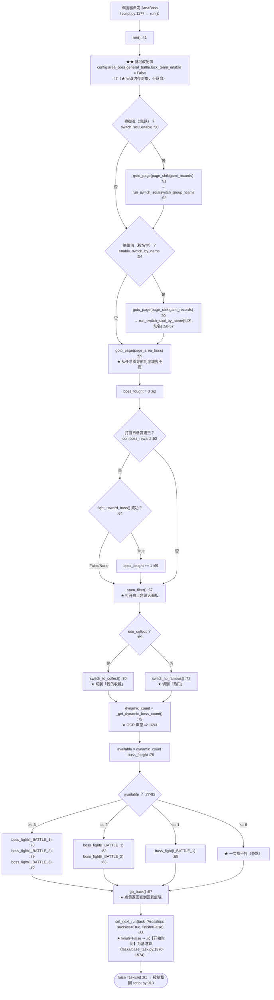
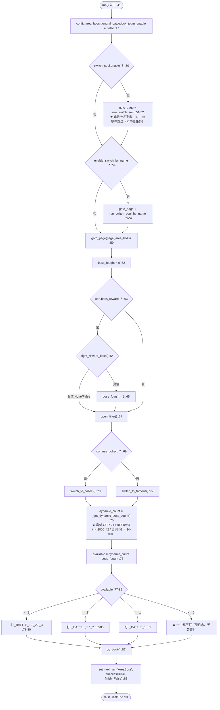
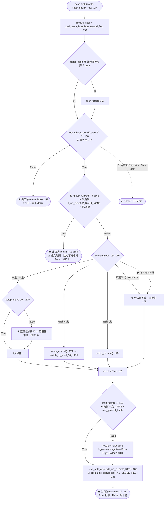
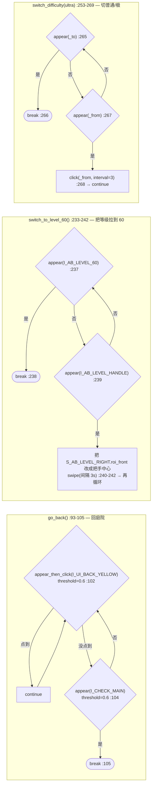
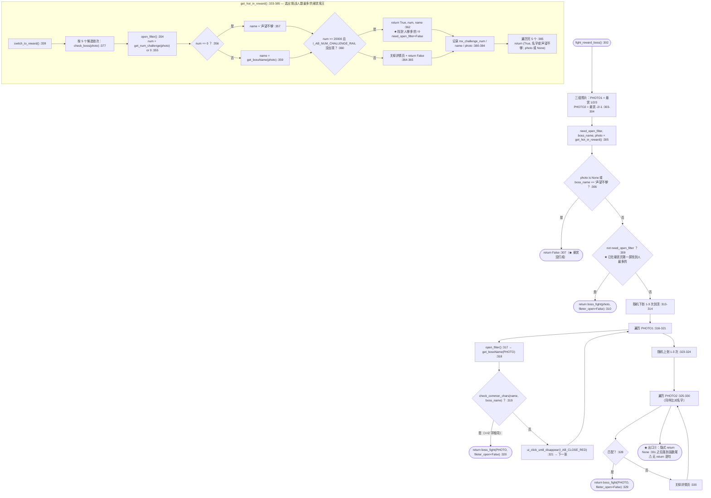
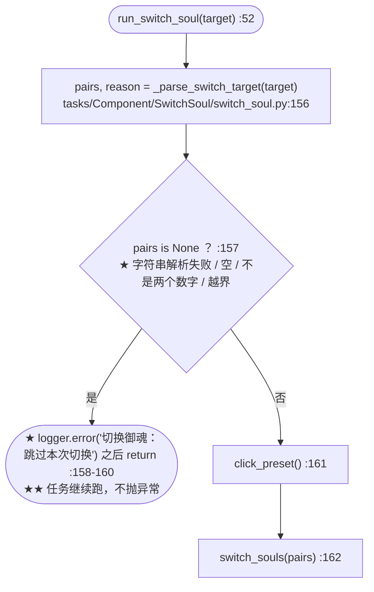

# `AreaBoss`（地域鬼王）流程图

> ★ **代码位置**：`tasks/AreaBoss/script_task.py`（506 行，★ 全部逻辑都在这一个文件里）
> ★ **配置**：`tasks/AreaBoss/config.py`（19 行）· `tasks/AreaBoss/config_boss.py`（26 行）
> ★ **资源**：`tasks/AreaBoss/assets.py`（122 行，素材在 `tasks/AreaBoss/res/`）
> ★ **元数据**：`tasks/AreaBoss/meta.py`（38 行，`Category.TIMED` + 全天 `window`）
> ★ **继承**：`GeneralBattle`（公共战斗循环）· `GameUi`（页面跳转 `goto_page`）·
>   `SwitchSoul`（换御魂）· `AreaBossAssets`（识别素材）
>   ⇒ 见 `tasks/AreaBoss/script_task.py:24`
>
> ⚠ **读法**：★ 这个任务**没有** `RealmRaid` 那种 `while 1` 大循环 ——
>   ★ `run()`（`:41-91`）是**一条直路**：切御魂 → 进地鬼页 → （可选）打悬赏 →
>   开筛选 → 按声望算次数 → 挨个打 → 回庭院 → 上报。
> ★ 所以「二、主循环」读的是**这条直路上的每一个分支**，
>   加上 `boss_fight()`（`:144-187`）这个**被反复调用的子流程**里的分支。
> ★ 每个判断都标了 `文件:行号`；★ 基类里的位置写成 `tasks/base_task.py:123` 这种相对 `backend` 根的路径。

---

## 一、总览：从被派发到收尾

★ **注意三件事**：

1. ★★ **`run()` 里没有任何"次数"判断** ——
   本任务在 `task_catalog` 里 **`countable == False`**（`tests/module/config/test_task_catalog.py:143` 断言），
   ⇒ ★ 界面上**不显示次数输入框**，★ 出厂 `count` 也没有（`meta.py:37` 是 `period=Period.NONE`，不是次数）。
2. ★★ **`run()` 里也没有"时间上限"判断** ——
   `grep time_limit tasks/AreaBoss/` 无匹配 ⇒ ★ 本任务**不读** `BaseTask.time_limit`
   （与 `RealmRaid:137` 不同）。★ 跑多久完全取决于"打几个鬼王"。
3. ★★ **`run()` 里没有 `mark_entry_completed()`** ——
   ★ 本任务**不自报本轮完成**；★ 上报由调度层收尾代劳（见「四、与调度层的接口」）。

---

## 二、主循环（★ 全部决策）

> ⚠ 本任务**没有 `while 1` 主循环**。★ 决策集中在 `run()`（`:41-91`）的**直路分支**
> 与 `boss_fight()`（`:144-187`）—— 后者是本任务**唯一被重复调用的战斗单元**。

### 2.1 `run()` 的直路分支

★ **`available <= 0` 是"静默出口"**（`:77-85` 三个 `if/elif` **都不成立**）：
★ 什么也不打、★ 什么也不记，★ 直接 `go_back()` + `success=True` 收尾。
★ 具体触发：`boss_reward=True` 且悬赏路径真值返回（`boss_fought=1`）
★ **且**声望 < 2000（`dynamic_count=1`）⇒ `available = 1 - 1 = 0` ⇒ ★ 一只都不打。
★ （★ 声望 2000-9999 时是 `2-1=1` ⇒ ★ 仍然会打 1 只 —— 与「声望不够」无关，
见坑 5 关于"这个数不是'今天还剩几次'"的说明。）

### 2.2 `boss_fight()` 的每个出口（★ 语义表）

★ `boss_fight()`（`:144-187`）有 **5 个出口**。
★ ⚠ **两个调用方对待返回值的方式不同**：

* ★ `run()` 的 6 处调用（`:78` / `:79` / `:80` / `:82` / `:83` / `:85`）**全是裸调用** ⇒ ★ 返回值被丢弃。
* ★ `fight_reward_boss()` 的 4 处调用（`:310` / `:320` / `:329`）**都 `return` 出去了**
  ⇒ ★ 出口 ①②③ **在悬赏路径上会被 `:64` 的 `if` 用到**。

| 出口 | 位置 | 返回 | ★ 语义 | `run()` 里 | 悬赏路径里 |
|---|---|---|---|---|---|
| ★ ① | `script_task.py:159` | `False` | **打不开鬼王详情**（点 3 次都没出关闭按钮+挑战按钮）| ★ 丢弃 | ★ **被 `:64` 当假值用** |
| ★ ② | `script_task.py:165` | `True` | **已上榜 ⇒ 跳过这场**（⚠ 但返回值是 `True`）| ★ 丢弃 | ★ **被 `:64` 当真值用**（⇒ 该只看作"已打"，见坑 18）|
| ★ ③ | `script_task.py:187` | `True` / `False` | 正常路径：★ `True` = 打赢，★ `False` = **战斗输了** | ★ 丢弃 | ★ **被 `:64` 用** |
| ★ ④ | `script_task.py:442` | `True` | ★ **不可达**（`while 1` 里前面必然 `return`）| —— | —— |
| ★ ⑤ | ★ **隐式 `None`** | `None` | ★ `fight_reward_boss()` 里所有照片都不匹配（`:331` 落到函数尾）| —— | ★ `None` 为假值 |

★ ★ **关键结论**：★ 本任务**不区分"成功/失败"上报** —— `run()` 永远 `success=True`（`:88`）。
★ 一场都没打赢，★ 调度层仍然记「成功」。★ 这是**设计现状**，不是笔误。

### 2.3 `boss_fight()` 之外的三个循环（★ 也都在主路上）

★ 三个循环**都是"条件满足才 break、否则一直重试"** —— ★ 没有超时上限：
★ 只要界面卡在**别的页面**，★ `go_back()` / `switch_to_level_60()` / `switch_difficulty()`
★ **会一直转到天荒地老**（★ 它们不抛 `GameStuckError`，也不看是否暂停）。
★ 唯一的出路是 `screenshot()` 里的**框架级暂停兜底**（`tasks/base_task.py:968` → `:801`，见「四、接口 4」）。

---

## 三、子过程（被主循环调用）

```mermaid
flowchart LR
    subgraph dyn["_get_dynamic_boss_count() :26-39 — 声望决定打几个"]
        A1["screenshot() :31"] --> A2["O_AB_REPUTATION.ocr_digit() :32<br/>★ 右上角声望 OCR"]
        A2 --> A3{"rep ？"}
        A3 -- ">= 10000" --> A4["3 :35"]
        A3 -- ">= 2000" --> A5["2 :37"]
        A3 -- "其余" --> A6["1 :39"]
    end
    subgraph detail["open_boss_detail(battle, try_num=3) :417-442 — 打开鬼王详情"]
        B1["截图 :430"] --> B2{"I_AB_CLOSE_RED 且 I_FIRE 都在？ :431"}
        B2 -- "是" --> B3["再截一帧 :432 → I_FIRE 消失了？ :433"]
        B3 -- "还在（闪烁）" --> B1
        B3 -- "没了" --> B4["return True :435"]
        B2 -- "否" --> B5{"try_count >= try_num ？ :436"}
        B5 -- "是" --> B6["warning + return False :437-438"]
        B5 -- "否" --> B7{"click(battle) 成功？ :439"}
        B7 -- "是" --> B8["try_count += 1 :440 → 循环"]
        B7 -- "否" --> B1
    end
    subgraph ranked["is_group_ranked() :444-449 — 这个鬼王是不是已有小组排名"]
        C1{"appear(I_AB_GROUP_RANK_NONE) :448"}
        C1 -- "没看到" --> C2["return True = 已上榜 ⇒ 跳过这一只"]
        C1 -- "看到" --> C3["return False = 没上榜 ⇒ 可以打"]
    end
    subgraph fight["start_fight() :189-197 — 点挑战 + 打一场"]
        D1["截图 :191"] --> D2{"appear_then_click(I_FIRE)<br/>interval=1 :192"}
        D2 -- "点到" --> D1
        D2 -- "没点到" --> D3{"I_AB_CLOSE_RED 还在？ :194"}
        D3 -- "还在" --> D1
        D3 -- "没了" --> D4["return run_general_battle(config.area_boss.general_battle) :197"]
    end
    subgraph gb["run_general_battle(config) :197 · :137<br/>★ 公共战斗循环 tasks/Component/GeneralBattle/general_battle.py:41"]
        E1["current_count += 1 :74"] --> E2["battle_before() 换预设/开加成/点准备 :84"]
        E2 --> E3["battle_wait() 等到胜利/失败 :89"]
        E3 --> E4["win ？ :110-113"]
        E4 -- "True" --> E5["★ 返回 True（并且若收到暂停 ⇒ raise TaskPaused :108）"]
        E4 -- "False" --> E6["★ 返回 False"]
    end
    subgraph ultra["setup_ultra() :199-216 / setup_normal() :218-231 — 模式切换"]
        F1["wait_until_appear(I_AB_CLOSE_RED) :201 / :223"] --> F2{"get_difficulty() :203 / :224<br/>= appear(I_AB_DIFFICULTY_JI) :251"}
        F2 -- "已是目标模式" --> F3["return True"]
        F2 -- "不是" --> F4{"appear(另一模式的图标)？ :205 / :226"}
        F4 -- "是" --> F5["switch_difficulty(...) :206 / :227"]
        F4 -- "否" --> F6["warning 'Cannot switch ...' + return False :208-209 / :229-230"]
        F5 --> F7["极模式还要选层：ONE⇒switch_to_floor_1() · TEN⇒switch_to_floor_10() :211-215"]
    end
    subgraph floor["switch_to_floor_1() :271-286 / switch_to_floor_10() :288-300 — 选极地鬼层数"]
        H1["ui_click(C_AB_JI_FLOOR_SELECTED, I_AB_JI_FLOOR_LIST_CHECK) :277 / :293"] --> H2{"目标层图标出现？ :280 / :296"}
        H2 -- "是" --> H3["click(目标层) + 日志 :281-283 / :297-299"]
        H2 -- "否" --> H4["swipe(S_AB_FLOOR_DOWN) + 等 1s :284-286（★ 只有 switch_to_floor_1 会滑）"]
        H4 --> H2
    end
    subgraph ui["页面/筛选/领奖类子过程"]
        I1["open_filter() :451-454<br/>ui_click(I_FILTER → I_AB_FILTER_OPENED)"]
        I2["switch_to_collect() :456-463<br/>等到 I_AB_FILTER_TITLE_COLLECTION"]
        I3["switch_to_famous() :465-472<br/>等到 I_AB_FILTER_TITLE_FAMOUS"]
        I4["switch_to_reward() :474-482<br/>等到 I_AB_FILTER_TITLE_REWARD"]
        I5["check_common_chars(a, b) :484-495<br/>★ 交集 >= 2 个字符就算同名 :492"]
        I6["⚠ boss(battle, collect) :107-142<br/>★ 死代码 —— run() 不调它"]
    end
```

### 3.1 悬赏鬼王路径（★ 本任务最绕的一段）

★ **`get_hot_in_reward()` 的两条语义**（`:385`）：

* ★ 返回 `need_open_filter=False`（`:379`）⇒ ★ 悬赏列表**第一屏**就找到了够 20000 人的，
  ⇒ ★ 调用方**不再打开筛选**，直接 `boss_fight(photo, fileter_open=False)`。
* ★ 否则返回 `need_open_filter=True` + **候选名字/照片** ⇒ ★ 调用方要**开筛选、逐张比对名字**去找它。
  ★ 注意它返回的那个 `photo` 只用来**记日志**（`:384`），★ 真正用哪张照片由 `fight_reward_boss()` 自己重找。

### 3.2 换御魂（★ 只读基类，本任务不改）

★ ★ **出厂默认 `'-1,-1'` 的走法**（★ 用户只勾了「启用」没填组队时）：
`_parse_switch_target` 的**值域校验**在 `switch_soul.py:119`（`1<=组<=7` 且 `1<=队<=4`）
⇒ ★ `-1,-1` **必然**落到 `:120-124` 的 `return None, reason`
⇒ ★ `run_switch_soul` **响亮地 `logger.error` 并要求跳过**（`:158-160`）
⇒ ★ ★ **不会**再进 `switch_soul_one(-1,-1)` 触发 `KeyError: -1`。
★ 这是「[10-14] N9-9」的修复点，★ 注释在 `switch_soul.py:111-124`。

★ **但 `run()` 仍然先 `goto_page(page_shikigami_records)`（`:51` / `:55`）** ——
★ 也就是说**非法配置也会白跑一趟式神录**（★ 校验发生在 `goto_page` **之后**）。
★ 想要"根本不去式神录"，得在 `run()` 里先判。

### 3.3 `run_general_battle()` —— 公共战斗循环（★ 20+ 任务共用）

| 步骤 | 位置 | ★ 说明 |
|---|---|---|
| ★ 准备阶段暂停点 | `general_battle.py:69-71` | ★ `raise_if_paused_outside_battle()` ⇒ 非战斗时收到暂停**立刻中断** |
| ★ 计数 | `general_battle.py:74-82` | ★ `current_count += 1` + `commit_count()`（★ 空操作，`tasks/base_task.py:391-421`）|
| ★ 战前 | `general_battle.py:84` → `:115-164` | ★ 换预设 / 开加成 / 点准备（`timeout=5`）|
| ★ 战中 | `general_battle.py:89` → `:246` | ★ `battle_wait(random_click_swipt_enable)` ⇒ 返回**是否胜利** |
| ★ 战后暂停点 | `general_battle.py:107-108` | ★ 赢了才 `raise_if_paused()`（★ 这是"安全点"）|
| ★ 返回 | `general_battle.py:110-113` | ★ `True`=赢 / `False`=输 |

★ `AreaBoss` 传给它的配置是 `self.config.area_boss.general_battle`（`:137` / `:197`），
★ 而其中 `lock_team_enable` 已在 `:47` 被**强制置 `False`**
⇒ ★ `battle_before()` 的 `if not getattr(config, 'lock_team_enable', False):`（`general_battle.py:140`）
★ **必然进得去** ⇒ ★ 每次都会换预设/开加成/点准备。

---

## 四、与调度层的接口（★ 这四条最容易踩错）

| # | 接口 | 代码 | ★ 说明 |
|---|---|---|---|
| **1** | ★ **次数从哪来** | ★ **没有次数** —— `run()` 不调 `bind_counter()` / `effective_target()`（`grep` 无匹配）| ★ `countable=False`（`task_catalog.py:169-171` + `COUNTABLE_CATEGORIES` 只含 FIXED/TOPPA，`task_catalog.py:97`）⇒ ★ **界面上没有次数框**，★ 打几个由**声望**决定（`script_task.py:34-39`）。★ 测试同样断言 `TC.get('AreaBoss').countable is False`（`tests/module/config/test_task_catalog.py:143`）|
| **2** | ★ **本轮完成怎么上报** | ★ 本任务**不上报** —— 没有 `mark_entry_completed()` 调用 | ★ 由 `script.py:1325-1330` **代劳**：★ 收尾时若 `entry_is_temporary()` 且 `entry_target_reached()`（`config.py:3997`，★ 临时任务**跑完一次即 True**，`config.py:4121-4131`）⇒ ★ 自动 `mark_entry_completed` ⇒ ★ `_skip_by_completed()`（`config.py:3917`）下次剔出 pending |
| **3** | ★ **收尾怎么排下一次** | `set_next_run(task='AreaBoss', success=True, finish=False)` `script_task.py:88` | ★ `finish=False` ⇒ 以 `self.start_time`（`base_task.py:107`）为基准（`base_task.py:1570-1573`）⇒ ★ 走 `config.task_delay()`（`base_task.py:1574` → `config.py:4612`）★ `success=True` 时：★ 全天窗口 ⇒ `next_run_after()` 返回"现在"（`config.py:4254-4257`），★ 随后 `server_update`（默认 09:00）会把它挪到**明天 09:00**（`config.py:4737`），★ 但**临时任务的 `next_run` 最后会被压成"现在"**（`config.py:4812-4818`）|
| **4** | ★ **暂停/切条怎么响应** | ★ 本任务**自己一处都没查** | ★ 靠**框架级兜底**：`screenshot()` → `_pause_check_at_screenshot()`（`tasks/base_task.py:968` → `:801-846`）★ **只在 `PAUSE_BATTLE` 模式下生效**、★ `PAUSE_ROUND` 交给任务自己（★ 而本任务没写）★ ⇒ ★ **「本轮跑完再停」对本任务 ≈ 不生效**；★ `PAUSE_BATTLE` 下会在**任意一次截图后**中断 ⇒ ★ 可能停在筛选/滑动/换御魂的**中途** |

★ **接口 4 的补充**：★ `run_general_battle()` 里也有两处安全点
（`general_battle.py:69-71` 准备前、`:107-108` 战斗后），
★ 但它们**只管战斗** —— ★ 本任务的
`go_back()`（`script_task.py:100-105`）、`switch_to_level_60()`（`:235-242`）、
`switch_difficulty()`（`:263-269`）、`switch_to_floor_1/10()`（`:278-286` / `:294-300`）
★ 里**没有**暂停检查，唯一出口就是 `screenshot()` 的框架级兜底。

★ **接口 1 的补充（★ 一个真实现状）**：
★ `task_catalog` 里 AreaBoss 是 **`Category.TIMED`（定时任务）**（`meta.py:23`），
★ 但它 `meta.period = Period.NONE`（`meta.py:37`）
⇒ ★ 出厂配置下 `Config.task_period('AreaBoss')` 返回 `'none'`
（`config.py:805-819`：**配置优先**、`meta` 只当回填）
⇒ ★ 它**被判为"临时任务"**（`config.py:4117-4121`）
⇒ ★ 于是 `script.py:474` 的 `if _is_temp_task or task.next_run <= now:` **恒真**
⇒ ★ **它不看 `next_run`、按队列顺序跑**。

★ 这一点有仓库内的**明文旁证**：
`tests/module/config/test_entry_target_reached.py:56-57` 写着
`#: 临时任务（period = none）—— 出厂默认就是 none` / `TEMP_TASK = 'AreaBoss'`。

★ **再上一层（"这一条"是谁）**：★ `script.py:407-408`
（`task = self.config.get_next()` → `self.config.task = task`）
把 `self.config.task` 设成 `Config.get_next()` 返回的 `Function`（类的定义在 `config.py:52`，
★ 它**没有** `period` 属性、也没有 `current_count`）
⇒ ★ `mark_entry_completed()` 与 `entry_target_reached()` 必须绕道
`self.config.model` / `build_run_list()` 才能拿到 `period` 与 `entry_id`
（★ 见 `config.py:4117-4121` 读 `sch.period`）。

---

## 五、已知坑（★ 改这个任务前必读）

| # | 坑 | 位置 |
|---|---|---|
| **1** | ★★ **`run()` 里**没有**任何"次数/时间上限"** —— 既没 `bind_counter()` 也没读 `time_limit`。★ 若将来要给它加次数，★ **不能只加 `scheduler.target`**：还要看 `countable`（现在 `False`）与 `_skip_by_completed` 的交互 | `script_task.py:41-91` · `task_catalog.py:169-171` |
| **2** | ★★ **`success=True` 是硬编码的** —— 一只鬼王都没打赢、甚至一只没打，★ 收尾仍然上报成功 | `script_task.py:88` |
| **3** | ★★ **`setup_ultra()` / `setup_normal()` 的 `False` 返回值被丢弃** —— `:170` 的 `if self.setup_ultra(reward_floor): pass` 是**空操作** ⇒ ★ 切模式失败（"Cannot switch difficulty"）后**照旧开打** ⇒ ★ 可能在**错误的模式/层数**上战斗 | `script_task.py:170-171` · `:208-209` · `:229-230` |
| **4** | ★★ **模式是"粘"的** —— `boss_fight()` 每次都用同一份 `reward_floor` 决定模式（`:168-179`），★ 而**极/普通模式是游戏里的持久状态**（`switch_difficulty` 改的是账号设置）⇒ ★ 打悬赏时切到"极·十星"，★ 后面打热门 3 只**也是在极·十星上打** | `script_task.py:168-179` · `:253-269` |
| **5** | ★★ **`_get_dynamic_boss_count()` 的语义与名字不符** —— docstring 写"动态决定**可挑战次数**"（`:26-30`），★ 实际返回的是**按声望分档的总数 1/2/3**，★ 与"今天还剩几次"无关 ⇒ ★ `available = dynamic_count - boss_fought` 只减了**悬赏那 1 只**，★ 减不掉"今天已经打过的" | `script_task.py:26-39` · `:75-76` |
| **6** | ★★ **已上榜的鬼王"跳过"却 `return True`** —— `boss_fight()` 里 `is_group_ranked()` 为真时（`:162-165`）★ 没打任何一场，★ 返回值却是 `True`；★ 与 `:159` 的 `False`、`:187` 的 `True/False` **混在同一个返回通道里** | `script_task.py:162-165` |
| **7** | ★ **`fight_reward_boss()` 可能返回 `None`** —— 两个 `for` 循环都走完也没匹配时，★ 函数**没有 `return` 语句**，★ 落到 `:331` 之后隐式返回 `None` ⇒ ★ 调用方 `:64` 的 `if` 把它当假值（**行为正确**，★ 但语义不清） | `script_task.py:302-331` |
| **8** | ★ **`boss()`（`:107-142`）是死代码** —— `run()` **从不调用它**。★ 里面有第二份"点挑战 + 打一场"的实现（★ 与 `start_fight()` **重复**），★ 且失败日志写死成"地域鬼王**第2只**战斗失败"（`:138`） | `script_task.py:107-142` |
| **9** | ★ **参数名拼写 `fileter_open`**（不是 `filter`）—— ★ 且 `boss()` 的 `collect` 参数也没人传 | `script_task.py:144` · `:107` |
| **10** | ★★ **`check_common_chars()` 用"交集 ≥ 2 个字符"判同名** —— ★ 中文名短的（2-3 字）极易误判；★ `common_chars >= 2` 对 `"鬼王"` vs `"鬼王X"` 一律成立 | `script_task.py:484-495`（`:492`） |
| **11** | ★ **`get_bossName()` 失败时 `return 0`** —— `0` 会被 `str(0)` 变成 `"0"`（`:319` / `:328` 都套了 `str(...)`），★ 于是"读不到名字"和"名字叫 0"不可区分 | `script_task.py:401-415`（`:412`） |
| **12** | ★ **`get_num_challenge()` 把"打不开详情"记成 0** —— `:398` `return 0` ⇒ ★ 被判成 `'声望不够'`（`:356-357`），★ 于是**网络/识别问题被伪装成"声望不够"** | `script_task.py:387-399` |
| **13** | ★ **`go_back()` / `switch_to_level_60()` / `switch_difficulty()` 都没有超时上限** —— ★ 卡在非预期页面会**一直转**；★ 唯一的断点是 `screenshot()` 的框架级暂停检查（★ 只在 `PAUSE_BATTLE` 下生效） | `script_task.py:100-105` · `:235-242` · `:263-269` |
| **14** | ★ **`go_back()` 的 break 条件写的是"回到庭院"**（`I_CHECK_MAIN`，`GameUi/assets.py:111`），★ 不是"回到地鬼页" ⇒ ★ 若地鬼页没有黄返回按钮，★ 会一直点/一直等 | `script_task.py:104` |
| **15** | ★ **`run()` 就地改配置对象** —— `config.area_boss.general_battle.lock_team_enable = False`（`:47`）★ 改的是**内存里的模型**，★ 同一进程后续任何 `save()` 都可能把它落盘 ⇒ ★ 用户在界面上勾的"锁定阵容"会被悄悄改掉 | `script_task.py:47` |
| **16** | ★ **换御魂非法配置会白跑一趟式神录** —— `goto_page(page_shikigami_records)`（`:51` / `:55`）**在校验之前**，★ 出厂默认 `'-1,-1'` 也照样进式神录 | `script_task.py:50-57` · `switch_soul.py:156-160` |
| **17** | ★★ **`period = Period.NONE`（`meta.py:37`）与 `Category.TIMED`（`meta.py:23`）不一致** —— ★ 前端把它归到"Daily Task"菜单（`module/config/config_menu.py:24`），★ 但 `task_period()` 读配置、出厂回落 `meta.period` = `'none'` ⇒ ★ 标签上是"**临时任务**"，★ 于是 `_skip_by_completed` 会对它生效（★ 一轮跑完要等下一轮队列循环或重启后端才能再跑） | `tasks/AreaBoss/meta.py:23` · `:37` · `module/config/config.py:805-819` · `:4121-4131` |
| **18** | ★ **`boss_fought` 只在"悬赏打赢"时 +1** —— ★ `fight_reward_boss()` 返回 `True` 有两种来源（★ 打赢、★ 已上榜跳过，见坑 6），★ 两者都算"已挑战" | `script_task.py:63-65` |

---

## ★ 相关文档

* ★ **样板**：[RealmRaid.md](RealmRaid.md) —— ★ 有真正的 `while 1` 主循环（本任务没有）
* ★ **调度层**：`docs/scheduler-architecture.md`
* ★ **本轮状态机制**：`docs/DESIGN-SPEC.md` §1.6.x（`session_start` 时间戳判定）
* ★ **换御魂**：`docs/DESIGN-SPEC.md` §1.5.y（非法配置"响亮地跳过"）
* ★ **完成语义**：`docs/DESIGN-SPEC.md` §1.5（C1~C5）
* ★ **公共战斗循环**：`tasks/Component/GeneralBattle/general_battle.py`（`run_general_battle` :41）
* ★ **页面跳转**：`tasks/GameUi/navigator.py`（`goto_page` :768）
