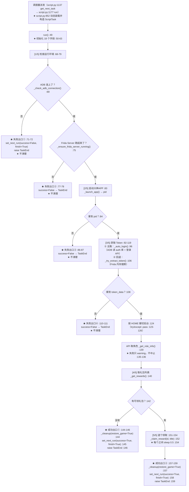
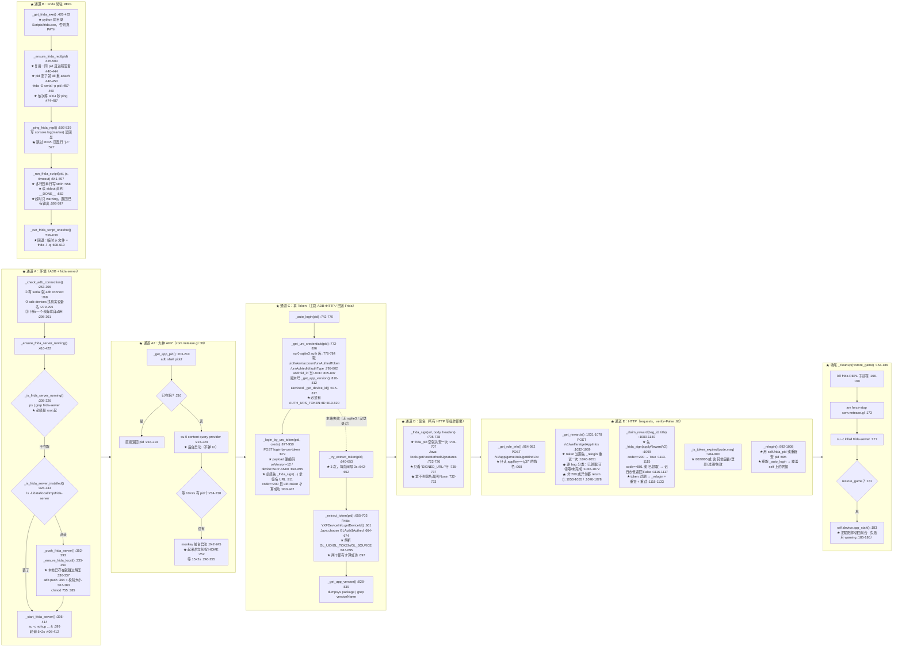

# `AutoCheckinBigGod`（大神签到）流程图

> ★ **代码位置**：`tasks/AutoCheckinBigGod/script_task.py`（1147 行）
> ★ **配置**：`tasks/AutoCheckinBigGod/config.py`（18 行）· **资源**：`tasks/AutoCheckinBigGod/assets.py`（12 行，★ **空壳**）
> ★ **自描述**：`tasks/AutoCheckinBigGod/meta.py`（26 行）
> ★ **继承**：`ScriptTask(BaseTask)`（`tasks/AutoCheckinBigGod/script_task.py:47`）——
>   ★ 只继承 `BaseTask`（`tasks/base_task.py:37`），**没有** `GameUi`、**没有** `GeneralBattle`、**没有** `SwitchSoul`。
>
> ★★ **读法（★ 三句话先纠正预期）**：
>
> 1. ★ **它不是"游戏 UI 流程"** —— 它**不点游戏界面、不做素材识别**
>    （`assets.py:10-11` 的空类 + 全文 0 处 `appear()` / `screenshot()` / `click()`）。
>    ★ 它的真实形态是：**ADB 起环境 → Frida 注入拿 token / 做签名 → HTTP 直接领奖**。
> 2. ★ **它没有战斗**，所以**没有 `bind_counter()` / 没有 `current_count` 计数**（见「四、」——
>    ★ 这正是"本轮完成怎么上报"的答案所在）。
> 3. ★ **它的"主循环"其实不是循环** —— `run()`（:49-159）是一条**线性 5 段流水线**，
>    ★ 全部决策就是那 6 个出口（2 成功 + 4 失败）。★ 读「二、」时不要去找 `while 1`。
>
> ⚠ **本文所有行号都是读过文件后确认的**；★ 没能确认的地方写「未确认」，不猜。
> ⚠ **基类/调度层的行号写成相对 `backend/` 根的路径**（如 `tasks/base_task.py:686`、
>   `module/config/config.py:2058`），★ 方便直接跳转。

---

## 一、总览：从被调度器派发到收尾



★ **一句话概括主干**：**起环境（ADB + frida-server）→ 起 App → 拿 token（ADB/HTTP 主路 + Frida 回退）
→ 用 Frida 给 HTTP 请求签名 → 用 HTTP 领礼包 → 清理（关 App / 杀 frida-server / 把阴阳师切回前台）**。

★ **出口只有 6 个**（★ 全部在 `run()` 里，没有别的地方能结束本任务）：

| # | 出口 | 行号 | `success` | 会 `_cleanup()` 吗 | 语义 |
|---|---|---|---|---|---|
| ★① | ADB 没连上 | `script_task.py:71-72` | `False` | ★ **不会** | 环境不可用（模拟器没起 / serial 错）|
| ★② | Frida Server 起不来 | `script_task.py:77-78` | `False` | ★ **不会** | 环境不可用（没 Root / 推送失败）|
| ★③ | 大神 APP 起不来 | `script_task.py:86-87` | `False` | ★ **不会** | 环境不可用（没装 App / 包名不对）|
| ★④ | 拿不到 Token | `script_task.py:110-111` | `False` | ★ **不会** | 凭据失败（没登录过 / 没绑角色 / Frida 挂了）|
| ★⑤ | **没有可领礼包** | `script_task.py:142-146` | ★ **`True`** | ✔（`restore_game=True`）| ★ **正常结束**（今天领过了 / 没活动）|
| ★⑥ | **领完礼包** | `script_task.py:157-159` | ★ **`True`** | ✔（`restore_game=True`）| ★ **正常结束**（唯一的"真干活"路径）|

★ **注意 `raise TaskEnd(...)` 的语义**：`script.py:913-914` 捕获 `TaskEnd` 后**直接 `return True`**
（算成功）⇒ ★ 出口 ⑤/⑥ 的 `success=True` 与 `TaskEnd` **不冲突**，
★ 而出口 ①~④ 是先 `set_next_run(success=False)`、再 `raise TaskEnd`，
★ 于是调度层的 `_task_failed` 是 `False`（`script.py:1176/1180`）——
★ **`success=False` 只体现在 `next_run` 的**失败间隔**上**（见「四、」）。

---

## 二、主流程（★ 全部决策都在这里）

★ **它不是 `while 1` 循环**：`run()`（`script_task.py:49-159`）**从头走到尾只走一遍**，
★ 没有 `raise_if_paused()`，也**没有任何重试循环** ⇒ ★ **本文的"主循环"= 这条线性流水线的全部分支**。

```mermaid
flowchart TD
    S(["run() 入口 :49"]) --> INI["18 个字段初始化 :50-63<br/>★ gl_uid/gl_token/gl_deviceid/gl_version<br/>role_id/server/app_key/frida_pid<br/>_frida_session=None :59<br/>_frida_attached_pid=None :60<br/>session=requests.Session(); verify=False :62-63"]
    INI --> L1["logger.hr('AutoCheckinBigGod') :65"]
    L1 --> D1{"_check_adb_connection() :69"}
    D1 -- "False" --> X1["error :70 + set_next_run(False,finish=True) :71<br/>raise TaskEnd :72"]
    D1 -- "True" --> D2{"_ensure_frida_server_running() :75"}
    D2 -- "False" --> X2["error :76 + set_next_run(False) :77 + TaskEnd :78"]
    D2 -- "True" --> LA["_launch_app() :83"]
    LA --> D3{"if not pid :84"}
    D3 -- "真" --> X3["error :85 + set_next_run(False) :86 + TaskEnd :87"]
    D3 -- "假" --> PIDF["self.frida_pid = pid :88"]
    PIDF --> AL["_auto_login(pid) :96<br/>→ new_pid, login_token"]
    AL --> D4{"if new_pid :97"}
    D4 -- "真" --> PID2["pid=new_pid :98; frida_pid=pid :99"]
    D4 -- "假" --> D5
    PID2 --> D5{"if login_token :100"}
    D5 -- "真" --> TD["token_data = login_token :101"]
    D5 -- "假" --> D6
    TD --> D6{"if not token_data :104"}
    D6 -- "★ 真（主路失败）" --> EX["warning :105<br/>token_data = _try_extract_token(pid) :106<br/>★ 内部最多 3 次尝试 :642-652"]
    D6 -- "假" --> D7
    EX --> D7{"if not token_data :108"}
    D7 -- "真" --> X4["error :109 + set_next_run(False) :110 + TaskEnd :111"]
    D7 -- "假" --> ASS["落库到 self :113-116<br/>GL_UID/GL_TOKEN/GL_DEVICEID/GL_SOURCE"]
    ASS --> VER{"if token_data['GL_VERSION'] :117"}
    VER -- "真" --> VER2["self.gl_version = ... :118"]
    VER -- "假" --> HOME
    VER2 --> HOME["ADB KEYCODE_HOME :124<br/>★ 大神APP 切后台，减少干扰<br/>★ 整段包在 try/except: pass :123-126"]
    HOME --> ROL["_get_role_info() :130<br/>POST gameRole/getBindList"]
    ROL --> RD{"if role_info :131"}
    RD -- "真" --> RS["role_id / server :132-133"]
    RD -- "假" --> RW["warning :136<br/>★ 不中止：role_id/server 留空"]
    RS --> GR
    RW --> GR["_get_rewards() :140"]
    GR --> GD{"if not rewards :142"}
    GD -- "★ 真" --> OK1["'没有可领取的礼包' :143<br/>_cleanup(restore_game=True) :144<br/>set_next_run(True, finish=True) :145<br/>raise TaskEnd :146"]
    GD -- "假" --> LOOP["for r in rewards :151<br/>if self._claim_reward(r['id'], r['title']) :152<br/>→ success_count += 1 :153<br/>time.sleep(0.5) :154<br/>★ 无重试、无 break"]
    LOOP --> OK2["logger.info 完成 x/y :156<br/>_cleanup(restore_game=True) :157<br/>set_next_run(True, finish=True) :158<br/>raise TaskEnd :159"]
```



### ★ 出口语义表（★ 每个出口的"成功/失败/正常结束"）

| 出口 | 条件（行号）| `success` | 清理 / 回前台 | 调度层看到什么 |
|---|---|---|---|---|
| ★ **失败①** | `_check_adb_connection()` 为假 `:69` | `False` `:71` | ❌ **都没做** | `success=False` ⇒ `next_run = 开始 + retry_interval`（`module/config/config.py:4696-4699`）；★ **不写**周期完成记忆 |
| ★ **失败②** | `_ensure_frida_server_running()` 为假 `:75` | `False` `:77` | ❌ **都没做** | 同上 |
| ★ **失败③** | `_launch_app()` 返回空 `:84` | `False` `:86` | ❌ **都没做** | 同上 |
| ★ **失败④** | 两条 token 路都失败 `:108` | `False` `:110` | ❌ **都没做** | 同上 |
| ★ **正常结束⑤** | `rewards` 为空 `:142` | ★ `True` `:145` | ✔ 关闭大神 APP + 杀 frida-server + `device.app_start()` 回阴阳师 `:144→:163-186` | ★ `success=True` ⇒ 走**窗口排期** + **写本周期完成记忆**（`module/config/config.py:4702-4707`）|
| ★ **正常结束⑥** | 领完（**无论领到几个**）`:157-159` | ★ `True` `:158` | ✔ 同上 | ★ 同上 |

★ **出口⑤ 与 ⑥ 在调度层眼里完全一样** —— ★ 都是"**本周期成功跑完一次**"。
★ 这正是本任务**没有战斗计数**时的"完成"定义（★ 详见「四、」）。

### ★ 判断清单（★ 逐个带行号，便于核对）

| # | 判断 | 行号 | 为真时做什么 | ★ 备注（坑/事实）|
|---|---|---|---|---|
| 1 | ADB 连接检查 | `:69` | `:70-72` 失败退出 | ★ 用的是**游戏那台**设备的 `serial`（`:265`）|
| 2 | Frida Server 就绪 | `:75` | `:76-78` 失败退出 | ★ 内部三段：已在跑 / 没装就推 / 再启动（`:416-422`）|
| 3 | 大神 APP 已起 | `:84` | `:85-87` 失败退出 | ★ 已在跑则**不重启**（`:216-219`）|
| 4 | 自动登录拿到新 pid | `:97` | `:98-99` 更新 pid | ★ 拿到就顺带刷新 `frida_pid` |
| 5 | 自动登录拿到 token | `:100` | `:101` 采用 | ★ 主路是 **ADB + HTTP**，不是 Frida |
| 6 | 主路没 token | `:104` | `:105-106` 回退 Frida | ★ 回退路**最多试 3 次**（`:642-652`）|
| 7 | 两条路都没 token | `:108` | `:109-111` 失败退出 | ★ 提示"请确保已登录大神APP并绑定阴阳师角色" |
| 8 | Token 里带 APP 版本 | `:117` | `:118` 覆盖 `gl_version` | ★ 默认值是硬编码 `4.12.0`（`:42`）|
| 9 | 角色信息拿到了 | `:131` | `:132-134` 落 `role_id/server` | ★ **拿不到也继续跑**（`:135-136`）⇒ 见「五、坑 3」|
| 10 | 礼包列表为空 | `:142` | `:143-146` **成功**结束 | ★ **"没有奖励"与"API 报错"在这里不可分辨**（`:1055` / `:1078` 都返回 `[]`）|
| 11 | 单个礼包领取成功 | `:152` | `:153` 只把 `success_count` +1 | ★ **失败不中止、不重试**，最终仍走出口⑥ |

---

## 三、子过程（被 `run()` 调用的函数）

★ **本任务 0 处素材识别 / 0 处页面跳转** —— ★ 所以这一段**没有**"识别 / 点击 / 跳页"这类子过程，
★ 取而代之的是**三条通道**：**ADB 通道**、**Frida 通道**、**HTTP 通道**。



### ★ 子过程一览（一行一个，带行号）

| 类别 | 函数 | 行号 | 一句话 |
|---|---|---|---|
| ADB 原语 | `_adb_cmd` / `_adb_shell` | `:190-198` / `:200-201` | ★ 统一走外部包给的 `ADB_PATH`（`:24`），带 `-s` 指定设备 |
| ADB 环境 | `_check_adb_connection` | `:263-306` | ★ 会把 `192.168.1.66` 补成 `adb devices` 里的真名（`:288-295`）|
| ADB 环境 | `_get_app_pid` / `_launch_app` | `:203-210` / `:212-259` | ★ 已在跑就不重启；后台起不来才 monkey + HOME |
| Frida | `_is_frida_server_running` / `_is_frida_server_installed` | `:308-326` / `:328-333` | ★ 非 root 运行会被 kill 掉重来（`:318-323`）|
| Frida | `_ensure_frida_local` / `_push_frida_server` | `:335-350` / `:352-393` | ★ 本地文件存在即**跳过解压**；推送后**校验大小** |
| Frida | `_start_frida_server` / `_ensure_frida_server_running` | `:395-414` / `:416-422` | ★ `su -c "nohup ... &"`，轮询 5×2s |
| Frida | `_get_frida_exe` | `:426-433` | ★ 先找 `<python>/Scripts/frida.exe`，找不到靠 PATH |
| Frida | `_ensure_frida_repl` / `_ping_frida_repl` | `:435-500` / `:502-539` | ★ 常驻 REPL（首次 3~5 秒，之后毫秒级）；用唯一 marker 判就绪 |
| Frida | `_run_frida_script` / `_run_frida_script_oneshot` | `:541-597` / `:599-638` | ★ 以 `__DONE__` 为结束标记；REPL 不可用就回退单次执行 |
| Token | `_auto_login` | `:742-770` | ★ 主路 = 读库 + 登录 API |
| Token | `_get_urs_credentials` | `:772-826` | ★ 需 **Root + 设备内有 sqlite3**（`:779`）|
| Token | `_get_app_version` / `_get_device_id` | `:828-839` / `:841-875` | ★ 版本走 `dumpsys`；DeviceId 走 Frida，失败退 `android_id`（`:867-871`）|
| Token | `_login_by_urs_token` | `:877-950` | ★ 必须**先签名再发**；`clientType=50`（`:43/890`）|
| Token | `_try_extract_token` / `_extract_token` | `:640-653` / `:655-703` | ★ Frida 内存搜索 `GLAuth$Authed` |
| 签名 | `_frida_sign` | `:705-738` | ★ 所有"写"接口都要签名 URL（登录 / 领奖）|
| HTTP | `_build_headers` / `_generate_nonce` | `:1013-1029` / `:1010-1011` | ★ 头里带 `gl-token` / `gl-deviceid` / `gl-nonce` |
| HTTP | `_is_token_expired` / `_relogin` | `:984-990` / `:992-1008` | ★ 过期**自动重登并重试一次** |
| HTTP | `_get_role_info` | `:954-982` | ★ `appKey` 必须是 `g37`（`:41/968`）|
| HTTP | `_get_rewards` | `:1031-1078` | ★ 只挑 `completed==True` 且 `hasApplay==False` 的袋子（`:1063-1070`）|
| HTTP | `_claim_reward` | `:1080-1140` | ★ 逐个领，成功 `True`，其余一律 `False` |
| 收尾 | `_cleanup` | `:163-186` | ★ 关 App + 杀 frida-server + （可选）回阴阳师前台 |

---

## 四、与调度层的接口（★ 四条，本任务与 RealmRaid 差别最大）

```mermaid
flowchart TD
    Q1["① 次数从哪来？<br/>★ 答：**没有次数概念**<br/>meta.py:21 category=TIMED<br/>task_catalog_data.json:47 category=timed / count_field=null :48<br/>⇒ TaskMeta.countable=False<br/>⇒ effective_target() 返回 None<br/>⇒ 本任务**不调** bind_counter()<br/>⇒ current_count 恒为 0（tasks/base_task.py:116）"]
    Q1 --> Q2["② 本轮完成怎么上报？<br/>★ 答：**不调 mark_entry_completed**<br/>靠 set_next_run(success=True) :145/:158<br/>→ tasks/base_task.py:1559-1574<br/>→ Config.task_delay :4612<br/>→ 成功分支 :4679-4692 走窗口排期<br/>→ _record_task_success :4702-4707<br/>→ task_state.record_success :189<br/>⇒ 写 period_key（daily）"]
    Q2 --> Q3["③ 会不会被反复派发？<br/>★ 答：**同一个游戏日内不会**<br/>下一轮 update_scheduler 里<br/>_skip_by_period（module/config/config.py:2058 / 3750-3803）<br/>读 is_completed_in_period → 真<br/>⇒ 条目进 waiting，next_run 推到下个周期起点（:3794）<br/>★ 跨周期（次日 00:00，reset_at=00:00）自动可再跑"]
    Q3 --> Q4["④ 收尾怎么排下一次？<br/>set_next_run(task, success, finish=True)<br/>＝ 以**任务结束时刻**为基准 :1570-1571<br/>→ task_delay 里 next_run 计算完成<br/>★ 本任务**没有显式窗口**（meta.py 无 window）<br/>⇒ windows_effective 由 period=daily 推导<br/>⇒ 全天窗口 is_unrestricted ⇒ next_run_after 返回 now（:4262-4277）<br/>★ 真正的"下次什么时候跑"由 _skip_by_period 决定"]
    Q4 --> Q5["⑤ 暂停 / 切条怎么响应？<br/>★ 答：**任务内部没有任何安全点**<br/>0 处 raise_if_paused（tasks/base_task.py:686）<br/>0 处 should_stop_battle_loop（:518）<br/>0 处 screenshot（:949）⇒ 框架级兜底 :801/968 也不触发<br/>⇒ 只能等它整段跑完后<br/>script.py:1409 _handle_run_control() 生效"]
```

### ★ 逐条说明

| # | 接口 | 代码位置 | 说明 |
|---|---|---|---|
| **1** | ★ **次数从哪来** | `tasks/AutoCheckinBigGod/meta.py:21-24` · `module/config/task_catalog_data.json:47-51` · `tasks/base_task.py:137-240` | ★ **没有次数**：`count_field=null` / `count_default=null` ⇒ `TaskMeta.countable=False`（`module/config/task_catalog.py:168-171`，只有 `FIXED`/`TOPPA` 可计数 `task_catalog.py:97`）⇒ `BaseTask.effective_target()` 在 `tasks/base_task.py:171-173` 直接返回 `None`。★ 本任务**全文 0 处** `bind_counter()` / `commit_count()` / `current_count` ⇒ ★ `current_count` 保持 `BaseTask.__init__` 的 0（`tasks/base_task.py:116`）|
| **2** | ★★ **本轮完成怎么上报** | `script_task.py:145` / `:158` → `tasks/base_task.py:1559` → `module/config/config.py:4612` / `:4702-4707` → `module/config/task_state.py:189` | ★ **它不调 `mark_entry_completed()`**（那是 RealmRaid 的做法）。★ 它的"完成"是**间接**产生的：`set_next_run(..., success=True)` ⇒ `task_delay` 的**成功分支**在 `module/config/config.py:4702-4707` 调 `_record_task_success` ⇒ `task_state.record_success`（`:189-216`）写入 `period_key`（daily）⇒ ★ 下一轮调度就认得"今天做过了"|
| **3** | ★★ **会不会被反复派发** | `module/config/config.py:2058-2062` / `:3750-3803` | ★ **不会（同日）**：`period=daily`（`config/template.json:187`）⇒ 门② `_skip_by_period` 命中 ⇒ 条目移入 `waiting_task`，并把 `next_run` 推到**下个周期起点**（`module/config/config.py:3794-3796`，`period_start` 见 `module/config/task_state.py:110-138`，`reset_at=00:00`）。★ 次日再跑 —— 这正是"周期任务"的语义。⚠ **若用户把 `period` 改成 `none`（临时任务）**，门② 失效，改由 `script.py:1326-1330` 的 `entry_is_temporary + entry_target_reached` 打 `completed` 标记（`entry_target_reached` 对临时任务**无条件 True**，`module/config/config.py:4121-4131`），再由 `_skip_by_completed`（`module/config/config.py:2141` / `:3917-3971`）剔出 pending —— ★ 两条路都能防"反复派发"，但**机制完全不同** |
| **4** | ★ **收尾怎么排下一次** | `script_task.py:145` / `:158` · `tasks/base_task.py:1559-1574` | ★ `finish=True` ⇒ 以**当前时刻**（而非任务开始时刻）为基准（`tasks/base_task.py:1570-1571`）。★ 本任务**没有显式窗口**（`meta.py` 没写 `window`）⇒ `windows_effective` 回退到"按周期推导"（`module/config/task_catalog.py:430-459` + `module/config/availability.py:350-355` = 每天 00:00-23:59 全周）⇒ `next_run_after` 里该窗口 `is_unrestricted` 被跳过（`module/config/config.py:4262-4263`）⇒ 返回 `now`。★ 所以**"什么时候再跑"实际是靠周期完成记忆**（第 3 条），不是靠窗口 |
| **5** | ★★ **暂停/切条怎么响应** | `tasks/base_task.py:686` / `:518` / `:949` / `:968` · `script.py:1409-1420` | ★★ **本任务不可中断**：它全程不调 `screenshot()`，所以框架级兜底 `_pause_check_at_screenshot()`（`tasks/base_task.py:801-846`，在 `:968` 被调用）**永远不会执行**；也不调 `raise_if_paused()` / `should_stop_battle_loop()`。★ 「暂停调度」与「播放头切到别条」（`tasks/base_task.py:548-595`）都只能**等这一整段跑完**，由 `script.py:1409` 的 `_handle_run_control()` 在安全点生效（`script.py:1422-1456`）。★ 好消息：本任务**不碰游戏界面**，中途被外部 kill 的代价比战斗任务小（但 frida-server 会残留，见「五、」）|

★ **另有一条与调度层有关的事实**：★ 本任务的失败（出口 ①~④）**不写周期完成记忆** ⇒
★ 若同一天内反复失败，会按 `retry_interval`（出厂 `01 00:00:00`，`config/template.json:183`）
重试；连续失败达阈值后由 `failure_state` 给冷却（`script.py:1370-1397`）。

---

## 五、已知坑（★ 改这个任务前必读）

| # | 坑 | 位置 | 说明 |
|---|---|---|---|
| **1** | ★★ **强外部依赖：包没装就 ImportError** | `script_task.py:23-29` | ★ `from oas_checkin_biggod import FRIDA_SERVER_XZ, ADB_PATH` 在**模块导入期**执行 ⇒ ★ 包没装时 `load_module`（`script.py:851`）直接抛 `ImportError`，被 `script.py:966-974` 的兜底捕获 ⇒ 任务记为**失败**（`_task_failed=True`）且**不会**走到任何 `set_next_run`。★ 依赖清单：`requirements-in.txt:60` / `requirements.txt:47`（`oas-checkin-biggod==0.0.1`）|
| **2** | ★★ **Frida 版本必须两端匹配** | `script_task.py:38` / `:335-350` / `:426-433` | ★ 本地文件名**硬编码** `frida-server-17.6.2-android-x86_64`（`:38`），而 `frida.exe` 取自**当前 Python 环境**（`:426-433`）⇒ ★ 两端版本不一致时 attach/`Java.perform` 会失败。⚠ 且 `_ensure_frida_local` **只要本地文件存在就跳过解压**（`:336-337`）⇒ ★ 外部包升级了 `FRIDA_SERVER_XZ` 也**不会**重新解压（★ 这条是**代码事实**；运行时是否真会踩到未验证）|
| **3** | ★★ **"没有奖励"与"接口报错"不可分辨，都算成功** | `script_task.py:1053-1055` / `:1076-1078` → `:142-146` | ★ `_get_rewards()` 对"HTTP 异常""code!=200"和"真的没有可领袋子"**一律返回 `[]`** ⇒ ★ 调用方把它当成"**没有可领取的礼包**"并以 `success=True` 结束并写周期完成记忆 ⇒ ★ 当天**不会再自动重试**（要等次日或用户手动跑）。★ 同理 `_get_role_info()` 失败（`:135-136`）后 `roleId/server` 为空，也会让 `_get_rewards` 拿不到数据而"成功结束"|
| **4** | ★★ **4 个失败出口都不做清理 / 不回前台** | `:71-72` / `:77-78` / `:86-87` / `:110-111` | ★ 只有两个**成功**出口调 `_cleanup(restore_game=True)`（`:144` / `:157`）。★ 失败时：`frida.exe` 子进程可能残留（`:166-169` 只在 `_cleanup` 里 kill）、大神 APP 可能留在前台、**阴阳师没有 `device.app_start()` 回前台** ⇒ ★ 后面依赖截图的战斗任务可能因此起手就错乱。★ 修复思路：把清理放进 `try/finally`（★ 本文只描述现状，不改代码）|
| **5** | ★★ **任务内部没有任何暂停安全点** | `tasks/base_task.py:686` / `:968` | ★ 0 处 `raise_if_paused()` / `should_stop_battle_loop()` / `screenshot()` ⇒ ★ 点「暂停调度」时这个任务**会一直跑到自己结束**。★ 参考：框架级兜底是**挂在 `screenshot()` 上**的（`tasks/base_task.py:949-968`），而它一次都不截图 |
| **6** | ★ **"本轮完成"不靠 `mark_entry_completed()`，靠周期记忆** | `:145` / `:158` → `module/config/config.py:4702-4707` | ★ 所以**"周期"字段是它的生命线**：★ 用户把 `period` 改成 `none`（临时任务）后，行为**整条换轨**（见「四、」第 3 条的 ⚠）。★ 改这个任务时**先确认 `scheduler.period` 是什么**（出厂 `daily`，`config/template.json:187`）|
| **7** | ★ **Frida 读取超时后线程不回收，可能串台词** | `:541-597`（尤其 `:593-597`）| ★ 超时分支只 `timed_out.set()` + warning，**reader 线程仍在 `readline()` 上阻塞**（daemon，未 join）⇒ ★ 下一次 `_run_frida_script` 会**再起一个 reader** 读同一 stdout ⇒ ★ 可能读到**上一次调用的残留输出**（进而误判签名/Token）。⚠ 这是**读代码得到的怀疑**，★ 未在运行中复现确认 |
| **8** | ★ **登录 payload 里硬编码机型/系统** | `:877-899`（`osVersion":"12"` :894、`device":"SDY-AN00"` :895、`os":"android"` :892、`clientType` :890）| ★ 服务端若做风控/校验，这里是最脆弱的一环。★ 另有硬编码：`APP_KEY="g37"`（`:41`）、`GL_CLIENTTYPE="50"`（`:43`）、`GL_VERSION="4.12.0"` 默认值（`:42`）、`GL_PACKAGE="com.netease.gl"`（`:36`）、`frida-server` 远端路径（`:39`）|
| **9** | ★ **Token 过期有自动重登，但只在两处** | `:1046-1051`（取礼包）/ `:1118-1133`（领奖）| ★ 判据是 `_is_token_expired`（`:984-990`：`802/805` 或文案含「其他设备/登录/过期/失效」）⇒ ★ 若服务端换了错误码或文案，自动重登**静默失效**，表现成"取不到礼包 → 成功结束"（回到坑 3）|
| **10** | ★ **需要 Root + 设备内 `sqlite3`** | `:779`（`su 0 sqlite3 <db> "SELECT ..."`）| ★ 这是**主路**（快），失败才回退 Frida 内存提取（`:104-106`）⇒ ★ 没 Root / 没 sqlite3 时会**静默变慢**（每次至少 3 次 × 3 秒，`:642-652`）|
| **11** | ★ **本任务不产生"战斗次数"，统计里恒为 0** | `tasks/base_task.py:116` · `script.py:998-1074` · `script.py:1286-1301` | ★ `current_count` 恒 0 ⇒ 运行记录显示"**本次 0 次**"（`script.py:1071`），`total_log` 里也是 0 场（`script.py:1298-1301`）。★ 这是**预期事实**（它确实不战斗），★ 但看报表时容易误判成"没跑"|
| **12** | ★ **`assets.py` 是空壳，不要再找素材** | `tasks/AutoCheckinBigGod/assets.py:10-11` | ★ `class AutoCheckinBigGodAssets: pass` ⇒ ★ 本任务**不走素材识别**（也就**不会**因为"素材与游戏界面不匹配"而失败，`script.py:1379` 那条提示对它不适用）|
| **13** | ★ **框架会先截一张图** | `script.py:847` | ★ `Script.run()` 在装载任务**之前**调 `self.device.screenshot()` ⇒ ★ 本任务**唯一**的一帧截图来自框架，而它自己从不截图（这也是坑 5 的成因）|
| **14** | ★ **`auto_queue` 在 `meta.py` 里已不是判据** | `meta.py:22-23` vs `module/config/config.py:2579` / `:2611` | ★ 真判据是 `Config.auto_queue_of()` = **`period != 'none'`**（`module/config/config.py:2579-2632`，注释见 `:2611`）⇒ ★ 本任务因 `period=daily` 而**启用即自动进队列**；★ `meta.py:23` 那行 `auto_queue=True` 只是**声明**，别当权威（`tests/module/config/test_linkage_unification.py:82-95` 守着这条）|

### ★ 明确「未确认」的点（★ 不猜）

* ★ **运行时行为**：`frida-server-17.6.2` 与当前环境 `frida.exe` 是否真的版本匹配 —— **未确认**（没跑任务）。
* ★ **接口可用性**：`god-welfare.gameyw.netease.com` / `god.gameyw.netease.com`（`:34-35`）当前是否仍返回 `code=200` —— **未确认**（没发请求）。
* ★ **坑 7 的线程串台**是否会在真实日志里显现 —— **未确认**（未复现）。
* ★ **`oas_checkin_biggod` 包内 `ADB_PATH` / `FRIDA_SERVER_XZ` 的具体值** —— **未确认**（包是否安装在本机 `toolkit` 环境未验证）。
* ★ `docs/flows/README.md:44` 目前把本任务记成「纯 UI 流程（无战斗）」—— ★ **这一句与代码不符**（本文已按事实写；★ 登记由用户更新）。

---

## ★ 相关文档

* ★ **调度层**：`docs/scheduler-architecture.md` · ★ `docs/DESIGN-SPEC.md` §1
* ★ **本轮状态机制**：`docs/DESIGN-SPEC.md` §1.6.x（`session_start` 时间戳判定）
* ★ **完成记忆（周期）**：`module/config/task_state.py:110-229`（`period_start` / `record_success` / `is_completed_in_period`）
* ★ **任务自描述契约**：`docs/architecture.md` §7 · ★ `module/config/task_catalog.py:217-352`
