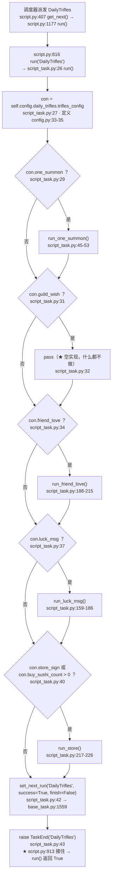
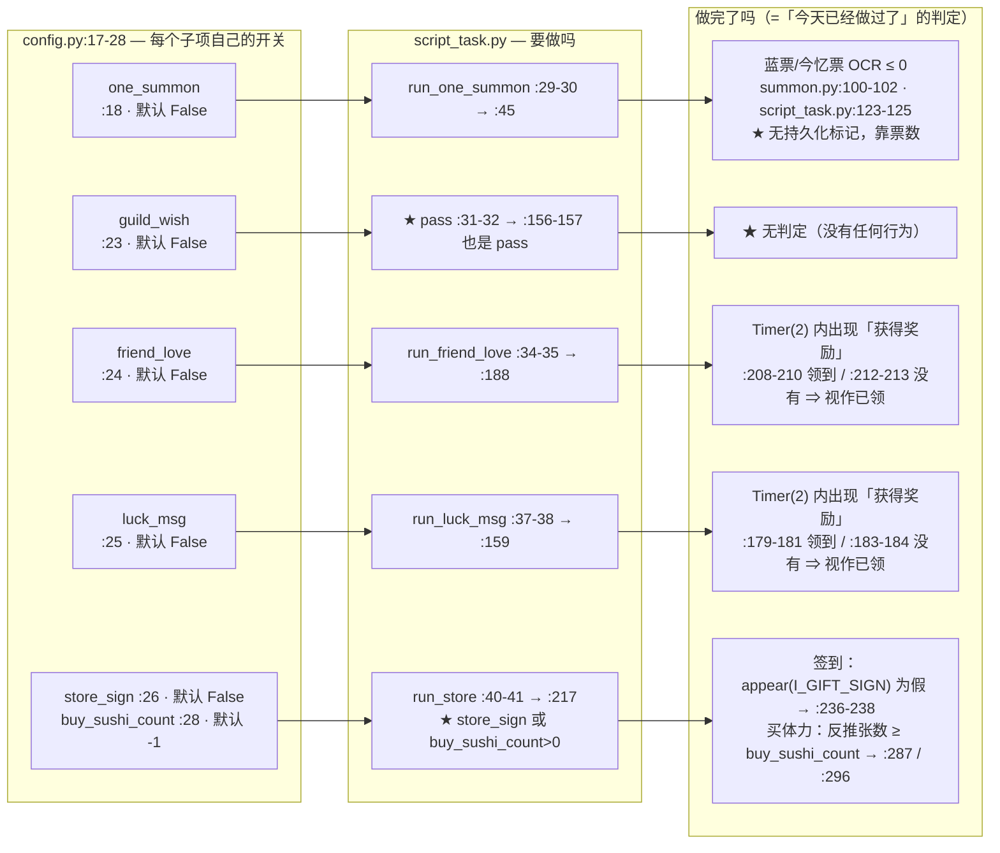
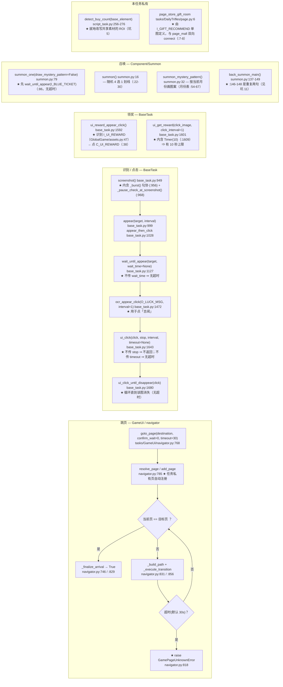

# `DailyTrifles`（每日琐事）流程图

> ★ **代码位置**：`tasks/DailyTrifles/script_task.py`（311 行）
> ★ **配置**：`tasks/DailyTrifles/config.py`（35 行）· **资源**：`tasks/DailyTrifles/assets.py`（77 行）
> ★ **私有页面**：`tasks/DailyTrifles/page.py`（8 行）· **自描述**：`tasks/DailyTrifles/meta.py`（38 行）
> ★ **继承**：`ScriptTask(GameUi, Summon, DailyTriflesAssets)`（`script_task.py:24`）
>   * `GameUi` → `BaseTask`（`tasks/base_task.py:37`）—— 提供 `appear` / `ui_click` / `ui_get_reward` / `set_next_run` …
>   * `Summon`（`tasks/Component/Summon/summon.py:13`）—— 提供 `summon_one()` / `summon_mystery_pattern()` / `back_summon_main()`
>   * `DailyTriflesAssets`（`tasks/DailyTrifles/assets.py:10`）—— 识别素材
> ★ **meta 事实**：`category=TIMED` · `auto_queue=True` · `period=Period.NONE` · `window=AvailabilityWindow(True, 00:00, 23:59)`（整天）
>
> ⚠ **读法**：★ **本任务没有 `while` 主循环** —— 它的"主循环"是 `run()` 里
>   **5 个串行子项**（`script_task.py:26-43`）。★ 所以本文的「二、主循环」
>   按 **"决策在哪"** 拆成两半：**开关门（二之一）** 与 **子项内部判断（二之二）**。
> ★ 先看「一、总览」建立骨架，再看「二、主循环」——那是**这个任务的全部决策**。
> ★ 每个判断/出口都标了 `文件:行号`；★ 所有行号都是**读代码后核对过的**，
>   没确认的地方显式写「**未确认**」。

---

## 一、总览：从被派发到收尾



★ **注意 3 件事**（★ 它们决定了本任务"看起来像定时任务、底层却按临时任务跑"）：

1. ★ **没有收尾动作** —— 不点返回键、不回庭院，★ 上一个子项停在哪个页面，
   下一个子项就**从那个页面起步**（★ 每个子项自己 `goto_page`，见 `script_task.py:46/160/189/218/230`）。
2. ★ **子项顺序写死在源码里**（:29 → :31 → :34 → :37 → :40），★ 不可配置、不重排。
3. ★ **`guild_wish` 是空开关** —— `run()` 里是 `pass`（:32），
   而且旁边还留着一个同样为空的 `run_guild_wish()`（:156-157）。

---

## 二、主循环（★ 全部决策都在这里）

### 二之一 · 开关门（串行 · 无循环）

★ 上半部分已经在「一、总览」的图里画完了（:29 / :31 / :34 / :37 / :40 五个判断）。
★ **出口语义表**（★ 读这段最能理解本任务的设计）：

| 出口 | 触发条件 | 到达处 | `success` | 含义 |
|---|---|---|---|---|
| ★ `raise TaskEnd` | **串行序列走完** | `script_task.py:43` | `True`（`script.py:913-914`）| ★ **本轮正常结束**（唯一的主干出口）|
| ★ 子项内部 `return` | 子项**自己发现"没法做"** | `:106`（今忆抽卡失败）/ `:238`（找不到签到）| 不变（仍 `True`）| ★ **软失败**：只结束**这个子项**，主流程继续 |
| ★ 异常冒出 `run()` | 任意子项抛异常（`<br/>`**没有 try/except**）| `script.py:966-974` | `False`（`self._task_failed=True`）| ★ **唯一会置失败的路径**；★ **后面的子项全部不跑** |
| ★ `TaskPaused` | 框架级暂停检查命中 | `base_task.py:968` → `script.py:893-912` | `True` | ★ 暂停（不是失败），★ 由用户点「继续」恢复 |

### 二之二 · 子项内部判断（★ 决策密度最高的地方）

```mermaid
flowchart TD
    subgraph S1["run_one_summon :45-53 — 每日召唤"]
        A0["goto_page(page_summon) :46"] --> A1{"config.summon_type == SummonType.default ？<br/>:48 · 枚举定义 config.py:12-14"}
        A1 -- "是（普通召唤）" --> A2["summon_one(draw_mystery_pattern=config.draw_mystery_pattern) :49<br/>★ 实现 Component/Summon/summon.py:79"]
        A2 --> A3["check_time() :50 ★ 只在【普通召唤】分支被调"]
        A1 -- "否" --> A4{"== SummonType.recall ？<br/>:51"}
        A4 -- "是（今忆召唤）" --> A5["summon_recall() :52"]
        A4 -- "都不是" --> A6["★ 什么都不做（静默）"] --> A7
        A3 --> A7["back_summon_main() :53<br/>★ summon.py:137-149"]
        A5 --> A7
    end

    subgraph S2["check_time :55-75 — 跨月才画神秘图案"]
        B0["next_run = config.next_run_after('DailyTrifles', after=now) :64<br/>★ 实现 module/config/config.py:4191"] --> B1{"next_run.month != now.month ？<br/>:66"}
        B1 -- "是（跨月）" --> B2{"not config.draw_mystery_pattern ？<br/>:68"}
        B2 -- "是" --> B3["config.draw_mystery_pattern = True :69"]
        B2 -- "否" --> B5
        B1 -- "否（同月）" --> B4["config.draw_mystery_pattern = False :74<br/>★★ 见「五、已知坑」坑 1：本分支恒命中"]
        B3 --> B5["config.save() :75"]
        B4 --> B5
    end

    subgraph S3["summon_recall :77-154 — 今忆召唤（自带 3 次重试）"]
        C0["list = [O_SELECT_SM2, O_SELECT_SM3, O_SELECT_SM4]<br/>:83 · 素材 assets.py:69/71/73"] --> C1["while True: count += 1 :85-86"]
        C1 --> C2["for i in 三个预设组 :88-99<br/>goto_page(page_main) → goto_page(page_summon)<br/>→ 点预设 → screenshot → appear(I_RECALL_TICKET) ？"]
        C2 --> C3{"appear(I_RECALL_TICKET) ？<br/>:97-98 / :102"}
        C3 -- "是" --> C4["跳出重试循环 :103"]
        C3 -- "否" --> C5{"count >= 3 ？<br/>:104"}
        C5 -- "是" --> C6["notifier.push('今忆召唤抽卡失败') → return :105-106<br/>★ 软失败：只结束本子项"]
        C5 -- "否" --> C2
        C4 --> C7["OCR O_RECALL_TICKET_AREA → 正则取数字 :111-122<br/>★ 素材 assets.py:63"]
        C7 --> C8{"ticket_info <= 0 ？<br/>:123"}
        C8 -- "是" --> C9["warning 'no any one RECALL ticket' → return :124-125<br/>★ 软失败"]
        C8 -- "否" --> C10["把 4 个 S_RANDOM_SWIPE 统一改名为 'S_RANDOM_SWIPE' :127-130"]
        C10 --> C11{"appear(I_RECALL_ONE_TICKET) ？<br/>:131-136"}
        C11 -- "否" --> C12["appear_then_click(I_RECALL_TICKET) :135"] --> C11
        C11 -- "是" --> C13{"确认框 I_RECALL_SM_CONFIRM / I_SM_CONFIRM_2 ？<br/>:140-147"}
        C13 -- "是" --> C14["ui_click_until_disappear(确认) → break :143/146"] --> C16
        C13 -- "否" --> C15{"appear(I_RECALL_ONE_TICKET) ？<br/>:148"}
        C15 -- "是" --> C15b["先点掉 I_UI_CANCEL（防"语言召唤"）:150<br/>再 summon() :152"] --> C13
        C15 -- "否" --> C13
        C16["logger 'Summon one success' :154"]
    end

    subgraph S4["run_luck_msg :159-186 — 吉闻"]
        D0["goto_page(page_friends) :160"] --> D1{"appear(I_LUCK_TITLE) ？<br/>:163"}
        D1 -- "是" --> D3
        D1 -- "否" --> D2["appear_then_click(I_FRIENDSHIP_UP) :165<br/>ocr_appear_click(O_LUCK_MSG, '吉闻') :167"] --> D1
        D3["check_timer = Timer(2).start() :170-171<br/>★ 2 秒窗口"] --> D4{"I_CLICK_BLESS / I_ONE_CLICK_BLESS ？<br/>:175 / :177"}
        D4 -- "是" --> D4b["点祝福 → continue"] --> D4
        D4 -- "否" --> D5{"ui_reward_appear_click() ？<br/>:179<br/>★ base_task.py:1592"]
        D5 -- "是" --> D6["'Get reward of luck msg' → break :180-181"]
        D5 -- "否" --> D7{"check_timer.reached() ？<br/>:182"}
        D7 -- "是" --> D8["warning 'There is no any luck msg' → break :183-184<br/>★ = 「今天已经领过了」的判定"]
        D7 -- "否" --> D4
        D6 --> D9["ui_click(I_UI_BACK_RED, I_CHECK_MAIN) :186<br/>★ 无 timeout ⇒ 无超时"]
        D8 --> D9
    end

    subgraph S5["run_friend_love :188-215 — 友情点"]
        E0["goto_page(page_friends) :189"] --> E1{"appear(I_L_LOVE) ？<br/>:192"}
        E1 -- "是" --> E3
        E1 -- "否" --> E2["I_FRIENDSHIP_UP :194 / I_L_FRIENDS :196 / I_FRIEND_TAB :198"] --> E1
        E3["check_timer = Timer(2).start() :201-202"] --> E4{"I_L_COLLECT ？<br/>:206"}
        E4 -- "是" --> E4b["点一键收取 → continue"] --> E4
        E4 -- "否" --> E5{"ui_reward_appear_click() ？<br/>:208"}
        E5 -- "是" --> E6["'Get reward of friend love' → break :209-210"]
        E5 -- "否" --> E7{"check_timer.reached() ？<br/>:211"}
        E7 -- "是" --> E8["warning 'There is no any love' → break :212-213"]
        E7 -- "否" --> E4
        E6 --> E9["ui_click(I_UI_BACK_RED, I_CHECK_MAIN) :215"]
        E8 --> E9
    end

    subgraph S6["run_store :217-226 — 商店（签到 + 买体力共用一次进店）"]
        F0["goto_page(page_mall, confirm_wait=3) :218"] --> F1{"store_sign ？<br/>:220"}
        F1 -- "是" --> F2["run_store_sign() :221"]
        F1 -- "否" --> F3
        F2 --> F3{"buy_sushi_count > 0 ？<br/>:222"}
        F3 -- "是" --> F4["run_buy_sushi() :223"]
        F3 -- "否" --> F5
        F4 --> F5["ui_click(I_UI_BACK_YELLOW, I_CHECK_MALL, interval=2.4, timeout=8) :225<br/>★ 返回值被丢弃"]
        F5 --> F6["goto_page(page_main) :226"]
    end

    subgraph S7["run_store_sign :228-241 — 免费一抽 / 签到"]
        G0["goto_page(page_store_gift_room) :230<br/>★ 页面定义 tasks/DailyTrifles/page.py:6"] --> G1["appear_then_click(I_GIFT_RECOMMEND) :232 → sleep(1) :234"]
        G1 --> G2{"appear(I_GIFT_SIGN) ？<br/>:236"}
        G2 -- "否" --> G3["warning 'There is no gift sign' → return :237-238<br/>★ 软失败（=「今天已经签过」）"]
        G2 -- "是" --> G4["ui_get_reward(I_GIFT_SIGN, click_interval=2.5) :240<br/>★ base_task.py:1601（内含 10 秒 Timer）"]
    end

    subgraph S8["run_buy_sushi :243-300 — 买体力"]
        H0["while 1: :246<br/>借 RichManAssets（:247）"] --> H1{"appear(RichManAssets.I_SIDE_CHECK_SPECIAL) ？<br/>:249"}
        H1 -- "是" --> H3
        H1 -- "否" --> H2["点 I_MALL_SUNDRY :251 / I_SIDE_SURE_SPECIAL :253"] --> H0
        H3{"appear(I_STORE_COST_TYPE_JADE) ？<br/>:285<br/>★ 货币是勾玉"] -- "是" --> H4["detect_buy_count(...) :286 → (count, price)"]
        H3 -- "否" --> H7{"appear(I_SPECIAL_SUSHI) ？<br/>:293"}
        H4 --> H5{"count >= buy_sushi_count ？<br/>:287"}
        H5 -- "是" --> H6["break :288 ★ 已买够"]
        H5 -- "否" --> H8["ui_click_until_disappear(买) :289 → continue"] --> H0
        H7 -- "是" --> H9["detect_buy_count(I_SPECIAL_SUSHI) :295"]
        H7 -- "否" --> H0
        H9 --> H10{"count >= buy_sushi_count ？<br/>:296"}
        H10 -- "是" --> H11["break :297 ★ 已买够"]
        H10 -- "否" --> H12["ui_click(I_SPECIAL_SUSHI, stop=I_STORE_COST_TYPE_JADE, interval=2) :298<br/>★ 无 timeout ⇒ 无超时 → continue"] --> H0
    end

    subgraph S9["detect_buy_count :256-276 — 从价格反推已买张数"]
        I0["roi = roi_front 的右下角 60x30 小块 :260-264<br/>★ 就地改写 O_STORE_SUSHI_PRICE.roi :265（见坑 5）"] --> I1["O_STORE_SUSHI_PRICE.detect_text(image) :266"]
        I1 --> I2{"int(_price) 成功 ？<br/>:268-271"}
        I2 -- "否" --> I3["_price = MAX_PRICE = 9999 :271"]
        I2 -- "是" --> I4
        I3 --> I4{"_price < 60 ？<br/>:273"}
        I4 -- "是" --> I5["return 0, MAX_PRICE :274（保守：不买）"]
        I4 -- "否" --> I6["return (_price - 60) / 20, _price :275<br/>★ 实际是 float，标注写的是 (int,int)（见坑 6）"]
    end
```

★ **关于"每个子项做完没做完"的完整决策图**（★ 用户最关心的那张）：



★ **"部分子项失败会不会影响其它子项"** —— 分三种情形，答案**不一样**：

| 子项的失败形态 | 代码位置 | 对**后面的子项**的影响 |
|---|---|---|
| ★ **软失败**（子项内部 `return`）| `:106` · `:238` · `summon.py:102` | ★ **不影响** —— 只有这个子项结束，`run()` 继续往下走 |
| ★★ **异常**（任意 `raise`，如 `goto_page` 抛 `GamePageUnknownError`，`navigator.py:818`）| `run()` 里**没有 try/except**（`:26-43`）| ★★ **后面的子项一个都不跑** —— 异常冒到 `script.py:966`，该条目记为失败（`script.py:973` `_task_failed=True`）|
| ★★ **卡死**（无超时的 `while 1`：`:161` `:190` `:246`；`ui_click` 无 `timeout`：`:298`）| 同上 | ★★ **整条链停住** —— 后面的子项**永远等不到**（只有 `screenshot()` 的暂停检查能在 `PAUSE_BATTLE` 下把它打断）|

★ 结论：**"子项互相独立"只对"软失败"成立**，对异常与卡死**不成立**。

---

## 三、子过程（被 `run()` 及其子项调用）



★ **每个子项实际用到的子过程一览**（★ 便于"改哪一处会影响哪几个子项"）：

| 子项 | 用到的公共子过程 |
|---|---|
| `run_one_summon` :45 | `goto_page`(:46) · `summon_one`(summon.py:79) · `check_time`(:50) · `back_summon_main`(summon.py:137) |
| `summon_recall` :77 | `goto_page`(:90-91) · `appear_then_click`(:92/135/150) · `ocr`(:111) · `ui_click_until_disappear`(:143/146) · `summon`(summon.py:16) · `notifier.push`(:105) |
| `run_luck_msg` :159 | `goto_page`(:160) · `appear`(:163) · `appear_then_click`(:165/175/177) · `ocr_appear_click`(:167) · `ui_reward_appear_click`(:179) · `ui_click`(:186) |
| `run_friend_love` :188 | `goto_page`(:189) · `appear`(:192) · `appear_then_click`(:194/196/198/206) · `ui_reward_appear_click`(:208) · `ui_click`(:215) |
| `run_store` :217 | `goto_page`(:218/226) · `ui_click`(:225) |
| `run_store_sign` :228 | `goto_page`(:230) · `appear_then_click`(:232) · `appear`(:236) · `ui_get_reward`(:240) |
| `run_buy_sushi` :243 | `appear`(:249/285/293) · `appear_then_click`(:251/253) · `ui_click_until_disappear`(:289) · `ui_click`(:298) · `detect_buy_count`(:286/295) |

---

## 四、与调度层的接口（★ 这四条最容易踩错）

| # | 接口 | 代码 | 说明 |
|---|---|---|---|
| **1** | ★ **次数从哪来** | **没有次数** —— 全任务**从不调** `bind_counter()`（`base_task.py:286`）/ `effective_target()`（:137）/ `commit_count()`（:391）| ★ `meta.py` 未声明 `count_field` / `count_default`（`module/config/task_catalog_data.json:100-103` 均为 `null`）⇒ 即便有人调 `effective_target()` 也只会拿到 `None`。★ 界面上那格 `scheduler.target`（`tasks/Component/config_scheduler.py:412-417`）对**本任务完全无效** —— 没人读它。★ "跑多少"由**5 个开关**（`:18/:23/:24/:25/:26+28`）决定，不是次数 |
| **2** | ★ **本轮完成怎么上报** | ★ **任务自己一个字都不上报**（从不调 `mark_entry_completed`，`base_task.py:447`）⇒ 由 **调度层收尾时自动标**：`script.py:1325-1330` | ★ 判据链：`entry_is_temporary(eid)`（`config.py:3974`，读 `task_period` = **配置里的 `scheduler.period`**，默认 `none`，`config_scheduler.py:337`）+ `entry_target_reached(eid)`（`config.py:3997`）；★ 对**临时任务**该函数的判据已改成"**能走到这里 = 成功跑完一次 ⇒ True**"（`config.py:4013`）⇒ ★ 跑完一次即 `mark_entry_completed` ⇒ `_skip_by_completed`（`config.py:3917`）下一轮把它剔出 `pending`。⚠ **只在 `success` 为真时**（`script.py:1266`）。⚠ `_record_task_success`（`config.py:4322`）对 `period=none` **直接 return**（`config.py:4332-4338`）⇒ **不写周期完成记忆** |
| **3** | ★ **收尾怎么排下一次** | `set_next_run('DailyTrifles', success=True, finish=False)`（`script_task.py:42`）| ★ `finish=False` ⇒ 以 `self.start_time`（任务**开始**时刻）为基准（`base_task.py:1570-1574`）。★ `success=True` ⇒ `config.task_delay` 走 `next_run_after(task, after=start_time, strict=True)`（`config.py:4691-4692`）。★★ **本任务的窗口是全天**（`meta.py:35`）⇒ `is_unrestricted` 为真（`module/config/availability.py:165-186`）⇒ `next_run_after` 在 `config.py:4262-4263` 把它 `continue` 掉 ⇒ `spans` 为空 ⇒ **直接返回 `when`（= start_time）**（`config.py:4275-4277`）⇒ 落盘的 `next_run` ≈ **任务开始时刻（在过去）**。★ 对 `period=none` 的临时任务 `next_run` **不参与派发判断**（`config.py:4791-4795` 的表）⇒ 无害，**但日志/界面会显示一个过去时刻**。⚠ 若用户改了内部字段 `server_update`（`config_scheduler.py:326-328`，界面隐藏）为非 09:00 ⇒ 会走 `parse_tomorrow_server`（`config.py:4737`）把 `next_run` 推到明天 —— ★ **未实测**，仅按代码推断 |
| **4** | ★ **暂停 / 切条怎么响应** | ★ **任务自己不接** —— 从不调 `raise_if_paused()`（`base_task.py:686`）/ `should_stop_battle_loop()`（:518）/ `raise_if_paused_outside_battle()`（:719）| ★ 唯一生效的是**框架级兜底**：`screenshot()`（`base_task.py:949`）→ `_pause_check_at_screenshot()`（`base_task.py:968` → 实现 :801）。★ 只在 `PAUSE_BATTLE` 模式生效（`base_task.py:836-837`）；`PAUSE_ROUND`（"本轮打满再停"）**不生效**（该模式要求任务自己判 `limit_count`，`base_task.py:832-837` —— 而本任务没接，也没有 `limit_count`）。★★ **"切条"（点别的行的 `[▶]`，即 `model.force_next_entry_id`）对本任务无效**：那条判据写在 `should_stop_battle_loop()` 里（`base_task.py:571-589`），本任务**不调它** ⇒ 只能等它自己跑完。⚠ 代价见 `base_task.py:744-748`：框架级检查可能停在**界面操作中途** |

---

## 五、已知坑（★ 改这个任务前必读）

| # | 坑 | 位置 |
|---|---|---|
| **1** | ★★ **"神秘图案"永远画不出来** —— `check_time()` 的"跨月"分支是**死分支**：本任务窗口是全天 ⇒ `next_run_after()` 返回 `now`（`config.py:4262-4263` → `4275-4277`）⇒ `next_run.month != now.month` **恒为 False**（`script_task.py:66`）⇒ 每次都走 `else` 把 `draw_mystery_pattern` 置 `False`（:74）⇒ `:49` 传进 `summon_one` 的值**恒 False** ⇒ `summon.py:129-132` 的画图案分支**不可达**。★ 且该字段被 `dynamic_hide` 隐藏（`config.py:30`）⇒ 用户**也无法手工打开**。⚠ **仅静态核对，未实机验证** | `script_task.py:64-75` · `config.py:4191/4262/4275` · `availability.py:165` |
| **2** | ★★ **`from winerror import NOERROR` 是 Windows 专有模块**（:10），★ 且 `NOERROR` **从未被使用**；同样"导入了但没用"的还有 `catch`(:8) 与 `time`/`timedelta`(:6) ⇒ ★ 在 Linux/macOS 上**导入即 `ModuleNotFoundError`**，这个任务**根本跑不起来**。⚠ 本机是 Windows，**未在其它平台实测** | `script_task.py:6-10` |
| **3** | ★★ **子项之间没有异常隔离** —— `run()`（:26-43）**没有 try/except** ⇒ 任一子项抛异常 ⇒ 后面的子项**全部不跑**（`script.py:966-974`）。★ 但子项内部用 `return` 的**软失败**（:106 / :238 / `summon.py:102`）**不会**影响后续子项 —— ★ 两种"失败"语义**必须分清** | `script_task.py:26-43` |
| **4** | ★★ **3 个导航 `while 1` 没有超时**（:161-168 吉闻 / :190-199 友情点 / :246-254 商店 Special），`ui_click` 不传 `timeout` 时**也没有超时**（`base_task.py:1652`，本任务 :186/:215/:298 都没传）⇒ 识别不到目标元素就**无限空转**，★ 只有 `PAUSE_BATTLE` 下的框架级暂停能救（坑 1 之外的第二个"卡死源"） | `script_task.py:161/190/246/298` · `base_task.py:1643/1652` |
| **5** | ★★ **被测素材的 ROI 被就地改写** —— `self.O_STORE_SUSHI_PRICE.roi = roi`（:265）。该对象是 `DailyTriflesAssets` 的**类属性**（`assets.py:47`，注释本就写着"roiBack 为动态调整，故设置为 0,0,0,0"）⇒ ★ 改的是**共享对象**，ROI 会**跨调用、跨运行残留**（同一进程内第二次跑用的是上次算出的 ROI） | `script_task.py:260-265` · `assets.py:47` |
| **6** | ★ **`detect_buy_count` 的返回类型与标注不符** —— 标注 `-> (int, int)`（:256），实际 `return (_price - 60) / 20` 是 **float**（:275）。★ 它**不是**"已买张数"，而是**从价格反推**（公式 `(价格-60)/20` 硬编码游戏规则）；`_price < 60` 时保守地返回 `0, 9999`（:273-274）| `script_task.py:256-276` |
| **7** | ★ **商店签到之后不重新进商店主页** —— `run_store_sign()` 只 `goto_page(page_store_gift_room)`（:230），**结束后不回 `page_mall`**；紧接着的 `run_buy_sushi()`（:222-223）是在**礼包屋页**上开始的，它靠**借来的** `RichManAssets.I_MALL_SUNDRY` / `I_SIDE_SURE_SPECIAL` / `I_SIDE_CHECK_SPECIAL`（:247-254，素材在 `tasks/RichMan/assets.py:176/196/198`）自己找回 Special 页。★ 若那条路走不通 ⇒ 命中坑 4 的死循环。⚠ **未实测** | `script_task.py:217-226` · `:243-254` |
| **8** | ★ **`guild_wish` 是空开关** —— `run()` 里只有 `pass`（:31-32），且旁边还留着同样为空的 `run_guild_wish()`（:156-157）。★ 打开它**没有任何行为、也不报错** | `script_task.py:31-32` · `:156-157` |
| **9** | ★ **`check_time()` 只在"普通召唤"分支被调**（:50）—— 选"今忆召唤"（:51-52）时**不会**更新/落盘 `draw_mystery_pattern`（`config.save()` 在 :75，只在 `check_time` 里）| `script_task.py:48-53` |
| **10** | ★ `run_store()` 里 `ui_click(..., timeout=8)` 的**返回值被丢弃**（:225）⇒ 超时（`base_task.py:1657-1659` 返回 `False`）时**照样**往下 `goto_page(page_main)`，失败被静默吞掉 | `script_task.py:225` · `base_task.py:1657-1659` |
| **11** | ★ `back_summon_main()` 里 **:146-148 是同一条件写了两遍**（第二句永不生效，死代码）；★ `summon_one` 开头 `wait_until_appear(I_BLUE_TICKET)` **不传 `wait_time`** ⇒ 无超时（`summon.py:86` / `base_task.py:1127`）| `tasks/Component/Summon/summon.py:86/146-148` |
| **12** | ★ `summon_recall()` 里 `list` **覆盖内置名**（:83）；★ 3 次重试用尽后 `notifier.push(...)` 再 `return`（:104-106）—— 推送本身失败会怎样**未确认**；★ :127-130 把 4 个 `S_RANDOM_SWIPE` 素材 `.name` **统一改成同一个字符串**（这是 `Summon.summon()` 的既有约定，见 `summon.py:104-107`，★ 但也意味着这 4 个对象的"名字→定时器"合流）| `script_task.py:83/104-106/127-130` |
| **13** | ★ `page_store_gift_room` 是**任务私有页**（`page.py:6`），靠 `goto_page` 里的 `add_page` 自动注册（`navigator.py:785`）；它由**单张图** `I_GIFT_RECOMMEND` 定义 ⇒ 该素材识别不稳时 `goto_page` 会在 navigator 里绕到 **30 秒超时**并抛 `GamePageUnknownError`（`navigator.py:818`）⇒ 命中坑 3（后面的子项全不跑）| `page.py:6-8` · `navigator.py:768/785/818` |
| **14** | ★ 注释里的旧路径（:282-284）写的是 `self.config.model.daily_trifles...`，而**活代码**用的是 `self.config.daily_trifles...`（:287 / :296）—— ★ 取消注释那段前请先确认真实路径 | `script_task.py:282-284` vs `:287/:296` |
| **15** | ★ 仅记录事实（★ 低置信度，不确定是有意还是巧合）：`DailyTriflesAssets.I_RECALL_TICKET` 的 `roi_front=(595,586,65,76)`（`assets.py:52`）与 `SummonAssets.I_BLUE_TICKET` 的 `roi_front=(595,586,65,76)`（`tasks/Component/Summon/assets.py:15`）**完全相同** —— 同一块区域、两张不同模板（普通蓝票 vs 今忆票）| `assets.py:52` · `Component/Summon/assets.py:15` |

---

## ★ 相关文档

* ★ **样板**：[`RealmRaid.md`](RealmRaid.md) · ★ **索引 / 待补台账**：[`README.md`](README.md)
* ★ **调度层**：`docs/scheduler-architecture.md` · ★ `docs/DESIGN-SPEC.md` §1
* ★ **本轮完成机制**：`docs/DESIGN-SPEC.md` §1.6.x（`session_start` 时间戳判定 / `entry_target_reached`）
* ★ **窗口与排期**：`module/config/availability.py`（`is_unrestricted`）· `Config.next_run_after()` / `Config.task_delay()`
* ★ **暂停语义**：`docs/architecture.md` §6.1（`PAUSE_BATTLE` vs `PAUSE_ROUND`）
