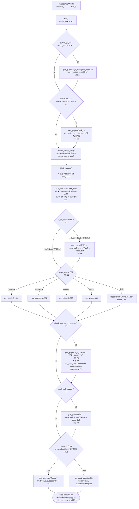
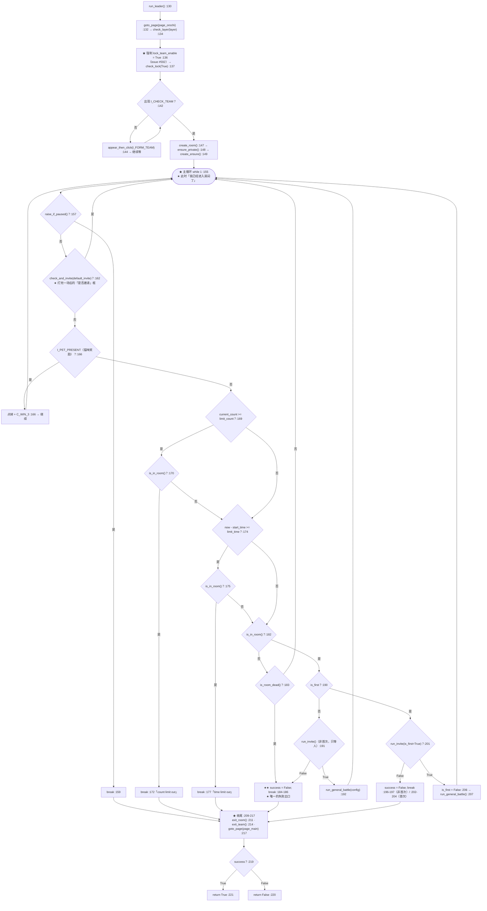
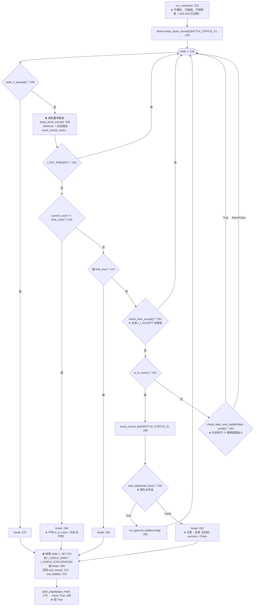
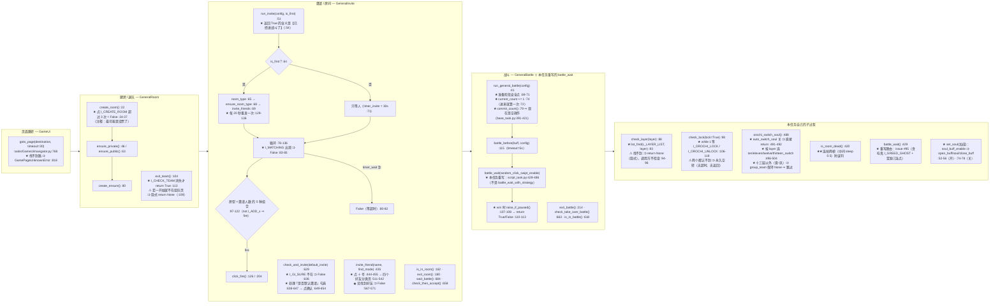
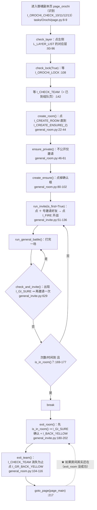

# `Orochi`（八岐大蛇 / 御魂副本）流程图

> ★ **代码位置**：`tasks/Orochi/script_task.py`（526 行）
> ★ **配置**：`tasks/Orochi/config.py`（70 行）· **资源**：`tasks/Orochi/assets.py`（48 行）
>   · **页面定义**：`tasks/Orochi/page.py`（16 行）· **自描述**：`tasks/Orochi/meta.py`（26 行）
> ★ **继承链**（`script_task.py:23`）：
>   `GeneralBattle`（公共战斗循环）· `GeneralInvite`（邀请/房间）· `GeneralBuff`（加成）
>   · `GeneralRoom`（建房/退队）· `GameUi`（页面跳转）· `SwitchSoul`（换御魂）
>   · `OrochiAssets` + `TrueOrochiAssets`（识别素材）
>
> ⚠ **读法**：★ 先看「一、总览」建立骨架 —— 本任务和样板 `RealmRaid` 最大的不同是
>   **有 4 种身份**（`leader` / `member` / `alone` / `wild`），★ 每种身份**各有一套主循环**。
> ★ 再看「二、主循环」—— 那里是**全部决策**。
> ★ 每个判断都标了 `文件:行号`（读代码时可直接定位；基类写成相对 `backend` 根的路径）。
>
> ★★ **本文最该看的一段**：★★「二·C」的**组队/房间状态分支** 与
>   「五、已知坑」第 1 条 —— **为什么收尾不能用"点返回"代替 `is_in_room()`**。

---

## 一、总览：从被派发到收尾

★ **注意**：★ 本任务（任务侧）**完全不调** `self.mark_entry_completed()`
  （全仓**任务侧**调用点只有 `tasks/RealmRaid/script_task.py:198`）。
  ★ "本轮完成"由**框架层**在收尾时补标（`script.py:1325-1333`）——
  ⚠ ★ 但**只对"临时条目"生效**（`entry_is_temporary()`，`module/config/config.py:3974-3995`）。
  ★ `Orochi` 的 `meta.py` 写的是 `period=Period.DAILY`（`meta.py:25`）⇒
  ★ 对已有配置（`period_backfilled` 把 `scheduler.period` 回填成 `daily`）
  ★ **框架层不会替它标完成**。详见「四·2」与「五·19」。

---

## 二、主循环（★ 全部决策都在这里）

★ 本任务有 **4 个主循环**，分别对应 4 种身份。★ 4 种身份**共用**的决策只有三件：
  `raise_if_paused()` / 猫咪奖励 / **次数 + 时间上限**。

### 二·A `run_leader()`（队长 · `:130-221`）

### 二·B `run_member()`（队员 · `:223-280`）

### 二·C `run_alone()`（单人 · `:282-332`）与 `run_wild()`（公开房 · `:334-418`）

★ **关键差异**：★ `run_alone()` **完全不涉及房间/邀请**（没有 `is_in_room()`），
  ★ 而 `run_wild()` **几乎复制**了 `run_leader()` 的房间骨架，只把
  `ensure_private()` 换成 `ensure_public()`（`:353`）、挑战按钮换成
  `I_OROCHI_WILD_FIRE`（`:398` / `:402`）。

```mermaid
flowchart TD
    subgraph ALONE["run_alone() :282-332 — ★ 单人，无房间"]
        A0["goto_page(page_orochi) :284 → check_layer :286 → check_lock :287"] --> A1["闭包 is_in_orochi() :289-292<br/>★ 判据 = I_OROCHI_FIRE"]
        A1 --> S1(["while 1 :294"])
        S1 --> A2{"raise_if_paused()？:296"} -- "是" --> AZ["break :298"]
        A2 -- "否" --> A3{"I_PET_PRESENT？:301"} -- "是" --> S1
        A3 -- "否" --> A4{"not is_in_orochi()？:304"} -- "是" --> S1
        A4 -- "否" --> A5{"次数到？:307 / 时间到？:310"} -- "是" --> AZ
        A5 -- "否" --> A6["内层 while 1 :315<br/>点 I_OROCHI_FIRE :317 → 它消失就 run_general_battle :321"]
        A6 --> S1
        AZ --> A7["收尾 while 1 :325-330<br/>I_FORM_TEAM 还在就点 I_UI_BACK_YELLOW :329"] --> A8["goto_page(page_main) :332"]
    end
    subgraph WILD["run_wild() :334-418 — ★ 公开房等路人"]
        W0{"is_in_battle(True)？:338"} -- "是（已在战斗）" --> W6
        W0 -- "否" --> W1["goto_page(page_orochi) :339 → check_layer :341 → check_lock :342"]
        W1 --> W2["等 I_CHECK_TEAM :347 → create_room :352 → ensure_public :353 → create_ensure :354"]
        W2 --> W6(["while 1 :357"])
        W6 --> W3{"raise_if_paused :358 / check_and_invite :364 / 猫咪 :368"} -- "命中" --> W6
        W3 -- "都没有" --> W4{"次数到？:371 且 is_in_room？:372<br/>时间到？:376 且 is_in_room？:377"}
        W4 -- "是" --> WZ["break :374 / :379"]
        W4 -- "否" --> W5{"is_in_room()？:381"}
        W5 -- "否" --> W7{"is_room_dead()？:382"} -- "是" --> W8["success = False; break :383-385"]
        W7 -- "否" --> W6
        W5 -- "是" --> W9["内层 while 1 :390<br/>点 I_OROCHI_WILD_FIRE(threshold=0.8) :398<br/>它消失 ⇒ run_general_battle :403"]
        W9 --> W6
        WZ --> WE["收尾 :406-414<br/>exit_room :408 · exit_team :411 · goto_page(庭院) :414"] --> WF{"success？:416"} -- "False" --> WG["return False :417"]
        WF -- "True" --> WH["return True :418"]
    end
```

★★ **「组队 / 房间状态」这条分支（本文重点）**

| 概念 | 判据 | 位置 | ★ 语义 |
|---|---|---|---|
| ★ `is_in_room()` | `I_GI_EMOJI_1` / `I_GI_EMOJI_2` / `I_GI_SPEAK` 任一出现 | `tasks/Component/GeneralInvite/general_invite.py:162-178` | ★ **"我已经在房间里了"**（含永生之海用发言按钮兜底）|
| ★ `is_room_dead()` | 连拍两帧都看到 `I_MATCHING` 或 `I_CHECK_EXPLORATION`（中间 `sleep(0.5)`）| `script_task.py:420-427` | ★ **"房间没了"** ⇒ 队长/公开房判**失败** |
| ★ `wait_battle()` | 回家/探索 ⇒ 房间被销毁；超时；出现 `I_FIRE` ⇒ 队长跑路 | `general_invite.py:684-738` | ★ 队员专用：True = 已进战斗 |
| ★ `exit_room()` | 先 `is_in_room()` 判定（不在就 `return False`），再处理 `I_GI_SURE` + `I_BACK_YELLOW` | `general_invite.py:180-202` | ★ **退房间**（点返回 + 确认弹窗）|
| ★ `exit_team()` | `I_CHECK_TEAM` 出现就点 `I_GR_BACK_YELLOW` 直到它消失 | `tasks/Component/GeneralRoom/general_room.py:104-116` | ★ **退组队界面**（不是退房间）|

★ **为什么"次数到 / 时间到"要加 `is_in_room()` 这一道**（`:169-177`、`:371-379`）：

* ★ 队长在**还没进房间**的时候（等 `I_CHECK_TEAM`、点建房按钮、等邀请页）
  也可能满足"次数到了" ⇒ ★ 若直接 `break`，收尾就得在**未知界面**上猜着退出。
* ★ 加了 `is_in_room()` ⇒ ★ 只在**房间这个确定的界面**上才收 ⇒ 收尾只有
  **两种确定的 UI**（注释原话：`"只有两个UI的可能，在房间或者是在组队界面"`，`:209-210`）。
* ★ `run_member()` / `run_alone()` **没有**这道判断（`:244-249`、`:307-312`）——
  因为队员/单人**不拥有房间**，随时可以走。

★ **为什么不能改成"收尾直接点返回"**（★ 这是本任务与 `RealmRaid` 最本质的差别）：

1. ★ **两种 UI 状态，"返回"不是同一个按钮**：★ 在房间里要退的是**房间**
   （`exit_room()`：`I_GI_SURE` 确认框 + `I_BACK_YELLOW`，`general_invite.py:194-201`）；
   ★ 在组队界面上要退的是**组队页**（`exit_team()`：`I_GR_BACK_YELLOW`，
   `general_room.py:115`）。★ 走错一个 ⇒ 卡在另一个界面上换场景，之后所有识别全错。
2. ★ **点返回**（`I_UI_BACK_YELLOW` / `I_GR_BACK_YELLOW`）**只是退出当前界面**，
   ★ 而**退房间必须处理"是否解散/确认退出"的弹窗**（`I_GI_SURE`）。
   ★ `exit_room()` 的循环顺序正是"**先确认、后返回**" —— 少了它，房间里点返回
   什么也不会发生（弹窗挡着），于是循环空转直到看门狗判卡死并重启游戏。
3. ★ **代价不对称**：★ 真人队友还在房间里等。★ 若"点返回"恰好
   **把房间直接解散**（而不是走确认流程），队友那边会变成"队长跑路"
   （`wait_battle()` 里对应 `I_FIRE` 出现 ⇒ `success=False`，`general_invite.py:713-717`）。
   ★ 这是**不可回滚的社交代价** —— 也正是 `BaseTask.PAUSE_FRAMEWORK_EXEMPT`
   那份名单（`tasks/base_task.py:767-771`）与"临界区"机制存在的理由，
   见「五·6」。
4. ★ 所以收尾是"**先试退房间、再试退组队页**"的**双保险**
   （`:211-215`、`:408-412`），且 `run_member()` 额外用
   **"回到庭院/探索"作为唯一成功终止条件**（`:269`）。

### 二·D 四个主循环的**出口语义**（★ 成功 / 失败 / 正常结束）

| 循环 | 出口 | 条件 | 对 `success` 的影响 | ★ 语义 |
|---|---|---|---|---|
| `run_leader` | `break :159` | `raise_if_paused()` | 不变（True）| ★ 用户要求暂停 ⇒ 本轮结束 |
| `run_leader` | `break :172` | 次数到 **且** 在房间 | 不变（True）| ★ 正常打满 |
| `run_leader` | `break :177` | 时间到 **且** 在房间 | 不变（True）| ★ 正常超时收工 |
| `run_leader` | `break :186` | `is_room_dead()` | ★ **False** | ★ 房间没了 = 失败 |
| `run_leader` | `break :197`（非首次）/ `:204`（首次） | `run_invite()` 返回 False | ★ **False** | ★ 邀请不到队友 = 失败 |
| `run_member` | `break :237` | `raise_if_paused()` | 不变（True）| ★ 本轮结束 |
| `run_member` | `break :246` / `:249` | 次数到 / 时间到 | 不变（True）| ★ 正常结束（**不判房间**）|
| `run_member` | `break :262` | `wait_battle()` 失败 | ★ **不变（True）** | ⚠ ★ 见「五·4」：**超时/房间被销毁也算成功** |
| `run_alone` | `break :298` / `:308` / `:311` | 暂停 / 次数到 / 时间到 | `run_alone()` 无返回值（`:62`）| ★ 不是出口：`return None` 不覆盖 `success` |
| `run_wild` | `break :361` / `:374` / `:379` | 暂停 / 次数到 / 时间到 | 不变（True）| ★ 正常结束 |
| `run_wild` | `break :385` | `is_room_dead()` | ★ **False** | ★ 房间没了 = 失败 |
| 全部 | `set_next_run :80-83` | `success` 为 True / False | — | ★ 决定下一次排期 |

★ **一句话**：★ 本任务**只有两个真失败**（房间死了、邀请失败），
  ★ 其余出口**一律保持 `success = True`** —— 与样板 `RealmRaid` 的
  "没票即本轮正常结束"是**同一个哲学**，但 `Orochi` **没有**调用
  `mark_entry_completed()`。

⚠ ★ **但"失败"不阻止"标完成"**：★ 无论真失败还是正常结束，★ 本任务最后都会走到
  `raise TaskEnd`（`:85`）⇒ ★ 框架层收尾**照样**可能调
  `task_state.mark_entry_completed()`（`script.py:1325-1333`，条件见「四·2」）
  ⇒ ★ **`completed` 标记与 `success` 是两件事**，别把它们当成同一格。
  ★ 真失败只影响 `set_next_run(..., success=False)`（`:83`）⇒ 走 `retry_interval` 退避。

---

## 三、子过程（被主循环调用）

★ **`battle_wait()` 是本任务唯一重写的战斗子过程**（`:429`）——
  ★ 它**不走**公共的 `battle_wait_with_strategy`（`battle_wait.py:1686`）⇒
  ★ **不刷 `note_battle_frame()` 心跳**（`battle_wait.py:1737-1739`）⇒
  ★ 影响 `BaseTask._in_battle`（`base_task.py:671-684`）与
  `raise_if_paused_outside_battle()`（`base_task.py:719-733`）的判据。见「五·5」。

### ★ 组队流程的完整时序（队长视角）

---

## 四、与调度层的接口（★ 这四条最容易踩错）

| # | 接口 | 代码 | 说明 |
|---|---|---|---|
| **1** | ★ **次数从哪来** | `bind_counter()` `script_task.py:46` → `tasks/base_task.py:286-389` | ★ `limit_count` 由 **`effective_target()`**（`base_task.py:137-240`）决定，优先级：★ **条目级 `target`**（`base_task.py:197-199`）→ ★ 任务级 `scheduler.target`（`:203-208`）→ ★ 任务配置里的 `count_field`（`:231-234`）→ ★ **`meta` 的 `count_default`**（`:237`）。★ `Orochi` 的 `count_default = 30`（`module/config/task_catalog_data.json:493`），★ 而 `OrochiConfig`（`config.py:37-45`）**没有** `limit_count` 字段 ⇒ ★ 实际总是落到第 ④ 级 = **30**（除非用户设了 `target`）。★ `bind_counter()` 同时把 `current_count` **置 0**（`base_task.py:374`，用户裁定「丙」：本轮进度**只在内存**、不读盘）|
| **2** | ★ **本轮完成怎么上报** | ★ **任务侧不上报**；★ 框架层收尾时可代标 | ★ **任务侧**：全仓 `self.mark_entry_completed()` 只有 `tasks/RealmRaid/script_task.py:198` 一处调用点 ⇒ ★ `Orochi` **不自报**"提前完成"（方法本体在 `tasks/base_task.py:447-496`）。★ **框架层**：`script.py:1325-1333` 在收尾时判断 `entry_is_temporary(_eid)`（`module/config/config.py:3974-3995`）**且** `entry_target_reached(_eid)`（`:3997-4031`）⇒ 才调 `task_state.mark_entry_completed()`。★ `entry_is_temporary()` **只认 `scheduler.period`**（`:3990`）⇒ ★ **本任务是不是"跑完即完成"取决于该配置的 `period`**： · ★ `period='none'`（"不限"/临时）⇒ ★ **跑完一次即自动标完成**（判据已不是"计数达标"，见 `:4007-4014`）⇒ ★ 下次不重复派发 · ★ `period='daily'`（**回填后的默认**，`meta.py:25` + `module/config/config.py:1512-1530`）⇒ ★ **不代标** ⇒ ★ 由**周期记忆**（`_skip_by_period`）决定一天跑一次 ⚠ ★ 所以「`Orochi` 要不要自己调 `mark_entry_completed`」**不能照抄 `RealmRaid` 的结论** —— 先确认该配置的 `period` |
| **3** | ★ **收尾怎么排下一次** | `set_next_run('Orochi', finish=True, success=True)` `script_task.py:81` / `set_next_run('Orochi', finish=False, success=False)` `:83` → `tasks/base_task.py:1559-1574` | ★ `finish=True` ⇒ 以**当前时刻**为基准算下次（`base_task.py:1570-1571`）；★ `finish=False` ⇒ 以 **`self.start_time`**（构造时记录，`base_task.py:107`）为基准 ⇒ ★ 一条跑了很久的失败任务**可能立刻又被排上**。★ 之后 `raise TaskEnd`（`:85`）⇒ 由 `script.py:913-914` 接住并 `return True` |
| **4** | ★ **暂停/切条怎么响应** | `raise_if_paused()` `script_task.py:157` / `:235` / `:296` / `:359`；框架级兜底在 `base_task.py:801-846`（挂在 `screenshot()`，`base_task.py:968`）| ★ 任务级安全点每轮循环头检查一次（**4 个主循环各一处**）。★ **框架级兜底也覆盖本任务**（`Orochi` **不在** `PAUSE_FRAMEWORK_EXEMPT` 名单里，`base_task.py:767-771`）⚠ 但只在 `PAUSE_BATTLE` 模式下生效（`base_task.py:836-837`）⇒ ★ **可能在界面操作中途停下**；★ 本任务**没有**用 `pause_protected()`（`base_task.py:787-799`）包住房间临界区 ⇒ ★ 组队途中被暂停会让队友干等（见「五·6」）|
| **5** | ★ **在不在战斗中** | `is_in_battle(True)` `script_task.py:51` / `:338` | ★ 判据是 `I_BATTLE_INFO` / `I_FRIENDS` / `I_WIN` / `I_FALSE` / `I_REWARD` 任一（`tasks/Component/GeneralBattle/general_battle.py:618-633`）⇒ ★ **准备界面也算"在战斗中"**（注释明说，`:621`）⇒ ★ 所以 `:51` / `:338` 这两处会**跳过开局初始化**（加成、建房等）|
| **6** | ★ **猫奖励怎么领** | `appear_then_click(I_PET_PRESENT, action=C_WIN_3, interval=1)` `script_task.py:166` / `:241` / `:301` / `:368` | ★ 点的是 `C_WIN_3`（安全区）而不是图片本身位置 —— 避免点到奖励弹窗上的按钮 |

---

## 五、已知坑（★ 改这个任务前必读）

| # | 坑 | 位置 |
|---|---|---|
| **1** | ★★ **收尾不能改成"点返回"** —— 本任务有**两种**可能的收尾 UI（房间 / 组队页），且退房间**必须走 `I_GI_SURE` 确认框**。★ 少了"先确认后返回"的顺序，房间退不掉、循环空转直到看门狗重启游戏；★ 且"点返回"可能直接把房间解散，让真人队友白等（不可回滚）| `script_task.py:209-217` · `general_invite.py:180-202` · `general_room.py:104-116` |
| **2** | ★★ **本任务（任务侧）不调 `self.mark_entry_completed()`** —— 与 `RealmRaid` 不同 ⇒ ★ 若将来按 `RealmRaid` 的样子补一行，★ **必须先确认语义**（`mark_entry_completed` 是"**提前完成**"，★ **不是**"资源耗尽"，`base_task.py:447-475`）| `script_task.py`（全文件无此调用）· `tasks/RealmRaid/script_task.py:198` |
| **2b** | ★★ **"跑完即完成"取决于 `scheduler.period`，不是任务目录名** —— ★ `entry_is_temporary()` **只认 `scheduler.period`**（`module/config/config.py:3990`）：★ `none` ⇒ 框架层收尾代标完成（`script.py:1325-1333`）；★ `daily` ⇒ **不代标**，改由周期记忆管。★ 而 `meta.py` 的 `Period.DAILY` 会在**首次**回填进 `scheduler.period`（`module/config/config.py:1512-1530`，一次性闸门 `period_backfilled`）⇒ ★ **同一个任务在不同账号配置上行为可能不同** | `meta.py:25` · `module/config/config.py:1512-1530` · `:3974-3995` · `script.py:1325-1333` |
| **3** | ★★ **`run_leader` 强制 `lock_team_enable = True`**（issue #592）—— ★ 用户配置里的"不锁阵容"在队长模式下**被覆盖**。★ 改这里会直接影响 `check_lock()` 的行为 | `script_task.py:136` |
| **4** | ★ **`run_member` 的 `wait_battle()` 失败不置 `success = False`** ⇒ ★ 等队友超时 / 房间被销毁，也会 **`set_next_run(success=True)`** 上报成功。★ 与 `run_leader`（`:186`）**不对称** | `script_task.py:259-262` vs `:183-186` |
| **5** | ★ **本任务重写了 `battle_wait()`** ⇒ ★ 不走 `battle_wait_with_strategy` ⇒ ★ **不刷 `_in_battle` 心跳** ⇒ ★ `raise_if_paused_outside_battle()`（准备阶段安全点）在本任务里**判据恒为"非战斗"** | `script_task.py:429-486` · `battle_wait.py:1737-1739` · `base_task.py:671-684` |
| **6** | ★ **没有用 `pause_protected()` 保护房间临界区** —— 框架级暂停检查挂在 `screenshot()` 上，★ 组队途中命中会**立刻中断**，队长/队员干等。★ 参考 `BaseTask` 的说明（"组队类任务中途停下会让队友干等"）| `base_task.py:735-753` · `script_task.py`（无 `pause_protected` 调用）|
| **7** | ★ **`check_layer()` 失败时隐式 `return None`**，★ 调用方**四个地方都不检查**（`:134` / `:286` / `:341`）⇒ ★ 层没选中也照跑，会打成**默认层** | `script_task.py:88-96` |
| **8** | ★ **`check_lock()` 是两个无界 `while 1`**（`:106-118`）—— ★ 锁/解锁图标**两个都认不到**时会**永久空转**（无超时、无 `return False`）。★ 对照 `GeneralRoom.create_room()` 有"点击超过 3 次就放弃"的兜底（`general_room.py:34-37`）| `script_task.py:98-118` |
| **9** | ★ **`is_in_room()` 依赖表情/发言按钮识别**（`I_GI_EMOJI_1/2`、`I_GI_SPEAK`，`general_invite.py:169-175`）⇒ ★ 皮肤/分辨率变化会**误判房间状态** ⇒ ★ 直接决定 `run_leader` 是 `break` 还是 `continue` | `general_invite.py:162-178` |
| **10** | ★ **`run_member` 的 `stuck_record_add('BATTLE_STATUS_S')` 每轮都要重申** —— ★ `handle_control_check()` 会因任何 detector 点击而 `stuck_record_clear()`；★ 且**不能**改成 `clear()`（转场动画期间无可识别状态 ⇒ 会被 60s 看门狗误判卡死并重启游戏）| `script_task.py:232` · `:238` · `:255-258` |
| **11** | ★ **`orochi_switch_soul()` 对壹~玖层无效** —— `match layer` 只覆盖 `TEN/ELEVEN/TWELVE/THIRTEEN`（`:496-504`）⇒ ★ 选壹~玖层时 `group_team` 保持 `None`，★ 然后仍会调 `run_switch_soul(None)`（`:508`）⇒ ★ 由 `_parse_switch_target()` 判定"配置为空"并**响亮地跳过**（`switch_soul.py:103-104`、`:156-160`）| `script_task.py:488-508` |
| **12** | ★ **`set_next_run('TrueOrochi', success=False, finish=False, server=False, target=datetime.now())`** —— ★ 发现真蛇时把 `TrueOrochi` 排到**当前时刻**（`:72`）。⚠ 名称与标签**不一致**：★ 它其实是"**立刻**跑"（`target=` 会参与 `min(run)`，`module/config/config.py:4712-4724`），★ 而 `success=False` 只把 `retry_interval` 那条候选也算进去（`:4693-4699`）；★ `finish=False` 又让它以**本条任务的 `start_time`** 为基准（`base_task.py:1572-1573`）| `script_task.py:67-72` · `tasks/base_task.py:1559-1574` · `module/config/config.py:4691-4724` |
| **13** | ★ **`config.orochi.switch_soul.enable` 与 `enable_switch_by_name` 是两套并行开关**，★ 两个都开会**连进两次式神录**（`:27-35`）| `script_task.py:26-35` |
| **14** | ★ 代码注释标称 `# 御魂切换方式一/二` 之后紧接着 `orochi_switch_soul()`（`:36-37`）—— ★ 即"按层换御魂"是**第三种**换法，与前两种**可能叠加生效**（不是 `elif`）| `script_task.py:36-37` |
| **15** | ★ **`Orochi` 已声明 `TrueOrochiAssets` 为基类**（`:23`，为 `I_FIND_TS` 取素材）—— ★ 改 `tasks/TrueOrochi/assets.py` 会**同时影响**本任务 | `script_task.py:18` · `:23` |
| **16** | ★ **`tasks/Orochi/assets.py` 是生成文件**（文件头 `Don't modify it manually.`，`:8-9`）—— ★ 要改素材请改 `dev_tools/assets_extract.py` 的配置后重跑 | `assets.py:8-9` |
| **17** | ★ **`meta.py` 里 `UserStatus.WILD` 的注释是"还不打算实现"**（`config.py:19`），★ 但 `run_wild()`（`:334-418`）**已经实现**了 —— ★ **代码与注释不一致**（见文末）| `config.py:19` vs `script_task.py:334` |
| **18** | ★ **`bind_counter()` 调用没传 `period`**（`:46`）⇒ ★ 任务实例上的 `_counter_period` 是**默认的 `'none'`**（`base_task.py:310`），★ 与 `meta.py` 声明的 `Period.DAILY`（`meta.py:25`）**不一致**。⚠ **目前无害**（`bind_counter` 的 `period` 已不再参与清零，`base_task.py:350-371`；★ 调度分类读的是**配置里的 `scheduler.period`**，`module/config/config.py:805-819`）—— ★ 但**别据此以为本任务是"临时任务"** | `script_task.py:46` · `meta.py:25` · `base_task.py:310` · `:350-371` |

---

## ★ 相关文档

* ★ **样板**：[RealmRaid.md](RealmRaid.md) · ★ 索引与固定结构：[README.md](README.md)
* ★ **调度层**：`docs/scheduler-architecture.md` · ★ `docs/DESIGN-SPEC.md` §1
* ★ **本轮状态机制**：`docs/DESIGN-SPEC.md` §1.6.x（`session_start` 时间戳判定）
* ★ **暂停语义**：`docs/architecture.md` §6.1（`PAUSE_BATTLE` / `PAUSE_ROUND` · 安全点）
* ★ **完成语义**：`docs/DESIGN-SPEC.md` §1.5（C1~C5）· §2.2-REC5（不能未完成却标记完成）
* ★ **换御魂**：`docs/DESIGN-SPEC.md` §1.5.y（非法配置"响亮地跳过"）
* ★ **守卫**：`tests/test_task_flow_docs.py`（每个任务都要在 `docs/flows/README.md` 里登记）
