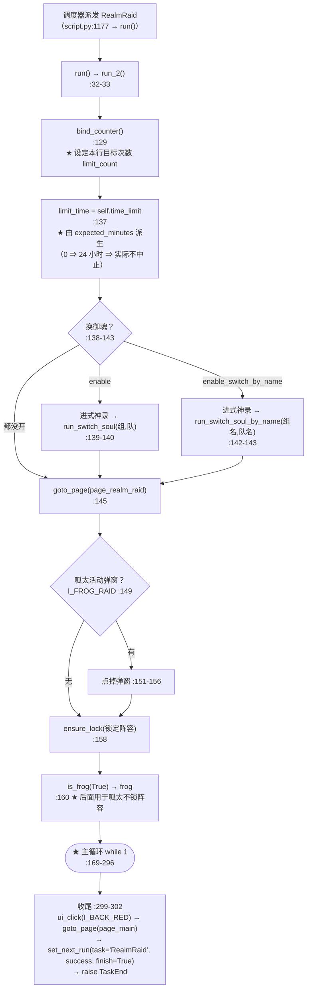

# `RealmRaid`（个人突破 / 结界突破）流程图

> ★ **本文是"逐任务流程图"的样板**（用户 [10-14] 记录第 5 条：
> 「**对每一个任务的代码逻辑，画出流程图，用于理解代码。**」）
>
> ★ **代码位置**：`tasks/RealmRaid/script_task.py`（634 行）
> ★ **配置**：`tasks/RealmRaid/config.py` · **资源**：`tasks/RealmRaid/assets.py`
> ★ **继承**：`GeneralBattle`（战斗循环）· `GameUi`（页面跳转）·
>   `SwitchSoul`（换御魂）· `RealmRaidAssets`（识别素材）
>
> ⚠ **读法**：★ 先看「一、总览」建立骨架，★ 再看「二、主循环」——
>   那是**这个任务的全部决策逻辑**（`run_2()` 的 `while 1`）。
> ★ 每个判断都标了 `script_task.py` 的**行号**（读代码时可直接定位）。

---

## 一、总览：从被派发到收尾



★ **注意**：★ 本任务**自己不做**"标记本轮已完成"的**成功路径**判断 ——
  它只在**没票**时主动上报（见下），★ 其余交给 `script.py` 收尾
  （`entry_target_reached()` ⇒ 临时任务跑完即完成，SPEC §1.6.x-Z6）。

---

## 二、主循环（★ 全部决策都在这里）

```mermaid
flowchart TD
    S(["循环头 :170"]) --> P{"raise_if_paused()？<br/>:171"}
    P -- "是（暂停/停止）" --> Z1["break :173<br/>★ 走收尾，success 保持 True"]
    P -- "否" --> Q{"I_FRESH_ENSURE 弹窗？<br/>:175"}
    Q -- "是" --> Q2["点确定（刷新确认）:177<br/>continue"]
    Q2 --> S
    Q -- "否" --> R{"check_ticket(number_base)？<br/>:180"}
    R -- "★ 没票" --> R2["★★ mark_entry_completed('没券了（本轮结束）')<br/>:198<br/>★ 语义：没票 = 本轮【正常结束】（成功）<br/>★ 不标"资源耗尽"；★ 清 success 不变<br/>⇒ 调度层 _skip_by_completed 剔出 pending<br/>⇒ 不再 40 秒一轮；★ 新一轮自动清零"]
    R2 --> Z2["break :200 → 收尾（success=True）"]
    R -- "有票" --> T{"datetime.now() - start_time >= limit_time？<br/>:219"}
    T -- "超时" --> Z3["break :222 → 收尾"]
    T -- "没超时" --> U{"current_count >= limit_count？<br/>:228<br/>★ limit_count 来自 bind_counter()"}
    U -- "打满了" --> Z4["break :231 → 收尾"]
    U -- "还没" --> V["find_one(False) → (medal, index)<br/>:233<br/>★ 按 order_attack 顺序找可打的勋章"]
    V --> W{"找到了？<br/>:234"}
    W -- "没有" --> X{"when_attack_fail？<br/>:236"}
    X -- "CONTINUE" --> X2{"check_refresh()？<br/>:238"}
    X2 -- "刷到了" --> S
    X2 -- "在 CD 中" --> X3["success = False; break :241-242"]
    X -- "其它（EXIT 等）" --> X4["success = False; break :250-251<br/>（顺带点掉挡路的刷新弹窗）"]
    W -- "找到 index" --> Y{"index == 1（左上角第一个）<br/>且 exit_four？<br/>:254-256"}
    Y -- "是" --> Y2["★★ 退四打九：fire(1) + run_general_battle_back(exit_four=True) × 4<br/>:258-265<br/>（先退 4 场把分数压下来）"]
    Y -- "否" --> Y3{"check_medal_is_frog(frog, medal, index)？<br/>:266<br/>★ 呱太（7-9 号位 + 4/5 星）⇒ 关掉"锁定阵容""}
    Y3 -- "是" --> Y4["lock_team_enable = False（临时）:268"]
    Y3 -- "否" --> Y5
    Y4 --> Y5["fire(index) :269（点挑战）"]
    Y2 --> Y5
    Y5 --> Y6["last_battle = run_general_battle(config)<br/>:270<br/>★ 真正的战斗循环（GeneralBattle）"]
    Y6 --> Y7{"reward_detect_click(False)？<br/>:274<br/>★ 三胜奖励"}
    Y7 -- "有奖励" --> S
    Y7 -- "无" --> Y8{"three_refresh 且出现 I_RR_THREE？<br/>:278"}
    Y8 -- "是" --> Y9{"check_refresh()？<br/>:280"}
    Y9 -- "成功" --> S
    Y9 -- "CD 中" --> Y10["success = False; break :283-284"]
    Y8 -- "否" --> Y11{"上一场输了 且 when_attack_fail == REFRESH？<br/>:286"}
    Y11 -- "是" --> Y12{"check_refresh()？<br/>:288"}
    Y12 -- "成功" --> S
    Y12 -- "CD 中" --> Y13["success = False; break :291-292"]
    Y11 -- "否" --> Y14{"上一场输了 且 when_attack_fail == EXIT？<br/>:294"}
    Y14 -- "是" --> Z5["break :296 → 收尾"]
    Y14 -- "否" --> S
```

★ **循环的"三条出口语义"**（★ 读这段最能理解设计）：

| 出口 | 条件 | `success` | 含义 |
|---|---|---|---|
| ★ `mark_entry_completed` + break | **没票** | `True` | ★ **本轮正常结束**（★ 用户裁定"没票了应该算这轮结束啊，也算成功结束了啊"）|
| ★ `break` | 超时 / 次数打满 / `raise_if_paused` / 输了且 EXIT | `True` | ★ 正常收尾（★ 没有失败语义）|
| ★ `success = False; break` | 刷新失败（CD 中/找不到按钮） | `False` | ★ 唯一会置失败的路径 |

---

## 三、子过程（被主循环调用）

```mermaid
flowchart LR
    subgraph check_ticket["check_ticket(base) :356-379 — 还有票吗"]
        A1["wait_until_appear(I_BACK_RED)"] --> A2["OCR 票数 O_NUMBER → (cu, res, total)"]
        A2 --> A3{"total == 0？"}
        A3 -- "是" --> A4["reward_detect_click(True)（先领奖励）→ 重新 OCR"]
        A3 -- "否" --> A5
        A4 --> A5{"cu == 0 且 cu+res == total？"}
        A5 -- "是" --> A6["False：没票 :375"]
        A5 -- "否" --> A7{"cu + res == total 且 cu < base？"}
        A7 -- "是" --> A8["False：票不够基准 :378"]
        A7 -- "否" --> A9["True"]
    end
    subgraph find_one["find_one() :408-442 — 找可打的勋章"]
        B1{"when_attack_fail == CONTINUE？"} -- "是" --> B2["把"上次失败"的位置涂黑<br/>（false_roi + false_image）:424-430"]
        B1 -- "否" --> B3
        B2 --> B3["order_medal.find_anyone(image)<br/>★ 按用户配的 order_attack 顺序（如 5>4>3）"]
        B3 --> B4{"找到？"}
        B4 -- "是" --> B5["用 partition 九个分区反查它在第几格 → index :435-440"]
        B4 -- "否" --> B6["(None, None)"]
    end
    subgraph fire["fire(order) :537-589 — 点挑战"]
        C1["等到 I_RR_PERSON 出现<br/>（期间点安全区清理奖励弹窗，最多 20 次）"] --> C2["点击 partition[order-1]"]
        C2 --> C3["循环：弹窗点取消 / I_SOUL_RAID 点掉 / I_FIRE 点挑战<br/>直到 I_RR_PERSON 消失"]
    end
    subgraph refresh["check_refresh() :512-535 — 刷新对手"]
        D1{"I_FRESH 出现？"} -- "否" --> D2["False（CD 中）"]
        D1 -- "是" --> D3["点刷新 → 等 I_FRESH_ENSURE 出现"]
        D3 --> D4["点确定 → 等确认框消失"]
        D4 --> D5["True"]
    end
    subgraph reward["reward_detect_click() :478-510 — 三胜奖励"]
        E1["等到 I_BACK_RED"] --> E2["OCR O_TEXT"]
        E2 --> E3{"有中文（= 聊天框遮挡）？"}
        E3 -- "是" --> E4["循环：等到出现 x/y 票数形式 → True"]
        E3 -- "否" --> E5["隐式返回 None"]
    end
    subgraph medal["medal_fire() :48-88 — 勋章页的挑战"]
        F1["等 I_FIRE 出现"] --> F2["点勋章（I_SOUL_RAID 干扰则先点掉）"]
        F2 --> F3["点 I_FIRE → 等它消失"]
    end
    subgraph battle["run_general_battle(config) :270 / run_general_battle_back :103<br/>★ 公共战斗循环 tasks/Component/GeneralBattle/"]
        G1["进入战斗 → battle_wait（★ battle_wait_strategy 装饰）"] --> G2["结算 → 返回是否胜利 last_battle"]
    end
    subgraph exitfour["退四打九（RaidMode.NORMAL）:100-112"]
        H1["medal_fire + run_general_battle_back(退出)"] --> H2["× 4 轮"]
    end
```

---

## 四、与调度层的接口（★ 这四条最容易踩错）

| # | 接口 | 代码 | 说明 |
|---|---|---|---|
| **1** | ★ **次数从哪来** | `bind_counter()` :129 | ★ `limit_count` = 条目级 `target` → 任务级 `number_attack` ⇒ ★ **界面改得到**（改造前直接读配置，改不到）|
| **2** | ★ **本轮完成怎么上报** | `mark_entry_completed('没券了（本轮结束）')` :198 | ★ **只在没票时**上报 ⇒ ★ 调度层 `_skip_by_completed` 剔出 pending（不再反复派发）|
| **3** | ★ **收尾怎么排下一次** | `set_next_run(task='RealmRaid', success=success, finish=True)` :301 | ★ 之后 `raise TaskEnd` :302 ⇒ ★ 控制权回 `script.py` 的 `loop()` 收尾 |
| **4** | ★ **暂停/切条怎么响应** | `raise_if_paused()` :171 | ★ 每轮循环头检查 ⇒ ★ 用户点「暂停调度」/ 别的行 `[▶]` ⇒ **本轮结束**（★ 不会卡在这里）|

---

## 五、已知坑（★ 改这个任务前必读）

| # | 坑 | 位置 |
|---|---|---|
| **1** | ★★ **`limit_time` 必须显式赋值** —— 本任务**原先从不设置**它，直接比较会 `TypeError`（`None >= timedelta`）| :137（片 4 补）|
| **2** | ★★ **没票 ≠ 失败** —— 标 `success=False` 会让"本轮正常结束"被记成失败 | :181-199（用户裁定）|
| **3** | ★★ **不许标"资源耗尽"** —— 项目里没有监控门票的机制，标了**永不解锁** | :194-195 |
| **4** | ★ **呱太（7-9 号位 + 4/5 星）要临时关"锁定阵容"**，打完要**还原** | :266-272 |
| **5** | ★ **`fire()` 有 20 次重试上限**（清奖励弹窗）—— 卡太久会 warning 但不抛 | :543-564 |

---

## ★ 相关文档

* ★ **调度层**：`docs/scheduler-architecture.md` · ★ `docs/DESIGN-SPEC.md` §1
* ★ **本轮状态机制**：`docs/DESIGN-SPEC.md` §1.6.x（`session_start` 时间戳判定）
* ★ **换御魂**：`docs/DESIGN-SPEC.md` §1.5.y（非法配置"响亮地跳过"）
* ★ **完成语义**：`docs/DESIGN-SPEC.md` §1.5（C1~C5）
