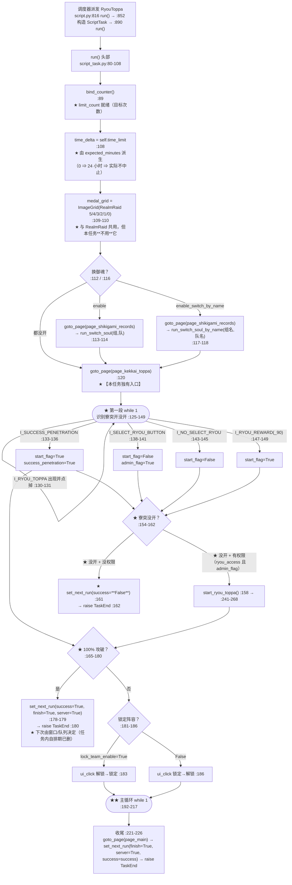

# `RyouToppa`（寮突破）流程图

> ★ **本文与样板 [RealmRaid.md](RealmRaid.md) 是"同源兄弟"** ——
>   两者共用 `RealmRaidAssets` 的素材、共用**同一个** `page_realm_raid` 页、
>   共用 `bind_counter()` / `time_limit` / `set_next_run` 同一套接口。
>   ★ **所以本文不重抄样板**：只写 `RyouToppa` **自己的**判断，
>   并在每处标出"**与 RealmRaid 同/不同**"（见下方对照表）。
>
> ★ **代码位置**：`tasks/RyouToppa/script_task.py`（382 行）
> ★ **配置**：`tasks/RyouToppa/config.py` · **资源**：`tasks/RyouToppa/assets.py`
> ★ **自描述**：`tasks/RyouToppa/meta.py`（`category=TOPPA` · `period=NONE` ·
>   `window=00:00-23:59` 全天 · `list_pos=12`）
> ★ **继承**：`GeneralBattle`（战斗循环）· `GameUi`（页面跳转）·
>   `SwitchSoul`（换御魂）· `RyouToppaAssets`（本任务素材）
>
> ⚠ **读法**：★ 先看「一、总览」建立骨架（**别急着看 `if`**）——
>   ★ 本任务的骨架是**三段**：`goto_page(page_kekkai_toppa)` → **识别寮突开没开**
>   → 主循环 `while 1`（打 8 个区域）。
>   ★ 然后看「二、主循环」—— ★ **全部决策都在那里**，每个判断都标了
>   `script_task.py` 的**行号**（读代码时可直接定位）。
>   ★ 基类里的位置写成相对 `backend` 根的路径（如 `tasks/base_task.py:123`）。
>   ★ 最后看「五、已知坑」—— ★ 那里有 **3 个** 我实测出来的、**改之前必须知道**的问题。
>
> ⚠ **本文的行号 = 我逐行读过 `script_task.py`（382 行）后确认的位置**；
>   ★ 有引用基类/公共组件的地方都注明了**是哪一个文件**，不同文件的行号**不可互推**。

---

## ★ `RyouToppa` vs `RealmRaid`：同在哪里 · 不同在哪里

> ★ 先看这张表，再看图 —— 这样两张图就不会混。

| 维度 | ★ 同（可直接对照样板，本文不重复） | ★ 不同（本文独有的重点） |
|---|---|---|
| **入口页面** | 都从庭院进「结界」体系 | ★ 本任务进 **`page_kekkai_toppa`**（`script_task.py:120`）；RealmRaid 进 `page_realm_raid`（`RealmRaid/script_task.py:145`）|
| **素材** | ★ ★ 共用 `RealmRaidAssets.I_MEDAL_*` / `I_FIRE` / `I_REALM_RAID` | ★ 本任务另有 **8 个区域**的失败/已攻破素材（`RyouToppa/assets.py:36-101`）|
| **目标物** | 都是"一屏多个可打格子" | ★ 本任务是**竖排 8 个区域**（`area_map`，`script_task.py:26-67`）；RealmRaid 是**勋章 6 格 + 分区反查**（`RealmRaid/script_task.py:408-442`）|
| **可打性判据** | 都靠"素材匹配" | ★ 本任务**没有 `order_attack` / 没有勋章星级** —— 靠**区域级** `fail_sign` / `finished_sign`（`script_task.py:291-296`）|
| **"没票"语义** | 都要先探券 | ★ ★ **本任务不改 `success`**（`:200`，**记为失败**）；RealmRaid 保持 `success=True` 且**上报"本轮完成"**（`RealmRaid/script_task.py:198`）|
| **刷新对手** | RealmRaid 有 `check_refresh()` + CD 语义 | ★ 本任务**没有刷新按钮**逻辑；★ 有需要时才用**手势滑动**刷新区块（`flush_area_cache`，`:310-324`）|
| **"退四打九"** | RealmRaid 独有 | ★ 本任务**没有**；`:247-303` 走的是"哪个区域失败就跳过、8 个都不可用才刷新" |
| **完成上报** | 都走 `set_next_run(finish=True)` 收尾 | ★ 本任务**从不调 `mark_entry_completed()`** ⇒ ★ **靠调度层收尾**（见「四、接口 2」）|
| **自排期** | ★ 两者的任务内自排期**都已删**（用户 2026-10-10 裁定）| ★ 本任务自排期删在 `:164-180`、`:296-303`（注释在 `:228-239`）|
| **暂停检查** | ★ 都能被「暂停调度」停下 | ★ 本任务**只在 `attack_area` 的战斗前循环头显式检查**（`:347`）；主循环**不显式检查** ⇒ ★ 靠**框架级兜底**（`screenshot()`，见「四、接口 4」）|
| **次数字段** | 都走 `bind_counter()`（`script_task.py:89`） | ★ 本任务配置里的 `limit_count` **已删** ⇒ 实际取 **`count_default=50`**（`module/config/task_catalog_data.json:597`）|

---

## 一、总览：从被派发到收尾



★ **注意（与样板的关键差别）**：
★ 本任务**在收尾只调 `set_next_run(finish=True)`，从不调 `mark_entry_completed()`**
（`script_task.py` 全文没有这个调用）⇒ ★ "本轮完成"的**上报责任落到调度层**
（`script.py:1325-1333`：临时任务跑完一次即标）—— ★ 见「四、接口 2」。

---

## 二、主循环（★ 全部决策都在这里）

★ 主循环**只有 12 行**（`:192-217`）—— 但 `attack_area()` 里**还有一层 `while True`**
（`:345-368`），那一层才是"点区域 / 等按钮 / 进战斗"的真正决策。
★ 所以本段给**两张图**：主循环 + `attack_area` 内层。

### 2.1 主循环 `while 1`（`:192-217`）

```mermaid
flowchart TD
    S(["循环头 :192"]) --> S1["screenshot() :193<br/>★ 会经过 BaseTask.screenshot → _pause_check_at_screenshot<br/>（tasks/base_task.py:968）"]
    S1 --> P{"I_TOPPA_RECORD 出现？<br/>:194<br/>★ 阈值 0.6（比其它处松）"}
    P -- "否" --> S
    P -- "是" --> P1["stuck_record_add('PREPARE_BEFORE_BATTLE')<br/>:197<br/>★ 声明"这是长任务"，别报卡死"]
    P1 --> Q{"★ has_ticket()？<br/>:198 → :270-284"}
    Q -- "★ 没票（False）" --> Q1["★★ success = False :200<br/>→ break :201<br/>★ 语义：**本轮【失败】**（与 RealmRaid 相反！）"]
    Q -- "有票" --> R{"current_count >= limit_count？<br/>:202<br/>★ limit_count 来自 bind_counter() :89"}
    R -- "打满了" --> R1["break :204 → ★ 正常结束（success 仍为 True）"]
    R -- "还没" --> T{"datetime.now() >= start_time + time_delta？<br/>:205<br/>★ time_delta 见 :108"}
    T -- "超时" --> T1["break :207 → ★ 正常结束（success=True）"]
    T -- "没超时" --> U["res = attack_area(area_index)<br/>:209<br/>★ 内层决策见图 2.2"]
    U --> V{"res 为假？<br/>:211"}
    V -- "★ 否（= 打了一场，返回 True）" --> S
    V -- "★ 是（区域不可用 / 点不到按钮 / 暂停）" --> W["area_index += 1 :212"]
    W --> W1{"area_index >= 8（len(area_map)）？<br/>:213"}
    W1 -- "是" --> W2["area_index = 0; flush_area_cache() :214-216<br/>★ 8 个区域都不可用 ⇒ 滑屏刷新"]
    W1 -- "否" --> S
    W2 --> S
    R1 --> Z["→ 收尾 :221-226"]
    T1 --> Z
    Q1 --> Z
```

★ **主循环的"三条出口语义"**（★ 与样板的三条**不完全一样**）：

| 出口 | 条件 | `success` | 含义 |
|---|---|---|---|
| ★ `break`（`:204`）| **次数打满** `current_count >= limit_count` | `True` | ★ 正常结束（本轮该打的打完了）|
| ★ `break`（`:207`）| **时间上限**到 `now >= start_time + time_delta` | `True` | ★ 正常结束（★ 默认 `expected_minutes=0` ⇒ 24 小时 ⇒ 实际不触发）|
| ★ `success = False; break`（`:200-201`）| ★ **`has_ticket()` 说没票** | ★ `False` | ★ ★ **唯一会置失败的路径** —— 而且它在**两次 OCR 之间**触发（见「五、坑 1」）|
| ★ 不 `break`（`:347-349`）| `attack_area` 内层收到暂停 | （不变）| ★ 内层 `break` **不返回值** ⇒ `None` ⇒ 主循环 :211 判假 ⇒ `area_index += 1` ⇒ ★ **继续打下一个区域**（这是**最容易读错**的一条，见「五、坑 3」）|
| ★ 抛 `TaskPaused` | ★ **框架级**暂停检查（由 `:193` 的 `screenshot()` 触发，`tasks/base_task.py:968`）| —— | ★ `TaskPaused` 是 `BaseException` ⇒ ★ **跳过本任务收尾**（`:221-226` 不执行）⇒ ★ 不停在 `page_main`、不重排 `next_run` |

★ **判断顺序的坑**：★ 本任务是 **"先探券（`:198`）→ 再看次数（`:202`）→ 最后看时间（`:205`）"**；
★ 样板 RealmRaid 是 **"先暂停（`RealmRaid/script_task.py:171`）→ 再探券（`:180`）→ 时间（`:219`）→ 次数（`:228`）"**
⇒ ★ **本任务在主循环里没有显式的暂停检查**（只在 `attack_area` 里有）。

### 2.2 `attack_area(index)` 内层循环（`:326-368`）★ 真正的点按决策

```mermaid
flowchart TD
    A(["attack_area(index) :326"]) --> B{"check_area(index)？<br/>:331 → :286-308"}
    B -- "★ 已攻破（finished_sign 命中）:296" --> B1["★★ set_next_run(success=True, finish=True, server=True)<br/>:301-302<br/>→ raise TaskEnd :303<br/>★ 语义：**全部打完 ⇒ 本轮成功结束**"]
    B -- "★ 该区域失败过（fail_sign 命中）:305" --> B2["return False :307<br/>⇒ 主循环 area_index += 1"]
    B -- "★ 可用（True）:308" --> C["★ 随机延迟（可选）:335-337<br/>config.ryou_toppa.raid_config.random_delay"]
    C --> D["rcl = area_map[index]['rule_click'] :340<br/>★ C_AREA_1..8 八个可点区（assets.py:15-29）"]
    D --> E(["内层 while True :345"])
    E --> E1["screenshot() :346"]
    E1 --> E2{"raise_if_paused()？<br/>:347<br/>★ 命中即抛 TaskPaused（不会返回 True）"}
    E2 -- "抛异常" --> E3["★ 任务在安全点中断（收尾由 script.py 保证）"]
    E2 -- "没抛" --> E4{"click_failure_count >= 5？<br/>:350"}
    E4 -- "是" --> E5["warning + return False :351-352<br/>★ 语义：**点不到 ⇒ 当"区域不可用"**"]
    E4 -- "否" --> F{"I_TOPPA_RECORD 出现？<br/>:353<br/>★ 阈值 0.85（比主循环的 0.6 严）"}
    F -- "★ 不出现" --> F1["sleep(1) + 再截一张 :354-355"] --> F2{"再判一次出现？<br/>:356"}
    F2 -- "又出现了" --> E
    F2 -- "仍不出现" --> F3["return run_general_battle(config) :358-359<br/>★ 已进入战斗画面 ⇒ 打这一场"]
    F -- "★ 出现（还在区域列表页）" --> G{"appear_then_click(I_FIRE)？<br/>:361<br/>★ RealmRaidAssets.I_FIRE（共用素材）"}
    G -- "命中" --> G1["click_failure_count += 1 :362 → continue"]
    G -- "否" --> H{"click(rcl)（点该区域格子）？<br/>:364<br/>★ interval=5 秒节流"}
    H -- "命中" --> H1["time.sleep(0~0.3) :366<br/>click_failure_count += 1 :367 → continue"]
    H -- "否" --> E
    G1 --> E
    H1 --> E
```

★ **这张图里最反直觉的一条**（★ 我读了三遍才确认）：
★ `:361` / `:364` 是 **"先找 `I_FIRE`（挑战按钮），找不到才点区域格子"** ——
也就是 **"区域格子会在下一轮循环才被点到"**，
★ **且 `:350` 的 5 次失败上限是"每一次成功点击/命中都加一"**，
所以 `I_FIRE` 一旦出现就会立刻把 `click_failure_count` 冲到 5 ⇒ **`return False`**。
★ 这说明设计意图是：**点区域格子的那一次 `click()` 只是"顺手"**，
真正的进入战斗判据是 **`:353` 的"区域列表页消失"**。
★ 我**未在代码注释或文档中找到**对这段顺序的说明 ⇒ 标为「**未确认**」（见结尾）。

---

## 三、子过程（被主循环调用）

```mermaid
flowchart LR
    subgraph has_ticket["has_ticket() :270-284 — 还有进攻机会吗"]
        A1{"hour >= 21 或 hour <= 5？<br/>:276"}
        A1 -- "是" --> A2["★ return True（21 点后无限机会）:277"]
        A1 -- "否" --> A3["wait_until_appear(I_TOPPA_RECORD) :278<br/>→ screenshot() :279"]
        A3 --> A4["O_NUMBER.ocr() → (cu, res, total) :280<br/>★ assets.py:141（DigitCounter，ROI 271,560,48,31）"]
        A4 --> A5{"cu == 0 且 cu + res == total？<br/>:281"}
        A5 -- "是" --> A6["★ return False :283"]
        A5 -- "否" --> A7["return True :284"]
    end
    subgraph check_area["check_area(index) :286-308 — 该区域能打吗"]
        B1["取 fail_sign / finished_sign :291-292<br/>★ area_map[index]（:26-67）"] --> B2{"finished_sign 命中？:296"}
        B2 -- "是" --> B3["★ set_next_run(success=True) :301-302 → raise TaskEnd :303"]
        B2 -- "否" --> B4{"fail_sign 命中？:305"}
        B4 -- "是" --> B5["return False :307（跳过该区域）"]
        B4 -- "否" --> B6["return True :308"]
    end
    subgraph flush["flush_area_cache() :310-324 — 刷新 8 个区域"]
        C1["sleep(2) :311"] --> C2["count = randint(1,3) :313"]
        C2 --> C3["swipe_adb(p1 → p2, duration=0.352)<br/>:318-323<br/>★ 安全区内随机点，滑一段再 sleep(2)"]
    end
    subgraph start["start_ryou_toppa() :241-268 — 作为寮管理开寮突"]
        D1["等 I_SELECT_RYOU_BUTTON 出现并点 :247-250"] --> D2["等 I_GUILD_ORDERS_REWARDS 出现，<br/>点 C_SELECT_FIRST_RYOU :254-257"]
        D2 --> D3["点 I_START_TOPPA_BUTTON :261-264<br/>直到 I_RYOU_REWARD 出现 :266-267"]
    end
    subgraph battle["run_general_battle(config) :359<br/>★ 公共战斗循环 tasks/Component/GeneralBattle/general_battle.py:41-113"]
        E1["准备阶段安全点 :69-71"] --> E2["current_count += 1 :74 + commit_count() :79"]
        E2 --> E3["battle_before(buff, config) :84 → :115-164<br/>★ 第一场（current_count==1）且未锁阵容才换预设/开加成 :141-144"]
        E3 --> E4["绿标 :86-87（config.green_enable）"]
        E4 --> E5["battle_wait(...) :89<br/>★ 本任务**用 @battle_wait_strategy() 覆写**<br/>（script_task.py:370-372）"]
        E5 --> E6["win 且暂停 ⇒ raise_if_paused() :107-108"] --> E7["return win :110-113"]
    end
    subgraph switch["run_switch_soul() / run_switch_soul_by_name()<br/>tasks/Component/SwitchSoul/switch_soul.py:128 / :295"]
        F1["先校验组/队（非法则**响亮跳过**）:156-160"] --> F2["click_preset() :161 → switch_souls(pairs) :162"]
    end
    subgraph goto["goto_page(page) tasks/GameUi/navigator.py:768-888"]
        G1["_refresh_current_page → 识别当前页 :801"] --> G2{"已在目标页？:827"}
        G2 -- "是" --> G3["_finalize_arrival :829 → return True"]
        G2 -- "否" --> G4["_build_path → _execute_transition :856-875<br/>30 秒无进展 ⇒ raise GamePageUnknownError :818"]
    end
```



★ **注意 `run_general_battle` 的副作用**（★ 与"次数"直接相关）：
★ 它**在战斗真正开始之前**就 `current_count += 1`（`general_battle.py:74`）
⇒ ★ 即使这一场**打输了 / 中途退出**，次数**也已经算上了**。

---

## 四、与调度层的接口（★ 这四条最容易踩错）

| # | 接口 | 代码 | 说明 |
|---|---|---|---|
| **1** | ★ **次数从哪来** | `bind_counter()` `script_task.py:89` → `tasks/base_task.py:286-389` | ★ `limit_count` = **条目级 `target`** → 任务级 `scheduler.target` → **`meta.count_default`**。★ 本任务**三级里的前两级都可能落空** ⇒ 实际默认 **50**（`module/config/task_catalog_data.json:597`，来自历史迁移记录 `module/config/config.py:956` 的 `raid_config.limit_count=50`）。★ `current_count` **本轮从 0 开始且不读盘**（`tasks/base_task.py:374`）|
| **2** | ★ **本轮完成怎么上报** | ★ **本任务自己不上报** —— 全文**没有** `mark_entry_completed()` 调用 | ★ 由**调度层收尾**完成：`script.py:1325-1333` → `entry_is_temporary(eid)`（`module/config/config.py:3974-3995`，判据是 **`task_period()`**，不是 `meta.auto_queue`）**且** `entry_target_reached(eid)`（`:3997-` ，临时任务**能走到收尾即 True**）⇒ 标 completed ⇒ 下一轮 `_skip_by_completed()`（`:3917-3971`）把它剔出 pending。★ **只对 `period='none'` 生效** ⇒ ★ 本任务 `meta.py:37` 的 `period=Period.NONE` 正好命中 ⇒ **会**被标记 ⇒ **不会**被 40 秒一轮反复派发 |
| **3** | ★ **收尾怎么排下一次** | `set_next_run(task='RyouToppa', finish=True, server=True, success=...)` `script_task.py:178` / `:161` / `:223` / `:225` / `:301` → `tasks/base_task.py:1559-1574` | ★ **5 处**调用，`success` 各不相同（见下表）。★ 之后一律 `raise TaskEnd` ⇒ 控制权回 `script.py:913` ⇒ ★ 由 `next_run` + **窗口/队列顺序**决定下次。★ `finish=True` ⇒ 以**收尾时刻**为基准（`tasks/base_task.py:1570-1571`）|
| **4** | ★ **暂停/切条怎么响应** | ① 显式：`raise_if_paused()` `script_task.py:347`（**只在 `attack_area` 内层**）② 框架级：`tasks/base_task.py:968` `_pause_check_at_screenshot()` ← 由 `screenshot()` 触发 | ★ ① 抛 `TaskPaused` ⇒ 中断；★ ② 是**兜底**：`PAUSE_BATTLE` 模式下**任何** `screenshot()` 都会检查（三道闸：临界区 / 排除名单 / 模式，`tasks/base_task.py:801-846`）。★ **本任务不在排除名单**（`tasks/base_task.py:767-771` 只有 `MysteryShop`/`FindJade`/`Hyakkiyakou`）⇒ ★ **「暂停调度」立刻能停**（代价：可能停在界面操作中途）。★ **切条**（用户点别条 `[▶]`）由 `should_stop_battle_loop()` 的 `force_next_entry_id ≠ running_entry_id` 判据处理（`tasks/base_task.py:571-595`）⇒ 本任务会**打完当前这场**再停 |

### ★ 5 处 `set_next_run` 的语义矩阵（★ 本任务最该记住的一张表）

| 行号 | 触发点 | `success` | 语义 |
|---|---|---|---|
| `:161` | 寮突**没开** + **没权限** | ★ **False** | ★ 失败（"我不是管理，开不了"）|
| `:178` | 检测到 **100% 攻破**（`I_SUCCESS_PENETRATION`）| `True` | ★ 成功；★ 下次由窗口/队列决定 |
| `:223` | 主循环正常收尾且 `success` 仍为 `True` | `True` | ★ 成功 |
| `:225` | 主循环正常收尾且 `success` 为 `False`（→ 只有"没票"会这样）| ★ **False** | ★ 失败 |
| `:301` | `check_area` 发现某区域**已攻破** ⇒ `raise TaskEnd` | `True` | ★ 成功（"能打的都打完了"）|

★ 注意 **`:223`/`:225` 的 `if/else` 是冗余的**（`success` 只有 `True`/`False` 两种取值）
—— ★ 不是 bug，但改的时候别以为漏了分支。

---

## 五、已知坑（★ 改这个任务前必读）

| # | 坑 | 位置 | 现在的样子 |
|---|---|---|---|
| **1** | ★★ **没票 = 失败**（与样板相反）| `:198-201` | ★ `has_ticket()` 返回 False 时 **`success = False` + `break`** ⇒ 收尾走 `:225` 记失败。★ 日志里写的是 `"Try again after 1 hour."`（听起来是"待会儿再来"），**但代码记的是失败**。★ 对照样板 `RealmRaid/script_task.py:180-200`：那里**保持 True 且调 `mark_entry_completed()`**。★ **这是本任务最大的语义不一致** |
| **2** | ★★ **满票会被误判成"没票"** | `has_ticket()` `:281-283` | ★ 判据是 `cu == 0 and cu + res == total`。★ `O_NUMBER` 是 `DigitCounter`（`assets.py:141`），★ `sub_ocr.py:157-166` 的语义是 `current = 已用`、`res = total - current` ⇒ ★ 当界面显示 **`0/6`（一次没打）** 时 `cu=0, res=6, total=6` ⇒ ★ **条件成立 ⇒ 判"没票"** ⇒ ★ **任务一场不打就记失败**。★ 只有当"满票 = 已用完"时才成立 ⇒ ★ **至少有一种票数语义会被误判**（哪一种取决于游戏界面实际显示"剩余"还是"已用"，我**未确认**）|
| **3** | ★★ **`attack_area` 的"暂停"会变成"打下一个区域"** | `:347-349` + `:211-217` | ★ `if self.raise_if_paused(): ... break` —— 但 `raise_if_paused()`（`tasks/base_task.py:686-717`）**命中时抛 `TaskPaused`，从不返回 `True`** ⇒ ★ 这个 `break` 是**死代码**。★ 更麻烦的是：即使真的 `break` 出内层循环，★ 函数会**返回 `None`** ⇒ ★ 主循环 `:211` 判假 ⇒ ★ **`area_index += 1` 继续打下一个区域**，而不是收尾。★ 若想让"暂停"真的收尾，必须在内层 **`return True`** 或直接把信号抛出去 |
| **4** | ★★ **主循环没有显式暂停检查** | `:192-217` | ★ 全靠框架级兜底（`screenshot()` → `tasks/base_task.py:968`）。★ **在 `PAUSE_ROUND`（⏭ 本轮跑完再停）模式下框架层不介入**（`tasks/base_task.py:836`）⇒ ★ 本任务此时**没有自己的检查点** ⇒ 会一直打到次数/时间上限。★ 与样板 `RealmRaid/script_task.py:171` 形成对照 |
| **5** | ★ **`click_failure_count` 的语义是"点击次数"而不是"失败次数"** | `:344` / `:362` / `:367` / `:350` | ★ 每次 `I_FIRE` 命中（`:362`）或每次点到区域格子（`:367`）都 **+1** ⇒ ★ 它到 5 很快 ⇒ `:350-352` 会 **`return False`** ⇒ 主循环**换下一个区域**。★ 改这个阈值前先看懂它在数什么 |
| **6** | ★ **`skip_difficult` 是死配置** | `config.py:12-13`（字段）· 全仓**无引用** | ★ 我在**整个 `backend/` 下 grep 过 `skip_difficult`**：只有 `tasks/RyouToppa/config.py:12` 这一处**定义**，**没有任何读取**。★ 界面上它仍在（`description='skip_difficult_help'`）⇒ ★ 改了**没有效果**。★ 与"已删"的 `raid_config.limit_time`（`:90-99` 注释）不同：那个是真删了 |
| **7** | ★ **`flush_area_cache()` 是"手势模拟"而非游戏 API** | `:310-324` | ★ 注释（`:315-317`）自述：`win32api` / `WM_MOUSEWHEEL` 都试过、"出现过很多次离奇事件" ⇒ ★ 现在用 `swipe_adb`（`:323`）+ 硬编码 `duration=0.352`（`:312`）+ 随机坐标（`:318-319`）。★ **分辨率变了就会刷错** |
| **8** | ★ **`start_ryou_toppa()` 三个 `while 1` 都没有超时** | `:247` / `:254` / `:261` | ★ 只靠 `stuck_record` 看门狗兜底。★ 若"选择阴阳寮"列表里**没有可选寮**（`I_GUILD_ORDERS_REWARDS` 不出现），会**卡在这里**直到看门狗报 `GameStuckError` |
| **9** | ★ **第一段 `while 1`（`:125-149`）可能永不退出** | `:125-149` | ★ 五个分支**都不命中**时 `continue` 回到循环头 ⇒ ★ 无限重试。★ 且 `:130` 的 `I_RYOU_TOPPA` 点击**没有 `break`**（`:131` 是 `continue`），★ `:127` 的 `I_REALM_RAID` 同理 —— 这是**故意的**（"先把它点掉再看"），但意味着**识别素材失效时会空转** |
| **10** | ★ **`battle_wait` 被 `@battle_wait_strategy()` 覆写但没传参** | `:370-372` | ★ 效果是"**重设** plan 为默认"，并**顺带**启用 `randomclick` 钩子（`battle_wait.py:701-731`：kwargs 里 `random_click_swipt_enable` 为真时会 `override('randomclick_default')`）。★ 与样板 `RealmRaid/script_task.py:621-623` **写法完全一样** ⇒ ★ 这段是"同源代码"，改一处要改两处 |

---

## ★ 相关文档

* ★ **样板**：`docs/flows/RealmRaid.md`（★ 同源任务，先读它再读本文）
* ★ **固定结构**：`docs/flows/README.md` 的「每份流程图的固定结构」段
* ★ **调度层**：`docs/scheduler-architecture.md` · `docs/DESIGN-SPEC.md` §1
* ★ **本轮状态机制**：`docs/DESIGN-SPEC.md` §1.6.x（`session_start` 时间戳判定）
* ★ **暂停 / 切条**：`docs/architecture.md` §6.1
* ★ **窗口与全天**：`tests/module/config/test_window_single_source.py::TestRyouToppaIsFullDay`
* ★ **换御魂非法配置**：`docs/DESIGN-SPEC.md` §1.5.y（`tasks/Component/SwitchSoul/switch_soul.py:128-160`）

---

## ★ 未确认清单（★ 我没有编造，以下都**没核实**）

| # | 未确认的点 | 为什么未确认 |
|---|---|---|
| **1** | `O_NUMBER` ROI 里的数字**到底是"剩余次数"还是"已用次数"** | ★ 需要真机截图才能定。★ 但坑 2 的逻辑分析**不依赖**这一条：无论哪种语义，`cu == 0 and cu + res == total` 都**不可能**只表示"没票" |
| **2** | `I_REAL_RAID_REFRESH`（`assets.py:134`）在**本任务里到底什么时候出现** | ★ 它只在 `:129` 被 `appear()` 判断，**从没被点击**（`:130` 点的是 `I_RYOU_TOPPA`）。★ 没有找到对应文档 |
| **3** | `attack_area` 里 **"先判 `I_FIRE`、后点区域格子"** 的顺序是否为有意设计 | ★ 代码与注释（`:341-342` 注释掉的 `ui_click` 写法）**都没有说明**。★ 我只能确认**代码事实**（见图 2.2） |
| **4** | `medal_grid`（`:109-110`）在本任务里**有任何用处吗** | ★ 我在 `tasks/RyouToppa/` 下**没找到**对 `self.medal_grid` 的使用；★ 它是从 RealmRaid 复制过来的"同源残留"（★ 但 `ImageGrid` 可能被基类按属性名读取，**未确认**）|
| **5** | `I_RYOU_REWARD` 阈值不一致（`:147` 用 `0.8`、`:266` 用 `0.8`，而 `assets.py:128` 声明 `0.65`）是否有意 | ★ 代码里三处阈值不同，**没有注释解释** |
| **6** | 本任务在 `PAUSE_ROUND` 模式下**究竟靠什么停** | ★ 代码上只有 `:347` 一处（且见坑 3/4）。★ 我**没有实机验证**过 |
