# `Tako`（石距）流程图

> ★ **本文是"逐任务流程图"**（用户 [10-14] 记录第 5 条：
> 「**对每一个任务的代码逻辑，画出流程图，用于理解代码。**」）
>
> ★ **代码位置**：`tasks/Tako/script_task.py`（163 行）
> ★ **配置**：`tasks/Tako/config.py` · **资源**：`tasks/Tako/assets.py`（★ **空壳**，见 §五-1 / §五-9）
> ★ **元数据**：`tasks/Tako/meta.py`（`category=TIMED` · `period=DAILY` · 两个窗口）
> ★ **继承**：`GameUi`（页面跳转 `goto_page`）· `GeneralBattle`（战斗循环）·
>   `GeneralRoom`（**开房 / 场地选择 / 次数倒计时**）· `GeneralInvite`（**组队身份**）·
>   `SwitchSoul`（换御魂）
>
> ⚠ **读法**：★ 先看「一、总览」建立骨架，★ 再看「二、主循环」——
>   本任务的"主循环"**不是** `while 1`（它**没有**主循环体），
>   ★ 而是 `run()` 里的一条**单轮直线流程**（`run()` :23-103）。
> ★ 每个判断都标了 `文件:行号`（读代码时可直接定位）。
> ★ 基类里的位置写成相对 `backend` 根的路径，如 `tasks/base_task.py:286`。

---

## 一、总览：从被派发到收尾

```mermaid
flowchart TD
    A["调度器派发 Tako<br/>（定时类: auto_queue=True<br/>meta.py:25）→ run() :23"] --> B{"换御魂（组,队）？<br/>script_task.py:25"}
    B -- "是" --> B2["goto_page(page_shikigami_records)<br/>→ run_switch_soul(组,队)<br/>:26-27<br/>★ 非法组/队 ⇒ 只记 error 并跳过<br/>（switch_soul.py:157-160）"]
    B -- "否" --> C
    B2 --> C{"换御魂（按名字）？<br/>:29"}
    C -- "是" --> C2["goto_page(page_shikigami_records)<br/>→ run_switch_soul_by_name(组名,队名)<br/>:30-32"]
    C -- "否" --> D
    C2 --> D{"加成开关 enable？<br/>:35<br/>★ 取 conf.tako_config"}
    D -- "是" --> D2["goto_page(page_main) → open_buff()<br/>:36-37<br/>★ 再按 4 个勾选开加成 :38-45<br/>→ close_buff() :46"]
    D -- "否" --> E
    D2 --> E{"user_status == MEMBER？<br/>:65<br/>★ 取自 tako_config 分组内（config.py:27）"}
    E -- "★ 是" --> E2["run_battle_by_accept() :67<br/>★ 内含战斗流程<br/>→ exit_task() :68 → ★ 收尾"]
    E -- "否（ALONE / LEADER）" --> F["goto_page(page_team) :71<br/>★ 进「便捷组队」页"]
    F --> G{"周末？（5 ≤ weekday ≤ 6）<br/>:72"}
    G -- "是" --> G2["zone_name = '喷怒的石距'<br/>→ check_zones(...)<br/>:74-75"]
    G -- "否" --> G3["zone_name = '石距'<br/>→ check_zones(...)<br/>:77-78"]
    G2 --> H
    G3 --> H{"read_zone_countdown(zone_name)<br/>读数 > 0？ :81-82<br/>★ 界面显示刷新倒计时"}
    H -- "★ 是（游戏侧没次数了）" --> H2["set_next_run(finish=True, success=False,<br/>server=False, target=now+cd+5s) :84-86<br/>→ exit_task() :87"]
    H -- "否 / 读不到（None / 0）" --> I{"create_room()？<br/>:88"}
    I -- "否（没按钮 / 没票）" --> I2["★ 直接 exit_task() :89<br/>（★ 但收尾仍报 success=True —— 见 §五-5）"]
    I -- "是" --> J["ensure_public() :90<br/>★ 公开房，等路人"]
    J --> K["create_ensure() :91"]
    K --> L{"user_status == LEADER？<br/>:93"}
    L -- "★ 是" --> L2["enter_room_and_fire(LEADER,<br/>invite_config=conf.invite_config) :94"]
    L2 --> L3{"返回 True？<br/>:94"}
    L3 -- "否" --> L4["logger.warning('Invite team member failed')<br/>→ exit_task() :95-96"]
    L3 -- "是" --> M
    L -- "否（ALONE）" --> L5["enter_room_and_fire(ALONE,<br/>random_wait=60) :99<br/>★ 等路人 60s，超时也开战"]
    L5 --> M["run_general_battle() :100<br/>★ 无参数 ⇒ 全部用默认配置"]
    M --> N["exit_task() :103<br/>★ 关加成 :112-123（只反转勾选的 buff）<br/>★ set_next_run(finish=False, success=True) :125<br/>★ raise TaskEnd('Tako') :126"]
    I2 --> N
    L4 --> N
```

★ **注意（★ 与样板 `RealmRaid` 的「最大差别」）**：

* ★ `Tako` 的 `script_task.py` 里**没有 `while 1` 主循环**，也**没有**任何
  `break` / 超时 / 次数打满的判断 —— ★ **一次派发 = 打一场**（单轮任务）。
* ★ 它**不调用** `bind_counter()` / `commit_count()` / `mark_entry_completed()`
  （全文件 grep 无此三者）⇒ ★ **没有"本轮完成"上报**，也**没有"目标次数"**。
* ★ 它的"次数"完全靠**两层外部机制**：① `meta.py` 的**窗口**（何时允许跑）
  ② 调度器的**重复条目**（想多跑几次 = 队列里多加一条，见 `script_task.py:101-102` 注释）。

---

## 二、主循环（★ 全部决策都在 `run()` 里）

> ★ 本任务没有 `while` 主循环 ⇒ ★ 下表就是**一次派发的全部决策**，
> 每一个出口都列出**语义**（成功 / 失败 / 正常结束）。

```mermaid
flowchart TD
    S(["run() :23 入口"]) --> A1{"switch_soul.enable？<br/>:25"}
    A1 -- "是" --> A2["goto_page(page_shikigami_records) :26<br/>run_switch_soul(switch_group_team) :27<br/>★ 非法组/队 ⇒ 只记 error 并跳过<br/>（switch_soul.py:156-160）"]
    A1 -- "否" --> A3
    A2 --> A3{"switch_soul.enable_switch_by_name？<br/>:29"}
    A3 -- "是" --> A4["goto_page(...) :30<br/>run_switch_soul_by_name(group_name,team_name)<br/>:31-32"]
    A3 -- "否" --> B1
    A4 --> B1{"tako_config.enable？<br/>:35"}
    B1 -- "是" --> B2["goto_page(page_main) :36<br/>open_buff() :37"]
    B2 --> B3{"buff_gold_50_click :38"} -- "是" --> B3a["gold_50() :39"]
    B3 --> B4{"buff_gold_100_click :40"} -- "是" --> B4a["gold_100() :41"]
    B4 --> B5{"buff_exp_50_click :42"} -- "是" --> B5a["exp_50() :43"]
    B5 --> B6{"buff_exp_100_click :44"} -- "是" --> B6a["exp_100() :45"]
    B6 -.-> B7["close_buff() :46"]
    B3a --> B4
    B4a --> B5
    B5a --> B6
    B6a --> B7
    B1 -- "否" --> C1
    B7 --> C1{"user_status == MEMBER？<br/>:65"}
    C1 -- "★ 是" --> C2["run_battle_by_accept() :67<br/>★ 内含战斗 + 接管秒开<br/>（general_invite.py:286-307）"]
    C2 --> C3["exit_task() :68"]
    C1 -- "否" --> D1["goto_page(page_team) :71"]
    D1 --> D2{"5 ≤ start_time.weekday() ≤ 6？<br/>:72（周六/周日）"}
    D2 -- "周末" --> D3["zone_name='喷怒的石距' :74<br/>check_zones(zone_name) :75"]
    D2 -- "工作日" --> D4["zone_name='石距' :77<br/>check_zones(zone_name) :78"]
    D3 --> E1
    D4 --> E1{"cd = read_zone_countdown(zone_name) :81<br/>cd and cd > 0？ :82"}
    E1 -- "★ 是" --> E2["set_next_run(Tako, finish=True,<br/>success=False, server=False,<br/>target=now+cd+5s) :84-86<br/>→ exit_task() :87<br/>★ 语义: 【本次不做】，下一轮排到倒计时结束"]
    E1 -- "否（None = 没定位到条目）" --> F1{"create_room()？ :88"}
    E1 -- "否（0 = 仍有次数）" --> F1
    F1 -- "★ 否" --> F2["exit_task() :89<br/>★ 语义: 【没建成房】——但收尾报 success=True（§五-5）"]
    F1 -- "是" --> F3["ensure_public() :90（★ 恒真返回）<br/>create_ensure() :91"]
    F3 --> G1{"user_status == LEADER？ :93"}
    G1 -- "★ 是" --> G2["enter_room_and_fire(LEADER,<br/>invite_config) :94"]
    G2 --> G3{"返回 True？ :94"}
    G3 -- "否" --> G4["warning + exit_task() :95-96<br/>★ 语义: 【邀请/等待队友失败】"]
    G3 -- "是" --> H1
    G1 -- "否（ALONE）" --> G5["enter_room_and_fire(ALONE,<br/>random_wait=60) :99<br/>★ 返回值被丢弃"]
    G5 --> H1["run_general_battle() :100<br/>★ 无参数 ⇒ config=None<br/>⇒ GeneralBattleConfig() 全默认<br/>（general_battle.py:47-48）"]
    H1 --> H2["exit_task() :103"]
    C3 --> Z
    E2 --> Z
    F2 --> Z
    G4 --> Z
    H2 --> Z(["★ 收尾 exit_task() :105-126<br/>goto_page(page_main) :111<br/>→ 关加成 :112-123<br/>→ set_next_run(finish=False, success=True) :125<br/>→ raise TaskEnd :126"])
```

★ **出口语义表**（★ 读这段最能理解本任务的设计）：

| 出口 | 条件 | 代码 | `set_next_run` | 该出口的**语义** |
|---|---|---|---|---|
| ★ 队员模式 | `MEMBER` :65 | `run_battle_by_accept()` → `exit_task()` :67-68 | `success=True, finish=False` :125 | ★ **正常结束**（打完队长那一场）|
| ★ 倒计时跳票 | 界面读到 `cd > 0` :82 | :84-87 | ★ **`success=False, finish=True, server=False, target=now+cd+5`** | ★ **本次没做**（游戏侧次数未刷新）⇒ 明确排到倒计时后 |
| ★ 建不了房 | `create_room()` False :88 | :89 → `exit_task()` | `success=True, finish=False` :125 | ⚠ **失败被记为成功**（§五-5）|
| ★ 邀请失败 | LEADER 且 `enter_room_and_fire` False :94 | :95-96 → `exit_task()` | `success=True, finish=False` :125 | ⚠ **失败被记为成功**（§五-5）|
| ★ 打完一场 | 走到 `run_general_battle()` :100 | :103 → `exit_task()` | `success=True, finish=False` | ★ **正常结束**（★ 不看战斗胜负）|
| ★ 中途被打断 | 任意 `screenshot()` 处收到暂停 | `tasks/base_task.py:801-846` → `TaskPaused` | ★ 本任务的 `exit_task()` **不执行** | ★ **暂停**（由 `script.py` 接住，见 §四-4）|

⚠ ★ **所有出口最终都落到同一个 `exit_task()`**（:105）——
★ 也就是说 ★ **除了"倒计时跳票"那一条，`success` 恒为 `True`**（:125 是硬编码的）。

---

## 三、子过程（被主循环调用）

```mermaid
flowchart LR
    subgraph switchsoul["换御魂（两条路）"]
        A1["run_switch_soul(target)<br/>switch_soul.py:128-162<br/>★ 先校验: 组1-7 / 队1-4<br/>:119-126 · 非法 ⇒ 响亮跳过 :157-160"] --> A2["click_preset() :164-184<br/>→ switch_souls(pairs) :282-293<br/>→ switch_soul_one(group,team) :186-280"]
        A3["run_switch_soul_by_name(组,队)<br/>:295-302"] --> A4["click_preset() :301<br/>→ switch_soul_by_name(...) :358-471<br/>★ 双向慢扫 _scan_for_name :304-356<br/>★ 找不到 ⇒ 跳过（不卡死）"]
    end
    subgraph buffs["加成（GeneralBuff）"]
        B1["open_buff() general_buff.py:18-37"] --> B2["gold_50/gold_100/exp_50/exp_100<br/>:84 / :104 / :124 / :152<br/>★ 参数 is_open=True 开 / False 关"]
        B2 --> B3["close_buff() :39-50"]
    end
    subgraph zones["场地与倒计时（GeneralRoom）"]
        C1["check_zones(name) :202-234<br/>★ list_find 定位左栏条目 :208<br/>★ '喷怒的石距' ⇒ '价悠的石距' :211-212<br/>★ 石距 还能靠子串命中 :224"] --> C2["list_find(L_TEAM_LIST, name)<br/>tasks/base_task.py:1500"]
        C3["read_zone_countdown(name) :150-200<br/>★ 条目名上方 48px 一条做 OCR :182-189<br/>★ 解析 '2分9秒' :118-148<br/>★ 无倒计时 ⇒ 0 :196 · 定位失败 ⇒ None :176"]
    end
    subgraph room["开房（GeneralRoom）"]
        D1["create_room() :22-45<br/>★ 没有 I_CREATE_ROOM ⇒ False :28-30<br/>★ 点 3 次无效 ⇒ False（疑似没票）:34-37<br/>★ 见 I_CREATE_ENSURE / _2 ⇒ True :41-44"] --> D2["ensure_public() :63-78<br/>★ 恒真（while 1 里没有 return False）"]
        D2 --> D3["create_ensure() :80-102<br/>★ 没确认按钮 ⇒ False :93-95"]
    end
    subgraph invite["组队身份（GeneralInvite）"]
        E1["enter_room_and_fire(status, ...)<br/>:214-284"] --> E2{"LEADER？ :241"}
        E2 -- "是" --> E3["run_invite(is_first=True) :246<br/>→ wait_battle(wait_time) :250<br/>→ click_fire() :253"]
        E2 -- "否 ALONE" --> E4["等 random_wait(=60s) :257-258<br/>★ 房间没建起来 ⇒ 30s 上限返回 False :263-272<br/>★ 超时无人 ⇒ 也开战 :275-279<br/>★ 有人 ⇒ 开战 :280-284"]
        E5["run_battle_by_accept() :286-307<br/>★ MEMBER 专用，内含战斗"] --> E6["check_then_accept() :658-682<br/>★ 被秒开 ⇒ check_take_over_battle :306"]
    end
    subgraph battle["战斗（★ 本任务重写了 battle_wait）"]
        F1["run_general_battle() general_battle.py:41-113<br/>★ 准备阶段暂停断点 :69-71<br/>★ current_count += 1 :74（★ 无参数 ⇒ limit 未设）<br/>★ battle_before(...) :84<br/>★ 绿标 :86-87<br/>★ win = self.battle_wait(...) :89<br/>★ win 后 raise_if_paused() :107-108"] --> F2["★ 本任务的 battle_wait<br/>script_task.py:128-150（★ 覆盖基类）<br/>★ I_WIN / I_REWARD ⇒ True :136-145<br/>★ I_FALSE ⇒ False :147-150"]
        F2 --> F3["battle_before() general_battle.py:115-164<br/>★ is_in_real_battle ⇒ True :133<br/>★ current_count==1 时换预设/开 buff :141-146<br/>★ 点 I_PREPARE_HIGHLIGHT :148-151<br/>★ 超时未点成 ⇒ warning :159-163"]
    end
    subgraph nav["页面跳转（GameUi）"]
        G1["goto_page(page) navigator.py:768-888<br/>★ BFS 找路径 → _execute_transition<br/>★ 30s 无进展 ⇒ GamePageUnknownError :880-888"]
    end
```

★ **子过程清单（一行一个，带位置）**：

| 子过程 | 位置 | 语义 |
|---|---|---|
| `run()`（★ 真正的"主循环"）| `tasks/Tako/script_task.py:23-103` | 单轮直线流程 |
| `exit_task()` | `tasks/Tako/script_task.py:105-126` | ★ 唯一收尾（关加成 + 排下一次 + `TaskEnd`）|
| `battle_wait()`（★ 重写）| `tasks/Tako/script_task.py:128-150` | `I_WIN`/`I_REWARD` ⇒ 胜 |
| `run_switch_soul()` | `tasks/Component/SwitchSoul/switch_soul.py:128-162` | ★ 非法配置 ⇒ 跳过 |
| `run_switch_soul_by_name()` | `tasks/Component/SwitchSoul/switch_soul.py:295-302` | ★ 找不到 ⇒ 跳过 |
| `open_buff()` / `close_buff()` | `tasks/Component/GeneralBuff/general_buff.py:18-37` / `:39-50` | 加成面板开关 |
| `gold_50` / `gold_100` / `exp_50` / `exp_100` | `tasks/Component/GeneralBuff/general_buff.py:84` / `:104` / `:124` / `:152` | `is_open` 决定开/关 |
| `check_zones()` | `tasks/Component/GeneralRoom/general_room.py:202-234` | 选场地；★ `石距` 有子串兜底 |
| `read_zone_countdown()` | `tasks/Component/GeneralRoom/general_room.py:150-200` | ★ `>0` = 没次数 |
| `parse_countdown_text()` | `tasks/Component/GeneralRoom/general_room.py:118-148` | `'2分9秒'` ⇒ 秒 |
| `create_room()` | `tasks/Component/GeneralRoom/general_room.py:22-45` | ★ `False` = 建不了房 |
| `ensure_public()` | `tasks/Component/GeneralRoom/general_room.py:63-78` | ★ 恒真 |
| `create_ensure()` | `tasks/Component/GeneralRoom/general_room.py:80-102` | 点掉"创建确认" |
| `enter_room_and_fire()` | `tasks/Component/GeneralInvite/general_invite.py:214-284` | ALONE 等 60s / LEADER 邀请 |
| `run_invite()` | `tasks/Component/GeneralInvite/general_invite.py:51-136` | ★ 每 20s 重发邀请 |
| `wait_battle()` | `tasks/Component/GeneralInvite/general_invite.py:684-738` | 等队长开战 |
| `click_fire()` | `tasks/Component/GeneralInvite/general_invite.py:204-212` | 点挑战 |
| `run_battle_by_accept()` | `tasks/Component/GeneralInvite/general_invite.py:286-307` | ★ MEMBER 专用，**含**战斗 |
| `run_general_battle()` | `tasks/Component/GeneralBattle/general_battle.py:41-113` | ★ 每场战斗的唯一入口 |
| `battle_before()` | `tasks/Component/GeneralBattle/general_battle.py:115-164` | 预设 / 加成 / 点准备 |
| `goto_page()` | `tasks/GameUi/navigator.py:768-888` | ★ 30s 无进展 ⇒ 抛异常 |

---

## 四、与调度层的接口（★ 这五条最容易踩错）

| # | 接口 | 代码 | 说明 |
|---|---|---|---|
| **1** | ★ **次数从哪来** | ★ **本任务没有"次数"** | ★ `meta.py:22` 是 `Category.TIMED`（★ 不在 `COUNTABLE_CATEGORIES`，`task_catalog.py:97`）⇒ ★ `TaskMeta.countable` 为 `False`（`task_catalog.py:169-171`）⇒ ★ 即使 `bind_counter()` 被调用，`effective_target()` 也会**直接返回 `None`**（`tasks/base_task.py:171-173`）⇒ ★ **`limit_count` 永不设定**。★ 而 `script_task.py` **根本没调** `bind_counter()`（grep 无）|
| **2** | ★ **"何时能跑"从哪来** | `meta.py:41-44` | ★ **两个窗口**：`00:00-11:59` 与 `12:00-23:59`（`AvailabilityWindow(True, ...)`）⇒ ★ 与 `period=DAILY` 派生窗口**行为等价**（`availability.py:350-355` 派生的正是 `0:00-23:59`）⇒ ★ 这是**纯声明**；⚠ 但 `contains()` 是 `[start, end)`（`availability.py:209`）⇒ ★ 每天 `11:59:00-11:59:59` 与 `23:59:00-23:59:59` **各有一分钟不在窗口内**（§五-2）|
| **3** | ★ **本轮完成怎么上报** | ★ **不上报** | ★ 全文件**没有** `mark_entry_completed()`（`tasks/base_task.py:447`）⇒ ★ 调度层不会因为本任务"跑完一场"就把条目剔出 pending ⇒ ★ **要再跑一次，靠队列里的重复条目**（`script_task.py:101-102` 的注释就是这么写的）|
| **4** | ★ **收尾怎么排下一次** | `script_task.py:125-126` | ★ `set_next_run(task='Tako', success=True, finish=False)`（`base_task.py:1559-1574`；`finish=False` ⇒ ★ **以 `self.start_time` 为基准**排下一次，不是"跑完的时刻"）→ ★ 紧接着 `raise TaskEnd('Tako')` ⇒ ★ 控制权回 `script.py`。⚠ **例外**：倒计时跳票那条走的是 `:84-86`（`finish=True, success=False, server=False, target=...`，**排到明确时刻**）|
| **5** | ★ **暂停 / 切条怎么响应** | ★ **本任务自己没有暂停检查点** | ★ `script_task.py` 里**没有** `raise_if_paused()` / `should_stop_battle_loop()`（grep 无）。★ 响应完全靠**框架级兜底**：`screenshot()` → `tasks/base_task.py:949-968` → `_pause_check_at_screenshot()`（`:801-846`），★ 且**只在 `PAUSE_BATTLE` 模式下生效**（`:836-837`；`PAUSE_ROUND` 交给任务自己，而本任务没有那个知识）⇒ ★ 代价：**可能在界面操作中途被停**（`:744-748` 的注释明确说了）。★ `Tako` **不在**排除名单里（`tasks/base_task.py:767-771`）⇒ ★ 组队中途被打断会让**队友干等**（§五-7）|

★ **关于 `current_count`**：★ 本任务没调 `bind_counter()`，所以 `current_count` 停在
  `tasks/base_task.py:116` 的初值 `0`；★ 唯一让它 +1 的地方是
  `tasks/Component/GeneralBattle/general_battle.py:74`；★ 它被用到的地方是
  `general_battle.py:141`（`current_count == 1` ⇒ 才换预设 / 开加成）。
  ★ 对 `Tako` 无实际影响 —— 因为 `run_general_battle()` 用的是**默认配置**
  （`lock_team_enable=False`、`preset_enable=False`，见 `config_general_battle.py:25-28`）。

---

## 五、已知坑（★ 改这个任务前必读）

| # | 坑 | 位置 |
|---|---|---|
| **1** | ★ **`tasks/Tako/assets.py` 是空壳**（`class TakoAssets: pass`，12 行）—— ★ 本任务**不拥有任何素材**，全靠基类：`GameUiAssets` / `GeneralBattleAssets` / `GeneralRoomAssets` / `GeneralInviteAssets` / `SwitchSoulAssets` / `GeneralBuffAssets`。★ 也就是说 **`I_WIN` / `I_FALSE` / `I_REWARD` / `I_CREATE_ROOM` / `L_TEAM_LIST` 全部是别人的素材**，改动要连带核对其余 20+ 个任务 | `tasks/Tako/assets.py:10-11` |
| **2** | ★ **两个窗口在 11:59 / 23:59 各漏 1 分钟** —— `contains()` 用 `[start, end)`（`availability.py:208-211`），而 `meta.py:42-43` 写的是 `11:59` / `23:59`（不是 `12:00` / `24:00`）⇒ ★ 每天有 **2 处 60 秒的"窗口外"**。★ 判据在 `contains` 是闭开区间，★ **我未确认**调度器是否恰好会在那一分钟判定 | `meta.py:41-44` · `module/config/availability.py:208-211` |
| **3** | ★ **`meta.py` 的注释是从"金币妖怪"抄来的** —— `:36-40` 明确在讲"金币妖怪 (a) 多个 window"与**早已删除的"次数补充"旧字段**（★ 该机制已删 ⇒ 见 `docs/deprecated.md`；★ 这里**不写符号名**，否则会触发 `test_docs_no_dead_refs` 的"现行文档不许提已删符号"守卫）。★ 本文件的窗口是 `0:00-11:59` / `12:00-23:59`，即**每天两次节奏**，但这个"一天两次"是否为**石距的真实机制**，★ **我未核实**（注释里自己也写"若该玩法有真实游戏时段，应把它收窄"）| `meta.py:35-44` |
| **4** | ★★ **`battle_wait` 被重写，语义与基类不同** —— 基类会识别 `I_DE_WIN` / `I_REWARD_GOLD` / 统计页并做"二次确认 + 领奖"（`general_battle.py:246-340`）；★ 本任务的版本只认 `I_WIN` / `I_REWARD` / `I_FALSE`（`script_task.py:136-150`）⇒ ★ **只认这 3 张图**。改战斗识别时**只改基类不会生效**，必须改这里 | `script_task.py:128-150` |
| **5** | ★ **`exit_task()` 里的 `success` 是硬编码 `True`**（`:125`）⇒ ★ **`create_room()` 失败（:88-89）和邀请失败（:94-96）都会被记成"本轮成功"**。★ 只有倒计时跳票那条显式写了 `success=False`（`:84`）| `script_task.py:88-89` · `:94-96` · `:125` |
| **6** | ★ **`TakoConfig.enable` 是"死字段"** —— 它在 `:35` 与 `:112` 被读，但它**同时控制了"开加成"和"关加成"**。★ 运行时它必然为真（同一份配置），所以逻辑正确；★ 但**读代码时极易误以为是"任务总开关"** —— 它不是（任务开关在 `scheduler`）| `config.py:25` · `script_task.py:35` · `:112` |
| **7** | ★ **组队任务被打断的正确性风险** —— 本任务会 `ensure_public()` 开**公开房**（`:90`）并可能邀请真人好友（LEADER，`:94`）。★ 框架级暂停在 `screenshot()` 处生效（`base_task.py:949-968`）⇒ ★ 可能在**队友已在房间**时把房主拉走。★ `PAUSE_FRAMEWORK_EXEMPT` 目前只有 3 个任务，**`Tako` 不在其中**（`base_task.py:767-771`）| `script_task.py:90-99` · `tasks/base_task.py:767-771` |
| **8** | ★ `ensure_public()` / `ensure_private()` 的 `while 1` **没有失败出口**（只 `return True`）—— ★ 卡住时靠 device 的卡死看门狗兜底。★ 好消息：这几个 `while` 里都调了 `screenshot()`，所以能响应框架级暂停 | `general_room.py:63-78` |
| **9** | ★ **中文名曾被登记错**：`meta.py:22` 写 `name_zh='石距'`（★ 权威），而 `docs/flows/README.md` 原来把它登记成"**章鱼**" —— ✅ **[10-14] 已订正**（★ 同一批共订正 18 处中文名；★ 结论：**以 `meta.py` 为准**）| `meta.py:22` · `docs/flows/README.md` |
| **10** | ★ 场地名 `'喷怒的石距'`（`:74`）**不是笔误但会归一化成** `'价悠的石距'`（`general_room.py:211-212`）—— ★ 也就是说 OCR 关键词与游戏显示名**不一致**，靠 `:224` 的 `'石距' in text_ocr` **子串兜底**才不至于卡死。★ 这是"OCR 误读被写进代码"的典型痕迹 | `script_task.py:74` · `general_room.py:211-224` |

---

## ★ 相关文档

* ★ **流程图索引与固定结构**：`docs/flows/README.md`
* ★ **样板**：`docs/flows/RealmRaid.md`（★ 对照读：样板有 `while 1` 主循环 + 三条出口，
  本任务是**单轮直线**，★ 两者的"收尾"和"次数"机制**完全不同**）
* ★ **调度层**：`docs/scheduler-architecture.md` · `docs/DESIGN-SPEC.md` §1
* ★ **组队与窗口**：`docs/team-coordination.md`（★ 其中 :41-43 解释了 `'喷怒的石距'`）
* ★ **换御魂的"响亮跳过"**：`docs/DESIGN-SPEC.md` §1.5.y
