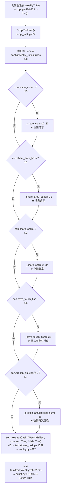
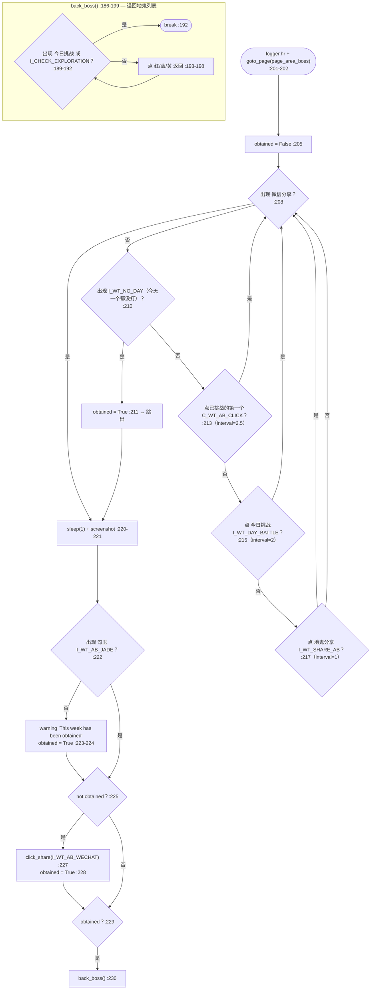
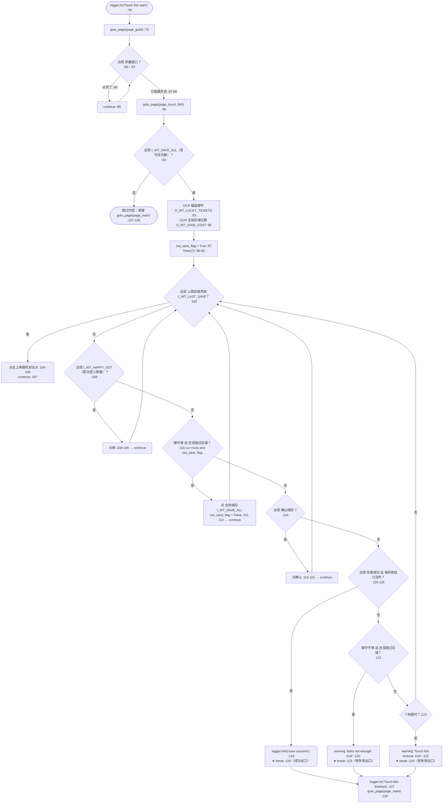
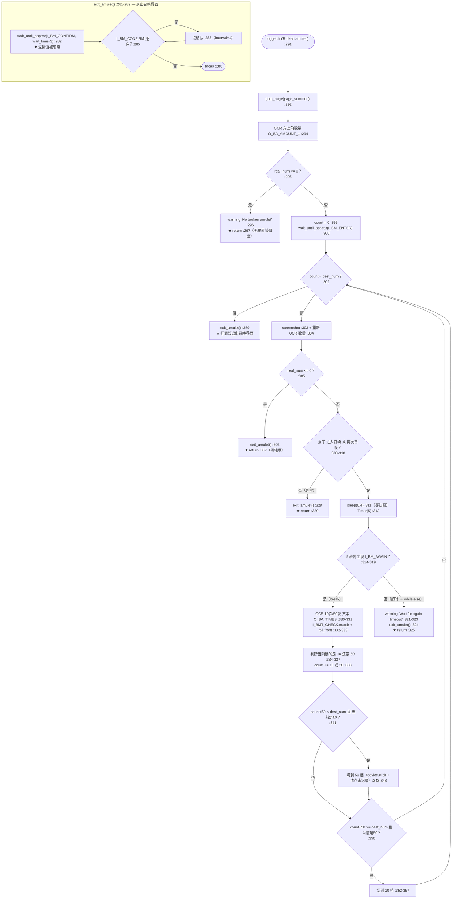
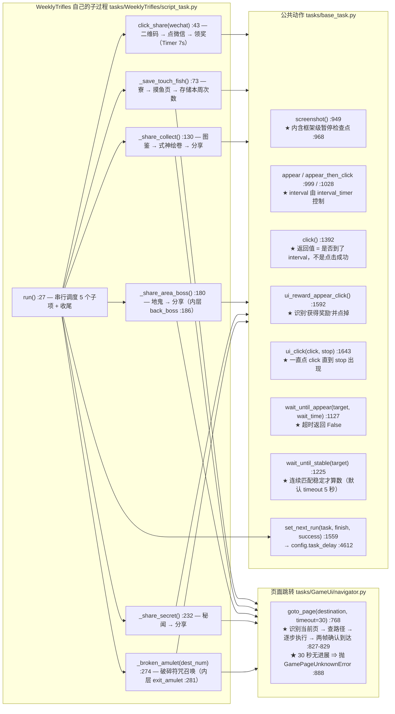
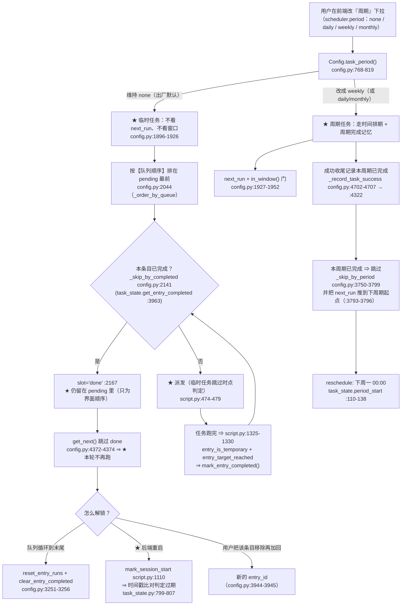

# `WeeklyTrifles`（每周琐事）流程图

> ★ **代码位置**：`tasks/WeeklyTrifles/script_task.py`（374 行）
> ★ **配置**：`tasks/WeeklyTrifles/config.py`（29 行）· **资源**：`tasks/WeeklyTrifles/assets.py`（111 行）
>   · **自描述**：`tasks/WeeklyTrifles/meta.py`（38 行）
> ★ **继承链**（`script_task.py:25`）：
>   `ScriptTask(GameUi, WeeklyTriflesAssets)`
>   → ★ `GameUi`（页面跳转 / 未知页恢复，`tasks/GameUi/navigator.py:36`）
>   → ★ `BaseTask`（`tasks/base_task.py:37`）
>   → `GlobalGameAssets` + `CostumeBase`
>   ⇒ ★ 素材来自 `WeeklyTriflesAssets`（`script_task.py:22`）+ `GameUiAssets` + `GlobalGameAssets`
>
> ⚠ **读法**：★ 先看「一、总览」建立骨架 —— 本任务**没有 `while 1` 主循环**，
>   它的"主"是 **`run()` 里 5 个子项的顺序串行**（`script_task.py:27-41`）。
>   ★ 再看「二、主循环」—— 那是**这个任务的全部决策逻辑**：
>   **5 个子项各自的 `while 1`**，逐个画出来并给出**出口语义**。
> ★ 每个判断都标了 `文件:行号`（读代码时可直接定位；基类写成相对 `backend` 根的路径）。
>
> ★★ **本文最该看的一段**：★★「四、与调度层的接口」——
>   ★ 本任务**不是"定时任务"**：`period = none` ⇒ 它是**临时任务**，
>   ★ "跑过就不再跑"靠的是**完成标记**（不是 `success_interval`，那个字段已删除）。
>   ★ 以及「五、已知坑」第 1 条：**本任务没有任何任务级暂停检查点**。

---

## 一、总览：从被派发到收尾

★ **三个要点**：

1. ★ **串行、无短路**：5 个开关是**独立 `if`**（`:29` / `:31` / `:33` / `:35` / `:37`）——
   顺序固定为 **图鉴 → 地鬼 → 秘闻 → 摸鱼 → 碎符**；某个子项**提前 `return`** 只是结束**它自己**，
   ★ **不影响后续子项**（`run()` 里没有 `return` / `break`）。
2. ★ **没有任何 `try/except`**：★ 任一子项抛异常（如 `goto_page` 抛 `GamePageUnknownError`，
   `tasks/GameUi/navigator.py:818` / `:888`）⇒ ★ `:40-41` 的收尾**不会执行** ⇒ 任务以失败告终。
3. ★ **收尾只有两行**：`:40` 排下一次 + `:41` 抛 `TaskEnd` 交回 `script.py` 的 `loop()`。

★ **注意**：★ 本任务**自己不做**"标记本轮已完成"——★ 它**不调用** `mark_entry_completed()`
（全文件 0 处）；那一步由**框架收尾**代劳（见「四」第 2 条）。

---

## 二、主循环（★ 全部决策都在这里）

> ★ 本任务**没有**统一的 `while 1`。★ "主循环"= **5 个子项各自的循环**。
> ★ 每个子项都用 `while 1: screenshot → 条件 break → appear_then_click(continue)` 的
>   项目通用写法（见 `tasks/base_task.py:1261-1270` 对这套写法的说明）。

### 二·A 分享类：`click_share()`（公共函数）· `_share_collect()` · `_share_secret()`

```mermaid
flowchart TD
    subgraph CS["click_share(wechat) :43-71 — 通用分享（扫二维码 + 点微信 + 领奖）"]
        A1(["进入 :51"]) --> A2{"出现二维码 I_WT_QR_CODE？<br/>:53"}
        A2 -- "是" --> A4
        A2 -- "否" --> A3["点 wechat（interval=2.5）:55<br/>continue"]
        A3 --> A1
        A4["Timer(7) :58-59"] --> A5{"ui_reward_appear_click()？<br/>:62"}
        A5 -- "是" --> A6["return True :64<br/>★ 领到奖了"]
        A5 -- "否" --> A7{"点二维码/微信？<br/>:65-68（interval=4.8）"}
        A7 -- "是" --> A1b["continue"] --> A5
        A7 -- "否" --> A8{"7 秒到了？<br/>:69"}
        A8 -- "是" --> A9["return False :71<br/>★ 超时（奖励可能已领过）"]
        A8 -- "否" --> A5
    end
    subgraph SC["_share_collect() :130-178 — 图鉴分享"]
        B1["goto_page(page_collection) :136"] --> B2{"出现 LOGO？<br/>:140"}
        B2 -- "是" --> B4
        B2 -- "否" --> B3["点 式神 / 式神绘卷 :142-145"] --> B2
        B4{"出现二维码？<br/>:149"} -- "是" --> B6
        B4 -- "否" --> B5["点 微信分享 :151（interval=4）"] --> B4
        B6["Timer(3) :154-155"] --> B7{"领奖？:159"}
        B7 -- "是" --> B9
        B7 -- "否" --> B8["点 二维码/微信 :163-166<br/>或 3 秒超时 :167-169"]
        B8 --> B7
        B9{"回到式神页（I_WT_SHIKIAGMI）？<br/>:173"} -- "是" --> B11(["结束 :178"])
        B9 -- "否" --> B10["点 红返回 / 黄返回 :175-177"] --> B9
    end
    subgraph SS["_share_secret() :232-272 — 秘闻分享"]
        C1["goto_page(page_secret_zones) :238"] --> C2{"出现 微信？:243"}
        C2 -- "是" --> C3["wait_until_stable :244 → 退出循环"]
        C2 -- "否" --> C4{"点 秘闻进入？:246"} -- "是" --> C2
        C4 -- "否" --> C5{"点 分享？:248<br/>（命中则 valid = True :249）"} -- "是" --> C2
        C5 -- "否" --> C6{"出现排行 且 未分享过？<br/>:251"}
        C6 -- "是" --> C7{"等待后 分享 出现？:253-254"}
        C7 -- "是" --> C2
        C7 -- "否" --> C8["★★ 本周还没打过：warning + 两次 ui_click 回庭院<br/>:256-259 → return"]
        C6 -- "否" --> C2
        C3 --> C9{"出现 勾玉 I_WT_SE_JADE？<br/>:264"}
        C9 -- "否" --> C10["obtained = True（本周已领）:265-266"]
        C9 -- "是" --> C11
        C10 --> C11
        C11{"未领取？:268"} -- "是" --> C12["click_share(I_WT_SE_WECHAT) :269"]
        C11 -- "否" --> C13
        C12 --> C13["两次 ui_click 回庭院 :271-272"]
    end
```

★ **出口语义（分享类）**：

| 出口 | 条件 | 语义 |
|---|---|---|
| `click_share` → `True`（`:64`）| 识别到"获得奖励" | ★ **成功领到分享奖励** |
| `click_share` → `False`（`:71`）| 7 秒内没领到 | ★ **软失败**：只 warning，**返回值无人检查**（`:227` / `:269` 都丢弃返回值）|
| `_share_collect` 正常结束（`:178`）| 走完"回去"循环 | ★ **成功**（无任何返回值 / 无异常）|
| `_share_secret` → `return`（`:259`）| 有排行但**没有分享按钮** | ★ **正常跳过**：`logger.warning` + 回庭院，**不报错**（★ 与"失败"不同）|
| `_share_secret` 正常结束（`:272`）| 走到最后 | ★ **成功**（无论是否真领到）|

⚠ ★ `_share_collect` 的 `:138` / `:147` / `:171` 三个循环**都没有超时**（见「五」第 4 条）。

### 二·B `_share_area_boss()`（`:180-230`，内层 `back_boss()` `:186-199`）

★ **出口语义**：★ `_share_area_boss()` **没有返回值、没有 return 语句** ——
  ★ 它**总是走到 `:229-230`**：`obtained` 在 `:211` / `:224` / `:228` 三处都可能被置 `True`
  ⇒ ★ `back_boss()` **实际上无条件执行**（`obtained` 退化成"走完了一遍"）。

### 二·C `_save_touch_fish()`（`:73-128`，★ 本任务唯一会"数数"的子项）

★ **出口语义（摸鱼）**：

| 出口 | 条件 | 语义 |
|---|---|---|
| `break :120` | 出现"存储成功"且"全部储存"按钮已消失 | ★ **成功**（唯一真成功）|
| `break :123` | `cu_tickts < cost_tickts` 且还没按过存储 | ★ **资源不够 → 主动放弃**（warning，不报错）|
| `break :126` | `Timer(7)` 超时 | ★ **超时放弃**（warning，不报错）|
| 跳过整块（`:92` 为假）| 没出现"全部储存" | ★ **本子项什么都没做**，仍回庭院 |

⚠ ★ 三个 `break` 之后**都要走 `:127-128`**（回庭院）——★ 所以"没做成"**不会**影响后面的子项。

### 二·D `_broken_amulet(dest_num)`（`:274-359`，内层 `exit_amulet()` `:281-289`）

★ **出口语义（碎符）**：

| 出口 | 条件 | 语义 |
|---|---|---|
| `return :297` | 进召唤页时 `real_num <= 0` | ★ **无事可做**（warning，不报错）|
| `return :307` | 召唤途中票耗尽 | ★ **资源耗尽 → 正常收尾**（先 `exit_amulet()`）|
| `return :329` | 既没"进入"也没"再次召唤" | ★ **异常兜底**（注释 `:327` 说"一般不会出现"）|
| `return :325` | 5 秒没等到"再次召唤" | ★ **超时兜底**（warning + `exit_amulet()`）|
| `exit_amulet() :359` | `count >= dest_num` | ★ **达成目标 → 正常结束** |

⚠ ★ 注意 `:314` 的 `while ... else`：★ **只有 `:319` 的 `break` 才走 `:330`**；
  超时落到 `while` 的 `else`（`:320-325`），★ 那里是 `return`（**直接结束整个子项**）。

---

## 三、子过程（被主循环调用）

★ **页面定义（都来自全局注册表）**：

| 页面 | 定义位置 | 本任务里被谁用 |
|---|---|---|
| `page_collection` | `tasks/GameUi/default_pages.py:140` | `_share_collect` `:136` |
| `page_area_boss` | `tasks/GameUi/default_pages.py:256` | `_share_area_boss` `:202` |
| `page_secret_zones` | `tasks/GameUi/default_pages.py:252` | `_share_secret` `:238` |
| `page_summon` | `tasks/GameUi/default_pages.py:166` | `_broken_amulet` `:292` |
| `page_guild` | `tasks/GameUi/default_pages.py:110` | `_save_touch_fish` `:79` |
| ★ `page_touch_fish` | ★ `tasks/GameUi/default_pages.py:118-128`（★ **用本任务的素材定义**）| `_save_touch_fish` `:90` |
| `page_main` | `tasks/GameUi/default_pages.py:62` | `_save_touch_fish` `:128` |

★ **资源分组**（`tasks/WeeklyTrifles/assets.py`，★ 每组对应一个子项）：

| 子项 | 素材 |
|---|---|
| 地鬼分享 | `I_WT_DAY_BATTLE` `:20` · `I_WT_NO_DAY` `:22` · `I_WT_SHARE_AB` `:24` · `I_WT_AB_JADE` `:26` · `I_WT_AB_WECHAT` `:28` · `C_WT_AB_CLICK` `:15` |
| 破碎符咒 | `I_BM_ENTER` `:33` · `I_BM_CONFIRM` `:35` · `I_BM_AGAIN` `:37` · `I_BMT_CHECK` `:39` · `O_BA_AMOUNT_1` `:44` · `O_BA_AMOUNT_2` `:46` · `O_BA_TIMES` `:48` |
| 图鉴分享 | `I_WT_SHIKIAGMI` `:58` · `I_WT_SHARE` `:60` · `I_WT_LOGO` `:62` · `I_WT_COLLECT_WECHAT` `:64` · `I_WT_QR_CODE` `:66` · `C_WT_WECHAT` `:53` |
| 秘闻分享 | `I_WT_ENTER_SE` `:71` · `I_WT_SE_SHARE` `:73` · `I_WT_SE_WECHAT` `:75` · `I_WT_SE_JADE` `:77` · `I_WT_SE_RANK` `:79` |
| 摸鱼行动 | `I_GUILD_GOTO_TF` `:84` · `I_WT_HAPPY_GET` `:86` · `I_WT_SAVE_ALL` `:88` · ★ `I_CHECK_TOUCH_FISH` `:90` · ★ `I_WT_TF_GOTO_MAIN` `:92` · `I_WT_OPEN_FOLD_WINDOW` `:94` · `I_WT_FOLD_WINDOW` `:96` · `I_WT_TF_CONFIRM` `:98` · `I_WT_TF_SAVE_SUCCESS` `:100` · `I_WT_LAST_SAVE` `:102` · `O_WT_LUCKY_TICKETS` `:107` · `O_WT_SAVE_COST` `:109` |

★ 带 ★ 的三个素材**同时**被全局页面定义引用（`tasks/GameUi/default_pages.py:121/126/118`）——
★ 见「五」第 9 条。

---

## 四、与调度层的接口（★ 这四条最容易踩错）

★★ **先明确一件事**：★ 本任务在调度器眼里**不是"每周任务"**，而是**临时任务**：

| 判据 | 值 | 位置 |
|---|---|---|
| `meta.py` 出厂周期 | ★ `period=Period.NONE` | `tasks/WeeklyTrifles/meta.py:37` |
| 配置里 `scheduler.period` 的默认 | ★ `TaskPeriod.NONE`（并被一次性迁移按出厂值回填）| `tasks/Component/config_scheduler.py:337-338` · `module/config/config.py:1512-1530` |
| ⇒ `Config.task_period('WeeklyTrifles')` | ★ `'none'` | `module/config/config.py:768-819`（① 配置 ② `meta.py`）|
| ⇒ 临时任务判据 | ★ `True` | `module/config/config.py:1896-1899`（派发）· `:3990`（条目）|
| `meta.py` 声明的窗口 | `AvailabilityWindow(True, 00:00, 23:59)` = ★ **不限时段** | `tasks/WeeklyTrifles/meta.py:35` · `module/config/availability.py:165-186` |
| 类别（总开关）| ★ `category=TIMED` ⇒ 受 **`enable_timed`** 管 | `tasks/WeeklyTrifles/meta.py:23` · `module/config/config.py:1820` → `:3628-3644` → `module/config/timed_schedule.py:52-53` |
| 自动进队列 | ★ `auto_queue=True` | `tasks/WeeklyTrifles/meta.py:25` · `module/config/config.py:2621` |

| # | 接口 | 代码 | 说明 |
|---|---|---|---|
| **1** | ★ **次数从哪来** | `tasks/WeeklyTrifles/config.py:22-24` · `script_task.py:37-38` | ★ **本任务没有调度层意义上的"次数"**：catalog 里 `count_field: null`（`module/config/task_catalog_data.json:711`）⇒ `TaskMeta.countable = False`（`module/config/task_catalog.py:169-171`）⇒ 即使调 `effective_target()` 也直接返回 `None`（`tasks/base_task.py:171-173`）★ 而本任务**根本没调** `bind_counter()`（全文件 0 处）。★ 唯一的"次数"是配置字段 `trifles.broken_amulet`（默认 100），★ **它既当开关**（`:37` 非 0 才跑）**又当目标**（`:38` → `dest_num`）。★ 界面上的「目标次数」框对本任务无效。 |
| **2** | ★ **本轮完成怎么上报** | ★ 任务**不上报**；由框架代劳：`script.py:1325-1330` | ★ `script.py` 收尾时：`entry_is_temporary(eid)`（`module/config/config.py:3974-3995`）+ `entry_target_reached(eid)`（`:3997-4139`，★ 现行语义 = "**临时任务成功跑完一次即 True**"，`:4121-4131`）⇒ `task_state.mark_entry_completed(...)`。★ 然后下一次 `update_scheduler()` 的 `_skip_by_completed`（`:2141`）把它标 `slot='done'`（`:2167`）⇒ `get_next()` 跳过（`:4372-4374`）。★ **所以"跑过就不再跑"是这么来的，不是 `success_interval`**。 |
| **3** | ★ **收尾怎么排下一次** | `script_task.py:40` → `tasks/base_task.py:1559` → `module/config/config.py:4612` | ★ `finish=True` ⇒ 以**收尾时刻**为基准（`tasks/base_task.py:1570-1573`）。★ 但 `success=True` 分支走窗口排期 `next_run_after(task, after, strict=True)`（`:4691`），★ 对**不受限窗口**返回 `when`（= 现在，`:4262-4277`）；★ 最后**临时任务还有一道覆盖**：`next_run > now` ⇒ **压成 now**（`:4807-4818`，注释原话"临时任务不排期"）。★ ⇒ ★ **本任务的 `next_run` 恒等于"现在"，它不决定下次何时跑**。★ 顺序分支同时会调 `_record_task_success`（`:4702-4707`），但 `period=none` 时**直接 return**（`:4337-4338`）⇒ 不写周期完成记忆。 |
| **4** | ★ **暂停/切条怎么响应** | ★ 任务级**没有**检查点；只有框架级：`tasks/base_task.py:968` → `:801-846` | ★ 本任务**从不调** `raise_if_paused()` / `should_stop_battle_loop()`（全文件 0 处，全仓 grep 也只在别的任务里）。★ 生效的是 `screenshot()` 里的兜底检查：★ **只在 `PAUSE_BATTLE`（⏸ 跑完本场就停）** 抛 `TaskPaused`（`:836-842`），由 `script.py:893-912` 接住 ⇒ 回 `loop()` 阻塞等「继续」。★ ⚠ **`PAUSE_ROUND`（⏭ 跑完本轮）与"点别条 `[▶]` 切条"在本任务内不生效** —— 判据在 `should_stop_battle_loop()`（`:518-619`，切条判据 `:586-589`），而本任务不调它 ⇒ ★ **只能等整个任务（最多 5 个子项）跑完**才让位。★ 另：`WeeklyTrifles` **不在**豁免名单 `PAUSE_FRAMEWORK_EXEMPT`（`:767-771`）里，所以兜底对它有效。 |
| **5** | ★ **还受哪些门控** | `module/config/config.py:1820` / `:1829` | ★ ① 类别总开关 `enable_timed`（`:1820` → `:3640`）；★ ② 连续失败冷却（`:1829`，`failure_state`，阈值后进冷却，`script.py:1373-1390`）。★ 任一命中 ⇒ 入 `waiting`，不派发。 |

---

## 五、已知坑（★ 改这个任务前必读）

| # | 坑 | 位置 |
|---|---|---|
| **1** | ★★ **本任务没有任何任务级暂停检查点** —— 不调 `raise_if_paused()`、不调 `should_stop_battle_loop()`。★ 后果：`⏭ 跑完本轮` 与**点别条 `[▶]` 切条**都**不会**在中途生效，必须等 5 个子项全部走完。★ 唯一能中断它的是 `screenshot()` 里的框架兜底，**且只在 `⏸ 跑完本场就停` 模式**下抛异常。 | `tasks/base_task.py:968` → `:801-846`（`:836` 模式闸）· `:586-589`（切条判据）|
| **2** | ★★ **"每周"不是靠 `success_interval`** —— 那个字段**已删除**（没有任何执行代码读它）。★ 现在决定"本周跑过就不再跑"的是 **`scheduler.period`**：★ 出厂是 `none` ⇒ 本任务是**临时任务**，由**完成标记 + 队列顺序**驱动；★ 只有用户把周期改成 `weekly`，才会走 `_skip_by_period` 的周期记忆。 | `tasks/Component/config_scheduler.py:288-298`（删除说明）· meta `:37` · `module/config/config.py:3750-3799` |
| **3** | ★★ `tasks/WeeklyTrifles/config.py:12-14` 的 `retry_interval = 7 天` **几乎是死配置**：★ 它只在 `task_delay(success=False)` 分支参与 `min()` 比较；★ 而本任务**只用 `success=True`** 调 `set_next_run`；★ 即便真走到失败分支，临时任务那步也会把未来的 `next_run` **压回现在**。★（若用户把周期改成非 `none`，它才会在失败退避时真正生效。） | `tasks/WeeklyTrifles/config.py:12-14` · `module/config/config.py:4693-4699` · `:4807-4818` · `script_task.py:40` |
| **4** | ★★ **多个"进入"循环没有超时**：`_share_collect` 的 `:138` / `:147` / `:171`、`_share_area_boss` 的 `:206`、`_share_secret` 的 `:241`。★ 模板失配时它们会**一直点同一个按钮**（本项目有 `_loop_budget` 工具，**本任务一处都没用**）。★ 兜底是 Device 的 `click_record`：同名点击累计 10 次抛 `GameTooManyClickError` ⇒ 任务失败并进冷却（不是静默卡死）。 | `script_task.py:138/147/171/206/241` · `tasks/base_task.py:1261-1270`（说明）|
| **5** | ★ **"临时任务"的解锁很慢**：完成标记只有三种方式清除 —— 队列循环到末尾（`reset_entry_runs` + `clear_entry_completed`）、**后端重启**（`session_start` 时间戳刷新）、或把条目移除再加回。★ 在 `goto_main` / `stay_there` 模式下，★ **本次运行内它不会再次被派发**（这正是设计意图，但很容易被误判成"卡住"）。 | `module/config/config.py:3251-3256` · `script.py:1108-1115` · `module/config/task_state.py:799-807` |
| **6** | ★ `_share_area_boss()` 里的 `obtained` 在**三条路径**上都会变 `True`（`:211` / `:224` / `:228`）⇒ `:229-230` 的 `back_boss()` **实际无条件执行**。★ 读代码时别把它当成"是否领到了"的标志。 | `script_task.py:205-230` |
| **7** | ★ `_save_touch_fish()` 的 `:92` 判定为假时，**整个内层块被跳过**，但 `:127-128` 仍会 `goto_page(page_main)` —— ★ 即"没出现全部储存按钮"也算**正常走完**（不报错、不影响后续子项）。 | `script_task.py:92` · `:127-128` |
| **8** | ★ `exit_amulet()` 里 `wait_until_appear(self.I_BM_CONFIRM, wait_time=3)`（`:282`）的**返回值被忽略**；★ 3 秒没出现就直接进入"等它消失"的循环，而该循环第一件事就是 `if not appear(...): break`（`:285`）⇒ ★ **退不出召唤界面时它静默通过**，不会报错（后续子项会照跑）。 | `script_task.py:281-289` · `tasks/base_task.py:1127-1153` |
| **9** | ★★ **本任务的素材写进了全局导航图**：`page_touch_fish` 用 `WeeklyTriflesAssets.I_CHECK_TOUCH_FISH` 定义（`category="global"`），连边用 `I_GUILD_GOTO_TF` / `I_WT_TF_GOTO_MAIN`；`tasks/GameUi/default_pages.py:24` **直接 import 本任务的 assets 模块**。★ 改/删这三个素材会**动到所有任务的页面图**（不只用本任务）。 | `tasks/GameUi/default_pages.py:24` · `:118-128` · `tasks/WeeklyTrifles/assets.py:84/90/92` |
| **10** | ★ **"定时还是固定"在本仓有两套答案**（可疑，非本任务 bug）：★ 总开关按 `TaskMeta.category = 'timed'`（`catalog JSON:710`，由 `task_catalog.py:778-782` 用 `spec.category` 覆盖）⇒ 看 `enable_timed`；★ 而 `TaskSpec.category_effective` 对"`category=TIMED` + `period=NONE`"**改判为 `fixed`**（`task_catalog.py:525-528`），`priority_group` 也跟着是 `fixed`（`:399`）。★ 结果是"关掉定时任务开关"会停掉这个被显示成**临时**的任务。 | `module/config/task_catalog_data.json:710` · `module/config/task_catalog.py:399/525-528/778-782` · `module/config/config.py:3640` |
| **11** | ★ **窗口有两套读取口径**（可疑）：派发闸门用 `Function.in_window()`，它读 **配置里的 `scheduler.windows` 优先**、meta 兜底（`config.py:135-247`）；★ 而排期用的 `Config._align_to_window()` → `task_window()`（`:4286-4320` / `:4142-4180`）**只读 meta**。★ 对"每周琐事"两边都得"不限"，**当前无差异**；★ 但一旦用户给别的任务配了窗口，两条路会给出不同答案。另：`period == 'none'` 时**不允许新增窗口**（`schema_router.py:2400-2422`）⇒ ★ 想给本任务加时段，必须先在界面上选一个周期。 | `module/config/config.py:135-247` · `:4142-4180` · `module/server/schema_router.py:2408` |
| **12** | ★ **`run()` 没有 `try/except`**：任一子项抛异常（最常见是 `goto_page` 30 秒无进展抛 `GamePageUnknownError`）⇒ ★ `:40-41` 的 `set_next_run` + `TaskEnd` **都不执行** ⇒ 任务以失败收场，并由失败冷却接管。 | `script_task.py:27-41` · `tasks/GameUi/navigator.py:818/888` · `script.py:1363-1400` |

---

## ★ 未确认 / 待核实

> ★ 按项目纪律（★ 不猜、不编造），下面这些点我**没能确认**，写出来供后续核实：

1. ★ **"每周琐事"的真实游戏开放时段**：`meta.py:35` 声明的是 `00:00-23:59`（= 不限），
   而 `meta.py:29-34` 的注释自己承认这是**纯声明**、并说明"若该玩法有真实时段应收窄"。
   ★ 我**没有**从代码/文案里找到该玩法的真实时段依据 ⇒ **未确认**。
2. ★ **"每周"在游戏内到底是"每周一重置"还是"以某个固定时刻重置"**：
   `task_state.period_start`（`:110-138`）按 `reset_at`（默认 `00:00`，`task_state.py:42`）
   取"周一 00:00 为下周期起点"。★ 这是**软件口径**，我没有证据表明它等于游戏的重置时刻
   ⇒ **未确认**。
3. ★ **`O_BA_TIMES.ocr(image, '10次')` / `'50次'` 的坐标语义**（`script_task.py:330-336`
   用"离 `I_BMT_CHECK.roi_front` 的 x 距离谁近"来判当前选的是 10 还是 50 档）：
   ★ 我只读了调用与算术，**没有实机/截图证据**证明该启发式在分辨率变化下仍成立 ⇒ **未确认**。
4. ★ **`retry_interval=7 天` 是否曾经有过作用**：现行代码路径上它几乎必然被覆盖/压平
   （见「五」第 3 条），★ 但我**无法从静态代码判断**它在历史配置或某些边界下是否真的生效过
   ⇒ **未确认**。

---

## ★ 相关文档

* ★ **调度层**：`docs/scheduler-architecture.md` · ★ `docs/DESIGN-SPEC.md` §1
* ★ **本轮状态机制**：`docs/DESIGN-SPEC.md` §1.6.x（`session_start` 时间戳判定）· `module/config/task_state.py`
* ★ **周期 / 完成记忆**：`module/config/task_state.py` 的 `period_key` / `period_start` / `is_completed_in_period`
* ★ **流程图索引（登记在本文件所在目录的 `README.md`）**：`docs/flows/README.md`
* ★ **样板**：`docs/flows/RealmRaid.md`（★ 五段结构 + 出口语义表的来源）
